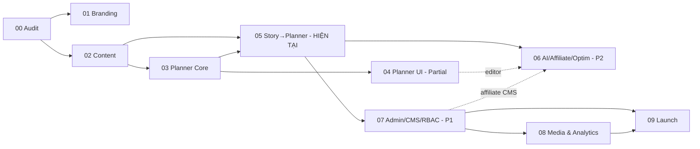

# Development Roadmap — Chuyện Nhà Hưng

> Đi đâu cũng có chuyện.

File làm việc của agent (không thuộc `docs/`, không bị `tests/docs.test.ts` kiểm).
Trạng thái phase hiện tại: [`CURRENT.md`](CURRENT.md). Việc tồn đọng theo phase:
[`backlog.md`](backlog.md).

Cập nhật lần cuối: 2026-11-09 — tạo file roadmap từ bằng chứng trên `main` @ `3d42707`
(chưa từng có `.claude/roadmap/` trước đó trong bất kỳ branch hay worktree nào).

## Quy tắc định danh

1. **Phase ID là định danh cố định.** `Phase 00`…`Phase 09` không bao giờ được đánh số
   lại, dời chỗ hay dùng lại cho nội dung khác. Phase mới nhận ID kế tiếp (`Phase 10`…).
2. **Thứ tự triển khai ≠ Phase ID.** Thứ tự được quyết định bởi cột *Phụ thuộc* và
   *Ưu tiên*. Một phase có ID lớn hơn có thể làm trước một phase ID nhỏ hơn.
3. **Không xóa nội dung của phase.** Phase bị hoãn hay đổi ưu tiên giữ nguyên phạm vi;
   chỉ đổi trạng thái/ưu tiên kèm lý do và ngày.
4. **Trạng thái chỉ đổi khi có bằng chứng** trong source code, test, ADR hoặc PR đã merge
   (`.claude/rules/01-global-engineering.md`). Không ghi "Done" cho thứ chưa kiểm.
5. Tham chiếu "Prompt NN" trong các contract/báo cáo cũ = `Phase NN` cùng số.

Trạng thái: `Done` · `Partial` · `In progress` · `Designed` (có ADR/contract, chưa code)
· `Not started`.

## Tổng quan

| ID | Tên | Trạng thái | Ưu tiên | Phụ thuộc (cứng) |
|---|---|---|---|---|
| 00 | Architecture Audit | Done | — | — |
| 01 | Branding & UX | Done (còn dữ liệu chủ nhà) | — | 00 |
| 02 | Travel Content System | Done | — | 00 |
| 03 | Travel Planner Core | Done | — | 02 |
| 04 | Interactive Planner UI | Partial | P2 | 03 |
| 05 | Story → Planner, My Trips & Sharing | **In progress — phase hiện tại** | P0 | 02, 03 |
| 06 | AI Planner, Affiliate & Optimization | Not started | P2 | 05, 04 (editor), 07 (phần affiliate) |
| 07 | Admin Portal, CMS & RBAC | Designed (ADR 0006 nháp, chưa commit) | **P1 — làm ngay sau 05** | 05 |
| 08 | Media Library & Analytics | Not started | P3 | 07 |
| 09 | Production Readiness & Launch | Not started | P4 | 07, 08 (hoặc loại trừ có ghi lại) |

## Thứ tự triển khai

Thứ tự đề xuất: **05 → 07 → 06 → 08 → 09**, với 04 (editor) chạy xen khi có slot
frontend và bắt buộc xong trước phần AI của 06.

**Quy tắc 07 trước 06** (quyết định của chủ dự án, 2026-11-09): sau khi Phase 05 đạt
tiêu chí đóng, Phase 07 được mở trước Phase 06 **nếu** các điều kiện mở của 07 (mục
Phase 07 bên dưới) đã thỏa. Nếu 07 bị chặn vì chờ quyết định của chủ nhà (nhà cung cấp
danh tính, ai là admin), không để đội đứng chờ: làm phần của 04/06 **không** phụ thuộc
07 (editor của 04, phần Optimization của 06) và ghi lý do vào `CURRENT.md`.

---

## Phase 00 — Architecture Audit
- **Trạng thái:** Done.
- **Bằng chứng:** PR #8 (`chore/aieos-framework-integration`): `.claude/agents/*`,
  `.claude/rules/*`, `.claude/skills/*`, `.claude/context/project-context.md`; PR #24
  thu gọn rule; `docs/architecture.md` + `.vi.md`; ADR index `docs/adr/README.md`.
- **Phạm vi:** quy trình AIEOS architect-first, phân quyền agent, git guard, tài liệu
  kiến trúc song ngữ.

## Phase 01 — Branding & UX
- **Trạng thái:** Done về code; còn mục chờ dữ liệu thật của chủ nhà.
- **Bằng chứng:** PR #1/#3 (`feat/site-foundation`); token trong `@theme` của
  `src/app/globals.css`; `docs/features/design-system.md`;
  `tests/design-tokens.test.ts`, `tests/i18n.test.ts`, `tests/routing.test.ts`.
- **Còn mở (không chặn phase khác):** ảnh thật (cover đang là SVG sinh ra); thẻ video
  bấm được (chưa có URL từng video); handle/số điện thoại/email đặt tour thật.

## Phase 02 — Travel Content System
- **Trạng thái:** Done.
- **Bằng chứng:** [ADR 0001](../../docs/adr/0001-travel-content-system.md);
  `src/server/content/**`; route `src/app/api/{travel,admin/travel}/**`;
  `docs/travel-content-api.md`; `tests/travel-content-*.test.ts`.
- **Ghi chú:** một principal duy nhất `ADMIN_API_TOKEN` — chính là nền mà Phase 07 thay.

## Phase 03 — Travel Planner Core
- **Trạng thái:** Done (backend).
- **Bằng chứng:** [ADR 0002](../../docs/adr/0002-planner-core.md),
  [ADR 0004](../../docs/adr/0004-planner-identity.md); `src/server/planner/**`,
  `src/app/api/planner/**`; `docs/features/travel-planner-core.md`;
  `tests/planner-{api,repository,budget,integrity,acceptance,session,session-api,patch-schemas}.test.ts`.

## Phase 04 — Interactive Planner UI
- **Trạng thái:** Partial.
- **Đã có (đến qua Phase 05):** form tạo chuyến từ template, My Trips, trang chi tiết
  chỉ-xem, `src/components/planner/itinerary-days.tsx`.
- **Chưa có (kiểm source 2026-11-09):** editor ngày/hoạt động/chi phí trong trình duyệt
  — không component nào gọi API activities/reorder/expenses; `/plan-your-trip` vẫn là
  trang liên hệ (mailto/Zalo/Messenger); Planner map. Xem
  `docs/features/follow-hung-footsteps.md` → *Limits and open questions*.
- **Ràng buộc:** Planner map cần ADR riêng (CLAUDE.md quy tắc 6).

## Phase 05 — Story → Planner, My Trips & Sharing
- **Trạng thái:** In progress — **phase hiện tại**. Chi tiết và tiêu chí đóng:
  [`CURRENT.md`](CURRENT.md).
- **Bằng chứng đã ship:** PR #23 (`feat/follow-hung-footsteps`, merge 2026-11-09):
  [ADR 0005](../../docs/adr/0005-trip-sharing-and-story-cloning.md),
  `.claude/contracts/follow-hung-footsteps.md`, 5 route mới, `src/server/rate-limit.ts`,
  `tests/planner-sharing.test.ts`, `tests/rate-limit.test.ts`, `tests/return-to.test.ts`,
  `docs/features/follow-hung-footsteps.md`.

## Phase 06 — AI Planner, Affiliate & Optimization
- **Trạng thái:** Not started. ID và phạm vi giữ nguyên như đã định nghĩa; chỉ ưu tiên
  được hạ xuống sau Phase 07.
- **Phạm vi:**
  - *AI Planner* — gợi ý lịch trình/hoạt động bằng AI ("AI suggestions" được hoãn có
    chủ đích từ brief mở Planner; CLAUDE.md quy tắc 6: cần ADR riêng).
  - *Affiliate* — liên kết đối tác cho place/khách sạn/vé.
  - *Optimization* — hiệu năng, SEO, chi phí.
- **Nền đã có:** trường `affiliateLinks` (rỗng ở mọi place) trong
  `src/server/content/schemas.ts` và `src/content/travel/seed.ts` — chưa có chương trình
  đối tác nào (ADR 0001 §Consequences). Không có code AI nào trong `src/`.
- **Phụ thuộc:** 05 đóng; 04 editor (gợi ý AI cần chỗ để người dùng chấp nhận/sửa);
  07 cho phần Affiliate (quản lý link đối tác qua CMS có phân quyền) và cho quy tắc
  "secret không tới trình duyệt" (ADR 0006 quyết định 5, áp cho API key AI).
  Phần Optimization không phụ thuộc 07.

## Phase 07 — Admin Portal, CMS & RBAC
- **Trạng thái:** Designed — **chưa commit**. Thiết kế nằm ở
  `docs/adr/0006-unified-identity-and-roles.md` (+ `.vi.md`), trạng thái *Proposed*, là
  thay đổi chưa commit trong worktree `prompt-05-planner-trips-sharing-7d932b`
  (branch `docs/adr-unified-identity-roles`). Bản nháp đó gọi phase này là
  "Phase 06 (Admin Portal & CMS)" — **phải đổi thành Phase 07** trước khi merge
  (xem `backlog.md` → Phase 07, mục R0).
- **Phạm vi:** một user model với `role: member|editor|admin`; `can(identity, action)`
  thuần; `ADMIN_API_TOKEN` thành service principal; session admin chặt hơn; audit log;
  CMS sửa template/story qua content store; UI Admin Portal.
- **Bất biến (ADR 0006):** admin **không** đọc/ghi trip của người khác qua phương thức
  trip thường; template và trip là hai hệ thống, chỉ nối bằng bản sao `sourceTemplate`.
- **Điều kiện mở:** 05 đóng; ADR 0006 được commit, đổi nhãn phase và *Accepted*; chủ nhà
  trả lời: nhà cung cấp danh tính, ai là admin, có bắt buộc MFA cho `admin`.

## Phase 08 — Media Library & Analytics
- **Trạng thái:** Not started.
- **Phạm vi:** thư viện ảnh/video (upload, lưu trữ, `alt` song ngữ, thay cover SVG);
  analytics tôn trọng quyền riêng tư.
- **Hiện trạng:** cover là SVG sinh ra; không có analytics trong `src/`. ADR 0005 cấm
  analytics/script bên thứ ba trên `/shared/[token]` — Phase 08 phải giữ ràng buộc này.
- **Phụ thuộc:** 07 (upload sau RBAC + audit); quyết định lưu trữ media và chính sách
  đồng ý/quyền riêng tư (ADR riêng).

## Phase 09 — Production Readiness & Launch
- **Trạng thái:** Not started.
- **Phạm vi:** SQL + nhiều instance (schema đích đã có ở ADR 0002), store chung cho rate
  limiter, nhà cung cấp danh tính thật, xử lý advisory phụ thuộc, dữ liệu thật của chủ
  nhà, checklist phát hành (`/release-check`), `/qc-check` và `/sec-check` toàn hệ thống.
- **Phụ thuộc:** 07; 08 hoặc quyết định loại 08 khỏi bản launch (ghi lại); SQL trước khi
  có hơn một instance.
