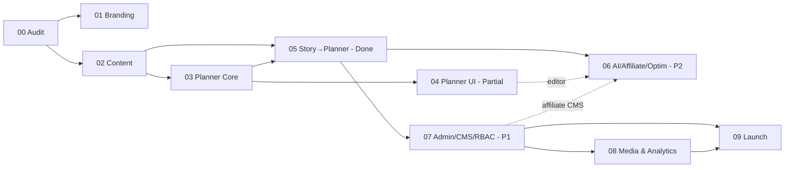

# Development Roadmap — Chuyện Nhà Hưng

> Đi đâu cũng có chuyện.

File làm việc của agent (không thuộc `docs/`, không bị `tests/docs.test.ts` kiểm).
Trạng thái phase hiện tại: [`CURRENT.md`](CURRENT.md). Việc tồn đọng theo phase:
[`backlog.md`](backlog.md). Trạng thái deploy từng phase:
[`DEPLOY-STATUS.md`](DEPLOY-STATUS.md).

Cập nhật lần cuối: 2026-11-16 — đối chiếu lại theo `main` @ `e362aea` (báo cáo
`.claude/contracts/community-platform-audit.md`; chủ dự án chốt khuyến nghị Q1–Q12 cùng ngày).
Lần trước: 2026-11-09 (`main` @ `124868e`). Tạo lần đầu từ `main` @ `3d42707`.

## Quy tắc định danh

1. **Phase ID là định danh cố định.** `Phase 00`…`Phase 09` không bao giờ được đánh số
   lại, dời chỗ hay dùng lại cho nội dung khác. Phase mới nhận ID kế tiếp (`Phase 10`…).
2. **Thứ tự triển khai ≠ Phase ID.** Thứ tự được quyết định bởi cột *Phụ thuộc* và
   *Ưu tiên*. Một phase có ID lớn hơn có thể làm trước một phase ID nhỏ hơn.
3. **Không xóa nội dung của phase.** Phase bị hoãn hay đổi ưu tiên giữ nguyên phạm vi;
   chỉ đổi trạng thái/ưu tiên kèm lý do và ngày.
4. **Trạng thái chỉ đổi khi có bằng chứng** trong source code, test, ADR hoặc PR đã merge
   (`.claude/rules/01-global-engineering.md`). Không ghi "Done" cho thứ chưa kiểm.
5. Tham chiếu "Prompt NN" trong các contract/báo cáo cũ = `Phase NN` cùng số.

Trạng thái: `Done` · `Partial` · `In progress` · `Designed` (có ADR/contract, chưa code)
· `Not started`.

## Tổng quan

| ID | Tên | Trạng thái | Ưu tiên | Phụ thuộc (cứng) |
|---|---|---|---|---|
| 00 | Architecture Audit | Done | — | — |
| 01 | Branding & UX | Done (còn dữ liệu chủ nhà) | — | 00 |
| 02 | Travel Content System | Done | — | 00 |
| 03 | Travel Planner Core | Done | — | 02 |
| 04 | Interactive Planner UI | Partial (editor Done; còn Planner map, `/plan-your-trip`) | P2 | 03 |
| 05 | Story → Planner, My Trips & Sharing | **Done** (2026-11-16; đóng với cảnh báo, xem `CURRENT.md`) | — | 02, 03 |
| 06 | AI Planner, Affiliate & Optimization | Not started | P2 | 05, 04 (editor), 07 (phần affiliate) |
| 07 | Admin Portal, CMS & RBAC | In progress — phần lớn Done (code); còn audit log, MFA, CMS create/delete/template | **P1** | 05 |
| 08 | Media Library & Analytics | Not started | P3 | 07 |
| 09 | Production Readiness & Launch | Partial — dev VM + Postgres đã chạy; production Not started | P4 | 07, 08 (hoặc loại trừ có ghi lại) |
| 10 | Community Foundations | Designed (đề xuất, chờ ADR); 10-S0 đã code | **P1** | 07 |
| 11 | Member Profiles & Creator Terms | Designed (đề xuất) | P1 | 10 |
| 12 | Travel Journal & Blog (curated) | Designed (đề xuất) | P2 | 10, 11 |
| 13 | Media Hybrid & Vlog | Designed (đề xuất) | P2 | 08, 12 |
| 14 | Engagement: Save · Follow · Like · Comment | Designed (đề xuất) | P3 | 10, 11, 12; rate-limit store chung |
| 15 | Curated Gallery & Discovery | Designed (đề xuất) | P4 | 12, 14 |

## Thứ tự triển khai

Thứ tự đề xuất (cập nhật 2026-11-16): **05 → 07 → 10 → 11 → 12 → 06 → 08 → 13 → 14 → 09 → 15**; 07 phần còn thiếu (audit log) làm cùng Phase 10. Thứ tự trước đó: 05 → 07 → 06 → 08 → 09, với 04 (editor) chạy xen khi có slot
frontend và bắt buộc xong trước phần AI của 06.

**Quy tắc 07 trước 06** (quyết định của chủ dự án, 2026-11-09): sau khi Phase 05 đạt
tiêu chí đóng, Phase 07 được mở trước Phase 06 **nếu** các điều kiện mở của 07 (mục
Phase 07 bên dưới) đã thỏa. Nếu 07 bị chặn vì chờ quyết định của chủ nhà (nhà cung cấp
danh tính, ai là admin), không để đội đứng chờ: làm phần của 04/06 **không** phụ thuộc
07 (editor của 04, phần Optimization của 06) và ghi lý do vào `CURRENT.md`.

---

## Phase 00 — Architecture Audit
- **Trạng thái:** Done.
- **Bằng chứng:** PR #8 (`chore/aieos-framework-integration`): `.claude/agents/*`,
  `.claude/rules/*`, `.claude/skills/*`, `.claude/context/project-context.md`; PR #24
  thu gọn rule; `docs/architecture.md` + `.vi.md`; ADR index `docs/adr/README.md`.
- **Phạm vi:** quy trình AIEOS architect-first, phân quyền agent, git guard, tài liệu
  kiến trúc song ngữ.

## Phase 01 — Branding & UX
- **Trạng thái:** Done về code; còn mục chờ dữ liệu thật của chủ nhà.
- **Bằng chứng:** PR #1/#3 (`feat/site-foundation`); token trong `@theme` của
  `src/app/globals.css`; `docs/features/design-system.md`;
  `tests/design-tokens.test.ts`, `tests/i18n.test.ts`, `tests/routing.test.ts`.
- **Còn mở (không chặn phase khác):** ảnh thật (cover đang là SVG sinh ra); thẻ video
  bấm được (chưa có URL từng video); handle/số điện thoại/email đặt tour thật.

## Phase 02 — Travel Content System
- **Trạng thái:** Done.
- **Bằng chứng:** [ADR 0001](../../docs/adr/0001-travel-content-system.md);
  `src/server/content/**`; route `src/app/api/{travel,admin/travel}/**`;
  `docs/travel-content-api.md`; `tests/travel-content-*.test.ts`.
- **Ghi chú:** một principal duy nhất `ADMIN_API_TOKEN` — chính là nền mà Phase 07 thay.

## Phase 03 — Travel Planner Core
- **Trạng thái:** Done (backend).
- **Bằng chứng:** [ADR 0002](../../docs/adr/0002-planner-core.md),
  [ADR 0004](../../docs/adr/0004-planner-identity.md); `src/server/planner/**`,
  `src/app/api/planner/**`; `docs/features/travel-planner-core.md`;
  `tests/planner-{api,repository,budget,integrity,acceptance,session,session-api,patch-schemas}.test.ts`.

## Phase 04 — Interactive Planner UI
- **Trạng thái:** Partial.
- **Đã có (đến qua Phase 05):** form tạo chuyến từ template, My Trips, trang chi tiết
  chỉ-xem, `src/components/planner/itinerary-days.tsx`.
- **Đã có thêm (kiểm 2026-11-16):** trip editor ngày/hoạt động/chi phí trên `/my-trips/[id]`
  (`src/components/planner/trip-editor/`, `docs/features/trip-editor.md`; kiểm tay, chưa có
  test component) — P04-1 xong.
- **Chưa có (kiểm source 2026-11-16):** `/plan-your-trip` vẫn là
  trang liên hệ (mailto/Zalo/Messenger); Planner map. Xem
  `docs/features/follow-hung-footsteps.md` → *Limits and open questions*.
- **Ràng buộc:** Planner map cần ADR riêng (CLAUDE.md quy tắc 6).

## Phase 05 — Story → Planner, My Trips & Sharing
- **Trạng thái:** Done — đóng 2026-11-16: `/sec-check` PASS_WITH_WARNINGS, `/qc-check`
  PASS với gaps (không có BLOCKED). Cảnh báo chuyển vào backlog P05-7..P05-11. Chi tiết:
  [`CURRENT.md`](CURRENT.md).
- **Bằng chứng đã ship:** PR #23 (`feat/follow-hung-footsteps`, merge 2026-11-09):
  [ADR 0005](../../docs/adr/0005-trip-sharing-and-story-cloning.md),
  `.claude/contracts/follow-hung-footsteps.md`, 5 route mới, `src/server/rate-limit.ts`,
  `tests/planner-sharing.test.ts`, `tests/rate-limit.test.ts`, `tests/return-to.test.ts`,
  `docs/features/follow-hung-footsteps.md`.

## Phase 06 — AI Planner, Affiliate & Optimization
- **Trạng thái:** Not started. ID và phạm vi giữ nguyên như đã định nghĩa; chỉ ưu tiên
  được hạ xuống sau Phase 07.
- **Phạm vi:**
  - *AI Planner* — gợi ý lịch trình/hoạt động bằng AI ("AI suggestions" được hoãn có
    chủ đích từ brief mở Planner; CLAUDE.md quy tắc 6: cần ADR riêng).
  - *Affiliate* — liên kết đối tác cho place/khách sạn/vé.
  - *Optimization* — hiệu năng, SEO, chi phí.
- **Nền đã có:** trường `affiliateLinks` (rỗng ở mọi place) trong
  `src/server/content/schemas.ts` và `src/content/travel/seed.ts` — chưa có chương trình
  đối tác nào (ADR 0001 §Consequences). Không có code AI nào trong `src/`.
- **Phụ thuộc:** 05 đóng; 04 editor (gợi ý AI cần chỗ để người dùng chấp nhận/sửa);
  07 cho phần Affiliate (quản lý link đối tác qua CMS có phân quyền) và cho quy tắc
  "secret không tới trình duyệt" (ADR 0006 quyết định 5, áp cho API key AI).
  Phần Optimization không phụ thuộc 07.

## Phase 07 — Admin Portal, CMS & RBAC
- **Trạng thái:** In progress — phần lớn Done về code (cập nhật 2026-11-16): ADR 0006 *Accepted* 2026-11-11, ADR 0010 (portal user), 0011 (CMS story/place/review), 0012 (public đọc từ content repo), 0017 (`super_admin`). **Còn thiếu:** audit log (`audit_events`), MFA, CMS create/delete/template (vẫn token-only), store rate-limit dùng chung (chưa xác minh). Admin trên trình duyệt chưa có bằng chứng chạy trên dev VM. Thiết kế gốc ở `docs/adr/0006-unified-identity-and-roles.md`
  (+ `.vi.md`). Nhãn cũ "Phase 06 (Admin Portal & CMS)" đã
  đổi thành Phase 07 (P07-R0). Còn chờ chủ nhà quyết định P07-D1.
- **Phạm vi:** một user model với `role: member|editor|admin`; `can(identity, action)`
  thuần; `ADMIN_API_TOKEN` thành service principal; session admin chặt hơn; audit log;
  CMS sửa template/story qua content store; UI Admin Portal.
- **Bất biến (ADR 0006):** admin **không** đọc/ghi trip của người khác qua phương thức
  trip thường; template và trip là hai hệ thống, chỉ nối bằng bản sao `sourceTemplate`.
- **Điều kiện mở:** 05 đóng; ADR 0006 được commit, đổi nhãn phase và *Accepted*; chủ nhà
  trả lời: nhà cung cấp danh tính, ai là admin, có bắt buộc MFA cho `admin`.

## Phase 08 — Media Library & Analytics
- **Trạng thái:** Not started.
- **Phạm vi:** thư viện ảnh/video (upload, lưu trữ, `alt` song ngữ, thay cover SVG);
  analytics tôn trọng quyền riêng tư.
- **Hiện trạng:** cover là SVG sinh ra; không có analytics trong `src/`. ADR 0005 cấm
  analytics/script bên thứ ba trên `/shared/[token]` — Phase 08 phải giữ ràng buộc này.
- **Phụ thuộc:** 07 (upload sau RBAC + audit); quyết định lưu trữ media và chính sách
  đồng ý/quyền riêng tư (ADR riêng).

## Phase 09 — Production Readiness & Launch
- **Trạng thái:** Partial (2026-11-16). Đã có bằng chứng: PostgreSQL (ADR 0008/0009/0013) và
  dev VM chạy Docker + auto-deploy (ADR 0016; báo cáo `.claude/reports/deploy-test-2026-11-15.md`:
  5 run xanh, rollback + redeploy thật, dữ liệu bền qua deploy). **Chưa có:** sao lưu (FAIL),
  production (G8), store rate-limit chung đã xác minh, `/release-check`.
- **Phạm vi:** SQL + nhiều instance (schema đích đã có ở ADR 0002), store chung cho rate
  limiter, nhà cung cấp danh tính thật, xử lý advisory phụ thuộc, dữ liệu thật của chủ
  nhà, checklist phát hành (`/release-check`), `/qc-check` và `/sec-check` toàn hệ thống.
- **Phụ thuộc:** 07; 08 hoặc quyết định loại 08 khỏi bản launch (ghi lại); SQL trước khi
  có hơn một instance.

## Phase 10 — Community Foundations
- **Trạng thái:** **Gần đóng (2026-11-17) — chưa đóng.** Batch 10.1–10.7 đã merge (PR #112, #115, #117, #122, #126, #129, #132, #136; migration `0010`–`0014`), cộng việc ngoài contract: #137 (giới hạn review khách 10/giờ + `guest_limit`), #138 (tên địa điểm + nhãn trong admin), #139 (staff ẩn danh hóa review khách; self-review PASS_WITH_WARNINGS). **Review toàn phase 2026-11-17:** `/sec-check` PASS_WITH_WARNINGS và `/qc-check` PASS_WITH_WARNINGS, không BLOCKED (typecheck/lint PASS; test 1156 pass với PostgreSQL cục bộ, 1084 pass + 73 skip khi không có DB; build NOT RUN). Điều kiện đóng và việc còn mở: `CURRENT.md` và `backlog.md`. Phase kế tiếp: 11 (ADR 0025 Proposed, PR #141).
- **10-S0 — đã có code, deploy chưa xác minh:** [ADR 0014](../../docs/adr/0014-community-trips-and-reviews.md)
  (Community Trips + Reviews) và [ADR 0015](../../docs/adr/0015-community-review-author-controls.md)
  (hold, restrictions); migration `0005`–`0008`; `tests/community-*.test.ts`,
  `tests/review-restrictions-routes.test.ts`. Ghi nhận hồi tố ở đây, **không** đổi ID Phase 05–09.
- **Phạm vi mới:** `audit_events` (P07-4), `terms_acceptances`, `reports` + hàng đợi, smoke
  `/community-trips` và `/reviews` trên dev, `/sec-check` + `/qc-check` cho community.
- **Quyết định đã chốt:** giữ review hiện ngay theo ADR 0014 (Q1), thêm Report + audit log
  trước khi cân nhắc siết.
- **ADR thiết kế:** [ADR 0019](../../docs/adr/0019-community-foundation.md) (Accepted), [ADR 0024](../../docs/adr/0024-guest-identity-privacy.md) (Accepted, danh tính khách) — máy trạng thái kiểm duyệt, `audit_events` (P10-1) và limiter ghi dùng chung (P10-6).
- **Phụ thuộc:** 07; ADR 0014/0015.

## Phase 11 — Member Profiles & Creator Terms
- **Trạng thái:** Designed. `member_profiles` (1:1 theo `userId`, mặc định riêng tư), đồng
  ý Terms theo phiên bản, sửa Terms cho khớp (hiện nhắc ảnh/video khi chưa có upload).
- **Thêm (đề xuất, từ bộ spec Community Platform):** **Dùng chuyến này** — thành viên đã đăng nhập sao chép một chuyến cộng đồng đã đăng thành bản nháp riêng, ghi công qua `origin`, không đồng bộ ngược (yêu cầu của chủ dự án; audit PR #107 chưa liệt kê). Điều 3 Terms đã cho phép sao chép khi người tạo bật; cần công tắc sao chép theo từng chuyến (P11-D2 chốt mặc định và phạm vi đăng lại) và nút Report (P10-3) có trước.
- **Phụ thuộc:** 10; chính sách riêng tư do chủ nhà cung cấp (Q9); quyết định công tắc sao chép (P11-D2).

## Phase 12 — Travel Journal & Blog (curated)
- **Trạng thái:** Designed. `journal_posts` kind `journal|blog`, duyệt trước (Q2), gắn trip.
- **Phụ thuộc:** 10, 11.

## Phase 13 — Media Hybrid & Vlog
- **Trạng thái:** Designed. Embed allow-list trước (YouTube, Q7), upload ảnh sau, `kind=vlog`.
  Thực thi trên nền Phase 08 (ID 08 giữ nguyên phạm vi). **Ranh giới:** Phase 08 xây thư viện media toàn site và interface `MediaStore`; Phase 13 chỉ dùng nó cho upload của thành viên, avatar và vlog (một interface, không xây lần hai).
- **Phụ thuộc:** 08, 12; ADR storage + chính sách media.

## Phase 14 — Engagement: Save · Follow · Like · Comment
- **Trạng thái:** Designed. Save riêng tư; comment hiện ngay + Report + hold (Q2).
- **Phụ thuộc:** 10, 11, 12; store rate-limit chung đã xác minh trước khi tăng bề mặt ghi.

## Phase 15 — Curated Gallery & Discovery
- **Trạng thái:** Designed. Tìm kiếm/lọc/phân trang gallery, collection do editor tuyển,
  thông báo; role `moderator` là quyết định riêng.
- **Phụ thuộc:** 12, 14.

## Nhóm spec Community Platform ↔ Phase

Bộ spec song ngữ `docs/specs-community-*.md` (PR #106) gọi các bó tính năng là **nhóm spec
C1–C7**. Chúng **không** phải Phase ID: Phase 10–15 ở trên là định danh roadmap, và Phase
00–09 không đổi. Bảng ánh xạ đầy đủ nằm ở `docs/specs-community-roadmap.md`.

| Nhóm spec | Rơi vào |
|---|---|
| C1 Nền tảng (máy trạng thái, log sự kiện, limiter dùng chung) | Phase 10 (`audit_events` = P10-1, limiter = P10-6) |
| C2 Trạng thái đăng chuyến, bộ lọc thư viện, Báo cáo | Phase 10 |
| C2 Dùng chuyến này; hồ sơ và trang công khai | Phase 11 |
| C3 Media | Phase 08 (thư viện), Phase 13 (upload thành viên, avatar) |
| C4 Nhật ký, blog | Phase 12; vlog và embed video: Phase 13 |
| C5 Theo dõi, thích, lưu, bình luận | Phase 14; thông báo: Phase 15 |
| C6 Tìm kiếm, cá nhân hóa | Phase 15 |
| C7 Danh tiếng | Chưa gán (không thiết kế); affiliate thuộc Phase 06 |
