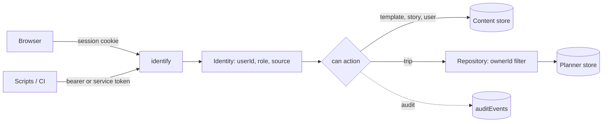

# ADR 0006 — Unified identity and roles for the Planner and the Admin Portal

🇻🇳 Bản tiếng Việt: [0006-unified-identity-and-roles.vi.md](0006-unified-identity-and-roles.vi.md)

- **Status:** Proposed — to be accepted when Phase 07 (Admin Portal, CMS & RBAC) opens. No code is written against it before then.
- **Date:** 2026-11-09
- **Owner:** system-architect

## Context

Two credentials exist and neither is a role system:

- **Planner:** `PlannerIdentity { userId, handle, source }` (`src/server/planner/auth.ts:53`), produced by `PlannerRepository.identify` (`src/server/planner/repository.ts:177`), which tries the session cookie and then a bearer token. Every trip method then filters by `ownerId` through `requireOwnedTrip` (`repository.ts:354-359`). ADR 0004 calls this seam `resolveIdentity`; no symbol of that name exists in `src/` — the seam is `identify`.
- **Travel Content System:** one principal, `AdminIdentity { principal: 'admin-token' }` (`src/server/content/auth.ts:11-14`), checked by `authorizeAdmin` (`:48`) against `ADMIN_API_TOKEN`. The Planner already borrows it to provision users (`src/server/planner/http.ts:254`).

Phase 07 puts people in a browser behind an admin screen. The token cannot be that credential: it is one shared, non-expiring, unattributable secret, and a browser that held it would turn any XSS into permanent takeover — the same argument ADR 0004 made for travellers. Unknown: the identity provider, and whether admins are the owner alone or a team.

## Decision

1. **One user model, one session mechanism, three roles.** `PlannerUser` gains `role: 'member' | 'editor' | 'admin'`. A missing `role` reads as `member` (the same read-default pattern as `withTripDefaults`), so existing `.data/planner.json` files load unchanged. The session table and cookie from ADR 0004 are reused for editors and admins; role-specific lifetimes (shorter idle and absolute expiry for `editor`/`admin`) are configuration, not a second mechanism.
2. **Identity carries a role; authorization is a pure function.** `PlannerIdentity` becomes `Identity { userId, handle, role, source }` where `source` adds `'service'`. A new `can(identity, action, resource?)` in `src/server/identity/` consults a static `role → permission[]` map in code (not in the database: permissions change with releases, not with clicks). Actions are `noun:verb` strings, e.g. `template:write`, `story:publish`, `user:provision`, `trip:read`.
3. **`can` is necessary, never sufficient, for personal trips.** The `ownerId` filter in the repository stays the only thing that grants access to a trip. **No role, including `admin`, may read or write another traveller's trip through the normal trip methods.** If support access is ever wanted it is a separate permission (`trip:support-read`), a separate repository method, and always writes an audit event. Default: not granted.
4. **`ADMIN_API_TOKEN` becomes a transitional service principal.** It resolves to `Identity { userId: 'service:admin-token', role: 'service', source: 'service' }`, permitted only the content and provisioning actions it is mapped to today, and denied every `trip:*` action. It remains for CI, scripts and bootstrap; it is no longer an admin's browser credential, and a later phase removes it.
5. **Rule — the token never reaches a browser.** `ADMIN_API_TOKEN` is read only by server modules. It is never in a `NEXT_PUBLIC_*` variable, never passed as a prop or a server-action argument, never echoed in a response, and never held by a Client Component. The Admin Portal authenticates an admin by the session cookie plus `role`, and its server components and route handlers call `can` with that identity. `tests/client-boundary.test.ts` is the regression guard — it checks every `'use client'` module for the token name, non-public `process.env` reads and value imports into `src/server` (direct, relative or `import()`; transitive imports are not followed) and must keep passing; a change that weakens it needs this ADR superseded.
6. **Templates and trips stay two systems** (see the boundary below). The Admin Portal edits templates through the content store with `template:*` permissions; it gains no access to the planner store through that route.

### Boundary: Travel Templates vs Personal Trips

| | Travel Template | Personal Trip |
|---|---|---|
| Owner | the brand (admin/editor) | one member (`ownerId`) |
| Store | `ContentStore`, `src/server/content/**`, seed `src/content/travel/**` | `PlannerStore`, `src/server/planner/**` |
| Written by | `template:*` permissions | the owner only |
| Visible to | public when approved | owner; others only via a share capability |

Invariants:

- **I1.** No shared document and no foreign key: the only link is `sourceTemplate`, a value copy of slug, title, version (`repository.ts:593-600`).
- **I2.** The Planner reaches content only through `PlannerCatalog`, which has read methods only (`src/server/planner/catalog.ts:17-24`).
- **I3.** Cloning is a snapshot: new ids for every day and activity (`repository.ts:512-518`). The template is never written.
- **I4.** Editing or withdrawing a template never rewrites an existing trip; staleness is reported, not repaired (`repository.ts:1488-1499`).
- **I5.** Admin role does not widen trip access (decision 3); editor/admin roles do not widen content access for members.

### Shared model and migration

Tables (logical; physically the JSON documents today, SQL later): `users` (`plannerUsers` renamed logically, plus `role`, `status`), `sessions` (as ADR 0004), `auditEvents` (`at`, `actorId`, `role`, `action`, `target`, `outcome`) — new.

Migration, expand then contract, each step reversible:

1. Add optional `role` and the `can` map; behaviour unchanged because everything reads as `member` and nothing yet calls `can`.
2. Bootstrap the first admin: an operator uses `ADMIN_API_TOKEN` once to create or promote a user. This is the only place the token confers a role.
3. Admin routes accept either the service principal (scripts) or a session with `role` (browser). The portal ships on the session path only.
4. Browser admin use of the token is removed; the token stays CI-only. Rollback at any step: ignore `role`, everything is `member`, the token path is untouched.

## Options considered

| Option | For | Against |
|---|---|---|
| A (chosen): extend `PlannerUser` with `role`, reuse sessions, static permission map, token → service principal | Smallest change behind the existing seam; `ownerId` code untouched; no new dependency | Two kinds of principal to keep straight; permission map lives in code |
| B: separate admin user table and admin session | Hard isolation of admin from member | Two session systems, two CSRF stories, two sets of expiry and revocation code |
| C: adopt an identity provider (Auth.js / hosted) now | Signup, reset, MFA, OAuth for free | New runtime dependency and operator infrastructure; needs its own ADR and decides provider choice prematurely |
| D: keep `ADMIN_API_TOKEN` as the portal credential | Zero work | Shared secret, no attribution or expiry, browser exposure risk |

Runner-up B lost on one reason: it duplicates the session machinery, doubling the surface that has to stay correct. A does not preclude C — the provider replaces `identify` and the session rows, as ADR 0004 intended.

## Consequences

Easier: one place decides identity; roles are testable as a pure function; the portal gets attributable, expiring, revocable admin sessions; audit becomes possible.

Harder: every route must declare its action and call `can`, so the cost is a sweep of `plannerRoute` and the admin wrapper; a role stored on a user raises the stakes of a stolen session (an admin session is more valuable than a member one), so admin sessions need stricter lifetimes and the CSRF check in `requireSameOrigin` (`src/server/planner/http.ts:107`) becomes load-bearing for admin mutations; the token remains a live secret until step 4 completes; the in-memory rate limiter is per-process, so admin sign-in throttling is only as good as that until SQL. Reversing means ignoring `role`; the data is additive.

**Tests not yet written** (gaps, owned by backend-engineer when Phase 07 opens): `can` matrix per role; service principal denied `trip:*`; an `admin` session gets `not_found` on another member's trip; role absent reads as `member`; no admin route reachable by a `member` session.

## Follow-up

- Accept this ADR when Phase 07 opens; then a Task Contract for the backend (identity module, `can`, audit store) before any portal UI.
- `docs/architecture.md` and `.vi.md` Phases carry the Phase 07 backlog.
- Needs the owner: identity provider choice, who the admins are, whether MFA is required for `admin`.
