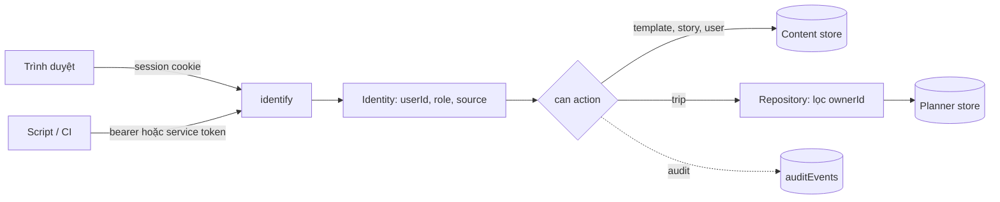

# ADR 0006 — Danh tính và vai trò thống nhất cho Planner và Admin Portal

🇬🇧 English: [0006-unified-identity-and-roles.md](0006-unified-identity-and-roles.md)

- **Trạng thái:** Accepted (đã chấp nhận) — 2026-11-11. Thay đổi chấp nhận chỉ hiện thực bước migration 1–2 (`role` tùy chọn, bảng `can`, bootstrap và nâng quyền bằng admin token); bước 3–4 (route admin qua session, portal, audit store, bỏ việc trình duyệt dùng token) vẫn thuộc Phase 07 và không được dựng sớm. Hợp đồng: `.claude/contracts/admin-role-bootstrap.md`.
- **Ngày:** 2026-11-09 (chấp nhận 2026-11-11)
- **Người sở hữu:** system-architect

## Bối cảnh

Hiện có hai loại credential và không cái nào là hệ vai trò:

- **Planner:** `PlannerIdentity { userId, handle, source }` (`src/server/planner/auth.ts:53`), do `PlannerRepository.identify` (`src/server/planner/repository.ts:177`) tạo ra, thử session cookie rồi tới bearer token. Sau đó mọi phương thức về trip đều lọc theo `ownerId` qua `requireOwnedTrip` (`repository.ts:354-359`). ADR 0004 gọi đường ráp này là `resolveIdentity`; trong `src/` không có symbol tên đó — đường ráp thực tế là `identify`.
- **Travel Content System:** một principal duy nhất, `AdminIdentity { principal: 'admin-token' }` (`src/server/content/auth.ts:11-14`), được `authorizeAdmin` (`:48`) kiểm tra với `ADMIN_API_TOKEN`. Planner đã mượn nó để cấp người dùng (`src/server/planner/http.ts:254`).

Phase 07 đưa con người vào trình duyệt sau một màn hình admin. Token không thể là credential đó: nó là một bí mật dùng chung, không hết hạn, không quy được cho ai, và trình duyệt giữ nó sẽ biến mọi lỗ XSS thành chiếm quyền vĩnh viễn — đúng lập luận ADR 0004 đã dùng cho người đi chơi. Chưa biết: nhà cung cấp danh tính, và admin chỉ là chủ nhà hay là cả một nhóm.

## Quyết định

1. **Một mô hình người dùng, một cơ chế session, ba vai trò.** `PlannerUser` thêm `role: 'member' | 'editor' | 'admin'`. Thiếu `role` được đọc là `member` (cùng kiểu mặc định khi đọc như `withTripDefaults`), nên file `.data/planner.json` hiện có vẫn nạp được nguyên vẹn. Bảng session và cookie của ADR 0004 được dùng lại cho editor và admin; thời hạn theo vai trò (idle và tuyệt đối ngắn hơn cho `editor`/`admin`) là cấu hình, không phải cơ chế thứ hai.
2. **Identity mang vai trò; phân quyền là một hàm thuần.** `PlannerIdentity` thành `Identity { userId, handle, role, source }` với `source` thêm `'service'`. Hàm mới `can(identity, action, resource?)` trong `src/server/identity/` tra một bảng tĩnh `role → permission[]` nằm trong code (không nằm trong database: quyền đổi theo bản phát hành, không đổi theo cú click). Action là chuỗi `noun:verb`, ví dụ `template:write`, `story:publish`, `user:provision`, `trip:read`.
3. **`can` là điều kiện cần, không bao giờ là điều kiện đủ, với trip cá nhân.** Bộ lọc `ownerId` trong repository vẫn là thứ duy nhất cấp quyền vào một trip. **Không vai trò nào, kể cả `admin`, được đọc hay ghi trip của người khác qua các phương thức trip thông thường.** Nếu sau này cần quyền hỗ trợ, đó là một permission riêng (`trip:support-read`), một phương thức repository riêng, và luôn ghi audit event. Mặc định: không cấp.
4. **`ADMIN_API_TOKEN` thành service principal chuyển tiếp.** Nó resolve thành `Identity { userId: 'service:admin-token', role: 'service', source: 'service' }`, chỉ được các action nội dung và cấp người dùng như hiện nay, và bị từ chối mọi action `trip:*`. Nó còn lại cho CI, script và bootstrap; không còn là credential trình duyệt của admin, và một phase sau sẽ gỡ nó.
5. **Quy tắc — token không bao giờ tới trình duyệt.** `ADMIN_API_TOKEN` chỉ được module server đọc. Không nằm trong biến `NEXT_PUBLIC_*`, không truyền làm prop hay đối số server action, không echo trong response, không do Client Component giữ. Admin Portal xác thực admin bằng session cookie cộng `role`, và server component cùng route handler của nó gọi `can` với identity đó. `tests/client-boundary.test.ts` là chốt chặn hồi quy — nó kiểm mọi module `'use client'` về tên token, việc đọc `process.env` không công khai và import giá trị vào `src/server` (trực tiếp, tương đối hoặc `import()`; không lần theo import bắc cầu) và phải luôn pass; thay đổi làm yếu nó cần một ADR thay thế ADR này.
6. **Template và trip vẫn là hai hệ thống** (xem ranh giới bên dưới). Admin Portal sửa template qua content store với quyền `template:*`; đường đó không cho quyền vào planner store.

### Ranh giới: Travel Template và Personal Trip

| | Travel Template | Personal Trip |
|---|---|---|
| Chủ sở hữu | thương hiệu (admin/editor) | một member (`ownerId`) |
| Store | `ContentStore`, `src/server/content/**`, seed `src/content/travel/**` | `PlannerStore`, `src/server/planner/**` |
| Ai ghi | quyền `template:*` | chỉ chủ sở hữu |
| Ai thấy | công khai khi đã duyệt | chủ sở hữu; người khác chỉ qua share capability |

Bất biến:

- **I1.** Không chung document, không khoá ngoại: liên kết duy nhất là `sourceTemplate`, một bản sao giá trị của slug, title, version (`repository.ts:593-600`).
- **I2.** Planner chỉ chạm nội dung qua `PlannerCatalog`, chỉ có phương thức đọc (`src/server/planner/catalog.ts:17-24`).
- **I3.** Clone là snapshot: mọi ngày và activity có id mới (`repository.ts:512-518`). Template không bao giờ bị ghi.
- **I4.** Sửa hay rút template không bao giờ viết lại trip đã có; độ cũ được báo cáo, không được sửa (`repository.ts:1488-1499`).
- **I5.** Vai trò admin không mở rộng quyền vào trip (quyết định 3); vai trò editor/admin không mở rộng quyền nội dung của member.

### Mô hình dùng chung và migration

Bảng (logic; hiện là document JSON, sau này là SQL): `users` (`plannerUsers` đổi tên logic, thêm `role`, `status`), `sessions` (như ADR 0004), `auditEvents` (`at`, `actorId`, `role`, `action`, `target`, `outcome`) — mới.

Migration theo kiểu mở rộng rồi thu hẹp, mỗi bước đảo ngược được:

1. Thêm `role` tuỳ chọn và bảng `can`; hành vi không đổi vì mọi thứ đọc là `member` và chưa ai gọi `can`.
2. Bootstrap admin đầu tiên: người vận hành dùng `ADMIN_API_TOKEN` một lần để tạo hoặc nâng quyền một user. Đây là nơi duy nhất token trao vai trò.
3. Route admin chấp nhận service principal (script) hoặc session có `role` (trình duyệt). Portal chỉ ship trên đường session.
4. Bỏ việc admin dùng token trên trình duyệt; token chỉ còn cho CI. Rollback ở mọi bước: bỏ qua `role`, mọi thứ là `member`, đường token không đổi.

## Các phương án đã cân nhắc

| Phương án | Ưu | Nhược |
|---|---|---|
| A (chọn): thêm `role` vào `PlannerUser`, dùng lại session, bảng quyền tĩnh, token → service principal | Thay đổi nhỏ nhất sau đường ráp có sẵn; code `ownerId` không đụng; không thêm dependency | Phải phân biệt hai loại principal; bảng quyền nằm trong code |
| B: bảng user và session admin riêng | Cách ly admin khỏi member rất chặt | Hai hệ session, hai câu chuyện CSRF, hai bộ code hết hạn và thu hồi |
| C: dùng ngay nhà cung cấp danh tính (Auth.js / hosted) | Có sẵn đăng ký, đặt lại mật khẩu, MFA, OAuth | Thêm dependency runtime và hạ tầng cho người vận hành; cần ADR riêng và chốt nhà cung cấp quá sớm |
| D: giữ `ADMIN_API_TOKEN` làm credential của portal | Không tốn công | Bí mật dùng chung, không quy được, không hết hạn, rủi ro lộ ra trình duyệt |

Phương án về nhì B thua vì một lý do: nó nhân đôi bộ máy session, nhân đôi bề mặt phải luôn đúng. A không loại trừ C — nhà cung cấp thay `identify` và các dòng session, đúng như ADR 0004 dự tính.

## Hệ quả

Dễ hơn: một nơi duy nhất quyết định danh tính; vai trò kiểm thử được như một hàm thuần; portal có session admin quy được cho người, có hạn, thu hồi được; audit trở nên khả thi.

Khó hơn: mọi route phải khai báo action và gọi `can`, nên cái giá là rà lại `plannerRoute` và wrapper admin; vai trò gắn vào user làm session bị đánh cắp đáng giá hơn (session admin quý hơn session member), nên session admin cần thời hạn chặt hơn và kiểm tra CSRF ở `requireSameOrigin` (`src/server/planner/http.ts:107`) trở thành chốt chịu lực cho mutation của admin; token vẫn là bí mật còn sống tới khi bước 4 xong; rate limiter in-memory là theo từng process, nên chặn đăng nhập admin chỉ tốt bằng nó cho tới khi có SQL. Đảo ngược nghĩa là bỏ qua `role`; dữ liệu chỉ thêm vào.

**Test chưa viết** (khoảng trống, backend-engineer đảm nhận khi Phase 07 mở): ma trận `can` theo vai trò; service principal bị từ chối `trip:*`; session `admin` nhận `not_found` khi đọc trip của member khác; thiếu role đọc là `member`; session `member` không vào được route admin nào.

## Việc tiếp theo

- Đã chấp nhận 2026-11-11 chỉ cho bước 1–2. Với bước 3–4, khi Phase 07 mở: sau đó là Task Contract cho backend (module identity, `can`, audit store) trước mọi UI portal.
- Mục Các phase trong `docs/architecture.md` và `.vi.md` mang backlog của Phase 07.
- Cần chủ nhà quyết: chọn nhà cung cấp danh tính, ai là admin, có bắt buộc MFA cho `admin` không.
