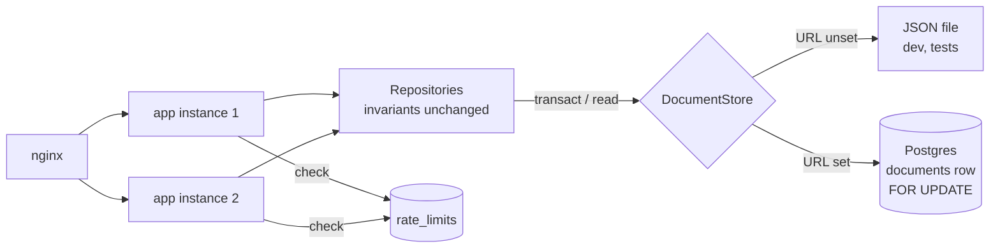

# ADR 0008 — PostgreSQL as the shared document store, the step before normalised tables

🇻🇳 Bản tiếng Việt: [0008-postgres-document-store.vi.md](0008-postgres-document-store.vi.md)

- **Status:** Accepted — approved by the owner on 2026-11-11
- **Date:** 2026-11-11
- **Owner:** system-architect
- **Decided by:** owner (run on the self-hosted VM, more than one app instance), system-architect (shape)
- **Affects:** `src/server/persistence/**`, `src/server/content/{repository,instance}.ts`, `src/server/planner/{repository,instance}.ts`, `src/server/rate-limit.ts`, `src/content/travel/seed.ts`, `package.json` (new dependency `pg`), `.github/workflows/ci.yml`, `docs/usage.*`, `docs/architecture.*`

## Context

Both systems persist through `DocumentStore<T>`
(`src/server/persistence/json-store.ts`): the whole Travel Content set and the whole
Planner set are each one JSON file under `.data/`. ADR 0001 §1 accepted that this is
safe for **one Node process only** and named multi-instance deployment as the trigger
to move to SQL; ADR 0002 recorded the table shape it would become; ADR 0005 and 0006
added the per-process rate limiter to the same trigger.

The trigger has now been pulled. The owner provisioned a VM (Docker, PostgreSQL 17,
nginx) and wants the app to run as more than one instance. Today that would lose data,
for three independent reasons:

1. **Read-modify-write is serialised in-process only.** `transaction()` in
   `src/server/content/repository.ts:87` and `src/server/planner/repository.ts:146`
   chains `read → mutate → write` on a promise queue. Two processes each read the same
   document, each apply their change, and the second `write` silently discards the
   first. `If-Match` does not help: it checks a version both processes read before
   either wrote.
2. **The read cache cannot see another writer.** `createJsonDocumentStore` caches the
   parsed document and replaces it only on its own writes.
3. **Rate limits are per process.** `createRateLimiter` keeps hits in a `Map`, so N
   instances allow N times the configured rate — and `signInLimiter` guards sign-in.

Sessions are not a separate problem: they are rows in the Planner document
(`sessions`, ADR 0004), so once the document is shared, a session issued by one
instance is valid on every instance. A session touch is a write, but it is throttled by
`SESSION_TOUCH_INTERVAL_MINUTES`, so it does not turn every request into a write.

What we know: the documents are small (the seed content plus a handful of staff-
provisioned travellers), writes are rare compared with reads, and all invariants live
in the repositories, which operate on the whole document. What we do not know: real
traffic, and how large the Planner document grows once the UI is public.

*(Amended 2026-11-11: for the Planner, step 2 is taken directly by
[ADR 0009](0009-postgres-persistence.md) — normalised tables, with this ADR's
variable name, startup migrations and revision-validated cache. Step 1 below
now applies to the Travel content store only.)*

## Decision

1. **Engine: PostgreSQL 17**, the version already running on the VM. One database per
   store — `cnh_content` and `cnh_planner`, owned by one login role — so the two keep
   the separate blast radius, backup and retention that ADR 0002 §1 asked for.
2. **Shape, step 1: the document moves into Postgres unchanged.** Each database holds
   one table:

   ```sql
   CREATE TABLE documents (
     name       text PRIMARY KEY,          -- 'travel-content' | 'planner'
     body       jsonb NOT NULL,
     revision   bigint NOT NULL,
     updated_at timestamptz NOT NULL DEFAULT now()
   );
   ```

   The normalised tables of ADR 0002 are **step 2**, deliberately not taken now (see
   Options). The repositories, their invariants and every API contract stay exactly as
   they are.
3. **The store interface gains a transaction.** `DocumentStore<T>` adds
   `transact<R>(mutate: (data: T) => Promise<R> | R): Promise<R>`. Each repository's
   private `transaction()` delegates to it instead of owning the promise queue.
   - Memory and JSON stores implement it with today's in-process queue — behaviour
     unchanged, so every existing test keeps its meaning.
   - The Postgres store implements it as `BEGIN; SELECT body, revision … FOR UPDATE;
     mutate; UPDATE … SET body = $1, revision = revision + 1; COMMIT`. The row lock is
     what makes read-modify-write atomic **across instances**. A throw inside `mutate`
     rolls back, preserving "a failed validation writes nothing".
4. **Reads are cached per instance and validated by revision.** `read()` sends
   `SELECT body FROM documents WHERE name = $1 AND revision <> $2` with the cached
   revision; an empty result means the cache is current. One round trip, no body
   transfer when nothing changed, never stale.
5. **Selection by environment, JSON stays the default.** `CONTENT_DATABASE_URL` and
   `PLANNER_DATABASE_URL` select the Postgres store for their system; unset, the
   current JSON file store is used. Local development and the test suite need no
   database.
6. **Driver: `pg` (node-postgres), no ORM.** One table and three statements do not
   justify a query builder or ORM; adding one later needs its own ADR, per the ADR
   index. `pg` is pure JavaScript (no install scripts, so no `allowScripts` change);
   `@types/pg` is a dev dependency. Pool size is configuration, default 5 per store.
7. **Schema bootstrap at startup, under an advisory lock.** On first use, each store
   takes `pg_advisory_lock`, applies numbered migrations recorded in a
   `schema_migrations` table, and releases the lock. No separate migration step to
   forget in a deploy; concurrent instances cannot apply the same migration twice.
8. **Seeding runs once, under the same lock.** `seedTravelContent` is several
   transactions; two instances starting together would both see an empty store and the
   second would fail on duplicate slugs. The Postgres-backed content instance seeds
   inside the advisory lock and re-checks emptiness after acquiring it.
9. **Rate limits move to Postgres when a planner database is configured.** A table
   `rate_limits(key text, window_start timestamptz, hits int, PRIMARY KEY (key,
   window_start))` with a fixed-window counter via `INSERT … ON CONFLICT DO UPDATE …
   RETURNING hits`, and periodic deletion of old windows. `RateLimiter.check` becomes
   async. The in-memory limiter remains the implementation when no database is set.
   The client-key spoofability noted in ADR 0005 is unchanged by this ADR.
10. **One-off import.** A script reads `.data/travel-content.json` and
    `.data/planner.json` and inserts them as revision 1, refusing to overwrite an
    existing row. The JSON files are kept as the rollback copy.



## Options considered

| Option | For | Against |
|---|---|---|
| A (chosen): one JSONB document per store in Postgres, row-locked `transact`, revision-validated cache | Fixes all three multi-instance faults; repositories and API contracts untouched; JSON stays for dev and tests; small reviewable change; real backups (`pg_dump`, already scheduled on the VM) | Every write rewrites the whole document and holds one lock per store, so writes are globally serialised; no SQL-level constraints or queries over the data; the normalised migration is still owed |
| B: normalised tables now (ADR 0002 shape) | Row-level locking, real foreign keys and indexes, writes cost O(row) not O(document) | Rewrites every repository method and its invariants at once; the largest-risk change in the codebase for a load we do not have; blocks the deploy for weeks |
| C: keep JSON files on a shared volume with a file lock | No new dependency | Ties every instance to one host's filesystem; `flock` across containers and network filesystems is unreliable; still no point-in-time backup; cache invalidation still needed |
| D: SQLite | Embedded, no server | Single-writer on one host — does not solve multi-instance, which is the trigger |

The runner-up is **B**, and the one reason it lost: it changes every invariant-bearing
method at the same time as the storage, so a defect could come from either and the
tests would no longer pin the behaviour while the data moves. A makes B a later,
table-by-table change behind the same repositories.

## Consequences

**Easier.** The app can run as several instances behind nginx with sessions, trips and
content shared and no lost updates. Rate limits hold across instances. Backups and
restores are `pg_dump`/`pg_restore`. Dev and CI keep working without a database.
Step 2 can move one collection at a time.

**Harder.**

- **Writes are serialised per store across the whole fleet.** One trip edit blocks every
  other Planner write until it commits. Fine at staff scale; it is the reason step 2
  exists. Do not hold the transaction across network calls — `mutate` must stay
  in-process work.
- **Write cost grows with the document.** Each commit rewrites the full JSONB value and
  a new TOAST tuple; autovacuum has to keep up. Step 2's trigger, to be measured, not
  guessed: the Planner document past ~5 MB, or p95 Planner write latency past 200 ms.
- **Every read is a round trip.** The revision check replaces a memory read; on the same
  VM that is sub-millisecond, but pages that read several times per request now pay it
  several times.
- **A new dependency and a new secret.** `pg` joins the supply chain; the two database
  URLs are credentials and follow the `ADMIN_API_TOKEN` rules — server modules only,
  never `NEXT_PUBLIC_*`, never logged.
- **Tests now have a third implementation to cover.** A store contract suite must run
  against memory, JSON and Postgres; the Postgres leg runs only when
  `TEST_DATABASE_URL` is set, so CI needs a Postgres service container or the leg is
  reported **NOT RUN**, never PASS.
- **Rate-limit checks become async**, touching every caller of `checkShareRead` and the
  sign-in route.
- **Reversing** is cheap while step 2 has not started: unset the two URLs and export
  the `body` column back to the JSON files. After step 2 it is not.

## Follow-up

1. backend-engineer: `transact` on `DocumentStore`, the memory/JSON implementations,
   repositories delegating to it — no behaviour change, existing tests green first.
2. backend-engineer: the Postgres store, bootstrap migrations, seeding under the lock,
   the Postgres rate limiter, the import script, and the store contract suite.
   Tests to write: lost-update across two store instances on one database; rollback on
   throw; cache invalidated by another instance's write; concurrent seed runs once;
   rate limit shared by two limiter instances.
3. CI: a `postgres:17` service and `TEST_DATABASE_URL` in `.github/workflows/ci.yml`.
4. `docs/usage.*`: the two URLs, the import, running with Docker Compose;
   `docs/architecture.*`: the Phases entry for SQL moves from "absent" to step 1 of
   this ADR.
5. Deploy: an `app` service on the VM stack (networks `edge` and `backend`), two
   replicas behind the existing nginx upstream, only after 1–4 have shipped.
6. **Owner input:** a retention policy for traveller data (still open from ADR 0002),
   now that it will sit in nightly backups kept for 7 days.
