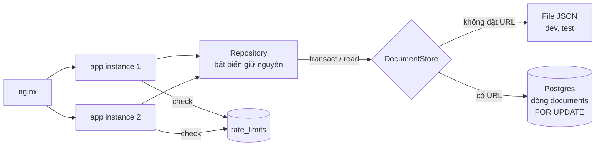

# ADR 0008 — PostgreSQL làm document store dùng chung, bước đệm trước các bảng chuẩn hoá

🇬🇧 English version: [0008-postgres-document-store.md](0008-postgres-document-store.md)

- **Trạng thái:** Đã chấp nhận — chủ sản phẩm duyệt ngày 2026-11-11
- **Ngày:** 2026-11-11
- **Người sở hữu:** system-architect
- **Người quyết định:** chủ sản phẩm (chạy trên VM tự host, nhiều hơn một instance app), system-architect (hình dạng)
- **Ảnh hưởng:** `src/server/persistence/**`, `src/server/content/{repository,instance}.ts`, `src/server/planner/{repository,instance}.ts`, `src/server/rate-limit.ts`, `src/content/travel/seed.ts`, `package.json` (dependency mới `pg`), `.github/workflows/ci.yml`, `docs/usage.*`, `docs/architecture.*`

## Bối cảnh

Cả hai hệ thống lưu dữ liệu qua `DocumentStore<T>`
(`src/server/persistence/json-store.ts`): toàn bộ Travel Content và toàn bộ Planner,
mỗi bên là một file JSON trong `.data/`. ADR 0001 §1 đã chấp nhận rằng cách này chỉ
an toàn cho **một process Node**, và gọi tên việc triển khai nhiều instance là mốc phải
chuyển sang SQL; ADR 0002 đã ghi lại hình dạng bảng sẽ thành; ADR 0005 và 0006 thêm
rate limiter theo process vào cùng mốc đó.

Mốc đó giờ đã tới. Chủ sản phẩm đã dựng một VM (Docker, PostgreSQL 17, nginx) và muốn
app chạy nhiều hơn một instance. Làm vậy hôm nay sẽ mất dữ liệu, vì ba lý do độc lập:

1. **Đọc-sửa-ghi chỉ được tuần tự hoá trong một process.** `transaction()` ở
   `src/server/content/repository.ts:87` và `src/server/planner/repository.ts:146`
   xâu chuỗi `read → mutate → write` trên một hàng đợi promise. Hai process cùng đọc một
   document, mỗi bên áp thay đổi của mình, và lệnh `write` thứ hai lặng lẽ xoá mất thay
   đổi thứ nhất. `If-Match` không cứu được: nó so một version mà cả hai process đều đã
   đọc trước khi bên nào ghi.
2. **Cache đọc không thấy được người ghi khác.** `createJsonDocumentStore` cache
   document đã parse và chỉ thay nó khi chính nó ghi.
3. **Rate limit tính theo process.** `createRateLimiter` giữ lượt gọi trong một `Map`,
   nên N instance cho phép gấp N lần mức đã cấu hình — mà `signInLimiter` đang canh
   đăng nhập.

Session không phải vấn đề riêng: chúng là các dòng trong document Planner
(`sessions`, ADR 0004), nên khi document được dùng chung, session do một instance cấp
sẽ hợp lệ trên mọi instance. Việc chạm session là một lần ghi, nhưng đã được giãn bởi
`SESSION_TOUCH_INTERVAL_MINUTES`, nên không biến mọi request thành một lần ghi.

Điều đã biết: các document nhỏ (nội dung seed cộng vài người đi chơi do nhân viên cấp),
ghi hiếm hơn đọc rất nhiều, và mọi bất biến nằm trong repository, vốn thao tác trên cả
document. Điều chưa biết: lưu lượng thật, và document Planner sẽ lớn tới đâu khi giao
diện mở công khai.

## Quyết định

1. **Engine: PostgreSQL 17**, đúng bản đang chạy trên VM. Mỗi store một database —
   `cnh_content` và `cnh_planner`, cùng thuộc một role đăng nhập — để hai bên giữ blast
   radius, backup và chính sách lưu trữ tách biệt như ADR 0002 §1 yêu cầu.
2. **Hình dạng, bước 1: document chuyển nguyên vào Postgres.** Mỗi database có một bảng:

   ```sql
   CREATE TABLE documents (
     name       text PRIMARY KEY,          -- 'travel-content' | 'planner'
     body       jsonb NOT NULL,
     revision   bigint NOT NULL,
     updated_at timestamptz NOT NULL DEFAULT now()
   );
   ```

   Các bảng chuẩn hoá của ADR 0002 là **bước 2**, cố ý chưa làm lúc này (xem các phương
   án). Repository, các bất biến của chúng và mọi hợp đồng API giữ nguyên.
3. **Interface store có thêm transaction.** `DocumentStore<T>` thêm
   `transact<R>(mutate: (data: T) => Promise<R> | R): Promise<R>`. `transaction()` riêng
   của mỗi repository uỷ quyền cho nó thay vì tự giữ hàng đợi promise.
   - Store bộ nhớ và JSON cài nó bằng hàng đợi trong process như hiện nay — hành vi
     không đổi, nên mọi test hiện có giữ nguyên ý nghĩa.
   - Store Postgres cài nó bằng `BEGIN; SELECT body, revision … FOR UPDATE; mutate;
     UPDATE … SET body = $1, revision = revision + 1; COMMIT`. Khoá dòng là thứ làm cho
     đọc-sửa-ghi nguyên tử **giữa các instance**. Một lỗi ném ra trong `mutate` sẽ
     rollback, giữ nguyên quy tắc "validation thất bại thì không ghi gì".
4. **Đọc được cache theo instance và kiểm bằng revision.** `read()` gửi
   `SELECT body FROM documents WHERE name = $1 AND revision <> $2` với revision đang
   cache; kết quả rỗng nghĩa là cache còn đúng. Một round trip, không truyền body khi
   không có gì đổi, không bao giờ cũ.
5. **Chọn theo biến môi trường, JSON vẫn là mặc định.** `CONTENT_DATABASE_URL` và
   `PLANNER_DATABASE_URL` chọn store Postgres cho hệ thống tương ứng; không đặt thì dùng
   store file JSON hiện tại. Phát triển local và bộ test không cần database.
6. **Driver: `pg` (node-postgres), không ORM.** Một bảng và ba câu lệnh không đáng một
   query builder hay ORM; thêm cái đó về sau cần ADR riêng, theo chỉ mục ADR. `pg` là
   JavaScript thuần (không có install script, nên không phải sửa `allowScripts`);
   `@types/pg` là dev dependency. Kích thước pool là cấu hình, mặc định 5 mỗi store.
7. **Dựng schema lúc khởi động, dưới một advisory lock.** Lần dùng đầu, mỗi store lấy
   `pg_advisory_lock`, áp các migration đánh số và ghi vào bảng `schema_migrations`, rồi
   nhả khoá. Không có bước migration riêng để quên khi deploy; các instance khởi động
   cùng lúc không thể áp một migration hai lần.
8. **Seed chạy đúng một lần, dưới cùng khoá đó.** `seedTravelContent` gồm nhiều
   transaction; hai instance khởi động cùng lúc sẽ cùng thấy store rỗng và instance thứ
   hai sẽ lỗi vì trùng slug. Instance content chạy trên Postgres seed bên trong advisory
   lock và kiểm lại store rỗng sau khi đã lấy được khoá.
9. **Rate limit chuyển sang Postgres khi có database planner.** Một bảng
   `rate_limits(key text, window_start timestamptz, hits int, PRIMARY KEY (key,
   window_start))` với bộ đếm cửa sổ cố định qua `INSERT … ON CONFLICT DO UPDATE …
   RETURNING hits`, và định kỳ xoá các cửa sổ cũ. `RateLimiter.check` trở thành async.
   Limiter trong bộ nhớ vẫn là bản cài khi không đặt database. Việc client key có thể bị
   giả mạo như ADR 0005 đã nêu không đổi trong ADR này.
10. **Import một lần.** Một script đọc `.data/travel-content.json` và
    `.data/planner.json` rồi chèn vào làm revision 1, từ chối ghi đè dòng đã có. Các
    file JSON được giữ lại làm bản để rollback.



## Các phương án đã cân nhắc

| Phương án | Ủng hộ | Phản đối |
|---|---|---|
| A (chọn): một document JSONB mỗi store trong Postgres, `transact` khoá dòng, cache kiểm bằng revision | Sửa cả ba lỗi khi chạy nhiều instance; repository và hợp đồng API không đổi; JSON vẫn dùng cho dev và test; thay đổi nhỏ, dễ review; có backup thật (`pg_dump`, đã lên lịch trên VM) | Mỗi lần ghi viết lại cả document và giữ một khoá mỗi store, nên mọi lần ghi bị tuần tự hoá toàn cục; không có ràng buộc hay truy vấn SQL trên dữ liệu; vẫn còn nợ bước chuẩn hoá |
| B: bảng chuẩn hoá ngay (hình dạng ADR 0002) | Khoá theo dòng, khoá ngoại và index thật, ghi tốn O(dòng) chứ không O(document) | Viết lại mọi phương thức repository cùng bất biến của chúng một lúc; thay đổi rủi ro lớn nhất codebase cho một tải mà ta chưa có; chặn deploy hàng tuần |
| C: giữ file JSON trên volume dùng chung với file lock | Không thêm dependency | Buộc mọi instance vào filesystem của một host; `flock` giữa các container và filesystem mạng không đáng tin; vẫn không có backup theo thời điểm; vẫn cần vô hiệu hoá cache |
| D: SQLite | Nhúng sẵn, không cần server | Một người ghi trên một host — không giải quyết nhiều instance, vốn là mốc kích hoạt |

Phương án về nhì là **B**, và nó thua vì một lý do: nó đổi mọi phương thức mang bất biến
cùng lúc với việc đổi nơi lưu, nên một lỗi có thể đến từ bên nào cũng được và test không
còn ghim được hành vi trong lúc dữ liệu đang chuyển. A biến B thành một thay đổi về sau,
từng bảng một, đằng sau cùng các repository.

## Hệ quả

**Dễ hơn.** App có thể chạy nhiều instance sau nginx, dùng chung session, trip và nội
dung mà không mất cập nhật. Rate limit có hiệu lực giữa các instance. Backup và khôi
phục là `pg_dump`/`pg_restore`. Dev và CI vẫn chạy không cần database. Bước 2 có thể
chuyển từng collection một.

**Khó hơn.**

- **Các lần ghi bị tuần tự hoá theo từng store trên toàn bộ các instance.** Một lần sửa
  trip chặn mọi lần ghi Planner khác cho tới khi commit. Ổn ở quy mô nhân viên dùng; đó
  là lý do có bước 2. Không giữ transaction qua lời gọi mạng — `mutate` phải là việc
  thuần trong process.
- **Chi phí ghi tăng theo kích thước document.** Mỗi commit viết lại toàn bộ giá trị
  JSONB và một TOAST tuple mới; autovacuum phải theo kịp. Mốc kích hoạt bước 2, phải đo
  chứ không đoán: document Planner vượt khoảng 5 MB, hoặc p95 độ trễ ghi Planner vượt
  200 ms.
- **Mỗi lần đọc là một round trip.** Kiểm revision thay cho đọc bộ nhớ; trên cùng VM
  thì dưới một mili giây, nhưng trang nào đọc nhiều lần mỗi request sẽ trả giá đó nhiều
  lần.
- **Một dependency mới và một secret mới.** `pg` vào chuỗi cung ứng; hai URL database là
  thông tin xác thực và theo đúng quy tắc của `ADMIN_API_TOKEN` — chỉ module server,
  không bao giờ ở `NEXT_PUBLIC_*`, không bao giờ ghi log.
- **Test có thêm bản cài thứ ba phải phủ.** Một bộ test hợp đồng store phải chạy với bộ
  nhớ, JSON và Postgres; nhánh Postgres chỉ chạy khi đặt `TEST_DATABASE_URL`, nên CI cần
  một service container Postgres, nếu không thì nhánh đó được báo **NOT RUN**, không bao
  giờ PASS.
- **Kiểm rate limit trở thành async**, chạm tới mọi chỗ gọi `checkShareRead` và route
  đăng nhập.
- **Đảo ngược** còn rẻ khi chưa bắt đầu bước 2: bỏ đặt hai URL và xuất cột `body` trở lại
  file JSON. Sau bước 2 thì không còn rẻ.

## Việc kéo theo

1. backend-engineer: `transact` trên `DocumentStore`, bản cài bộ nhớ/JSON, repository
   uỷ quyền cho nó — không đổi hành vi, test hiện có phải xanh trước.
2. backend-engineer: store Postgres, migration lúc khởi động, seed dưới khoá, rate
   limiter Postgres, script import, và bộ test hợp đồng store. Các test phải viết: mất
   cập nhật giữa hai instance store trên một database; rollback khi ném lỗi; cache bị vô
   hiệu bởi lần ghi của instance khác; seed đồng thời chỉ chạy một lần; rate limit dùng
   chung giữa hai instance limiter.
3. CI: service `postgres:17` và `TEST_DATABASE_URL` trong `.github/workflows/ci.yml`.
4. `docs/usage.*`: hai URL, bước import, chạy bằng Docker Compose;
   `docs/architecture.*`: mục SQL trong Phases chuyển từ "vắng mặt" sang bước 1 của ADR
   này.
5. Deploy: một service `app` trong stack trên VM (mạng `edge` và `backend`), hai replica
   sau upstream nginx hiện có, chỉ sau khi 1–4 đã ship.
6. **Cần chủ sản phẩm quyết:** chính sách lưu trữ dữ liệu người đi chơi (vẫn còn mở từ
   ADR 0002), giờ khi dữ liệu sẽ nằm trong bản backup hằng đêm giữ 7 ngày.
