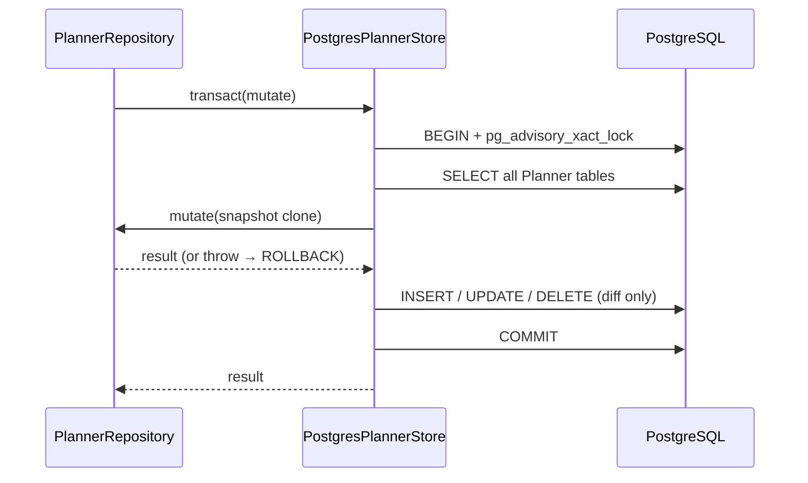

# ADR 0009 — Planner persistence moves to PostgreSQL

🇻🇳 Bản tiếng Việt: [0009-postgres-persistence.vi.md](0009-postgres-persistence.vi.md)

- **Status:** Accepted — the owner accepted it on 2026-11-11; implementation follows in the same PR
- **Date:** 2026-11-11
- **Owner:** system-architect
- **Affects:** `src/server/persistence/**`, `src/server/planner/store.ts`, `src/server/planner/instance.ts`, `src/server/planner/repository.ts` (transaction plumbing only), `db/migrations/**` (new), `scripts/**` (new import/export/migrate scripts), `package.json`, `tests/**`, `docs/architecture.*`, `docs/usage.*`

## Context

Every Planner record — users, sessions, Google sign-in attempts, trips, days,
activities and expenses — lives in one JSON file, `.data/planner.json`, behind
the two-method `DocumentStore` in `src/server/persistence/json-store.ts`.
[ADR 0001](0001-travel-content-system.md) §1 and
[ADR 0002](0002-planner-core.md) §1 chose that deliberately, because no
database existed, and recorded what it costs:

1. **One process only.** `PlannerRepository.transaction`
   (`src/server/planner/repository.ts:200`) serialises read-modify-write behind
   an in-process promise chain, and the JSON store caches the parsed document in
   memory. Two Node processes — a second container, a rolling restart that
   overlaps, a cron job — would each believe they are the only writer, and the
   last `rename` silently wins.
2. **No integrity below the repository.** Foreign keys, unique emails and
   unique Google subjects are enforced only in TypeScript. A hand-edited file
   can still hold a dangling reference;
   `GET /api/admin/planner/integrity` detects that, it does not prevent it.
3. **Durability is a file in a container.** Backups, point-in-time recovery
   and inspection are whatever happens to the volume that holds `.data/`.

Two things changed. Since [ADR 0007](0007-password-and-google-sign-in.md) the
file holds **real accounts** — scrypt password hashes, Google links, sessions —
and customers can create accounts themselves through Google, so losing or
forking the file now loses people's sign-in, not just demo trips. And the owner
has **deployed PostgreSQL** on the self-hosted VM that will run the app, so the
precondition ADR 0002 waited for ("the SQL swap is additive rather than a
rewrite") is met.

What we know: the repository was written for this — the four trip collections
are already flat arrays with foreign keys "because they are the four tables this
will become" (`src/server/planner/store.ts`), money is integer VND capped far
below `Number.MAX_SAFE_INTEGER` so it maps onto `BIGINT`, and the repository
holds every invariant behind 65+ tests that run against an in-memory store.
The owner has
confirmed that the VM runs PostgreSQL 16 or 17 and that the app will reach it
over a private Docker network on the same VM, so TLS is not required and port
5432 is not published. What we do not know: the expected data volume (no
production traffic yet).

**Relation to [ADR 0008](0008-postgres-document-store.md).** ADR 0008, accepted
the same day on a parallel branch, decides the path: JSONB documents in Postgres
first, normalised tables second. This ADR was written as 0008 on its own branch
and renumbered when both met. It takes **step 2 directly for the Planner**; the
`transact` method it relies on is the one ADR 0008 already merged. ADR 0008 still
governs the Travel content store, the shared rate-limit store and multi-instance
operation. *(Reconciled 2026-11-11.)* The three
points where the drafts differed for the Planner now follow ADR 0008, which was
accepted first and plans two app replicas: the variable is
`PLANNER_DATABASE_URL` (§5), migrations run at startup under an advisory lock
(§4), and reads use a per-instance cache validated by a revision (§2). The
Planner skips ADR 0008's JSONB step 1 and goes straight to these tables.

## Decision

**The Planner stores its data in PostgreSQL, in normalised tables, behind the
existing repository. The repository keeps its read-mutate-write model; the
store becomes responsible for making that one atomic database transaction.**

### 1. Scope

- **In:** the Planner document — `users`, `sessions`, `oauthAttempts`,
  `trips`, `tripDays`, `tripActivities`, `tripExpenses`.
- **Out, for now:** the Travel Content System store (`.data/travel-content.json`).
  It is editorial seed content that a fresh clone re-seeds itself; moving it is
  a second, smaller step with the same adapter pattern, and does not need this
  ADR reopened. Also out: the in-memory rate limiter (`src/server/rate-limit.ts`)
  — see Consequences.

### 2. The store owns the transaction

`DocumentStore<T>` gains one method:

```ts
transact<R>(mutate: (data: T) => Promise<R> | R): Promise<R>;
```

`PlannerRepository.transaction` delegates to it instead of chaining its own
`read` and `write`. The memory and JSON stores implement it exactly as today
(their existing queue). The Postgres store implements it as:

1. `BEGIN`, then `SELECT pg_advisory_xact_lock(<planner lock key>)` — one
   global lock for Planner writes, the same serialisation the in-process queue
   gives today, but held **across processes**.
2. Load every Planner table into a `PlannerData` snapshot.
3. Run `mutate` on a clone.
4. Diff the clone against the snapshot per collection by `id`, and issue only
   the `INSERT`, `UPDATE` and `DELETE` statements the diff needs.
5. `COMMIT`. Any throw — from `mutate`, from a constraint, from the network —
   is a `ROLLBACK`, which matches today's rule that a failed mutation writes
   nothing.

`read()` runs the same load in a `REPEATABLE READ, READ ONLY` transaction so the
seven tables come from one consistent snapshot.

**Per-instance cache, validated by revision (as ADR 0008 §4).** A one-row table
`planner_revision` holds a counter that every committing `transact` increments
under the lock. `read()` first asks for that counter; if it equals the cached
one, it returns a clone of the cache with no table load. Otherwise it reloads
the seven tables and the counter in one snapshot. `transact` does the same
check after taking the lock, so an unchanged store is not reloaded for a write
either. Anything else derived per instance from the data — the repository's
share-token index — is invalidated when the revision moves, not only on local
writes, so a link created or revoked on one replica is honoured on the other.

Loading everything on every request is the price of leaving the 2,300-line
repository untouched. It is acceptable while the Planner holds, roughly, fewer
than a few thousand trips; past that, the next step is to move the hot reads
(`identify`, `listTrips`, `getTrip`) onto targeted queries, one method at a
time, behind the same repository API.

### 3. Schema

One table per collection, snake_case columns, one column per schema field.
Text primary keys keep the existing id format (`trip_xxxxxxxx`).

| Table | Key constraints |
|---|---|
| `planner_users` | PK `id`; unique `handle`; unique `token_hash`; unique `email` where not null (already lower-cased); unique `google_sub` where not null; `created_via` as a `CHECK` constraint |
| `planner_sessions` | PK `id`; unique `token_hash`; FK `user_id` → users `ON DELETE CASCADE`; index on `expires_at` |
| `planner_oauth_attempts` | PK `id`; unique `state_hash`; FK `link_user_id` → users `ON DELETE CASCADE`; index on `expires_at` |
| `trips` | PK `id`; FK `owner_id` → users; unique `share_token` where not null; `budget_target_total_vnd BIGINT`; `source_template JSONB`; FK `duplicated_from_trip_id` → trips `ON DELETE SET NULL`; `version INTEGER` for `If-Match` |
| `trip_days` | PK `id`; FK `trip_id` → trips `ON DELETE CASCADE`; unique `(trip_id, day_number)` |
| `trip_activities` | PK `id`; FK `trip_id` → trips and FK `day_id` → trip_days, both `ON DELETE CASCADE`; unique `(day_id, "order")` `DEFERRABLE INITIALLY DEFERRED`, so a reorder can commit |
| `trip_expenses` | PK `id`; FK `trip_id` → trips `ON DELETE CASCADE`; `amount_vnd BIGINT`; FK `day_id` → trip_days and FK `activity_id` → trip_activities, both nullable |

What happens to an expense when its activity or day is deleted is decided by
the repository today; the foreign-key action (`SET NULL` or `CASCADE`) must
copy that behaviour exactly, and is pinned by a test, not chosen in SQL.
*(Amended 2026-11-11, at implementation:* the expense FKs mirror the
repository — `activity_id` is `ON DELETE SET NULL` (deleting an activity
detaches its expenses) and `day_id` is `NO ACTION` (a trip cannot be shortened
over a day that holds an expense); `order` is the column `sort_order`; every
table has a hidden `seq` identity column so reads keep insertion order and an
export → import round-trip is exact; `trips.duplicated_from_trip_id` and the
`(trip_id, day_number)` unique are deferred so an import can insert in any
order; the scripts run through `vite-node`, which Vitest already installs.
Details: [features/planner-postgres-persistence.md](../features/planner-postgres-persistence.md).*)*

The exact column list is derived from `src/server/planner/schemas.ts` in the
implementation, and every row the store reads back is parsed with the same zod
schemas the JSON store relies on. Timestamps are `timestamptz` and are returned
to the repository as `toISOString()` strings, so the repository sees exactly
the shape it sees today. `BIGINT` arrives from the driver as a string and is
converted with the existing money boundary (`src/server/planner/money.ts`),
never with a bare `Number()`.

### 4. Driver and migrations

- **Driver:** [`pg`](https://node-postgres.com) (node-postgres), one `Pool`
  per process, small (`max` 5 by default). No ORM and no query builder: the
  adapter is one file of parameterised SQL, and the schema is owned by
  migrations, not by TypeScript.
- **Migrations:** numbered plain-SQL files in `db/migrations/NNNN_slug.sql`,
  applied in order by a small runner that records each one in
  `schema_migrations` inside the same transaction. As in ADR 0008 §7 they run
  **at startup**, on the store's first use, under a session advisory lock, so
  replicas starting together apply each file once and nothing is forgotten in a
  deploy. `npm run db:migrate` runs the same code by hand (CI, a first import).
- Every query is parameterised. String-built SQL is a defect.

### 5. Selection is explicit and fails closed

- `PLANNER_DATABASE_URL` set → the Postgres store. Unset → the JSON store at
  `PLANNER_STORE`, as today. Tests use the memory store regardless. (The name
  is ADR 0008's; `CONTENT_DATABASE_URL` will select the content store.)
- If `PLANNER_DATABASE_URL` is set and the database is unreachable, Planner routes
  answer `503`. The app **never falls back** to the JSON file: a silent
  fallback would fork the data into two stores.
- The credentials are a dedicated role that owns only the Planner tables (no
  superuser, no `CREATEDB`), supplied by environment, never committed. The
  database port is not published beyond the VM's private network.

### 6. Moving the data, and moving it back

- `scripts/planner-import` reads an existing `planner.json`, validates every
  record with the zod schemas, runs `validateIntegrity()`, and inserts
  everything in **one** transaction. It refuses to run against non-empty
  tables.
- `scripts/planner-export` writes the database back out as a `planner.json`
  the JSON store can open. That export is the rollback path, and it doubles as
  a human-readable backup alongside `pg_dump`.



## Options considered

| Option | For | Against |
|---|---|---|
| **A. Normalised tables, store-level transaction with a diff (chosen)** | Real FKs and unique constraints; safe across processes; repository and its tests unchanged; data can be exported back to JSON | Loads every Planner row per request; diff code to write and test; one global write lock |
| B. The whole document as one `JSONB` row, `SELECT … FOR UPDATE` | Smallest possible adapter; safe across processes | No foreign keys, no unique constraints, nothing queryable — fixes durability and concurrency but not integrity, which is half the reason to move |
| C. Rewrite the repository as SQL queries per method | Fastest at scale; row-level locking | Rewrites ~2,300 lines of tested invariants in one step; highest regression risk for a dataset that is still small |
| D. Stay on JSON, add volume backups | No work | Leaves real accounts in a single-process file with no integrity; the database already exists |
| E. Add an ORM (Prisma, Drizzle) | Typed schema, generated migrations | A new framework and code generation for one adapter file; the zod schemas already are the types |

The runner-up is **B**. It lost because it moves the bytes without adding a
single constraint, so the dangling-reference problem from ADR 0002 would
survive the migration. **C** stays the planned *next* step for individual hot
paths, not a replacement for A.

## Consequences

**Easier.**

- More than one app process can run safely; a rolling restart cannot lose a
  write.
- The database enforces what TypeScript used to enforce alone: a session
  without a user, an expense on a deleted trip, or two accounts with one email
  are rejected by Postgres even if a bug or a hand-edit slips past the
  repository.
- Backups and restore become standard (`pg_dump`, `pg_restore`), and the
  export script keeps a JSON escape hatch.
- The repository's 65+ unit tests keep running offline, unchanged, against the
  memory store.

**Harder.**

- **A runtime dependency.** The app now needs a reachable database to serve the
  Planner. "`npm run build` emits a fully prerendered app with no runtime data
  dependency" stops being true for the Planner routes, and the deploy needs a
  migration step and a secret it did not have.
- **Every request reads every Planner row.** Fine at today's size, linear in
  data volume. The trigger to move a method onto targeted queries is a Planner
  request whose p95 exceeds ~200 ms on the VM, or roughly a few thousand trips.
- **One global write lock.** Two users editing different trips still wait on
  each other, as they do today. Row-level locking only arrives with option C.
- **The diff is new, subtle code.** A bug there could drop or duplicate rows.
  It needs its own tests, including a round-trip property: load → no-op mutate
  → no statements issued.
- **Integration tests need a database.** The Postgres store is tested only
  when `TEST_DATABASE_URL` is set; otherwise those tests are skipped and must be
  reported as NOT RUN, never as passing.
- **Per-process state is still per process.** The rate limiter
  (`src/server/rate-limit.ts`) and the repository's share-token index are in
  memory. With several instances the rate limits multiply; the share index must
  be rebuilt per transaction or keyed to a database generation counter, not
  trusted across processes. Running a single instance on the VM, which is the
  plan, keeps both correct.
- **Constraint errors are new failure modes.** A unique-violation from Postgres
  must map to the same `409` the repository already returns, not to a `500`.
- **Reversal** is the export script plus unsetting `PLANNER_DATABASE_URL`; writes made
  after the last export are lost unless exported first.

## Follow-up

1. Owner review of this ADR; status moves to Accepted before any code.
2. Task Contract for `backend-engineer`: the `transact` method on all three
   stores, `PostgresPlannerStore`, `db/migrations/0001_planner.sql`, the
   migrate / import / export scripts, `pg` and `@types/pg` in `package.json`,
   and tests (diff unit tests offline; adapter integration tests behind
   `TEST_DATABASE_URL`).
3. `docs/architecture.md` + `.vi.md`: replace the stale "Persistence: None"
   row, describe the store selection and the lock.
4. `docs/usage.md` + `.vi.md`: `PLANNER_DATABASE_URL`, `npm run db:migrate`, importing
   an existing `planner.json`, backups, and the Deploy section's new runtime
   dependency.
5. Feature document `docs/features/planner-postgres-persistence.*` with the
   code change.
6. **Needs the owner:** a dedicated database role and database for the app on
   the VM (answered: PostgreSQL 16/17, private Docker network, no TLS).
7. Recommended before going live: `/sec-check` on the adapter, the role's
   grants and secret handling.
