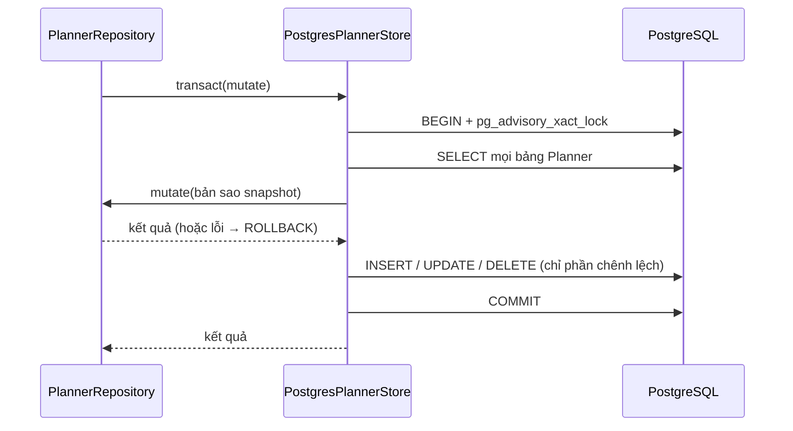

# ADR 0009 — Chuyển persistence của Planner sang PostgreSQL

🇬🇧 English: [0009-postgres-persistence.md](0009-postgres-persistence.md)

- **Trạng thái:** Accepted (đã chấp nhận) — chủ dự án chấp nhận ngày 2026-11-11; phần triển khai nằm trong cùng PR
- **Ngày:** 2026-11-11
- **Người sở hữu:** system-architect
- **Ảnh hưởng:** `src/server/persistence/**`, `src/server/planner/store.ts`, `src/server/planner/instance.ts`, `src/server/planner/repository.ts` (chỉ phần transaction), `db/migrations/**` (mới), `scripts/**` (script import/export/migrate mới), `package.json`, `tests/**`, `docs/architecture.*`, `docs/usage.*`

## Bối cảnh

Mọi bản ghi của Planner — user, session, lượt đăng nhập Google, trip, ngày,
hoạt động và chi phí — nằm trong một file JSON, `.data/planner.json`, sau
`DocumentStore` hai method trong `src/server/persistence/json-store.ts`.
[ADR 0001](0001-travel-content-system.md) §1 và
[ADR 0002](0002-planner-core.md) §1 chọn cách đó có chủ đích, vì lúc ấy chưa có
database, và đã ghi lại cái giá:

1. **Chỉ một process.** `PlannerRepository.transaction`
   (`src/server/planner/repository.ts:200`) tuần tự hoá read-modify-write bằng
   một promise chain trong process, và JSON store cache document đã parse trong
   bộ nhớ. Hai process Node — container thứ hai, một lần restart chồng lấn, một
   cron job — đều tưởng mình là writer duy nhất, và lần `rename` cuối cùng âm
   thầm thắng.
2. **Không có ràng buộc toàn vẹn bên dưới repository.** Foreign key, email duy
   nhất và Google subject duy nhất chỉ được kiểm tra bằng TypeScript. File sửa
   tay vẫn có thể chứa tham chiếu treo;
   `GET /api/admin/planner/integrity` phát hiện được, nhưng không ngăn được.
3. **Độ bền là một file trong container.** Backup, khôi phục theo thời điểm và
   việc kiểm tra dữ liệu phụ thuộc hoàn toàn vào volume chứa `.data/`.

Có hai điều đã thay đổi. Từ [ADR 0007](0007-password-and-google-sign-in.md),
file chứa **tài khoản thật** — hash mật khẩu scrypt, liên kết Google, session —
và khách hàng tự tạo được tài khoản qua Google, nên mất hoặc tách đôi file giờ
là mất khả năng đăng nhập của người dùng, không chỉ mất trip demo. Và chủ dự án
đã **triển khai PostgreSQL** trên VM tự host sẽ chạy app, nên điều kiện mà
ADR 0002 chờ ("việc chuyển sang SQL là bổ sung chứ không phải viết lại") đã có.

Điều đã biết: repository được viết sẵn cho việc này — bốn collection của trip
đã là mảng phẳng có foreign key "vì đó là bốn bảng mà nó sẽ trở thành"
(`src/server/planner/store.ts`), tiền là số nguyên VND có trần thấp hơn nhiều so
với `Number.MAX_SAFE_INTEGER` nên map được sang `BIGINT`, và repository giữ mọi
bất biến sau hơn 65 test chạy trên store trong bộ nhớ. Chủ dự án đã xác
nhận VM chạy PostgreSQL 16 hoặc 17 và app sẽ kết nối qua một Docker network nội
bộ trên cùng VM, nên không cần TLS và cổng 5432 không mở ra ngoài. *(Sửa đổi
2026-11-11, sau PR #36: chủ dự án chạy hai bố cục — PostgreSQL là một service trong
**cùng một compose**, nơi điều trên vẫn đúng, hoặc trên **một VM riêng**, nơi kết
nối đi qua mạng LAN và bắt buộc TLS với `sslmode=verify-full` — xem §5.)* Điều chưa
biết: khối lượng dữ liệu dự kiến (chưa có traffic thật).

**Quan hệ với [ADR 0008](0008-postgres-document-store.vi.md).** ADR 0008, được
chấp nhận cùng ngày trên một branch song song, quyết định lộ trình: document JSONB
trong Postgres trước, bảng chuẩn hoá sau. ADR này được viết với số 0008 trên branch
riêng và đổi số khi hai bên gặp nhau. Nó làm **thẳng bước 2 cho Planner**; method
`transact` mà nó dựa vào là bản ADR 0008 đã merge. ADR 0008 vẫn chi phối store
Travel content, store rate limit dùng chung và việc chạy nhiều instance. *(Đã thống nhất
2026-11-11.)* Ba điểm mà hai bản nháp khác nhau với Planner nay theo ADR 0008, vốn
được chấp nhận trước và có kế hoạch chạy hai replica: biến là
`PLANNER_DATABASE_URL` (§5), migration chạy khi khởi động dưới advisory lock (§4),
và việc đọc dùng cache theo từng instance, kiểm bằng revision (§2). Planner bỏ qua
bước 1 JSONB của ADR 0008 và đi thẳng tới các bảng này.

## Quyết định

**Planner lưu dữ liệu trong PostgreSQL, dạng bảng chuẩn hoá, nằm sau repository
hiện có. Repository giữ mô hình read-mutate-write; store chịu trách nhiệm biến
nó thành một transaction database nguyên tử.**

### 1. Phạm vi

- **Trong phạm vi:** document của Planner — `users`, `sessions`,
  `oauthAttempts`, `trips`, `tripDays`, `tripActivities`, `tripExpenses`.
- **Tạm ngoài phạm vi:** store của Travel Content System
  (`.data/travel-content.json`). Đó là nội dung biên tập mà một bản clone mới tự
  seed lại; chuyển nó là bước thứ hai, nhỏ hơn, dùng cùng mẫu adapter, và không
  cần mở lại ADR này. Cũng ngoài phạm vi: rate limiter trong bộ nhớ
  (`src/server/rate-limit.ts`) — xem phần Hệ quả.

### 2. Store sở hữu transaction

`DocumentStore<T>` có thêm một method:

```ts
transact<R>(mutate: (data: T) => Promise<R> | R): Promise<R>;
```

`PlannerRepository.transaction` uỷ quyền cho nó thay vì tự nối `read` và
`write`. Memory store và JSON store cài đặt y như hiện nay (bằng queue sẵn có).
Postgres store cài đặt như sau:

1. `BEGIN`, rồi `SELECT pg_advisory_xact_lock(<khoá của planner>)` — một khoá
   toàn cục cho mọi lần ghi của Planner, cùng kiểu tuần tự hoá mà queue trong
   process đang làm, nhưng có hiệu lực **giữa các process**.
2. Nạp mọi bảng của Planner thành một snapshot `PlannerData`.
3. Chạy `mutate` trên một bản sao.
4. So sánh bản sao với snapshot theo `id` từng collection, và chỉ phát các câu
   `INSERT`, `UPDATE`, `DELETE` mà phần chênh lệch cần.
5. `COMMIT`. Mọi lỗi — từ `mutate`, từ constraint, từ mạng — đều là
   `ROLLBACK`, khớp với quy tắc hiện tại: mutation thất bại thì không ghi gì.

`read()` chạy cùng thao tác nạp trong transaction `REPEATABLE READ, READ ONLY`
để bảy bảng đến từ cùng một snapshot nhất quán.

**Cache theo từng instance, kiểm bằng revision (như ADR 0008 §4).** Một bảng một
dòng `planner_revision` giữ một bộ đếm mà mỗi `transact` commit thành công tăng lên
dưới khoá. `read()` hỏi bộ đếm trước; nếu bằng bộ đếm đang cache, nó trả bản sao
của cache mà không nạp bảng nào. Nếu khác, nó nạp lại bảy bảng cùng bộ đếm trong
một snapshot. `transact` cũng kiểm như vậy sau khi lấy khoá, nên store không đổi
thì lần ghi cũng không phải nạp lại. Mọi thứ khác suy ra từ dữ liệu theo từng
instance — chỉ mục share-token của repository — bị huỷ khi revision đổi, không chỉ
khi ghi local, nên link tạo hay thu hồi ở replica này được tôn trọng ở replica kia.

Nạp toàn bộ dữ liệu mỗi request là cái giá để giữ nguyên repository 2.300 dòng.
Chấp nhận được khi Planner còn dưới khoảng vài nghìn trip; vượt mức đó, bước tiếp
theo là chuyển các lần đọc nóng (`identify`, `listTrips`, `getTrip`) sang query
có mục tiêu, từng method một, sau cùng API repository.

### 3. Schema

Mỗi collection một bảng, cột snake_case, mỗi trường schema một cột. Khoá chính
dạng text giữ nguyên định dạng id hiện có (`trip_xxxxxxxx`).

| Bảng | Ràng buộc chính |
|---|---|
| `planner_users` | PK `id`; unique `handle`; unique `token_hash`; unique `email` khi khác null (đã lower-case sẵn); unique `google_sub` khi khác null; `created_via` là `CHECK` constraint |
| `planner_sessions` | PK `id`; unique `token_hash`; FK `user_id` → users `ON DELETE CASCADE`; index trên `expires_at` |
| `planner_oauth_attempts` | PK `id`; unique `state_hash`; FK `link_user_id` → users `ON DELETE CASCADE`; index trên `expires_at` |
| `trips` | PK `id`; FK `owner_id` → users; unique `share_token` khi khác null; `budget_target_total_vnd BIGINT`; `source_template JSONB`; FK `duplicated_from_trip_id` → trips `ON DELETE SET NULL`; `version INTEGER` cho `If-Match` |
| `trip_days` | PK `id`; FK `trip_id` → trips `ON DELETE CASCADE`; unique `(trip_id, day_number)` |
| `trip_activities` | PK `id`; FK `trip_id` → trips và FK `day_id` → trip_days, đều `ON DELETE CASCADE`; unique `(day_id, "order")` `DEFERRABLE INITIALLY DEFERRED`, để việc sắp xếp lại commit được |
| `trip_expenses` | PK `id`; FK `trip_id` → trips `ON DELETE CASCADE`; `amount_vnd BIGINT`; FK `day_id` → trip_days và FK `activity_id` → trip_activities, đều nullable |

Chi phí sẽ ra sao khi hoạt động hoặc ngày của nó bị xoá hiện do repository quyết
định; hành động của foreign key (`SET NULL` hay `CASCADE`) phải sao chép đúng
hành vi đó, và được khoá bằng test, không tự chọn trong SQL.
*(Bổ sung 2026-11-11, khi triển khai:* FK của chi phí sao chép đúng
repository — `activity_id` là `ON DELETE SET NULL` (xoá hoạt động thì tách chi
phí ra) và `day_id` là `NO ACTION` (không thể rút ngắn trip qua một ngày đang có
chi phí); `order` là cột `sort_order`; mỗi bảng có một cột identity ẩn `seq` để
đọc ra giữ đúng thứ tự chèn và export → import khớp tuyệt đối;
`trips.duplicated_from_trip_id` và unique `(trip_id, day_number)` được hoãn
(deferred) để import chèn theo thứ tự nào cũng được; các script chạy bằng
`vite-node`, thứ Vitest đã cài sẵn. Chi tiết:
[features/planner-postgres-persistence.vi.md](../features/planner-postgres-persistence.vi.md).*)*

Danh sách cột chính xác được suy ra từ `src/server/planner/schemas.ts` khi triển
khai, và mọi dòng store đọc lên đều được parse bằng chính các zod schema mà JSON
store đang dùng. Timestamp là `timestamptz` và trả về repository dưới dạng chuỗi
`toISOString()`, nên repository thấy đúng hình dạng như hôm nay. `BIGINT` từ
driver về dưới dạng chuỗi và được chuyển đổi qua ranh giới tiền tệ sẵn có
(`src/server/planner/money.ts`), không bao giờ bằng `Number()` trần.

### 4. Driver và migration

- **Driver:** [`pg`](https://node-postgres.com) (node-postgres), một `Pool` mỗi
  process, nhỏ (`max` mặc định 5). Không ORM, không query builder: adapter là một
  file SQL có tham số, và schema thuộc về migration, không thuộc về TypeScript.
- **Migration:** các file SQL thuần đánh số trong
  `db/migrations/NNNN_slug.sql`, áp dụng theo thứ tự bằng một runner nhỏ ghi lại
  từng file vào `schema_migrations` trong cùng transaction. Như ADR 0008 §7, chúng
  chạy **khi khởi động**, ở lần dùng store đầu tiên, dưới một session advisory
  lock, nên các replica khởi động cùng lúc chỉ áp mỗi file một lần và không có
  bước deploy nào bị quên. `npm run db:migrate` chạy cùng code đó bằng tay (CI,
  lần import đầu).
- Mọi query đều có tham số. SQL ghép chuỗi là lỗi.

### 5. Chọn store rõ ràng và an toàn khi lỗi

- Có `PLANNER_DATABASE_URL` → Postgres store. Không có → JSON store tại
  `PLANNER_STORE`, như hiện nay. Test luôn dùng memory store. (Tên biến theo
  ADR 0008; `CONTENT_DATABASE_URL` sẽ chọn store content.)
- Nếu `PLANNER_DATABASE_URL` được đặt mà database không truy cập được, các route Planner
  trả `503`. App **không bao giờ quay về** file JSON: quay về âm thầm sẽ tách dữ
  liệu thành hai store.
- Thông tin đăng nhập là một role riêng chỉ sở hữu các bảng của Planner (không
  superuser, không `CREATEDB`), cung cấp qua biến môi trường, không bao giờ
  commit. Cổng database không mở ra ngoài mạng riêng của VM.
- *(Sửa đổi 2026-11-11.)* Hỗ trợ cả hai bố cục deploy, mỗi bố cục là một
  overlay compose trên `deploy/compose.app.yml`, nên không bố cục nào sửa bố cục kia:
  - **Cùng một compose** (`compose.app.local-db.yml`): service `postgres` trên
    mạng Docker riêng `backend`, cổng không publish, không TLS — giả định ban đầu ở
    trên, vẫn đúng cho bố cục này.
  - **VM riêng** (`compose.app.external-db.yml`): kết nối đi qua mạng LAN, nên
    `PLANNER_DATABASE_URL` **phải** có `sslmode=verify-full&sslrootcert=<CA>`.
    `pg` 8.23 đang dùng vốn đã coi `require`, `prefer` và `verify-ca` là
    `verify-full`, nên người vận hành cung cấp một CA và một server certificate có
    SAN chứa IP của VM database. Trên VM database, `pg_hba.conf` chỉ nhận role
    của app qua một dòng `hostssl` cho IP của VM app, và firewall chỉ mở 5432 cho
    IP đó.

  Thiết lập: [usage → Deploy](../usage.vi.md#deploy) và
  [usage → Chạy Planner trên PostgreSQL](../usage.vi.md#chạy-planner-trên-postgresql).

### 6. Chuyển dữ liệu sang, và chuyển ngược lại

- `scripts/planner-import` đọc `planner.json` hiện có, kiểm tra mọi bản ghi bằng
  zod schema, chạy `validateIntegrity()`, rồi insert tất cả trong **một**
  transaction. Script từ chối chạy nếu bảng đích đã có dữ liệu.
- `scripts/planner-export` ghi database ra lại một `planner.json` mà JSON store
  mở được. Bản export đó là đường rollback, đồng thời là bản backup người đọc
  được, bên cạnh `pg_dump`.



## Các phương án đã cân nhắc

| Phương án | Ưu | Nhược |
|---|---|---|
| **A. Bảng chuẩn hoá, transaction ở store kèm diff (được chọn)** | FK và unique constraint thật; an toàn giữa các process; repository và test giữ nguyên; export ngược ra JSON được | Nạp mọi dòng Planner mỗi request; phải viết và test code diff; một khoá ghi toàn cục |
| B. Cả document là một dòng `JSONB`, `SELECT … FOR UPDATE` | Adapter nhỏ nhất có thể; an toàn giữa các process | Không foreign key, không unique, không query được — giải quyết độ bền và đồng thời nhưng không giải quyết toàn vẹn, vốn là một nửa lý do để chuyển |
| C. Viết lại repository thành query SQL cho từng method | Nhanh nhất khi lớn; khoá theo dòng | Viết lại ~2.300 dòng bất biến đã test trong một bước; rủi ro hồi quy cao nhất cho một tập dữ liệu còn nhỏ |
| D. Giữ JSON, thêm backup volume | Không tốn công | Để tài khoản thật trong một file một-process không có toàn vẹn; database đã có sẵn |
| E. Thêm ORM (Prisma, Drizzle) | Schema có kiểu, migration tự sinh | Một framework mới và bước sinh code cho một file adapter; zod schema đã là kiểu dữ liệu |

Phương án về nhì là **B**. Nó thua vì chỉ chuyển byte đi mà không thêm một
constraint nào, nên vấn đề tham chiếu treo từ ADR 0002 vẫn còn sau khi chuyển.
**C** vẫn là bước *tiếp theo* đã lên kế hoạch cho từng đường nóng riêng lẻ, không
phải thay thế cho A.

## Hệ quả

**Dễ hơn.**

- Chạy được nhiều hơn một process app an toàn; restart cuốn chiếu không làm mất
  lần ghi nào.
- Database bảo đảm những gì trước đây chỉ TypeScript bảo đảm: session không có
  user, chi phí trên trip đã xoá, hay hai tài khoản trùng email đều bị Postgres
  từ chối, kể cả khi một bug hoặc một lần sửa tay lọt qua repository.
- Backup và khôi phục trở thành chuẩn (`pg_dump`, `pg_restore`), và script export
  giữ một lối thoát về JSON.
- Hơn 65 unit test của repository vẫn chạy offline, không đổi, trên memory store.

**Khó hơn.**

- **Một phụ thuộc runtime.** App giờ cần database truy cập được để phục vụ
  Planner. Câu "`npm run build` tạo ra app prerender hoàn toàn, không phụ thuộc dữ
  liệu lúc chạy" không còn đúng với các route Planner, và việc deploy cần thêm một
  bước migration và một secret trước đây không có.
- **Mỗi request đọc mọi dòng Planner.** Ổn với kích thước hiện tại, tăng tuyến
  tính theo dữ liệu. Ngưỡng để chuyển một method sang query có mục tiêu là khi một
  request Planner có p95 vượt ~200 ms trên VM, hoặc khoảng vài nghìn trip.
- **Một khoá ghi toàn cục.** Hai người sửa hai trip khác nhau vẫn chờ nhau, như
  hiện nay. Khoá theo dòng chỉ có với phương án C.
- **Code diff là code mới, tinh vi.** Một bug ở đó có thể làm mất hoặc nhân đôi
  dòng. Nó cần test riêng, bao gồm thuộc tính round-trip: nạp → mutate không đổi
  gì → không phát câu lệnh nào.
- **Integration test cần database.** Postgres store chỉ được test khi có
  `TEST_DATABASE_URL`; nếu không, các test đó bị bỏ qua và phải báo là NOT RUN,
  không bao giờ là đạt.
- **Trạng thái theo process vẫn theo process.** Rate limiter
  (`src/server/rate-limit.ts`) và chỉ mục share-token của repository nằm trong bộ
  nhớ. Với nhiều instance, giới hạn rate bị nhân lên; chỉ mục share phải được dựng
  lại mỗi transaction hoặc gắn với một bộ đếm thế hệ trong database, không được
  tin cậy giữa các process. Chạy một instance trên VM, như kế hoạch, giữ cả hai
  đúng.
- **Role của app có quyền DDL.** Migration khi khởi động (§4) nghĩa là role chạy
  app tạo, sửa và xoá được các bảng Planner, nên credential của app bị lộ hoặc một
  lỗi injection cũng mang theo các quyền đó. Chấp nhận cho một VM trên mạng riêng
  (security review, 2026-11-11). Muốn bỏ nó cần một công tắc tắt migration khi
  khởi động, một role chủ riêng cho `npm run db:migrate` và một role app chỉ có
  DML. Thời gian chờ lock lúc khởi động có giới hạn (30 giây, rồi `503`), và một
  lần khởi động lỗi không được thử lại trong 5 giây.
- **Lỗi constraint là kiểu lỗi mới.** Lỗi unique-violation từ Postgres phải map
  về đúng `409` mà repository đang trả, không phải `500`.
- **Đảo ngược** là script export cộng với bỏ `PLANNER_DATABASE_URL`; các lần ghi sau lần
  export cuối sẽ mất nếu không export trước.

## Việc kéo theo

1. Chủ dự án duyệt ADR này; trạng thái chuyển sang Accepted trước khi có code.
2. Task Contract cho `backend-engineer`: method `transact` trên cả ba store,
   `PostgresPlannerStore`, `db/migrations/0001_planner.sql`, các script migrate /
   import / export, `pg` và `@types/pg` trong `package.json`, và test (unit test
   cho diff chạy offline; integration test cho adapter sau `TEST_DATABASE_URL`).
3. `docs/architecture.md` + `.vi.md`: thay dòng "Persistence: None" đã lỗi thời,
   mô tả cách chọn store và khoá.
4. `docs/usage.md` + `.vi.md`: `PLANNER_DATABASE_URL`, `npm run db:migrate`, import
   `planner.json` có sẵn, backup, và phụ thuộc runtime mới trong phần Deploy.
5. Tài liệu feature `docs/features/planner-postgres-persistence.*` đi cùng thay
   đổi code.
6. **Cần chủ dự án:** một role và một database riêng cho app trên VM (đã trả
   lời: PostgreSQL 16/17, Docker network nội bộ, không TLS).
7. Khuyến nghị trước khi go-live: `/sec-check` cho adapter, quyền của role và
   cách xử lý secret.
