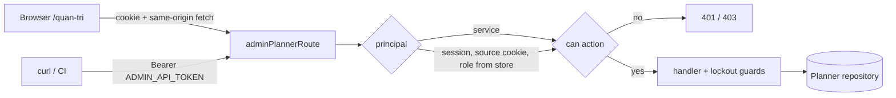

# ADR 0010 — Admin portal: session-principal authorization

🇻🇳 Bản tiếng Việt: [0010-admin-portal-session-authorization.vi.md](0010-admin-portal-session-authorization.vi.md)

- **Status:** Accepted (2026-11-11)
- **Date:** 2026-11-11
- **Owner:** system-architect

## Context

ADR 0006 steps 1–2 shipped: users carry a `role`, `can()` exists in `src/server/identity/permissions.ts`, and `ADMIN_API_TOKEN` can bootstrap or promote an admin. Nothing calls `can()` in the request path. `adminPlannerRoute` (`src/server/planner/http.ts`) accepts only the bearer service token, so the only way to administer users is `curl`. The owner wants a browser admin page and a clear way to sign in as admin. ADR 0006 step 3 says admin routes accept a service principal or a session with `role`; it does not settle the details a first browser slice needs. Facts that shape the answer:

- `identify` already re-reads the user row on every request, so a role change applies at once (`repository.ts`, `setUserRole` comment).
- Session lifetimes are global constants (`SESSION_IDLE_DAYS = 7`, `SESSION_ABSOLUTE_DAYS = 14`, `schemas.ts`). `identify` also falls back to a *user's own bearer access token*, which is non-expiring.
- `requireSameOrigin` already protects cookie mutations; `passwordChangeRequired` is already on the identity.
- The rate limiter is in-memory and per process; the dev VM is one replica over plain HTTP on a LAN IP; production will be HTTPS.

## Decision

1. **Reuse the existing `/api/admin/planner/users/**` handlers; widen the guard, do not add routes.** `adminPlannerRoute(request, { action, session }, handler)` resolves a principal in this order: (a) an `Authorization` header present -> only `authorizeAdmin` (service principal, `role: 'service'`); a planner user's own access token is **not** accepted here. (b) otherwise the session cookie via `identify`, requiring `source === 'cookie'`. Then `can(principal, action)` must hold, else 403. The handler receives the principal (`{ kind: 'service' } | { kind: 'session', userId, role }`) so it can apply the guards below.
2. **Opt-in per route.** Session access is granted only to: list users (`user:provision`), create user (`user:provision`), set role (`user:promote`), reset password (`user:provision`). `rotate-token`, `DELETE`, `google` unlink and `integrity` stay service-token only until a later slice names them.
3. **Same-origin.** `requireSameOrigin` runs on every admin request with the resolved `source`; a cookie-authenticated admin mutation must state `Sec-Fetch-Site: same-origin` or a matching `Origin`. No CSRF token is added: same-origin plus `SameSite=Lax` is the ADR 0004 position and the browser UI is same-origin `fetch`.
4. **Role is read from the store on every request, never from the cookie** (already true; pinned by a test). Admin sessions get shorter lifetimes: idle 2 h, absolute 12 h, chosen by the *current* role at `identify` time, so demotion restores the member lifetime and promotion shortens it. Constants live beside the existing ones in `schemas.ts`. No second session mechanism.
5. **Temporary-password gate blocks admin.** The admin guard never sets `allowPendingPasswordChange`; an admin on an operator-issued password gets `password_change_required` from admin routes, and the page redirects to `/account/password`.
6. **Lockout guards, enforced in the repository transaction (not only the route):** a session principal cannot change its own role or reset its own password (409 `invalid_state`, the existing code; use the change-password page); no role change or deletion may leave zero `admin` users (409 `invalid_state`). The service token is exempt from the self rules but not from the last-admin rule.
7. **Denial.** Pages: no session -> redirect to sign-in with `returnTo`; signed in without `admin` -> `notFound()` (the portal's existence is not confirmed to members). API: no credential -> 401; authenticated but not permitted -> 403, matching the existing envelope.
8. **Rate limiting.** Admin mutations by a session principal pass the existing in-memory limiter keyed by `userId` (30 per minute). Sign-in throttling is unchanged. Honest limit: per process (ADR 0005), a speed bump, not authorization.
9. **No indexing.** Admin pages export `robots: { index: false, follow: false }`, responses carry `X-Robots-Tag: noindex`, the pages are absent from `sitemap.ts` and disallowed in `robots.ts`.
10. **Secrets shown once.** Every admin response is `Cache-Control: no-store` (already `plannerJson`). A `temporaryPassword` or `accessToken` lives only in client component state, is rendered once with a copy button and an explicit "shown once" notice, is cleared on dismiss/navigation, and is never put in a URL, `localStorage`, a server action argument or a log. `tests/client-boundary.test.ts` must keep passing.
11. **Routes.** New localized pathname `'/admin': { vi: '/quan-tri', en: '/admin' }`; `'/admin'` is added to the `returnTo` allow-list. The admin page is a server component; only the forms and the one-time secret display are client components, calling the API above with same-origin `fetch`. No server actions in this slice: one mutation path, one set of guards.
12. **Admin sign-in is the existing sign-in.** `/dang-nhap?returnTo=/quan-tri` with email and password (ADR 0007). Bootstrap is unchanged: an operator uses the service token once to create or promote the first admin (`email`, `role: 'admin'`), hands over the temporary password, and the admin changes it on first sign-in. No separate admin login, no new credential.

## Owner decisions

The owner approved this ADR with the proposed defaults:

- Admin session lifetimes: idle 2 h, absolute 12 h.
- A signed-in non-admin gets `notFound()` (404), not 403, at `/quan-tri`.
- HTTPS is **not** enforced for the portal: the dev VM is plain HTTP on a LAN IP. Switching to HTTPS (and refusing admin over HTTP) is required before real users.
- An admin may reset another admin's password until the audit-log slice exists.
- First admin: bootstrapped by the operator with the service token (decision 12).

## Implementation notes

Deviations and details as built:

- The lockout 409 reuses the existing `invalid_state` error code; no new `conflict` code was added.
- `readAdminPageAccess()` (`src/server/planner/admin-page.ts`) returns `{ status: 'anonymous' | 'must-change-password' | 'not-admin' | 'admin', principal }`; the page maps the status to redirect, `notFound()` or render.
- The limiter is built with `createRateLimiter` in `src/server/planner/http.ts` (`adminSessionLimiter`, 30 per minute per `userId`).
- The acting admin is re-checked **inside** the repository transaction, so a demotion between guard and write cannot slip through.
- Admin sessions refresh `lastSeenAt` every 10 minutes (`ADMIN_SESSION_TOUCH_INTERVAL_MINUTES`), not on every read.
- The page gate is the first server component to read the Planner store. Next.js loads `src/server/persistence/json-store.ts` once for the page bundle and once for the route handlers, so the JSON store's in-memory cache and write queue are now kept per file path on `globalThis` (`tests/json-store.test.ts`). Without that, a session signed in through the API was invisible to `/quan-tri`. PostgreSQL is unaffected.
- Routes that have not opted in keep token-only behaviour: `adminPlannerRoute(request, handler)` without options is service-token only; session access needs `adminPlannerRoute(request, { action, session: true }, handler)`.

## Options considered

| Option | For | Against |
|---|---|---|
| A (chosen): widen `adminPlannerRoute` to token or session, reuse handlers | One contract, one test suite, scripts and portal cannot drift; no new route surface | The guard gets a principal type every handler must tolerate; a mistake in the guard affects both paths |
| B: parallel `/api/admin/portal/**` routes for sessions | Service path untouched | Two copies of validation and response shape to keep in sync; twice the surface |
| C: server actions for the portal | No public API for the browser | A second mutation path with its own guards; same-origin handling is implicit; harder to test |
| D: accept the admin's own access token as a bearer admin credential | Scriptable per person | A non-expiring, unattributed-in-practice admin credential, the thing ADR 0006 removes |

Runner-up B lost on one reason: duplicated validation drifts, and the drift would be in privileged code.

## Consequences

Easier: attributable, expiring, revocable admin sessions; the first real callers of `can()`; the portal is a thin client over a tested API.

Harder: the shorter admin lifetime means re-sign-in in the middle of work; the guard is now security-critical for two principals and needs a full matrix test; any admin can mint another admin or reset another admin's password (account takeover between admins is possible and unaudited until the audit-log slice); over plain HTTP on the LAN the admin password and cookie travel in clear text — acceptable for the dev VM only, and production must be HTTPS with `TRUST_PROXY_HEADERS` set correctly; per-process rate limiting does not hold across instances; no MFA, so a phished admin password is a full admin takeover. Reversing: remove the session branch from the guard; the service-token path is untouched and `role` data is additive.

## Follow-up

- Task Contract: `.claude/contracts/phase07-admin-portal-slice1.md`. Feature document `docs/features/admin-portal.md` + `.vi.md`.
- `docs/architecture.md` / `.vi.md`: route table, Phase 07 backlog (step 3 partly done), the guard contract. `docs/usage.md` / `.vi.md`: how to bootstrap and sign in as admin.
- Later slices: audit log, content CMS, editor screens, MFA for `admin`, `rotate-token`/`DELETE` for sessions, enforcing HTTPS for admin in production.
- Still open: whether to refuse the portal over HTTP in production (the owner deferred it until real users); who the permanent admins are.
