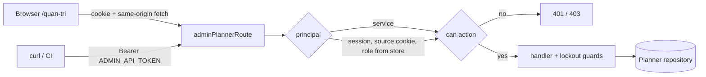

# ADR 0010 — Cổng quản trị: phân quyền theo principal của session

🇬🇧 English: [0010-admin-portal-session-authorization.md](0010-admin-portal-session-authorization.md)

- **Trạng thái:** Accepted (đã chấp nhận, 2026-11-11)
- **Ngày:** 2026-11-11
- **Người sở hữu:** system-architect

## Bối cảnh

ADR 0006 bước 1–2 đã xong: user có `role`, `can()` đã có trong `src/server/identity/permissions.ts`, và `ADMIN_API_TOKEN` có thể tạo hoặc nâng quyền admin đầu tiên. Chưa nơi nào trong đường xử lý request gọi `can()`. `adminPlannerRoute` (`src/server/planner/http.ts`) chỉ nhận service token dạng bearer, nên cách duy nhất để quản lý user là `curl`. Chủ dự án muốn một trang admin trên trình duyệt và một cách đăng nhập admin rõ ràng. ADR 0006 bước 3 nói route admin nhận service principal hoặc session có `role`, nhưng chưa chốt các chi tiết mà lát cắt đầu tiên trên trình duyệt cần. Các sự thật định hình câu trả lời:

- `identify` đã đọc lại dòng user ở mỗi request, nên đổi role có hiệu lực ngay (`repository.ts`, chú thích của `setUserRole`).
- Thời hạn session là hằng số toàn cục (`SESSION_IDLE_DAYS = 7`, `SESSION_ABSOLUTE_DAYS = 14`, `schemas.ts`). `identify` còn rơi về *access token bearer của chính user*, vốn không hết hạn.
- `requireSameOrigin` đã bảo vệ mutation dùng cookie; `passwordChangeRequired` đã nằm trong identity.
- Bộ giới hạn tốc độ nằm trong bộ nhớ, theo từng process; VM dev chạy một replica qua HTTP thuần trên IP LAN; production sẽ dùng HTTPS.

## Quyết định

1. **Tái dùng các handler `/api/admin/planner/users/**` hiện có; nới guard, không thêm route.** `adminPlannerRoute(request, { action, session }, handler)` xác định principal theo thứ tự: (a) có header `Authorization` -> chỉ dùng `authorizeAdmin` (service principal, `role: 'service'`); access token của một planner user **không** được chấp nhận ở đây. (b) nếu không, dùng session cookie qua `identify`, yêu cầu `source === 'cookie'`. Sau đó `can(principal, action)` phải đúng, nếu không trả 403. Handler nhận principal (`{ kind: 'service' } | { kind: 'session', userId, role }`) để áp các guard bên dưới.
2. **Bật từng route.** Session chỉ được dùng cho: liệt kê user (`user:provision`), tạo user (`user:provision`), đổi role (`user:promote`), reset mật khẩu (`user:provision`). `rotate-token`, `DELETE`, gỡ liên kết `google` và `integrity` vẫn chỉ dùng service token cho tới khi một lát cắt sau gọi tên chúng.
3. **Same-origin.** `requireSameOrigin` chạy cho mọi request admin với `source` đã xác định; mutation admin dùng cookie phải có `Sec-Fetch-Site: same-origin` hoặc `Origin` khớp. Không thêm CSRF token: same-origin cộng `SameSite=Lax` là lập trường của ADR 0004 và UI trình duyệt chỉ dùng `fetch` cùng origin.
4. **Role luôn đọc từ store ở mỗi request, không bao giờ từ cookie** (đã đúng; khoá bằng test). Session admin có thời hạn ngắn hơn: idle 2 giờ, tuyệt đối 12 giờ, chọn theo role *hiện tại* tại thời điểm `identify`, nên hạ quyền trả về thời hạn của member và nâng quyền rút ngắn nó. Hằng số đặt cạnh các hằng số cũ trong `schemas.ts`. Không có cơ chế session thứ hai.
5. **Cổng mật khẩu tạm thời chặn admin.** Guard admin không bao giờ đặt `allowPendingPasswordChange`; admin còn dùng mật khẩu do operator cấp sẽ nhận `password_change_required` từ route admin, và trang chuyển sang `/account/password`.
6. **Guard chống tự khoá, thực thi trong transaction của repository (không chỉ ở route):** principal session không được đổi role của chính mình hay reset mật khẩu của chính mình (409 `invalid_state`, mã lỗi sẵn có; dùng trang đổi mật khẩu); không thao tác đổi role hay xoá nào được để lại 0 user `admin` (409 `invalid_state`). Service token được miễn quy tắc tự thân nhưng không được miễn quy tắc admin cuối.
7. **Từ chối.** Trang: chưa đăng nhập -> chuyển sang đăng nhập với `returnTo`; đã đăng nhập nhưng không phải `admin` -> `notFound()` (không xác nhận sự tồn tại của cổng với member). API: không có credential -> 401; đã xác thực nhưng không được phép -> 403, theo đúng envelope hiện có.
8. **Giới hạn tốc độ.** Mutation admin của principal session đi qua bộ giới hạn trong bộ nhớ hiện có, khoá theo `userId` (30 lần mỗi phút). Việc giới hạn đăng nhập giữ nguyên. Giới hạn thật: theo từng process (ADR 0005), là gờ giảm tốc, không phải phân quyền.
9. **Không lập chỉ mục.** Trang admin xuất `robots: { index: false, follow: false }`, response mang `X-Robots-Tag: noindex`, trang không có trong `sitemap.ts` và bị disallow trong `robots.ts`.
10. **Bí mật chỉ hiện một lần.** Mọi response admin là `Cache-Control: no-store` (`plannerJson` đã vậy). `temporaryPassword` hay `accessToken` chỉ nằm trong state của client component, hiển thị một lần kèm nút sao chép và thông báo "chỉ hiện một lần", bị xoá khi đóng hoặc điều hướng, và không bao giờ nằm trong URL, `localStorage`, tham số server action hay log. `tests/client-boundary.test.ts` phải tiếp tục pass.
11. **Route.** Pathname bản địa hoá mới `'/admin': { vi: '/quan-tri', en: '/admin' }`; `'/admin'` được thêm vào danh sách cho phép của `returnTo`. Trang admin là server component; chỉ form và phần hiển thị bí mật một lần là client component, gọi API trên bằng `fetch` cùng origin. Lát cắt này không dùng server action: một đường mutation, một bộ guard.
12. **Đăng nhập admin là đăng nhập hiện có.** `/dang-nhap?returnTo=/quan-tri` với email và mật khẩu (ADR 0007). Bootstrap không đổi: operator dùng service token một lần để tạo hoặc nâng quyền admin đầu tiên (`email`, `role: 'admin'`), giao mật khẩu tạm thời, và admin đổi nó ở lần đăng nhập đầu. Không có trang đăng nhập admin riêng, không có credential mới.

## Quyết định của chủ dự án

Chủ dự án đã duyệt ADR này với các giá trị mặc định đề xuất:

- Thời hạn session admin: idle 2 giờ, tuyệt đối 12 giờ.
- Người đã đăng nhập nhưng không phải admin nhận `notFound()` (404), không phải 403, tại `/quan-tri`.
- **Không** bắt buộc HTTPS cho cổng: VM dev chạy HTTP thuần trên IP LAN. Phải chuyển sang HTTPS (và từ chối admin qua HTTP) trước khi có người dùng thật.
- Admin được reset mật khẩu admin khác cho tới khi có lát cắt audit log.
- Admin đầu tiên: operator bootstrap bằng service token (quyết định 12).

## Ghi chú hiện thực

Các điểm lệch và chi tiết như đã dựng:

- Mã 409 chống tự khoá dùng lại mã lỗi `invalid_state` sẵn có; không thêm mã `conflict` mới.
- `readAdminPageAccess()` (`src/server/planner/admin-page.ts`) trả về `{ status: 'anonymous' | 'must-change-password' | 'not-admin' | 'admin', principal }`; trang ánh xạ status thành chuyển hướng, `notFound()` hoặc render.
- Bộ giới hạn được dựng bằng `createRateLimiter` trong `src/server/planner/http.ts` (`adminSessionLimiter`, 30 lần mỗi phút theo `userId`).
- Admin đang thao tác được kiểm tra lại **bên trong** transaction của repository, nên việc hạ quyền giữa guard và lúc ghi không lọt qua được.
- Session admin làm mới `lastSeenAt` mỗi 10 phút (`ADMIN_SESSION_TOUCH_INTERVAL_MINUTES`), không phải mỗi lần đọc.
- Cổng của trang là server component đầu tiên đọc kho Planner. Next.js nạp `src/server/persistence/json-store.ts` một lần cho bundle trang và một lần cho route handler, nên bộ nhớ đệm và hàng đợi ghi của kho JSON nay được giữ theo đường dẫn tệp trên `globalThis` (`tests/json-store.test.ts`). Nếu không, session đăng nhập qua API sẽ không hiện với `/quan-tri`. PostgreSQL không bị ảnh hưởng.
- Bộ giới hạn tần suất cho session admin cũng được giữ trên `globalThis` vì cùng lý do, nên mọi bản sao của `http.ts` dùng chung một hạn mức 30 lần mỗi phút.
- Rủi ro chấp nhận: bước kiểm tra lại trong transaction xác nhận người thao tác vẫn là admin, chứ không xác nhận session của họ còn hiệu lực. Một session hết hạn hoặc bị thu hồi trong vài mili giây giữa `identify` và lúc ghi (ví dụ khi admin đó bị cấp lại mật khẩu cùng lúc) vẫn hoàn tất thay đổi đang chạy đó. Muốn đóng kẽ hở này cần kiểm tra lại session ngay trong transaction; xem lại cùng với audit log.
- Route chưa bật giữ hành vi chỉ-token: `adminPlannerRoute(request, handler)` không kèm options chỉ nhận service token; muốn dùng session cần `adminPlannerRoute(request, { action, session: true }, handler)`.

## Các phương án đã cân nhắc

| Phương án | Ưu điểm | Nhược điểm |
|---|---|---|
| A (chọn): nới `adminPlannerRoute` nhận token hoặc session, tái dùng handler | Một contract, một bộ test, script và portal không lệch nhau; không thêm bề mặt route | Guard có thêm kiểu principal mà mọi handler phải chịu được; lỗi trong guard ảnh hưởng cả hai đường |
| B: route song song `/api/admin/portal/**` cho session | Đường service không bị đụng | Hai bản validation và response shape phải đồng bộ; bề mặt gấp đôi |
| C: server action cho portal | Trình duyệt không cần API công khai | Đường mutation thứ hai với guard riêng; xử lý same-origin ngầm định; khó test hơn |
| D: nhận access token của chính admin làm credential admin dạng bearer | Dùng được trong script theo từng người | Credential admin không hết hạn, đúng thứ ADR 0006 muốn loại bỏ |

Phương án về nhì B thua vì một lý do: validation bị nhân đôi sẽ trôi lệch, và sự lệch đó nằm trong code đặc quyền.

## Hệ quả

Dễ hơn: session admin có thể quy cho từng người, có hạn, thu hồi được; những lần gọi `can()` thật đầu tiên; portal chỉ là lớp client mỏng trên một API đã được test.

Khó hơn: thời hạn admin ngắn hơn nghĩa là phải đăng nhập lại giữa chừng; guard giờ là phần then chốt về bảo mật cho hai principal và cần test ma trận đầy đủ; bất kỳ admin nào cũng tạo được admin khác hoặc reset mật khẩu admin khác (chiếm tài khoản giữa các admin là khả thi và chưa có audit cho tới lát cắt audit log); qua HTTP thuần trên LAN, mật khẩu và cookie admin đi dạng rõ — chỉ chấp nhận cho VM dev, production phải dùng HTTPS với `TRUST_PROXY_HEADERS` đặt đúng; giới hạn tốc độ theo process không giữ được khi có nhiều instance; chưa có MFA nên mật khẩu admin bị lừa lấy là mất toàn quyền. Đảo ngược: bỏ nhánh session khỏi guard; đường service token không đổi và dữ liệu `role` chỉ là phần thêm.

## Việc tiếp theo

- Task Contract: `.claude/contracts/phase07-admin-portal-slice1.md`. Tài liệu tính năng `docs/features/admin-portal.md` + `.vi.md`.
- `docs/architecture.md` / `.vi.md`: bảng route, backlog Phase 07 (bước 3 xong một phần), contract của guard. `docs/usage.md` / `.vi.md`: cách bootstrap và đăng nhập admin.
- Các lát cắt sau: audit log, CMS nội dung, màn hình editor, MFA cho `admin`, `rotate-token`/`DELETE` qua session, bắt buộc HTTPS cho admin ở production.
- Còn mở: có từ chối portal qua HTTP ở production hay không (chủ dự án hoãn tới khi có người dùng thật); ai là admin thường trực.
