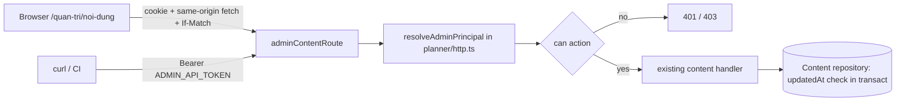

# ADR 0011 — Admin portal: browser content management (Phase 07, slice 2)

🇻🇳 Bản tiếng Việt: [0011-admin-content-cms.vi.md](0011-admin-content-cms.vi.md)

- **Status:** Accepted (2026-11-12)
- **Amended by CORE-11:** `If-Match` is now required on content `PATCH`/`reorder`/`move-activity` for every caller (missing → 428 `precondition_required`); the "optional" and "last-write-wins" wording below is the original decision, kept as history.
- **Date:** 2026-11-12
- **Owner:** system-architect

## Context

ADR 0010 let an admin session reach the user-administration routes through `adminPlannerRoute(request, { action, session: true }, handler)`. The Travel Content admin API (`src/app/api/admin/travel/**`, ADR 0001) is still token-only: `adminRoute` in `src/server/content/http.ts` only calls `authorizeAdmin`, so stories, places and reviews can be edited only with `curl`. Facts that shape the answer:

- `can()` knows `template:write` and `story:publish` (editor, admin, service) and `user:*` (admin, service). Nothing names a content edit.
- The page gate (`readAdminPageAccess`) answers `not-admin` -> 404 for anyone without `user:provision`, so an editor can never see `/quan-tri`.
- `placeSchema`, `storySchema`, `reviewSchema` carry `updatedAt`; there is no `version`, and the content PATCH handlers take no `If-Match` (the Planner does, ADR 0002).
- Nothing calls `revalidatePath` or `revalidateTag`. Only `/stories/[slug]` sets `revalidate = 60`.
- The principal resolver `resolveAdminPrincipal` lives in `src/server/planner/http.ts`, which already imports `content/auth`, `content/errors` and `content/http`. Making `content/http.ts` import it back would be a cycle.

## Decision

1. **Reuse the content handlers; add a session-capable wrapper, do not add routes.** `resolveAdminPrincipal` is exported from `src/server/planner/http.ts` unchanged. A new `src/server/admin/content-route.ts` exports `adminContentRoute(request, { action, session }, handler)`: it calls that resolver, runs the handler, maps errors with `toErrorResponse`, and sets `no-store`. `src/server/content/http.ts` is **not** edited and gains no planner import, so the dependency stays one-way (admin -> planner -> content). Routes that do not opt in keep `adminRoute` (token-only).
2. **One new action, `content:write`**, granted to `editor`, `admin` and `service`. It covers read and edit of stories, places and reviews. Publish, unpublish, archive and review moderation reuse `story:publish` (same holders today). Two names are kept so a later, narrower role can hold one and not the other.
3. **Route matrix.** Session access is granted only here; everything else in `src/app/api/admin/travel/**` stays token-only.

| Route | Method | Action | Session |
|---|---|---|---|
| `stories`, `places`, `reviews` | GET (list) | `content:write` | yes |
| `stories/[slug]`, `places/[slug]`, `reviews/[id]` | GET | `content:write` | yes |
| `stories/[slug]`, `places/[slug]`, `reviews/[id]` | PATCH | `content:write` | yes |
| `stories/[slug]/places` | PATCH | `content:write` | yes |
| `stories/[slug]/status`, `reviews/[id]/status` | POST | `story:publish` | yes |
| `stories`, `places`, `reviews` | POST (create) | | no (later) |
| any `[slug]` / `[id]` | DELETE | | no, token-only |
| `templates/**`, `collections/**`, `integrity` | all | | no, token-only |

4. **Optimistic concurrency by `updatedAt`.** Content PATCH accepts an optional `If-Match: "<updatedAt>"`. Compared **inside the repository transaction**; on mismatch the write is refused whole with the existing `version_conflict` code (409). Absent header = last-write-wins, so existing `curl` scripts are unchanged; the browser always sends it, and the form tells the editor to reload.
5. **Page gate admits editors.** `/quan-tri` is open to any role that can do something there. A new `readStaffPageAccess()` in `src/server/planner/admin-page.ts` returns `anonymous | must-change-password | forbidden | staff` with the role; `member` -> `notFound()`. The shell shows **Users** only if `can(role, 'user:provision')` and **Content** only if `can(role, 'content:write')`. `readAdminPageAccess` is kept for the users section. The API remains the authority; hiding a section is not authorization.
6. **UI scope (minimal shippable).** Stories: list, edit every `Localized` field with vi and en side by side, publish / unpublish / archive. Places: list, edit. Reviews: moderation queue (publish / unpublish) and edit. **Out:** create, delete, templates, collections, integrity, rich-text, image upload.
7. **Routes.** New localized pathnames: `/admin/content/stories` (vi `/quan-tri/noi-dung/chuyen-di`), `/admin/content/stories/[slug]`, `/admin/content/places` (vi `/quan-tri/noi-dung/dia-diem`), `/admin/content/places/[slug]`, `/admin/content/reviews` (vi `/quan-tri/noi-dung/danh-gia`). Pages are server components with `noindex`, absent from the sitemap, covered by the existing `robots.ts` / `X-Robots-Tag` prefixes. Forms are client components calling the API above with same-origin `fetch`; no server actions (ADR 0010 §11).
8. **Caching.** No on-demand revalidation in this slice: a published edit reaches `/stories/[slug]` within the 60 s `revalidate` window; other public pages are as fresh as their own caching allows (backend-engineer verifies and records which). The editor UI says so. *Superseded by [ADR 0012](0012-public-travel-from-content-repository.md) decision 4 (public Travel pages render fully dynamic from the content repository).*
9. **Audit log stays open.** Content edits by session principals are attributed only by the server log line of the principal id, not stored. Accepted risk, same as ADR 0010.

## Owner decisions

The owner approved this ADR with the proposed defaults (2026-11-12):

- Add `content:write`, held by editor, admin, service; reuse `story:publish` for status changes.
- Editors may enter `/quan-tri` and see Content only; members still get 404.
- Slice 2 is edit and moderate only: no create, no delete, no templates, collections or integrity in the browser.
- Optimistic concurrency via optional `If-Match: "<updatedAt>"`, not mandatory (428) for now.
- No on-demand revalidation; accept up to 60 s staleness.
- Audit log remains unbuilt; editor and admin edits are unattributed in stored data.

## Implementation notes

Deviations found while building (2026-11-12):

- **Decision 8 does not hold as written.** The public story, destination and review pages render from the typed seed in `src/content/**` (`src/app/[locale]/stories/page.tsx`, `stories/[slug]/page.tsx`), not from the content repository. The only repository read on a public page is `getPublicTemplate` in `stories/[slug]` (`revalidate = 60`). So a CMS edit to a story, place or review is stored and served by `/api/travel/**`, but it does **not** appear on the public pages at all, not after 60 s either. The editor UI says so plainly. Wiring the public pages to the repository is a separate decision (data shape differs between `src/content/types.ts` and the content entities) and needs its own ADR.
- **Stale write is 412, not 409.** `version_conflict` already existed as 412 for the Planner's `If-Match` path; the content path reuses it unchanged rather than give one code two statuses.
- `adminContentRoute` and `ifMatchStamp` live in `src/server/admin/content-route.ts`; `readStaffPageAccess` in `src/server/planner/admin-page.ts`. Tests: `tests/admin-content-session.test.ts`.

## Options considered

| Option | For | Against |
|---|---|---|
| A (chosen): `adminContentRoute` in a neutral module reusing the planner resolver, existing handlers | One guard implementation, no duplicated validation, no import cycle, service path untouched | Content routes now depend on planner session code at runtime; a guard bug affects both systems |
| B: make `content/http.ts` `adminRoute` accept options and import the planner | Fewer files | Content -> planner import cycle; couples the two systems at the lowest layer |
| C: copy the resolver into `content/` | No coupling | Two copies of privileged code that drift |
| D: reuse `story:publish` / `template:write` for edits | No new action | Names lie; blocks a future narrower role |
| E: mandatory `If-Match` (428) | No lost updates at all | Breaks every existing `curl` script and the documented API |

Runner-up B lost on one reason: it creates a cycle and ties content to planner internals at the lowest layer.

## Consequences

Easier: editors work in a browser with no token; the same guarded API serves scripts and UI; stale-edit conflicts are caught for the browser.

Harder: `content:write` and the new wrapper are security-critical and need the same matrix test as ADR 0010; editors can now publish site copy with no audit trail, and a compromised editor session can change public content (no MFA); last-write-wins remains for token callers and for any caller that omits `If-Match`; `updatedAt` has millisecond resolution, so it is an ETag and not a real version; a 60 s window of stale public pages after an edit; the 30 per minute per-user limit applies to saving forms; per-process limits do not hold across instances; the editor role now has a browser surface, so any bug in the shell is reachable by a lower-privilege account. Reversing: drop `session: true` from the content routes; the action and the wrapper are additive.

## Follow-up

- Task Contract: `.claude/contracts/phase07-admin-content-cms.md`. Feature document `docs/features/admin-content-cms.md` + `.vi.md` (frontend-engineer).
- `docs/architecture.md` / `.vi.md`: route table, guard contract, Phase 07 backlog. `docs/usage.md` / `.vi.md`: editor sign-in and the `If-Match` header. `docs/travel-content-api.md`: `If-Match` and session access.
- P07-16 amendment: `POST stories` and `POST places` now accept the session (`content:write`); delete stays token-only. Places had no status, so a created place was public immediately; superseded by [ADR 0035](0035-place-publish-status.md).
- Later slices: audit log, delete, templates and collections editing, MFA for `admin`/`editor`, on-demand revalidation.
- Open: how an editor account is created (`role: 'editor'` via the existing admin portal) and who the first editors are.
