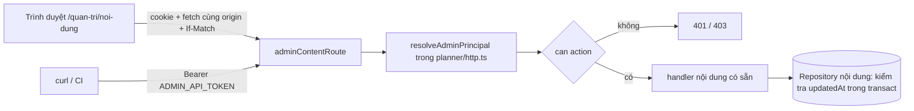

# ADR 0011 — Cổng quản trị: quản lý nội dung trên trình duyệt (Phase 07, lát 2)

🇬🇧 English version: [0011-admin-content-cms.md](0011-admin-content-cms.md)

- **Trạng thái:** Đã chấp nhận (2026-11-12)
- **Ngày:** 2026-11-12
- **Người sở hữu:** system-architect

## Bối cảnh

ADR 0010 cho phép session admin gọi các route quản lý user qua `adminPlannerRoute(request, { action, session: true }, handler)`. API quản trị nội dung du lịch (`src/app/api/admin/travel/**`, ADR 0001) vẫn chỉ nhận token: `adminRoute` trong `src/server/content/http.ts` chỉ gọi `authorizeAdmin`, nên story, địa điểm và review chỉ sửa được bằng `curl`. Các dữ kiện định hình câu trả lời:

- `can()` biết `template:write` và `story:publish` (editor, admin, service) cùng `user:*` (admin, service). Không có action nào cho việc sửa nội dung.
- Cổng trang (`readAdminPageAccess`) trả `not-admin` -> 404 cho ai không có `user:provision`, nên editor không bao giờ thấy `/quan-tri`.
- `placeSchema`, `storySchema`, `reviewSchema` có `updatedAt`; không có `version`, và các handler PATCH nội dung không nhận `If-Match` (Planner có, ADR 0002).
- Không nơi nào gọi `revalidatePath` hay `revalidateTag`. Chỉ `/stories/[slug]` đặt `revalidate = 60`.
- `resolveAdminPrincipal` nằm trong `src/server/planner/http.ts`, file này đã import `content/auth`, `content/errors`, `content/http`. Cho `content/http.ts` import ngược lại sẽ tạo vòng phụ thuộc.

## Quyết định

1. **Dùng lại handler nội dung; thêm wrapper hỗ trợ session, không thêm route.** `resolveAdminPrincipal` được export từ `src/server/planner/http.ts`, giữ nguyên. Module mới `src/server/admin/content-route.ts` export `adminContentRoute(request, { action, session }, handler)`: gọi resolver đó, chạy handler, map lỗi bằng `toErrorResponse`, đặt `no-store`. `src/server/content/http.ts` **không** bị sửa và không import planner, nên phụ thuộc chỉ đi một chiều (admin -> planner -> content). Route không opt-in vẫn dùng `adminRoute` (chỉ token).
2. **Một action mới, `content:write`**, cấp cho `editor`, `admin` và `service`. Bao gồm đọc và sửa story, địa điểm, review. Publish, unpublish, archive và duyệt review dùng lại `story:publish` (hiện cùng nhóm người giữ). Giữ hai tên để sau này một role hẹp hơn có thể giữ cái này mà không giữ cái kia.
3. **Ma trận route.** Session chỉ được cấp ở đây; mọi thứ khác trong `src/app/api/admin/travel/**` vẫn chỉ nhận token.

| Route | Method | Action | Session |
|---|---|---|---|
| `stories`, `places`, `reviews` | GET (danh sách) | `content:write` | có |
| `stories/[slug]`, `places/[slug]`, `reviews/[id]` | GET | `content:write` | có |
| `stories/[slug]`, `places/[slug]`, `reviews/[id]` | PATCH | `content:write` | có |
| `stories/[slug]/places` | PATCH | `content:write` | có |
| `stories/[slug]/status`, `reviews/[id]/status` | POST | `story:publish` | có |
| `stories`, `places`, `reviews` | POST (tạo) | | không (để sau) |
| mọi `[slug]` / `[id]` | DELETE | | không, chỉ token |
| `templates/**`, `collections/**`, `integrity` | tất cả | | không, chỉ token |

4. **Đồng thời lạc quan bằng `updatedAt`.** PATCH nội dung nhận `If-Match: "<updatedAt>"` tuỳ chọn. So sánh **bên trong transaction của repository**; lệch thì từ chối cả lần ghi bằng mã `version_conflict` có sẵn (409). Không có header = last-write-wins, nên script `curl` hiện có không đổi; trình duyệt luôn gửi, và form nhắc editor tải lại.
5. **Cổng trang cho editor vào.** `/quan-tri` mở cho mọi role làm được việc gì đó ở đây. `readStaffPageAccess()` mới trong `src/server/planner/admin-page.ts` trả `anonymous | must-change-password | forbidden | staff` kèm role; `member` -> `notFound()`. Khung trang chỉ hiện **Người dùng** nếu `can(role, 'user:provision')` và **Nội dung** nếu `can(role, 'content:write')`. `readAdminPageAccess` giữ cho phần người dùng. API vẫn là nơi quyết định; ẩn một mục không phải là phân quyền.
6. **Phạm vi UI (tối thiểu có thể phát hành).** Story: danh sách, sửa mọi trường `Localized` với vi và en cạnh nhau, publish / unpublish / archive. Địa điểm: danh sách, sửa. Review: hàng đợi duyệt (publish / unpublish) và sửa. **Ngoài phạm vi:** tạo, xoá, template, collection, integrity, rich-text, upload ảnh.
7. **Route.** Pathname bản địa hoá mới: `/admin/content/stories` (vi `/quan-tri/noi-dung/chuyen-di`), `/admin/content/stories/[slug]`, `/admin/content/places` (vi `/quan-tri/noi-dung/dia-diem`), `/admin/content/places/[slug]`, `/admin/content/reviews` (vi `/quan-tri/noi-dung/danh-gia`). Trang là server component, `noindex`, không có trong sitemap, nằm trong tiền tố đã có ở `robots.ts` / `X-Robots-Tag`. Form là client component gọi API trên bằng `fetch` cùng origin; không dùng server action (ADR 0010 §11).
8. **Cache.** Không revalidate theo yêu cầu trong lát này: bản sửa đã publish tới `/stories/[slug]` trong cửa sổ `revalidate` 60 giây; các trang công khai khác mới tới mức cache của riêng chúng (backend-engineer kiểm tra và ghi lại). UI cho editor nói rõ điều này.
9. **Audit log vẫn để ngỏ.** Bản sửa nội dung của session chỉ được ghi nhận qua dòng log máy chủ có id principal, không lưu vào dữ liệu. Rủi ro chấp nhận, như ADR 0010.

## Quyết định của chủ sở hữu

Chủ sở hữu đã duyệt ADR này với các mặc định đề xuất (2026-11-12):

- Thêm `content:write` cho editor, admin, service; dùng lại `story:publish` cho đổi trạng thái.
- Editor được vào `/quan-tri` và chỉ thấy Nội dung; member vẫn nhận 404.
- Lát 2 chỉ sửa và duyệt: không tạo, không xoá, không template, collection hay integrity trên trình duyệt.
- Đồng thời lạc quan qua `If-Match: "<updatedAt>"` tuỳ chọn, chưa bắt buộc (428).
- Không revalidate theo yêu cầu; chấp nhận cũ tối đa 60 giây.
- Audit log chưa xây; bản sửa của editor và admin không gắn người sửa trong dữ liệu lưu.

## Ghi chú triển khai

Các điểm lệch phát hiện khi xây dựng (2026-11-12):

- **Quyết định 8 không đúng như đã viết.** Các trang công khai về story, điểm đến và review render từ dữ liệu seed có kiểu trong `src/content/**` (`src/app/[locale]/stories/page.tsx`, `stories/[slug]/page.tsx`), không đọc từ content repository. Trang công khai duy nhất đọc repository là `getPublicTemplate` trong `stories/[slug]` (`revalidate = 60`). Vì vậy bản sửa story, địa điểm hay review qua CMS được lưu và phục vụ qua `/api/travel/**`, nhưng **không** hiện trên các trang công khai, kể cả sau 60 giây. UI cho editor nói rõ điều này. Nối các trang công khai vào repository là một quyết định riêng (cấu trúc dữ liệu giữa `src/content/types.ts` và các entity nội dung khác nhau) và cần ADR riêng.
- **Ghi đè dữ liệu cũ trả 412, không phải 409.** Mã `version_conflict` đã tồn tại với 412 cho đường `If-Match` của Planner; đường nội dung dùng lại nguyên trạng thay vì để một mã có hai status.
- `adminContentRoute` và `ifMatchStamp` nằm ở `src/server/admin/content-route.ts`; `readStaffPageAccess` ở `src/server/planner/admin-page.ts`. Kiểm thử: `tests/admin-content-session.test.ts`.

## Các phương án đã cân nhắc

| Phương án | Điểm cộng | Điểm trừ |
|---|---|---|
| A (đã chọn): `adminContentRoute` trong module trung lập dùng lại resolver của planner, handler có sẵn | Một bản cài đặt guard, không nhân đôi validation, không vòng phụ thuộc, đường service giữ nguyên | Route nội dung giờ phụ thuộc code session của planner lúc chạy; lỗi guard ảnh hưởng cả hai hệ thống |
| B: cho `adminRoute` của `content/http.ts` nhận options và import planner | Ít file hơn | Vòng import content -> planner; gắn hai hệ thống ở tầng thấp nhất |
| C: chép resolver vào `content/` | Không gắn kết | Hai bản code đặc quyền sẽ lệch nhau |
| D: dùng lại `story:publish` / `template:write` cho việc sửa | Không thêm action | Tên nói sai; chặn role hẹp hơn sau này |
| E: `If-Match` bắt buộc (428) | Không còn mất cập nhật | Phá mọi script `curl` hiện có và API đã tài liệu hoá |

Phương án về nhì B thua vì đúng một lý do: tạo vòng phụ thuộc và buộc content vào nội bộ planner ở tầng thấp nhất.

## Hệ quả

Dễ hơn: editor làm việc trên trình duyệt không cần token; cùng một API có guard phục vụ cả script và UI; xung đột sửa trên bản cũ được bắt cho trình duyệt.

Khó hơn: `content:write` và wrapper mới là phần trọng yếu về bảo mật, cần test ma trận như ADR 0010; editor giờ publish được nội dung site mà không có dấu vết kiểm toán, và session editor bị chiếm có thể đổi nội dung công khai (không MFA); last-write-wins vẫn còn với caller dùng token và caller bỏ `If-Match`; `updatedAt` độ phân giải mili-giây nên chỉ là ETag, không phải version thật; trang công khai cũ tới 60 giây sau khi sửa; giới hạn 30 lần/phút/người áp dụng cả cho việc lưu form; giới hạn theo từng tiến trình không giữ được giữa nhiều instance; role editor giờ có bề mặt trình duyệt, nên lỗi ở khung trang có thể bị tài khoản quyền thấp hơn chạm tới. Hoàn tác: bỏ `session: true` khỏi các route nội dung; action và wrapper chỉ là phần thêm.

## Việc tiếp theo

- Task Contract: `.claude/contracts/phase07-admin-content-cms.md`. Tài liệu tính năng `docs/features/admin-content-cms.md` + `.vi.md` (frontend-engineer).
- `docs/architecture.md` / `.vi.md`: bảng route, hợp đồng guard, backlog Phase 07. `docs/usage.md` / `.vi.md`: đăng nhập editor và header `If-Match`. `docs/travel-content-api.md`: `If-Match` và quyền truy cập bằng session.
- Các lát sau: audit log, tạo và xoá, sửa template và collection, MFA cho `admin`/`editor`, revalidate theo yêu cầu.
- Còn ngỏ: tài khoản editor được tạo thế nào (`role: 'editor'` qua cổng quản trị hiện có) và ai là editor đầu tiên.
