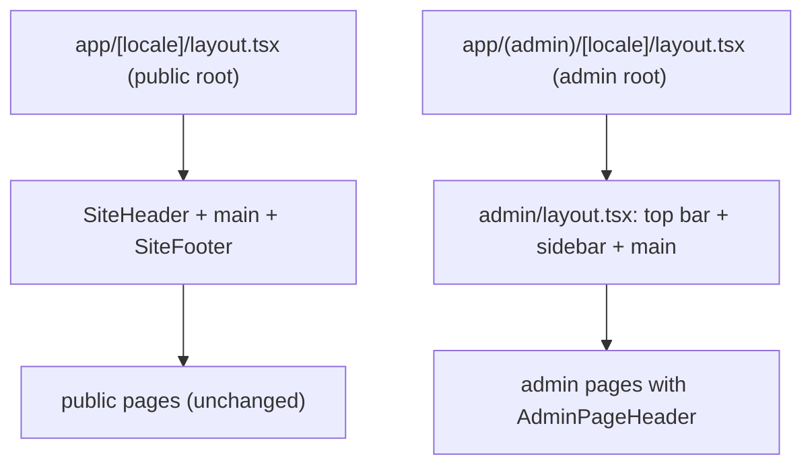

# ADR 0023 — Admin Workspace gets its own root layout, chrome and page header

🇻🇳 Bản tiếng Việt: [0023-admin-root-layout.vi.md](0023-admin-root-layout.vi.md)

- **Status:** Accepted
- **Date:** 2026-11-17
- **Owner:** system-architect
- **Affects:** `src/app/[locale]/admin/**` (moved to a route group), a new admin root layout, `src/app/fonts.ts`, `src/components/admin/**`, `messages/*.json`, one CSS variable
- **Part of:** Phase 07; refines [ADR 0020](0020-admin-workspace-shell.md) after the P07-10 review; task P07-19

## Context

P07-10 put the admin frame inside the public layout. `src/app/[locale]/layout.tsx` owns `<html>`, the public `SiteHeader`, `SiteFooter` and `<main>`, so every admin page still shows the public nav and a 400px public footer, and the sticky admin sidebar slides under the sticky public header. Page titles use the public hero masthead (263px tall). The owner decided that Admin must have its own layout, visually unified with the sidebar, and that the visitor site must not change.

A nested layout cannot remove what its parent renders, so this needs a structural split, not CSS.

## Decision

1. **Two root layouts.** The admin routes move, URL unchanged, from `src/app/[locale]/admin/**` to `src/app/(admin)/[locale]/admin/**`. A new `src/app/(admin)/[locale]/layout.tsx` is the admin root layout: `<html lang>`, fonts, `NextIntlClientProvider`, locale validation, `noindex` metadata. It renders no `SiteHeader`, `SiteFooter` or public skip link. The public `src/app/[locale]/layout.tsx` and every public page stay where they are.
2. **One admin frame.** `admin/layout.tsx` (from P07-10) draws a slim top bar (brand, "View site", language switch, signed-in handle and role, sign out), the sidebar below it, and a single `<main id="admin-content">`. Sidebar and content share one surface, with sticky offsets taken from `--admin-bar-h`.
3. **One `AdminPageHeader`** replaces the public `PageHeader` on every admin page: breadcrumb above, a compact title row (h1, one-line description, optional actions slot), a hairline below. No full-bleed band.
4. **Shared fonts, not copied.** The two `next/font` calls move to `src/app/fonts.ts` and both root layouts import them, so admin and public typography cannot drift. The public layout changes by that import only.
5. **Same 404 for everyone.** The admin root layout has one `not-found` used for forbidden roles and unknown admin URLs alike, so the 404 stays no oracle.
6. **No change** to routing, `pathnames`, `requireStaff`, RBAC, APIs, data or the `/quan-tri` header and robots rules.

## Options considered

| Option | Verdict |
|---|---|
| Hide header and footer with CSS (`:has`, `display:none`) | The public chrome would still render and ship; a hack the next phases would inherit |
| Client wrapper using `useSelectedLayoutSegment` to skip the chrome | Zero moves, but the header and footer are still built on the server and sent in the payload for every admin page; not a real separate layout |
| Move all public pages into a `(site)` group | Correct, but about 35 files and the tests that name them move, and the visitor site is touched |
| **Move only admin into an `(admin)` group with its own root layout (chosen)** | About 10 admin files move; the visitor site changes by one import |

## Consequences

- Positive: admin is visually and structurally independent; the visitor site keeps its static rendering and its cookie-free layout tests; later admin screens plug into one frame.
- Negative: moving between the two trees (admin → "View site", sign-out, the temporary-password page) is a full page load, not a client transition; paths in later contracts and in some tests and docs change from `src/app/[locale]/admin/**` to `src/app/(admin)/[locale]/admin/**`.
- Risks: Next.js must accept an `(admin)/[locale]` tree beside `app/[locale]` with no top-level layout, and must pick the admin `not-found` for unknown admin URLs. The first step of P07-19 proves both with `npm run build`; if either fails the fallback is the `(site)` group in the options table, which is a larger move and needs the owner's yes.
- Rollback: revert the PR; no data to undo.
- Follow-ups: [admin-ws-p07-19-ux-refinement.md](../../.claude/contracts/admin-ws-p07-19-ux-refinement.md); P07-11 builds on this frame.

