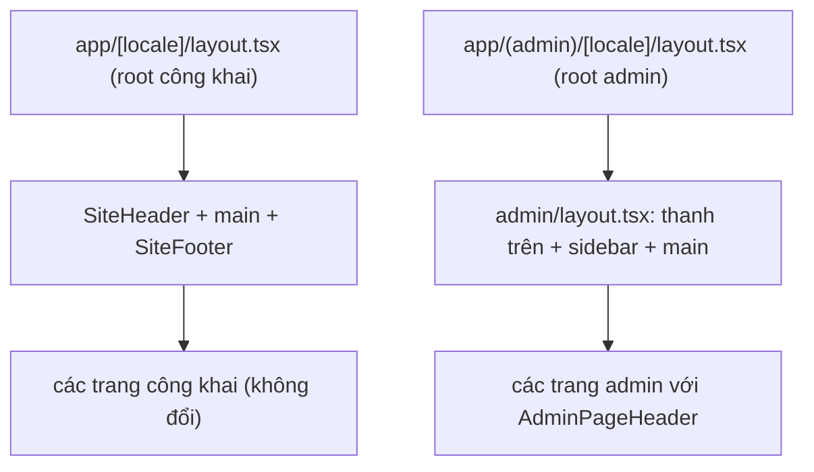

# ADR 0023 — Admin Workspace có root layout, khung và page header riêng

🇻🇳 English version: [0023-admin-root-layout.md](0023-admin-root-layout.md)

- **Trạng thái:** Đã chấp nhận
- **Ngày:** 2026-11-17
- **Chủ sở hữu:** system-architect
- **Ảnh hưởng:** `src/app/[locale]/admin/**` (chuyển vào route group), root layout admin mới, `src/app/fonts.ts`, `src/components/admin/**`, `messages/*.json`, một biến CSS
- **Thuộc:** Phase 07; tinh chỉnh [ADR 0020](0020-admin-workspace-shell.vi.md) sau đợt rà soát P07-10; task P07-19

## Bối cảnh

P07-10 đặt khung admin bên trong layout công khai. `src/app/[locale]/layout.tsx` sở hữu `<html>`, `SiteHeader`, `SiteFooter` và `<main>` công khai, nên mọi trang admin vẫn hiện menu công khai và footer công khai cao 400px, còn sidebar sticky của admin trượt xuống dưới header sticky công khai. Tiêu đề trang dùng masthead hero công khai (cao 263px). Chủ dự án đã quyết định Admin phải có layout riêng, đồng bộ với sidebar, và website khách truy cập không được đổi.

Layout lồng nhau không thể bỏ những gì layout cha render, nên cần tách cấu trúc, không phải CSS.

## Quyết định

1. **Hai root layout.** Các route admin được chuyển, URL không đổi, từ `src/app/[locale]/admin/**` sang `src/app/(admin)/[locale]/admin/**`. `src/app/(admin)/[locale]/layout.tsx` mới là root layout admin: `<html lang>`, font, `NextIntlClientProvider`, kiểm tra locale, metadata `noindex`. Nó không render `SiteHeader`, `SiteFooter` hay skip link công khai. Layout công khai `src/app/[locale]/layout.tsx` và mọi trang công khai giữ nguyên chỗ.
2. **Một khung admin.** `admin/layout.tsx` (từ P07-10) vẽ thanh trên mỏng (thương hiệu, "Xem trang", đổi ngôn ngữ, handle và vai trò đang đăng nhập, đăng xuất), sidebar bên dưới và một `<main id="admin-content">`. Sidebar và nội dung dùng chung một bề mặt, offset sticky lấy từ `--admin-bar-h`.
3. **Một `AdminPageHeader`** thay `PageHeader` công khai ở mọi trang admin: breadcrumb phía trên, hàng tiêu đề gọn (h1, mô tả một dòng, vùng actions tuỳ chọn), đường kẻ mảnh bên dưới. Không còn dải tràn viền.
4. **Dùng chung font, không sao chép.** Hai lời gọi `next/font` chuyển sang `src/app/fonts.ts`, cả hai root layout cùng import, nên typography admin và công khai không thể lệch nhau. Layout công khai chỉ đổi đúng dòng import đó.
5. **Cùng một trang 404.** Root layout admin có một `not-found` dùng cho vai trò bị chặn và URL admin không tồn tại, nên 404 vẫn không tạo oracle. Hai catch-all, `(admin)/[locale]/admin/[...rest]/page.tsx` và `(admin)/[locale]/quan-tri/[...rest]/page.tsx`, chỉ gọi `notFound()` (không đọc session, không đọc dữ liệu). Cái thứ hai cần thiết vì middleware viết lại `/quan-tri/xyz` không tồn tại thành `/vi/quan-tri/xyz`, không khớp gì trong cây `admin/` chuẩn; tên thư mục của nó phải bằng đoạn đầu của `pathnames['/admin'].vi`, điều `tests/admin-layout.test.ts` kiểm tra. Khách ẩn danh vẫn phân biệt được URL admin có thật (chuyển tới đăng nhập) với URL không tồn tại (404); danh sách route vốn công khai trong repository nên chấp nhận điều này.
6. **Không đổi** routing, `pathnames`, `requireStaff`, RBAC, API, dữ liệu, header `/quan-tri` và robots.

## Các phương án đã xét

| Phương án | Kết luận |
|---|---|
| Ẩn header/footer bằng CSS (`:has`, `display:none`) | Chrome công khai vẫn render và gửi đi; thủ thuật mà các giai đoạn sau sẽ thừa hưởng |
| Wrapper client dùng `useSelectedLayoutSegment` để bỏ chrome | Không phải di chuyển file, nhưng header và footer vẫn được dựng trên server và gửi trong payload ở mọi trang admin; không phải layout riêng thật sự |
| Chuyển mọi trang công khai vào group `(site)` | Đúng, nhưng khoảng 35 file và các test gọi tên chúng phải đổi, và website khách bị đụng tới |
| **Chỉ chuyển admin vào group `(admin)` có root layout riêng (chọn)** | Khoảng 10 file admin di chuyển; website khách chỉ đổi một dòng import |

## Hệ quả

- Tích cực: admin độc lập về hình thức lẫn cấu trúc; website khách giữ render tĩnh và các test layout không cookie; các màn hình admin sau cắm vào một khung.
- Tiêu cực: chuyển giữa hai cây (admin → "Xem trang", đăng xuất, trang đổi mật khẩu tạm) là tải trang đầy đủ, không phải chuyển trang phía client; đường dẫn trong các contract sau và một số test, tài liệu đổi từ `src/app/[locale]/admin/**` sang `src/app/(admin)/[locale]/admin/**`.
- Rủi ro: Next.js phải chấp nhận cây `(admin)/[locale]` cạnh `app/[locale]` khi không có layout cấp cao nhất, và phải chọn `not-found` của admin cho URL admin không tồn tại. Bước đầu của P07-19 chứng minh cả hai bằng `npm run build`; nếu một trong hai hỏng thì phương án dự phòng là group `(site)` trong bảng trên, di chuyển lớn hơn và cần chủ dự án đồng ý.
- Hoàn tác: revert PR; không có dữ liệu cần hoàn.
- Việc tiếp theo: [admin-ws-p07-19-ux-refinement.md](../../.claude/contracts/admin-ws-p07-19-ux-refinement.md); P07-11 xây trên khung này.

