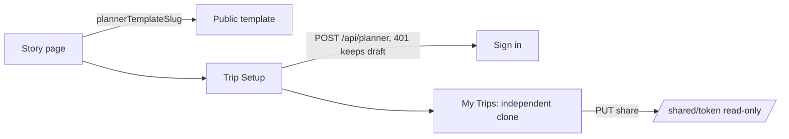

# Architecture — Chuyện Nhà Hưng

🇻🇳 Bản tiếng Việt: [architecture.vi.md](architecture.vi.md)

A Vietnamese-first travel-storytelling site. Stories, destinations, a travel map,
day-by-day itineraries, video reviews, and a trip-planning entry point. The
Planner *backend* core has shipped as an API — trips, days, activities, expenses
and budgeting — while the Planner *UI* is still a later phase; see
[Phases](#phases).

## At a glance

| Concern | Choice | Where |
|---|---|---|
| Framework | Next.js 16, App Router, React 19 | [`src/app/`](../src/app) |
| Rendering | Server components. Pages that read Travel content (`/`, `/stories`, `/stories/[slug]`, `/destinations/[slug]`, sitemap) are `force-dynamic`; the rest prerender at build ([ADR 0012](adr/0012-public-travel-from-content-repository.md)) | all `page.tsx` |
| Language | TypeScript `strict` + `noUncheckedIndexedAccess` | [`tsconfig.json`](../tsconfig.json) |
| i18n | `next-intl` 4, VI unprefixed, EN at `/en` | [`src/i18n/`](../src/i18n) |
| Styling | Tailwind v4, CSS-first `@theme` tokens | [`src/app/globals.css`](../src/app/globals.css) |
| Content | Stories, places and reviews: content repository via `getPublicContent()`; destinations, itineraries, video reviews: typed TypeScript in `src/content/` | [`src/content/`](../src/content) |
| Tests | Vitest 3 on Node 24 (4/5 now possible, not yet upgraded) | [`tests/`](../tests) |
| Persistence | Planner: PostgreSQL when `PLANNER_DATABASE_URL` is set ([ADR 0009](adr/0009-postgres-persistence.md)), else a JSON file; Travel content: PostgreSQL when `CONTENT_DATABASE_URL` is set ([ADR 0013](adr/0013-content-on-postgres-tables.md)), else a JSON file | [`src/server/persistence/`](../src/server/persistence) |

Public pages that show Travel content (home, stories, destination detail, sitemap) are rendered per request from the content repository through one server-only read module, `getPublicContent()` in `src/server/content/public.ts` ([ADR 0012](adr/0012-public-travel-from-content-repository.md)), so a published CMS edit is visible on the next request. The other public pages (`/about`, itineraries, video reviews, `/map`) stay static artefacts built from typed content in the repository. The API side — the Travel Content System and the Planner — runs
on the Node server, and in production both stores need PostgreSQL
([ADR 0009](adr/0009-postgres-persistence.md),
[ADR 0013](adr/0013-content-on-postgres-tables.md)); without `PLANNER_DATABASE_URL` or
`CONTENT_DATABASE_URL` the matching store falls back, by configuration only, to a JSON
file for local development.

## Request path

```
request
  │
  ├─ next.config.ts redirects ......... legacy /tour, /tours → itinerary routes (308)
  │
  ├─ src/middleware.ts ................ next-intl: locale resolution + localized
  │                                     pathname → internal pathname
  │                                     (skips /api, /_next, /opengraph-image, *.*)
  │
  ├─ src/app/[locale]/layout.tsx ...... fonts, <html lang>, header/main/footer,
  │                                     NextIntlClientProvider
  │
  └─ src/app/[locale]/**/page.tsx ..... server component
         ├─ reads getPublicContent()   (stories; src/server/content/public.ts)
         ├─ reads src/content/**       (destinations, itineraries, video reviews)
         ├─ reads messages/<locale>.json via useTranslations/getTranslations
         ├─ composes src/components/**
         └─ exports generateMetadata → src/lib/metadata.ts
```

Locale-independent routes sit outside `[locale]`: [`robots.ts`](../src/app/robots.ts),
[`sitemap.ts`](../src/app/sitemap.ts) and [`opengraph-image.tsx`](../src/app/opengraph-image.tsx).

## Routing and localization

Vietnamese is the product; English is a translation. VI renders **unprefixed**,
EN is prefixed, and `localeDetection` is **off** on purpose — Accept-Language
would hand a Vietnamese visitor with an English phone an English page.

Canonical (internal) pathnames are English and map 1:1 to the `app/[locale]`
folders. The visible URL per locale is defined once, in
[`src/i18n/routing.ts`](../src/i18n/routing.ts):

| Internal | Vietnamese | English |
|---|---|---|
| `/` | `/` | `/en` |
| `/stories` | `/chuyen-di-choi` | `/en/stories` |
| `/stories/[slug]` | `/chuyen-di-choi/[slug]` | `/en/stories/[slug]` |
| `/destinations` | `/kham-pha` | `/en/destinations` |
| `/destinations/[slug]` | `/kham-pha/[slug]` | `/en/destinations/[slug]` |
| `/map` | `/ban-do` | `/en/map` |
| `/itineraries` | `/len-lich-trinh` | `/en/itineraries` |
| `/itineraries/[slug]` | `/len-lich-trinh/[slug]` | `/en/itineraries/[slug]` |
| `/plan-your-trip` | `/thiet-ke-chuyen-di` | `/en/plan-your-trip` |
| `/reviews` | `/goc-review` | `/en/reviews` |
| `/community-trips` | `/chuyen-di-cong-dong` | `/en/community-trips` |
| `/admin/community` | `/quan-tri/cong-dong` | `/en/admin/community` |
| `/admin/runbook` | `/quan-tri/runbook` | `/en/admin/runbook` |
| `/about` | `/ve-nha-hung` | `/en/about` |
| `/trip-setup/[template]` | `/tao-chuyen-di/[template]` | `/en/trip-setup/[template]` |
| `/sign-in` | `/dang-nhap` | `/en/sign-in` |
| `/account/password` | `/doi-mat-khau` | `/en/account/password` |
| `/admin` | `/quan-tri` | `/en/admin` |
| `/admin/users` | `/quan-tri/nguoi-dung` | `/en/admin/users` |
| `/admin/content/stories` | `/quan-tri/noi-dung/chuyen-di` | `/en/admin/content/stories` |
| `/admin/content/stories/[slug]` | `/quan-tri/noi-dung/chuyen-di/[slug]` | `/en/admin/content/stories/[slug]` |
| `/admin/content/places` | `/quan-tri/noi-dung/dia-diem` | `/en/admin/content/places` |
| `/admin/content/places/[slug]` | `/quan-tri/noi-dung/dia-diem/[slug]` | `/en/admin/content/places/[slug]` |
| `/admin/content/reviews` | `/quan-tri/noi-dung/danh-gia` | `/en/admin/content/reviews` |
| `/my-trips` | `/chuyen-di-cua-toi` | `/en/my-trips` |
| `/my-trips/new` | `/chuyen-di-cua-toi/moi` | `/en/my-trips/new` |
| `/my-trips/[id]` | `/chuyen-di-cua-toi/[id]` | `/en/my-trips/[id]` |
| `/shared/[token]` | `/chia-se/[token]` | `/en/shared/[token]` |

Two types keep navigation honest: `AppPathname` is every internal route, and
`StaticPathname` excludes `[slug]` routes so a dynamic route can never be listed
as a plain menu entry in [`nav-items.ts`](../src/components/layout/nav-items.ts).

**Tour routes are permanent.** Tours are modelled as itineraries — an itinerary
carries the duration, indicative price, group size and day plan a tour would.
`/tour`, `/tours`, `/tour/:slug`, `/tours/:slug` and their `/en` equivalents are
308 redirects in [`next.config.ts`](../next.config.ts). Repointing or removing
them requires an approved ADR. Details:
[features/itineraries.md](features/itineraries.md).

Adding a locale means three changes together: `locales` + `pathnames` in
`routing.ts`, a new `messages/<locale>.json`, and the new key on every
`Localized<T>` field in `src/content/**`. `tests/i18n.test.ts` and
`tests/content.test.ts` fail until all three are done.

## Content layer

Content is typed TypeScript, not a CMS. `Localized<T>` is
`Record<Locale, T>`, so the type system — not a review — is what catches a
missing translation.

| Collection | File | Count |
|---|---|---|
| Destinations | [`destinations.ts`](../src/content/destinations.ts) | 8 |
| Stories (seed source / `static` adapter / test fixture; live stories come from the content repository) | [`stories.ts`](../src/content/stories.ts) | 6 |
| Itineraries | [`itineraries.ts`](../src/content/itineraries.ts) | 4 |
| Video reviews | [`video-reviews.ts`](../src/content/video-reviews.ts) | 6 |
| Site + socials | [`site.ts`](../src/content/site.ts) | — |

Public pages never import the repository or the store: they call `getPublicContent()` (`src/server/content/public.ts`, server-only, published-only, 404 otherwise), and `tests/client-boundary.test.ts` enforces that boundary. Rendering is `force-dynamic` with no revalidation; the JSON store serves an in-process cache that a write in the same process updates immediately, which assumes a single writer process. Rollback is `PUBLIC_CONTENT_SOURCE=static` (request-time env, restart, no rebuild); `npm run content:seed-static` adds the six seed stories to an existing store without overwriting edits.

Shapes live in [`src/content/types.ts`](../src/content/types.ts). Two fields
carry architectural weight: a destination's `coords` are real WGS84 values that
the map projects, and `cover` points at generated on-brand SVG artwork
(`npm run covers`) so the site ships with no broken image.

`site.ts` is flagged **owner action required** — the handles and contact email
are plausible defaults, not verified accounts.

Two **server-side** data sets sit beside this seed content, each a repository
over a document store — a JSON file, or for the Planner in production,
PostgreSQL ([ADR 0009](adr/0009-postgres-persistence.md))
([ADR 0001](adr/0001-travel-content-system.md) §1,
[ADR 0002](adr/0002-planner-core.md) §1). They are separate documents on purpose:
editorial content and private traveller data have different privacy, retention
and backup profiles.

| Store | File | Holds | Contract |
|---|---|---|---|
| Travel content | PostgreSQL (`CONTENT_DATABASE_URL`, tables `content_*`), else `.data/travel-content.json` (`TRAVEL_CONTENT_STORE`) | places, stories, collections, reviews, templates | [travel-content-api.md](travel-content-api.md) |
| Planner | PostgreSQL (`PLANNER_DATABASE_URL`), else `.data/planner.json` (`PLANNER_STORE`) | planner users, browser sessions, trips, trip days, trip activities, trip expenses | [features/travel-planner-core.md](features/travel-planner-core.md) |

Money in both is an integer count of đồng, capped at 10^12 — never a float,
never a minor unit. Derived totals are recomputed on read, never stored.

The JSON store (`src/server/persistence/json-store.ts`) keeps the parsed document
in memory after the first read and replaces it only once a write has reached disk,
so a read is a `structuredClone` rather than a file read plus `JSON.parse`. This
rests on the same single-process rule: a hand-edit of the file while the server is
running is not seen until restart (`tests/json-store.test.ts`). It also counts its
writes per file, process-wide, and reports the count as `revision()`: Next.js can load
the repository module more than once (a page's bundle and a route handler's), and the
share-token index each copy keeps is rebuilt when that count moves — without it a link
created through the API answered 404 on the `/shared/[token]` page
(`tests/planner-sharing.test.ts`).

The Planner's PostgreSQL store ([ADR 0009](adr/0009-postgres-persistence.md))
keeps the repository unchanged and moves the transaction into the store:
every store has `transact(mutate)`, and the Postgres one runs it as `BEGIN` →
`pg_advisory_xact_lock` → load the Planner tables (or reuse the cache) →
`mutate` → write only the rows that changed → bump `planner_revision` →
`COMMIT`, so writes are serialised **across processes** and the database
enforces foreign keys and unique emails, Google subjects and share tokens.
Each instance caches the last snapshot and reuses it while the one-row
`planner_revision` counter is unchanged, so an idle store costs one small query
per read; the repository's share-token index follows the same revision, so a
link created or revoked on one replica is honoured on another. Store selection
is explicit: `PLANNER_DATABASE_URL` set means Postgres, and an unreachable
database answers `503` — it never falls back to the JSON file. Schema changes
are numbered SQL migrations in `db/migrations/`, applied at startup under a
session advisory lock (ADR 0008 §7), or by hand with `npm run db:migrate`.

The Travel content store ([ADR 0013](adr/0013-content-on-postgres-tables.md)) is the
same engine with another table list: `content_places`, `content_stories`,
`content_collections`, `content_reviews`, `content_templates` and its own
`content_revision` counter and write lock. `ContentRepository` and the 26
handlers are unchanged. Scalars are columns (with `CHECK`s for the enums), structure
such as localised text and story blocks is `jsonb`, slug lists are `text[]`, and
there are no foreign keys between content entities yet. `CONTENT_DATABASE_URL` set
means Postgres, never a fallback; the first request runs the migrations and seeds
under a lock. It may point at the Planner's database or its own.

## Module boundaries

The dependency direction is one-way. Nothing below reaches upward.

```
app/[locale]/**      pages: compose, fetch nothing
   ↓
components/**        ui/ · layout/ · cards/ · sections/ · map/ · seo/
   ↓
lib/**               format.ts · map.ts · metadata.ts   (pure functions)
   ↓
content/** · i18n/** · messages/**                      (data + contracts)

app/api/**           route handlers: parse, authorize, map errors to status
   ↓
server/content/** · server/planner/**    repositories: all invariants
   ↓
server/persistence/**                    document store: JSON (atomic write + queue) · PostgreSQL (Planner, Travel content)
```

The API side is a second, parallel stack and the two meet in one place only: the
Planner reads the content system through
[`PlannerCatalog`](../src/server/planner/catalog.ts), a read-only interface with
three lookups and no writer. That is what makes "cloning a template never
modifies the template" structural rather than a matter of discipline.

- `lib/` is pure and side-effect free: date/price/duration formatting, the map
  projection, metadata assembly. It is the layer unit tests target directly.
- `components/ui/` holds primitives (`Button`, `Container`, `Section`, `Badge`,
  `Prose`, `CoverImage`); `sections/` holds page-level compositions; `cards/`
  holds one card per collection. A card never fetches — the page passes it data.
- `src/i18n/navigation.ts` is the only source of `Link`, `getPathname` and
  friends. Importing `next/link` directly would bypass the localized pathname
  map.

## Rendering and the client boundary

Server components by default; `'use client'` needs a stated reason. Today the
client bundle exists for exactly two things: the mobile navigation drawer
(focus trap, Escape, close-on-navigate) in
[`main-nav.tsx`](../src/components/layout/main-nav.tsx), and the locale switcher.

The travel map is deliberately **not** a client component: an SVG silhouette
with real `<a>` anchors positioned by [`lib/map.ts`](../src/lib/map.ts), so it is
keyboard-navigable and crawlable with JavaScript disabled.

The layout, header and page metadata never read request data. **One named
exception:** the home page `/` reads the session cookie on the server through
[`readHomeMember`](../src/server/planner/home-page.ts) to show a signed-in member a
first-trip or Continue Planning band ([ADR 0022](adr/0022-home-mvp-server-session.md),
[feature](features/home-continue-planning.md)). A request without the cookie gets
exactly the public page; a request with it is answered `private, no-store`. Any
shared cache in front of `/` must bypass it for cookie requests.

## SEO

SEO is structural here, not a polish pass.
[`src/lib/metadata.ts`](../src/lib/metadata.ts) builds every page's canonical URL
plus the full `hreflang` set, with `x-default` pointing at Vietnamese. Each page
exports `generateMetadata`; JSON-LD is emitted through
[`components/seo/json-ld.tsx`](../src/components/seo/json-ld.tsx) where a
schema.org type fits. `sitemap.ts` enumerates every route in every locale.
Details: [features/seo-and-metadata.md](features/seo-and-metadata.md).

## Design tokens

Every colour, font, radius, shadow and easing is defined once, in the `@theme`
block of [`globals.css`](../src/app/globals.css). Nothing else may hard-code one.
`tests/design-tokens.test.ts` parses the real CSS and asserts WCAG AA contrast —
it is the reason the interactive primary is `clay-600` rather than `clay-500`,
and the reason `--color-border-strong` exists. Details:
[features/design-system.md](features/design-system.md).

## Verification

| Gate | Command | What it protects |
|---|---|---|
| Types | `npm run typecheck` | `Localized<T>` completeness, route-type safety |
| Lint | `npm run lint` | `eslint-config-next` rules |
| Tests | `npm run test` | content, i18n parity, routing, map, tokens, docs |
| Build | `npm run build` | static pages prerender; Travel-content pages are `force-dynamic` and need no database at build |
| UI | `npm run verify:ui` | screenshots at 375/768/1440, fails on overflow |

## Trip sharing and story cloning

"Follow Nhà Hưng's footsteps" ([ADR 0005](adr/0005-trip-sharing-and-story-cloning.md);
task contract in `.claude/contracts/follow-hung-footsteps.md`). It adds no new
subsystem: it extends the Planner and adds one public read path.



- **Story link.** `Story.plannerTemplateSlug` (optional,
  [`types.ts`](../src/content/types.ts)) names a public template. The story page
  renders the itinerary and the call to action only while that template is public.
- **Trip fields added**, all optional on stored rows: `planningStatus`
  (`draft | planned | completed`, default `draft`, separate from the `active |
  archived` lifecycle), `visibility` (`private | unlisted | public`, default
  `private`), `shareToken`, `shareTokenCreatedAt`, `duplicatedFromTripId`, and
  `sourceTemplate.story` (attribution, derived server-side by
  `PlannerCatalog.getLinkedStory`, never from client input).
- **Share link.** A 256-bit random token. It resolves only when the token matches,
  visibility is `unlisted` or `public`, and the trip is active; every other case is
  one identical 404. `GET /api/shared/[token]` and `/shared/[token]` return a
  sanitised projection (no owner identity, no ids, no `version`, no trip note, no
  expenses) and never mutate. There is no public gallery.
- **Public endpoints are rate limited** by
  `src/server/rate-limit.ts`: in-memory and
  per-process, so it shares SQL's multi-instance trigger, and its client key is only
  as trustworthy as the proxy that sets `x-forwarded-for`.
- **Behind a reverse proxy** (`src/server/request-scheme.ts`): cookie `Secure`
  follows the browser's scheme, read from `X-Forwarded-Proto` only with
  `TRUST_PROXY_HEADERS=true`; the same-origin check accepts the request's own
  origin or the `NEXT_PUBLIC_SITE_URL` origin, because `request.url` carries the
  bind address there. The proxy must overwrite both forwarded headers
  ([usage → Deploy](usage.md#deploy)). `GET /api/health` is the container liveness
  probe and reads no store. Merging into `main` deploys the dev VM through a
  self-hosted runner ([ADR 0016](adr/0016-auto-deploy-dev.md)); dev and prod images differ
  because `NEXT_PUBLIC_SITE_URL` is baked at build.
- **Private pages** (`/sign-in`, `/account/password`, `/my-trips`, `/my-trips/new`, `/my-trips/[id]`, `/trip-setup/[template]`)
  are `noindex` and excluded from the sitemap; `/shared/[token]` is `noindex` unless
  the trip is `public`, and sends `Referrer-Policy: no-referrer`.
- **Every response carries security headers** from `next.config.ts`
  (`securityHeaders`): `X-Frame-Options: DENY` with CSP `frame-ancestors 'none'`,
  `base-uri`/`form-action 'self'`, `object-src 'none'`, `nosniff`,
  `Referrer-Policy: strict-origin-when-cross-origin`, a `Permissions-Policy` that
  turns off camera/microphone/geolocation/payment, and HSTS. There is deliberately
  no `script-src`: Next's inline bootstrap and JSON-LD would need per-request
  nonces, which makes every page dynamic — that needs its own decision
  (`tests/security-headers.test.ts`). A config header replaces one a route sets
  itself, so the share surfaces (`/api/shared/*`, `/chia-se/*`, `/en/shared/*`)
  restate `Referrer-Policy: no-referrer` in a later rule.

## Admin portal guard

[ADR 0010](adr/0010-admin-portal-session-authorization.md) (Accepted). `/quan-tri` (`/en/admin`) is a server component with `noindex`, absent from the sitemap and disallowed in `robots.ts`. Roles are enforced: `can()` is called in the request path, on pages and on the admin API.

`adminPlannerRoute` in `src/server/planner/http.ts` resolves one of **two principals**:

| Principal | Credential | Reaches |
|---|---|---|
| Service | `Authorization: Bearer ADMIN_API_TOKEN` (a user's own access token is refused here) | Every admin route |
| Session | Cookie session, same-origin proof, role re-read from the store each request, no pending temporary password, `can(role, action)` | Only routes that opt in with `{ action, session: true }`: list, create, set role, reset password |

`adminPlannerRoute(request, handler)` without options stays token-only. Admin sessions last idle 2 h / absolute 12 h by the current role. Lockout guards (no self role change or self reset by a session; never zero admins; acting admin re-checked in the repository transaction) answer 409 `invalid_state`. Pages use `readAdminPageAccess()` -> `{ status: 'anonymous' | 'must-change-password' | 'not-admin' | 'admin', principal }`: sign-in redirect, password-change redirect, `notFound()`, render. Mutations are rate-limited per user (in memory, per process).

**Admin frame ([ADR 0020](adr/0020-admin-workspace-shell.md), [ADR 0023](adr/0023-admin-root-layout.md), Proposed).** The admin pages sit in one frame (`admin/layout.tsx`: sidebar, breadcrumb, skip link). P07-19 gives them their own root layout (route group `src/app/(admin)/[locale]/`), so no public header or footer is rendered in admin, plus a slim top bar and a shared `AdminPageHeader`; the public layout and pages are unchanged and URLs stay the same. Until P07-19 ships, the frame still lives inside the public layout.

**Content guard (slice 2, [ADR 0011](adr/0011-admin-content-cms.md)).** The Travel Content admin routes opt in to sessions through `adminContentRoute(request, { action, session: true }, handler)` in `src/server/admin/content-route.ts`. It reuses `resolveAdminPrincipal` from the planner module (dependency direction admin -> planner -> content; `content/http.ts` imports neither), runs the handler, maps errors with `toErrorResponse` and always answers `Cache-Control: no-store`. A new action `content:write` is held by `editor`, `admin` and `service`; `story:publish` is unchanged. Pages use `readStaffPageAccess()` (`anonymous` / `must-change-password` / `forbidden` / `staff`); `forbidden` is a role with neither `user:provision` nor `content:write`. The five content pages are `noindex`, not in the sitemap, and covered by the `/quan-tri` and `/en/admin` robots prefixes.

| Route | Method | Action |
|---|---|---|
| `stories`, `places`, `reviews` | GET list | `content:write` |
| `stories/[slug]`, `places/[slug]`, `reviews/[id]` | GET, PATCH | `content:write` |
| `stories/[slug]/places` | PATCH | `content:write` |
| `stories/[slug]/status`, `reviews/[id]/status` | POST | `story:publish` |
| POST create, DELETE, `templates/**`, `collections/**`, `integrity` | any | token-only (`adminRoute`) |

PATCH accepts an optional `If-Match: "<updatedAt>"` (`ifMatchStamp`); the repository compares inside the transaction and a stale write answers **412** `version_conflict`. No header means last write wins.

### Community trips (ADR 0014, PR 1)

A trip's place on the home page is a separate opt-in, `Trip.listing`, not `visibility`.
Owner `PUT /api/planner/[id]/listing` -> `pending`; staff (`community:moderate`) approve or
reject at `/admin/community`; only `approved` reaches `GET /api/community/trips`, the
gallery and the home page, through the allow-list `CommunityTripCard`. Any mutation
re-queues it (`touch`), leaving `public` or archiving clears it. The control stays closed
until the owner fills `contribution` in `src/content/site.ts`.

Traveller place reviews (PR 2) are `CommunityReview` rows in the Planner store, table
`community_reviews`. `source: planner` (signed in, `PUT /api/planner/reviews/[placeSlug]`, 5/hour/user)
and `source: homepage` (`POST /api/community/reviews`, no account) are both `approved` at
once; staff can only remove them. The guest path is bounded by per-client and per-place
rate limits, a honeypot and plain text. Public output is the allow-list
`PublicCommunityReview`; the average shows from 3 approved reviews. The same `contribution`
gate closes every review form.

Author controls ([ADR 0015](adr/0015-community-review-author-controls.md)): staff (`community:moderate`)
can **hold** a live Planner review (status `held`, hidden, the reason is the question the author
sees; the author's edit republishes it), and admin/service (`community:restrict`) can switch an
author off through a `ReviewRestriction` (table `review_restrictions`, never deleted, lifting
sets `lifted_at`): for the review's place or every place, it blocks new reviews (403) and hides
the author's existing ones at read time, reversibly. A guest is known only by the hashed
connection key, so a guest restriction is time-boxed (30 days default, 90 max) and refused for the
shared `unknown` key. No author id or guest key appears in any response.

Audit log ([ADR 0019](adr/0019-community-foundation.md), [features/moderation-events.md](features/moderation-events.md)): every listing, review and restriction action appends one `AuditEvent` (table `audit_events`, migration `0010`, JSON key `auditEvents`) inside the same Planner-store transaction through `src/server/community/events.ts`; append-only, swept after one year, read by staff at `GET /api/admin/community/events?targetId=`. Listing transitions go through the pure state machine `src/server/community/submission.ts`. Shared write limiter ([features/shared-write-limiter.md](features/shared-write-limiter.md), migration `0011`): the review write limits (Planner 5/h per user, guest 3/h per client) count in table `rate_limit_counters` through `AsyncRateLimiter` / `src/server/persistence/postgres-rate-limiter.ts` when `PLANNER_DATABASE_URL` is set (one atomic upsert per check, outside the store transaction, fixed window), chosen in `planner/instance.ts` (`getWriteLimiters`); otherwise in-process. A database failure is `503` and the review is not written (fail closed); a forged `x-forwarded-for` still bypasses the guest limit.

## Phases

Deliberately absent, and not to be scaffolded early:

- **Planner UI** — partly opened by [ADR 0005](adr/0005-trip-sharing-and-story-cloning.md): story-to-trip cloning, My Trips, sign-in and the read-only share page, then the blank-trip form and the trip editor on `/my-trips/[id]` ([features/trip-editor.md](features/trip-editor.md)). The Planner map and AI suggestions are not. The Planner *backend* core shipped under `/api/planner`
  ([ADR 0002](adr/0002-planner-core.md),
  [features/travel-planner-core.md](features/travel-planner-core.md)):
  trips, generated days, activities, expenses, budgeting, archive/restore and
  template cloning. `/plan-your-trip` is still the contact-only content page —
  wiring it to the API is frontend-owned work and has not started.
- **Planner map and AI suggestions.** Deliberately deferred by the brief that
  opened the Planner phase.
- **A hosted identity provider.** Planner sign-in is self-managed: an
  operator-issued access token, an email and scrypt-hashed password, or Google
  through hand-written OIDC + PKCE that creates an account on first sign-in, or
  is linked to an existing one only by its signed-in owner, never by email — all three producing the same expiring `HttpOnly` session
  cookie ([ADR 0004](adr/0004-planner-identity.md),
  [ADR 0007](adr/0007-password-and-google-sign-in.md)). Still absent: self-service
  password reset (no email sender), password signup and MFA. A hosted provider
  or Auth.js would replace `identify` and the session rows, nothing below them.
- **SQL.** The path is decided in
  [ADR 0008](adr/0008-postgres-document-store.md): documents move into Postgres as
  JSONB rows first, normalised tables second. For the Planner, step 2 is built
  directly by [ADR 0009](adr/0009-postgres-persistence.md), and the Travel content
  store follows the same normalised-table route
  ([ADR 0013](adr/0013-content-on-postgres-tables.md): one table per collection, one
  table engine shared with the Planner, no foreign keys between content entities yet).
  Still open: the shared rate-limit store (ADR 0008, not built yet), foreign keys and a
  "still referenced" rule for content, and per-method SQL queries once loading a whole
  store per revision change becomes slow.
- **Phase 07 — Admin Portal, CMS & RBAC (in progress: slices 1 and 2 shipped).** Slice 2 — browser editing of stories, places and reviews — is built ([ADR 0011](adr/0011-admin-content-cms.md), [features/admin-content-cms.md](features/admin-content-cms.md)). Public pages now read the content repository ([ADR 0012](adr/0012-public-travel-from-content-repository.md)), so a published CMS edit appears on the public site. Still open after slice 2: audit log; templates, collections, create and delete in the browser; editor sign-out on the overview; MFA; HTTPS. Slice 1 — the
  browser user-administration portal — is built ([ADR 0010](adr/0010-admin-portal-session-authorization.md),
  [features/admin-portal.md](features/admin-portal.md)). Everything else below is not
  built or to be scaffolded early; each item needs its decision recorded first.
  Remaining after slice 1: CMS, audit log, MFA, a shared rate-limit store.
  Design direction: [ADR 0006](adr/0006-unified-identity-and-roles.md) (Accepted 2026-11-11; migration steps 1–2 — `role`, `can`, admin-token bootstrap — are implemented, step 3 — session principals on admin routes — is partly done by ADR 0010, step 4 and the rest remain Phase 07).
  Backlog of dependencies and decisions:
  - **Identity provider** — sign-in methods are decided ([ADR 0007](adr/0007-password-and-google-sign-in.md): password and Google); still open are self-service reset (needs an email sender) and MFA for `admin`.
  - **Role model** — `member` / `editor` / `admin` / `super_admin` ([ADR 0017](adr/0017-super-admin-role.md): Runbook and management of admin accounts) on the one user model, a pure `can(identity, action, resource)`, `ADMIN_API_TOKEN` demoted to a service principal. Enforced by `can` on every admin route and page; an `editor` reaches the content and community pages.
  - **Admin session and CSRF hardening** — done in slice 1 (shorter lifetimes per role; `requireSameOrigin` becomes load-bearing for admin mutations; the token never reaches a Client Component (`tests/client-boundary.test.ts`)); MFA still open.
  - **Audit log** — who changed which template or role, and any support read of a trip.
  - **SQL and multi-instance** — the admin portal makes a second writer to the stores likely; both stores can be on PostgreSQL ([ADR 0009](adr/0009-postgres-persistence.md), [ADR 0013](adr/0013-content-on-postgres-tables.md)), but the per-process rate limiter still does not survive more than one instance.
  - **Rate-limit store** — admin sign-in throttling needs a shared store once there is more than one process.
  - **CMS editing of templates** — through the content store only; versioning prior template revisions versus relying on cloned snapshots is undecided (clones are already independent, so history is optional).
  - **Template/trip boundary** — templates in the content store, trips in the planner store, linked only by the `sourceTemplate` value copy.
  - **Untested guarantees to close first** — see the gaps listed in ADR 0006 and the clone-independence gaps in the report for Prompt 05.
- **Clickable video cards.** We hold no per-video URLs, so cards are
  presentational. Making them clickable means adding a URL field to
  `VideoReview` and updating `tests/content.test.ts`.
- **Real photography.** Covers are generated SVG until the owner supplies photos.

## Ownership

| Agent | Owns |
|---|---|
| `system-architect` | Route topology, data contracts, ADRs, `docs/architecture.*`, diagrams |
| `backend-engineer` | `src/app/api/**`, server actions, persistence, validation |
| `frontend-engineer` | Pages, components, tokens, `messages/*.json` |

Whoever ships a feature writes its document in [`features/`](features/README.md),
in both languages. Rules: [`CLAUDE.md`](../CLAUDE.md).
