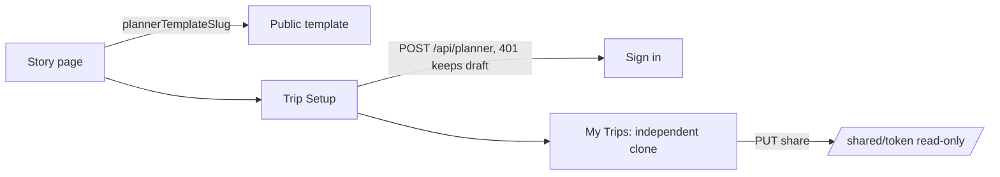

# Architecture — Chuyện Nhà Hưng

🇻🇳 Bản tiếng Việt: [architecture.vi.md](architecture.vi.md)

A Vietnamese-first travel-storytelling site. Stories, destinations, a travel map,
day-by-day itineraries, video reviews, and a trip-planning entry point. The
Planner *backend* core has shipped as an API — trips, days, activities, expenses
and budgeting — while the Planner *UI* is still a later phase; see
[Phases](#phases).

## At a glance

| Concern | Choice | Where |
|---|---|---|
| Framework | Next.js 16, App Router, React 19 | [`src/app/`](../src/app) |
| Rendering | Server components, fully prerendered at build | all `page.tsx` |
| Language | TypeScript `strict` + `noUncheckedIndexedAccess` | [`tsconfig.json`](../tsconfig.json) |
| i18n | `next-intl` 4, VI unprefixed, EN at `/en` | [`src/i18n/`](../src/i18n) |
| Styling | Tailwind v4, CSS-first `@theme` tokens | [`src/app/globals.css`](../src/app/globals.css) |
| Content | Typed TypeScript seed data, no CMS | [`src/content/`](../src/content) |
| Tests | Vitest 3 on Node 24 (4/5 now possible, not yet upgraded) | [`tests/`](../tests) |
| Persistence | **None.** No database, no API route, no server action | — |

There is no backend. Every page is a static artefact produced at build time from
typed content in the repository, which is why the whole site survives with no
runtime dependency beyond a file server.

## Request path

```
request
  │
  ├─ next.config.ts redirects ......... legacy /tour, /tours → itinerary routes (308)
  │
  ├─ src/middleware.ts ................ next-intl: locale resolution + localized
  │                                     pathname → internal pathname
  │                                     (skips /api, /_next, /opengraph-image, *.*)
  │
  ├─ src/app/[locale]/layout.tsx ...... fonts, <html lang>, header/main/footer,
  │                                     NextIntlClientProvider
  │
  └─ src/app/[locale]/**/page.tsx ..... server component
         ├─ reads src/content/**       (typed seed data)
         ├─ reads messages/<locale>.json via useTranslations/getTranslations
         ├─ composes src/components/**
         └─ exports generateMetadata → src/lib/metadata.ts
```

Locale-independent routes sit outside `[locale]`: [`robots.ts`](../src/app/robots.ts),
[`sitemap.ts`](../src/app/sitemap.ts) and [`opengraph-image.tsx`](../src/app/opengraph-image.tsx).

## Routing and localization

Vietnamese is the product; English is a translation. VI renders **unprefixed**,
EN is prefixed, and `localeDetection` is **off** on purpose — Accept-Language
would hand a Vietnamese visitor with an English phone an English page.

Canonical (internal) pathnames are English and map 1:1 to the `app/[locale]`
folders. The visible URL per locale is defined once, in
[`src/i18n/routing.ts`](../src/i18n/routing.ts):

| Internal | Vietnamese | English |
|---|---|---|
| `/` | `/` | `/en` |
| `/stories` | `/chuyen-di-choi` | `/en/stories` |
| `/stories/[slug]` | `/chuyen-di-choi/[slug]` | `/en/stories/[slug]` |
| `/destinations` | `/kham-pha` | `/en/destinations` |
| `/destinations/[slug]` | `/kham-pha/[slug]` | `/en/destinations/[slug]` |
| `/map` | `/ban-do` | `/en/map` |
| `/itineraries` | `/len-lich-trinh` | `/en/itineraries` |
| `/itineraries/[slug]` | `/len-lich-trinh/[slug]` | `/en/itineraries/[slug]` |
| `/plan-your-trip` | `/thiet-ke-chuyen-di` | `/en/plan-your-trip` |
| `/reviews` | `/goc-review` | `/en/reviews` |
| `/about` | `/ve-nha-hung` | `/en/about` |
| `/trip-setup/[template]` | `/tao-chuyen-di/[template]` | `/en/trip-setup/[template]` |
| `/sign-in` | `/dang-nhap` | `/en/sign-in` |
| `/my-trips` | `/chuyen-di-cua-toi` | `/en/my-trips` |
| `/my-trips/[id]` | `/chuyen-di-cua-toi/[id]` | `/en/my-trips/[id]` |
| `/shared/[token]` | `/chia-se/[token]` | `/en/shared/[token]` |

Two types keep navigation honest: `AppPathname` is every internal route, and
`StaticPathname` excludes `[slug]` routes so a dynamic route can never be listed
as a plain menu entry in [`nav-items.ts`](../src/components/layout/nav-items.ts).

**Tour routes are permanent.** Tours are modelled as itineraries — an itinerary
carries the duration, indicative price, group size and day plan a tour would.
`/tour`, `/tours`, `/tour/:slug`, `/tours/:slug` and their `/en` equivalents are
308 redirects in [`next.config.ts`](../next.config.ts). Repointing or removing
them requires an approved ADR. Details:
[features/itineraries.md](features/itineraries.md).

Adding a locale means three changes together: `locales` + `pathnames` in
`routing.ts`, a new `messages/<locale>.json`, and the new key on every
`Localized<T>` field in `src/content/**`. `tests/i18n.test.ts` and
`tests/content.test.ts` fail until all three are done.

## Content layer

Content is typed TypeScript, not a CMS. `Localized<T>` is
`Record<Locale, T>`, so the type system — not a review — is what catches a
missing translation.

| Collection | File | Count |
|---|---|---|
| Destinations | [`destinations.ts`](../src/content/destinations.ts) | 8 |
| Stories | [`stories.ts`](../src/content/stories.ts) | 6 |
| Itineraries | [`itineraries.ts`](../src/content/itineraries.ts) | 4 |
| Video reviews | [`video-reviews.ts`](../src/content/video-reviews.ts) | 6 |
| Site + socials | [`site.ts`](../src/content/site.ts) | — |

Shapes live in [`src/content/types.ts`](../src/content/types.ts). Two fields
carry architectural weight: a destination's `coords` are real WGS84 values that
the map projects, and `cover` points at generated on-brand SVG artwork
(`npm run covers`) so the site ships with no broken image.

`site.ts` is flagged **owner action required** — the handles and contact email
are plausible defaults, not verified accounts.

Two **server-side** data sets sit beside this seed content, each a repository
over a JSON document store rather than a database
([ADR 0001](adr/0001-travel-content-system.md) §1,
[ADR 0002](adr/0002-planner-core.md) §1). They are separate documents on purpose:
editorial content and private traveller data have different privacy, retention
and backup profiles.

| Store | File | Holds | Contract |
|---|---|---|---|
| Travel content | `.data/travel-content.json` (`TRAVEL_CONTENT_STORE`) | places, stories, collections, reviews, templates | [travel-content-api.md](travel-content-api.md) |
| Planner | `.data/planner.json` (`PLANNER_STORE`) | planner users, browser sessions, trips, trip days, trip activities, trip expenses | [features/travel-planner-core.md](features/travel-planner-core.md) |

Money in both is an integer count of đồng, capped at 10^12 — never a float,
never a minor unit. Derived totals are recomputed on read, never stored.

The JSON store (`src/server/persistence/json-store.ts`) keeps the parsed document
in memory after the first read and replaces it only once a write has reached disk,
so a read is a `structuredClone` rather than a file read plus `JSON.parse`. This
rests on the same single-process rule: a hand-edit of the file while the server is
running is not seen until restart (`tests/json-store.test.ts`).

## Module boundaries

The dependency direction is one-way. Nothing below reaches upward.

```
app/[locale]/**      pages: compose, fetch nothing
   ↓
components/**        ui/ · layout/ · cards/ · sections/ · map/ · seo/
   ↓
lib/**               format.ts · map.ts · metadata.ts   (pure functions)
   ↓
content/** · i18n/** · messages/**                      (data + contracts)

app/api/**           route handlers: parse, authorize, map errors to status
   ↓
server/content/** · server/planner/**    repositories: all invariants
   ↓
server/persistence/**                    document store (atomic write + queue)
```

The API side is a second, parallel stack and the two meet in one place only: the
Planner reads the content system through
[`PlannerCatalog`](../src/server/planner/catalog.ts), a read-only interface with
three lookups and no writer. That is what makes "cloning a template never
modifies the template" structural rather than a matter of discipline.

- `lib/` is pure and side-effect free: date/price/duration formatting, the map
  projection, metadata assembly. It is the layer unit tests target directly.
- `components/ui/` holds primitives (`Button`, `Container`, `Section`, `Badge`,
  `Prose`, `CoverImage`); `sections/` holds page-level compositions; `cards/`
  holds one card per collection. A card never fetches — the page passes it data.
- `src/i18n/navigation.ts` is the only source of `Link`, `getPathname` and
  friends. Importing `next/link` directly would bypass the localized pathname
  map.

## Rendering and the client boundary

Server components by default; `'use client'` needs a stated reason. Today the
client bundle exists for exactly two things: the mobile navigation drawer
(focus trap, Escape, close-on-navigate) in
[`main-nav.tsx`](../src/components/layout/main-nav.tsx), and the locale switcher.

The travel map is deliberately **not** a client component: an SVG silhouette
with real `<a>` anchors positioned by [`lib/map.ts`](../src/lib/map.ts), so it is
keyboard-navigable and crawlable with JavaScript disabled.

## SEO

SEO is structural here, not a polish pass.
[`src/lib/metadata.ts`](../src/lib/metadata.ts) builds every page's canonical URL
plus the full `hreflang` set, with `x-default` pointing at Vietnamese. Each page
exports `generateMetadata`; JSON-LD is emitted through
[`components/seo/json-ld.tsx`](../src/components/seo/json-ld.tsx) where a
schema.org type fits. `sitemap.ts` enumerates every route in every locale.
Details: [features/seo-and-metadata.md](features/seo-and-metadata.md).

## Design tokens

Every colour, font, radius, shadow and easing is defined once, in the `@theme`
block of [`globals.css`](../src/app/globals.css). Nothing else may hard-code one.
`tests/design-tokens.test.ts` parses the real CSS and asserts WCAG AA contrast —
it is the reason the interactive primary is `clay-600` rather than `clay-500`,
and the reason `--color-border-strong` exists. Details:
[features/design-system.md](features/design-system.md).

## Verification

| Gate | Command | What it protects |
|---|---|---|
| Types | `npm run typecheck` | `Localized<T>` completeness, route-type safety |
| Lint | `npm run lint` | `eslint-config-next` rules |
| Tests | `npm run test` | content, i18n parity, routing, map, tokens, docs |
| Build | `npm run build` | every page prerenders |
| UI | `npm run verify:ui` | screenshots at 375/768/1440, fails on overflow |

## Trip sharing and story cloning

"Follow Nhà Hưng's footsteps" ([ADR 0005](adr/0005-trip-sharing-and-story-cloning.md);
task contract in `.claude/contracts/follow-hung-footsteps.md`). It adds no new
subsystem: it extends the Planner and adds one public read path.



- **Story link.** `Story.plannerTemplateSlug` (optional,
  [`types.ts`](../src/content/types.ts)) names a public template. The story page
  renders the itinerary and the call to action only while that template is public.
- **Trip fields added**, all optional on stored rows: `planningStatus`
  (`draft | planned | completed`, default `draft`, separate from the `active |
  archived` lifecycle), `visibility` (`private | unlisted | public`, default
  `private`), `shareToken`, `shareTokenCreatedAt`, `duplicatedFromTripId`, and
  `sourceTemplate.story` (attribution, derived server-side by
  `PlannerCatalog.getLinkedStory`, never from client input).
- **Share link.** A 256-bit random token. It resolves only when the token matches,
  visibility is `unlisted` or `public`, and the trip is active; every other case is
  one identical 404. `GET /api/shared/[token]` and `/shared/[token]` return a
  sanitised projection (no owner identity, no ids, no `version`, no trip note, no
  expenses) and never mutate. There is no public gallery.
- **Public endpoints are rate limited** by
  `src/server/rate-limit.ts`: in-memory and
  per-process, so it shares SQL's multi-instance trigger, and its client key is only
  as trustworthy as the proxy that sets `x-forwarded-for`.
- **Private pages** (`/sign-in`, `/my-trips`, `/my-trips/[id]`, `/trip-setup/[template]`)
  are `noindex` and excluded from the sitemap; `/shared/[token]` is `noindex` unless
  the trip is `public`, and sends `Referrer-Policy: no-referrer`.
- **Every response carries security headers** from `next.config.ts`
  (`securityHeaders`): `X-Frame-Options: DENY` with CSP `frame-ancestors 'none'`,
  `base-uri`/`form-action 'self'`, `object-src 'none'`, `nosniff`,
  `Referrer-Policy: strict-origin-when-cross-origin`, a `Permissions-Policy` that
  turns off camera/microphone/geolocation/payment, and HSTS. There is deliberately
  no `script-src`: Next's inline bootstrap and JSON-LD would need per-request
  nonces, which makes every page dynamic — that needs its own decision
  (`tests/security-headers.test.ts`). A config header replaces one a route sets
  itself, so the share surfaces (`/api/shared/*`, `/chia-se/*`, `/en/shared/*`)
  restate `Referrer-Policy: no-referrer` in a later rule.

## Phases

Deliberately absent, and not to be scaffolded early:

- **Planner UI** — partly opened by [ADR 0005](adr/0005-trip-sharing-and-story-cloning.md): story-to-trip cloning, My Trips, sign-in and the read-only share page only. A full trip editor, the Planner map and AI suggestions are not. The Planner *backend* core shipped under `/api/planner`
  ([ADR 0002](adr/0002-planner-core.md),
  [features/travel-planner-core.md](features/travel-planner-core.md)):
  trips, generated days, activities, expenses, budgeting, archive/restore and
  template cloning. `/plan-your-trip` is still the contact-only content page —
  wiring it to the API is frontend-owned work and has not started.
- **Planner map and AI suggestions.** Deliberately deferred by the brief that
  opened the Planner phase.
- **A real identity provider.** Planner auth is an operator-provisioned
  per-traveller access token, which a browser exchanges for an expiring
  `HttpOnly` session cookie ([ADR 0004](adr/0004-planner-identity.md)). That is
  enough for staff use and is deliberately not an identity system: there is no
  public signup, no password reset, no OAuth and no MFA. Adding those is the next
  ADR, and `resolveIdentity` is the single seam it would replace.
- **SQL.** Both stores are single-process. Multi-instance deployment is the
  trigger; the target schema and its indexes are already written down in
  [ADR 0002](adr/0002-planner-core.md#the-sql-shape-this-becomes).
- **Phase 07 — Admin Portal, CMS & RBAC (announced, not started).** Nothing below is
  built or to be scaffolded early; each item needs its decision recorded first.
  Design direction: [ADR 0006](adr/0006-unified-identity-and-roles.md) (Proposed).
  Backlog of dependencies and decisions:
  - **Identity provider** — keep the operator-issued token plus session, or adopt Auth.js / hosted; decides signup, reset, MFA for `admin`. Own ADR.
  - **Role model** — `member` / `editor` / `admin` on the one user model, a pure `can(identity, action, resource)`, `ADMIN_API_TOKEN` demoted to a service principal.
  - **Admin session and CSRF hardening** — shorter lifetimes per role; `requireSameOrigin` becomes load-bearing for admin mutations; the token never reaches a Client Component (`tests/client-boundary.test.ts`).
  - **Audit log** — who changed which template or role, and any support read of a trip.
  - **SQL and multi-instance** — the admin portal makes a second writer to the stores likely; the JSON stores and the per-process rate limiter do not survive more than one instance.
  - **Rate-limit store** — admin sign-in throttling needs a shared store once there is more than one process.
  - **CMS editing of templates** — through the content store only; versioning prior template revisions versus relying on cloned snapshots is undecided (clones are already independent, so history is optional).
  - **Template/trip boundary** — templates in the content store, trips in the planner store, linked only by the `sourceTemplate` value copy.
  - **Untested guarantees to close first** — see the gaps listed in ADR 0006 and the clone-independence gaps in the report for Prompt 05.
- **Clickable video cards.** We hold no per-video URLs, so cards are
  presentational. Making them clickable means adding a URL field to
  `VideoReview` and updating `tests/content.test.ts`.
- **Real photography.** Covers are generated SVG until the owner supplies photos.

## Ownership

| Agent | Owns |
|---|---|
| `system-architect` | Route topology, data contracts, ADRs, `docs/architecture.*`, diagrams |
| `backend-engineer` | `src/app/api/**`, server actions, persistence, validation |
| `frontend-engineer` | Pages, components, tokens, `messages/*.json` |

Whoever ships a feature writes its document in [`features/`](features/README.md),
in both languages. Rules: [`CLAUDE.md`](../CLAUDE.md).
