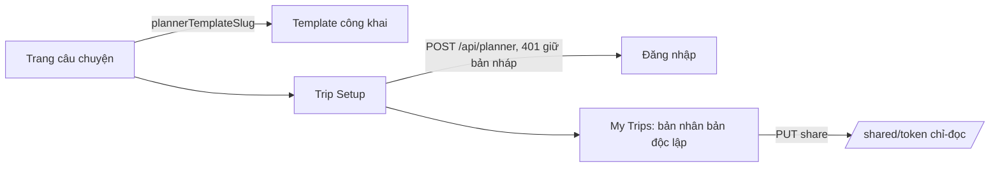

# Kiến trúc — Chuyện Nhà Hưng

🇬🇧 English version: [architecture.md](architecture.md)

Một trang kể chuyện du lịch lấy tiếng Việt làm gốc. Chuyện đi chơi, điểm đến, bản
đồ hành trình, lịch trình theo ngày, review video, và một điểm vào để thiết kế
chuyến đi. Phần lõi *backend* của Planner đã ship dưới dạng API — trip, ngày,
activity, chi phí và ngân sách — còn *giao diện* Planner vẫn thuộc phase sau; xem
[Các phase](#các-phase).

## Tổng quan nhanh

| Hạng mục | Lựa chọn | Ở đâu |
|---|---|---|
| Framework | Next.js 16, App Router, React 19 | [`src/app/`](../src/app) |
| Render | Server component. Trang đọc nội dung Travel (`/`, `/stories`, `/stories/[slug]`, `/destinations/[slug]`, `/places/[slug]`, sitemap) là `force-dynamic`; phần còn lại prerender khi build ([ADR 0012](adr/0012-public-travel-from-content-repository.vi.md)) | mọi `page.tsx` |
| Ngôn ngữ | TypeScript `strict` + `noUncheckedIndexedAccess` | [`tsconfig.json`](../tsconfig.json) |
| i18n | `next-intl` 4, VI không prefix, EN ở `/en` | [`src/i18n/`](../src/i18n) |
| Styling | Tailwind v4, token `@theme` theo hướng CSS-first | [`src/app/globals.css`](../src/app/globals.css) |
| Nội dung | Story, place, review: repository nội dung qua `getPublicContent()`; điểm đến, lịch trình, review video: TypeScript có type trong `src/content/` | [`src/content/`](../src/content) |
| Test | Vitest 3 trên Node 24 (giờ đã nâng lên 4/5 được, nhưng chưa nâng) | [`tests/`](../tests) |
| Lưu trữ | Planner: PostgreSQL khi có `PLANNER_DATABASE_URL` ([ADR 0009](adr/0009-postgres-persistence.vi.md)), nếu không thì file JSON; Travel content: PostgreSQL khi có `CONTENT_DATABASE_URL` ([ADR 0013](adr/0013-content-on-postgres-tables.vi.md)), nếu không thì file JSON | [`src/server/persistence/`](../src/server/persistence) |

Các trang công khai hiển thị nội dung Travel (trang chủ, story, chi tiết điểm đến, sitemap) được render theo từng request từ repository nội dung qua một module đọc chỉ-server, `getPublicContent()` trong `src/server/content/public.ts` ([ADR 0012](adr/0012-public-travel-from-content-repository.vi.md)), nên chỉnh sửa đã xuất bản trong CMS hiện ngay ở request kế tiếp. Các trang công khai còn lại (`/about`, lịch trình, review video, `/map`) vẫn là tệp tĩnh sinh lúc build từ dữ liệu có type trong repo.
Phía API — Travel Content System và Planner — chạy trên server Node, và ở
production cả hai store cần PostgreSQL
([ADR 0009](adr/0009-postgres-persistence.vi.md),
[ADR 0013](adr/0013-content-on-postgres-tables.vi.md)); không có `PLANNER_DATABASE_URL`
hoặc `CONTENT_DATABASE_URL` thì store tương ứng dùng file JSON cho phát triển local, và
chỉ do cấu hình quyết định.

## Đường đi của một request

```
request
  │
  ├─ next.config.ts redirects ......... /tour, /tours cũ → route lịch trình (308)
  │
  ├─ src/middleware.ts ................ next-intl: xác định locale + đổi pathname
  │                                     bản địa hoá → pathname nội bộ
  │                                     (bỏ qua /api, /_next, /opengraph-image, *.*)
  │
  ├─ src/app/[locale]/layout.tsx ...... font, <html lang>, header/main/footer,
  │                                     NextIntlClientProvider
  │
  └─ src/app/[locale]/**/page.tsx ..... server component
         ├─ đọc getPublicContent()     (story; src/server/content/public.ts)
         ├─ đọc src/content/**         (điểm đến, lịch trình, review video)
         ├─ đọc messages/<locale>.json qua useTranslations/getTranslations
         ├─ ghép các src/components/**
         └─ export generateMetadata → src/lib/metadata.ts
```

Các route không phụ thuộc locale nằm ngoài `[locale]`:
[`robots.ts`](../src/app/robots.ts), [`sitemap.ts`](../src/app/sitemap.ts) và
[`opengraph-image.tsx`](../src/app/opengraph-image.tsx).

## Routing và bản địa hoá

Tiếng Việt là sản phẩm; tiếng Anh là bản dịch. VI render **không có prefix**, EN
có prefix, và `localeDetection` **tắt** có chủ đích — Accept-Language sẽ đẩy một
khách Việt dùng điện thoại cài tiếng Anh sang trang tiếng Anh.

Pathname chuẩn (nội bộ) viết bằng tiếng Anh và khớp 1:1 với cây thư mục
`app/[locale]`. URL mà khách thực sự thấy ở từng locale được định nghĩa một lần,
trong [`src/i18n/routing.ts`](../src/i18n/routing.ts):

| Nội bộ | Tiếng Việt | Tiếng Anh |
|---|---|---|
| `/` | `/` | `/en` |
| `/stories` | `/chuyen-di-choi` | `/en/stories` |
| `/stories/[slug]` | `/chuyen-di-choi/[slug]` | `/en/stories/[slug]` |
| `/destinations` | `/kham-pha` | `/en/destinations` |
| `/destinations/[slug]` | `/kham-pha/[slug]` | `/en/destinations/[slug]` |
| `/places` | `/dia-diem` | `/en/places` |
| `/places/[slug]` | `/dia-diem/[slug]` | `/en/places/[slug]` |
| `/map` | `/ban-do` | `/en/map` |
| `/itineraries` | `/len-lich-trinh` | `/en/itineraries` |
| `/itineraries/[slug]` | `/len-lich-trinh/[slug]` | `/en/itineraries/[slug]` |
| `/plan-your-trip` | `/thiet-ke-chuyen-di` | `/en/plan-your-trip` |
| `/reviews` | `/goc-review` | `/en/reviews` |
| `/community-trips` | `/chuyen-di-cong-dong` | `/en/community-trips` |
| `/admin/community` | `/quan-tri/cong-dong` | `/en/admin/community` |
| `/admin/runbook` | `/quan-tri/runbook` | `/en/admin/runbook` |
| `/about` | `/ve-nha-hung` | `/en/about` |
| `/trip-templates` | `/lich-trinh-mau` | `/en/trip-templates` |
| `/trip-setup/[template]` | `/tao-chuyen-di/[template]` | `/en/trip-setup/[template]` |
| `/sign-in` | `/dang-nhap` | `/en/sign-in` |
| `/account/password` | `/doi-mat-khau` | `/en/account/password` |
| `/admin` | `/quan-tri` | `/en/admin` |
| `/admin/users` | `/quan-tri/nguoi-dung` | `/en/admin/users` |
| `/admin/content/stories` | `/quan-tri/noi-dung/chuyen-di` | `/en/admin/content/stories` |
| `/admin/content/stories/[slug]` | `/quan-tri/noi-dung/chuyen-di/[slug]` | `/en/admin/content/stories/[slug]` |
| `/admin/content/places` | `/quan-tri/noi-dung/dia-diem` | `/en/admin/content/places` |
| `/admin/content/places/[slug]` | `/quan-tri/noi-dung/dia-diem/[slug]` | `/en/admin/content/places/[slug]` |
| `/admin/content/reviews` | `/quan-tri/noi-dung/danh-gia` | `/en/admin/content/reviews` |
| `/my-trips` | `/chuyen-di-cua-toi` | `/en/my-trips` |
| `/my-map` | `/ban-do-cua-toi` | `/en/my-map` |
| `/my-trips/new` | `/chuyen-di-cua-toi/moi` | `/en/my-trips/new` |
| `/my-trips/[id]` | `/chuyen-di-cua-toi/[id]` | `/en/my-trips/[id]` |
| `/shared/[token]` | `/chia-se/[token]` | `/en/shared/[token]` |

`/trip-templates` là danh sách công khai, được index (có trong sitemap), của các
template có `visibility` là `public`; mỗi thẻ dẫn tới `/trip-setup/[template]`, trang
này vẫn `noindex`. Chi tiết: [features/trip-template-list.vi.md](features/trip-template-list.vi.md).

Hai type giữ cho điều hướng không sai: `AppPathname` là mọi route nội bộ, còn
`StaticPathname` loại bỏ các route `[slug]` để một route động không bao giờ bị
đưa vào menu như một mục phẳng trong
[`nav-items.ts`](../src/components/layout/nav-items.ts).

**Route tour là vĩnh viễn.** Tour được mô hình hoá thành lịch trình — một lịch
trình đã mang đủ thời lượng, giá tham khảo, số khách và kế hoạch từng ngày như
một tour. `/tour`, `/tours`, `/tour/:slug`, `/tours/:slug` và các bản `/en` là
redirect 308 trong [`next.config.ts`](../next.config.ts). Đổi đích hay bỏ chúng
phải có ADR được duyệt. Chi tiết:
[features/itineraries.vi.md](features/itineraries.vi.md).

Thêm một locale là ba việc làm cùng lúc: `locales` + `pathnames` trong
`routing.ts`, thêm `messages/<locale>.json`, và thêm key mới vào **mọi** field
`Localized<T>` trong `src/content/**`. `tests/i18n.test.ts` và
`tests/content.test.ts` sẽ fail đến khi làm đủ cả ba.

## Tầng nội dung

Nội dung là TypeScript có type, không phải CMS. `Localized<T>` chính là
`Record<Locale, T>`, nên chính hệ type — không phải người review — là thứ bắt lỗi
thiếu bản dịch.

| Bộ dữ liệu | File | Số lượng |
|---|---|---|
| Điểm đến (8 đã đi, 8 chưa đi — không có `firstVisited`/`visits`) | [`destinations.ts`](../src/content/destinations.ts) | 16 |
| Chuyện đi chơi (nguồn seed / adapter `static` / fixture test; story đang chạy đọc từ repository nội dung) | [`stories.ts`](../src/content/stories.ts) | 6 |
| Lịch trình | [`itineraries.ts`](../src/content/itineraries.ts) | 4 |
| Review video | [`video-reviews.ts`](../src/content/video-reviews.ts) | 6 |
| Site + mạng xã hội | [`site.ts`](../src/content/site.ts) | — |

Trang công khai không bao giờ import repository hay store: chúng gọi `getPublicContent()` (`src/server/content/public.ts`, chỉ-server, chỉ story đã xuất bản, còn lại 404), và `tests/client-boundary.test.ts` ép ranh giới này. Render là `force-dynamic`, không revalidate; JSON store dùng cache trong tiến trình và cache được cập nhật ngay khi ghi trong cùng tiến trình, nên giả định chỉ một tiến trình ghi. Rollback là `PUBLIC_CONTENT_SOURCE=static` (biến môi trường đọc lúc request, restart, không build lại); `npm run content:seed-static` thêm sáu story seed vào store đã có mà không ghi đè chỉnh sửa.

Các shape nằm trong [`src/content/types.ts`](../src/content/types.ts). Hai field
có ý nghĩa kiến trúc: `coords` của điểm đến là toạ độ WGS84 thật mà bản đồ chiếu
lên, và `cover` trỏ tới tranh SVG sinh tự động đúng tinh thần thương hiệu
(`npm run covers`) để site không bao giờ có ảnh lỗi.

`site.ts` được đánh dấu **cần chủ nhà xác nhận** — các handle và email liên hệ là
giá trị hợp lý nhưng chưa được kiểm chứng.

Bên cạnh nội dung seed này còn hai bộ dữ liệu **phía server**, mỗi bộ là một
repository nằm trên một document store — file JSON, hoặc với Planner ở
production là PostgreSQL ([ADR 0009](adr/0009-postgres-persistence.vi.md))
([ADR 0001](adr/0001-travel-content-system.vi.md) §1,
[ADR 0002](adr/0002-planner-core.vi.md) §1). Chúng là hai document riêng biệt một
cách có chủ đích: nội dung biên tập và dữ liệu riêng tư của người đi chơi có yêu
cầu riêng tư, lưu trữ và sao lưu khác nhau.

| Store | File | Chứa gì | Hợp đồng |
|---|---|---|---|
| Travel content | PostgreSQL (`CONTENT_DATABASE_URL`, bảng `content_*`), nếu không thì `.data/travel-content.json` (`TRAVEL_CONTENT_STORE`) | place, story, collection, review, template | [travel-content-api.vi.md](travel-content-api.vi.md) |
| Planner | PostgreSQL (`PLANNER_DATABASE_URL`), nếu không thì `.data/planner.json` (`PLANNER_STORE`) | planner user, session trình duyệt, trip, ngày, activity, chi phí | [features/travel-planner-core.vi.md](features/travel-planner-core.vi.md) |

Tiền ở cả hai đều là số nguyên đồng, chặn trên ở 10^12 — không bao giờ là số
thực, không bao giờ là đơn vị nhỏ. Các tổng dẫn xuất được tính lại khi đọc, không
bao giờ được lưu.

Store JSON (`src/server/persistence/json-store.ts`) giữ tài liệu đã parse trong bộ
nhớ sau lần đọc đầu và chỉ thay khi một lần ghi đã xuống đĩa, nên mỗi lần đọc là một
`structuredClone` thay vì đọc file rồi `JSON.parse`. Điều này dựa trên cùng quy tắc
một-process: sửa tay file khi server đang chạy sẽ không được thấy cho tới khi khởi
động lại (`tests/json-store.test.ts`). Store cũng đếm số lần ghi theo từng file, trên
toàn process, và trả số đó qua `revision()`: Next.js có thể nạp module repository nhiều
hơn một lần (bundle của trang và của route handler), và chỉ mục share-token mà mỗi bản
giữ sẽ được dựng lại khi số đếm đổi — thiếu nó, link tạo qua API sẽ trả 404 ở trang
`/shared/[token]` (`tests/planner-sharing.test.ts`).

Store PostgreSQL của Planner ([ADR 0009](adr/0009-postgres-persistence.vi.md))
giữ nguyên repository và chuyển transaction vào store: mọi store đều có
`transact(mutate)`, và bản Postgres chạy nó theo thứ tự `BEGIN` →
`pg_advisory_xact_lock` → nạp các bảng Planner (hoặc dùng lại cache) → `mutate` →
chỉ ghi các dòng đã đổi → tăng `planner_revision` → `COMMIT`, nên các lần ghi được
tuần tự hoá **giữa các process** và database bảo đảm foreign key cùng tính duy nhất
của email, Google subject và share token. Mỗi instance cache snapshot gần nhất và
dùng lại nó khi bộ đếm một dòng `planner_revision` chưa đổi, nên store không có ghi
mới chỉ tốn một query nhỏ mỗi lần đọc; chỉ mục share-token của repository cũng theo
revision đó, nên link tạo hay thu hồi ở replica này được tôn trọng ở replica kia.
Việc chọn store là rõ ràng: có `PLANNER_DATABASE_URL` nghĩa là Postgres, và database
không truy cập được thì trả `503` — không bao giờ quay về file JSON. Thay đổi schema
là các migration SQL đánh số trong `db/migrations/`, chạy khi khởi động dưới một
session advisory lock (ADR 0008 §7), hoặc chạy tay bằng `npm run db:migrate`.

Store Travel content ([ADR 0013](adr/0013-content-on-postgres-tables.vi.md)) là cùng engine
với một danh sách bảng khác: `content_places`, `content_stories`, `content_collections`,
`content_reviews`, `content_templates`, cùng bộ đếm `content_revision` và lock ghi riêng.
`ContentRepository` và 26 handler không đổi. Giá trị vô hướng là cột (có `CHECK` cho các
enum), cấu trúc như văn bản song ngữ và block của story là `jsonb`, danh sách slug là
`text[]`, và chưa có khoá ngoại giữa các entity content. Có `CONTENT_DATABASE_URL` nghĩa là
Postgres, không bao giờ lùi về file; request đầu tiên chạy migration và seed dưới một lock.
Nó có thể trỏ vào database của Planner hoặc database riêng.

## Ranh giới module

Hướng phụ thuộc là một chiều. Tầng dưới không bao giờ gọi lên tầng trên.

```
app/[locale]/**      trang: chỉ ghép, không tự fetch
   ↓
components/**        ui/ · layout/ · cards/ · sections/ · map/ · seo/
   ↓
lib/**               format.ts · map.ts · metadata.ts   (hàm thuần)
   ↓
content/** · i18n/** · messages/**                      (dữ liệu + hợp đồng)

app/api/**           route handler: parse, phân quyền, map lỗi sang status
   ↓
server/content/** · server/planner/**    repository: toàn bộ invariant
   ↓
server/persistence/**                    document store: JSON (ghi nguyên tử + hàng đợi) · PostgreSQL (Planner, Travel content)
```

Phía API là một tầng thứ hai chạy song song, và hai bên chỉ gặp nhau ở đúng một
chỗ: Planner đọc hệ nội dung qua
[`PlannerCatalog`](../src/server/planner/catalog.ts), một interface chỉ-đọc với ba
phép tra cứu và không có hàm ghi. Đó là thứ khiến "clone template không bao giờ
sửa template" thành chuyện cấu trúc chứ không phải chuyện kỷ luật.

- `lib/` là tầng thuần, không side effect: format ngày/giá/thời lượng, phép chiếu
  bản đồ, dựng metadata. Đây là tầng unit test nhắm trực tiếp vào.
- `components/ui/` chứa primitive (`Button`, `Container`, `Section`, `Badge`,
  `Prose`, `CoverImage`); `sections/` chứa các khối ghép ở tầm trang; `cards/`
  mỗi bộ dữ liệu một card. Card không bao giờ tự fetch — trang truyền dữ liệu vào.
- `src/i18n/navigation.ts` là nguồn duy nhất của `Link`, `getPathname` và các
  helper cùng họ. Import thẳng `next/link` sẽ bỏ qua bản đồ pathname bản địa hoá.

## Render và ranh giới client

Mặc định là server component; `'use client'` phải có lý do nêu rõ. Hiện tại bundle
client tồn tại cho đúng hai thứ: drawer điều hướng trên mobile (bẫy focus, Escape,
tự đóng khi chuyển trang) trong
[`main-nav.tsx`](../src/components/layout/main-nav.tsx), và bộ đổi ngôn ngữ.

Bộ đổi ngôn ngữ tạo từng liên kết bằng `getPathname`, nên tiếng Việt giữ URL không tiền tố (không còn chuyển hướng `/vi/...`). Menu tài khoản ở header gọi `GET /api/planner/session` sau khi tải trang; với khách đó là `401` và trình duyệt ghi vào console. Đây là chủ đích (CORE-12 / P-2): nhiều thành phần dùng chính `401` này để biết là khách, và cookie phiên là `HttpOnly` nên trang không thể biết trước.

Bản đồ hành trình **không** phải client component, có chủ đích: đó là một SVG
silhouette với các thẻ `<a>` thật, vị trí tính bởi [`lib/map.ts`](../src/lib/map.ts),
nên nó đi được bằng bàn phím và bot vẫn đọc được khi tắt JavaScript.

Layout, header và metadata của trang không bao giờ đọc dữ liệu request. **Một ngoại lệ
được gọi tên:** trang chủ `/` đọc cookie phiên ở server qua
[`readHomeMember`](../src/server/planner/home-page.ts) để hiện cho thành viên đã đăng nhập
dải chuyến đầu tiên hoặc Continue Planning ([ADR 0022](adr/0022-home-mvp-server-session.vi.md),
[tính năng](features/home-continue-planning.vi.md)). Request không có cookie nhận đúng trang
công khai; request có cookie được trả `private, no-store`. Mọi cache dùng chung đặt trước `/`
phải bỏ qua nó với request có cookie.

## SEO

Ở đây SEO là yêu cầu cấu trúc, không phải bước đánh bóng.
[`src/lib/metadata.ts`](../src/lib/metadata.ts) dựng URL canonical cho từng trang
cùng bộ `hreflang` đầy đủ, với `x-default` trỏ về tiếng Việt. Mỗi trang export
`generateMetadata`; JSON-LD phát qua
[`components/seo/json-ld.tsx`](../src/components/seo/json-ld.tsx) ở những chỗ có
type schema.org phù hợp. `sitemap.ts` liệt kê mọi route ở mọi locale. Chi tiết:
[features/seo-and-metadata.vi.md](features/seo-and-metadata.vi.md).

## Design token

Mọi màu, font, bán kính bo, bóng đổ và easing được định nghĩa một lần, trong khối
`@theme` của [`globals.css`](../src/app/globals.css). Không nơi nào khác được
hard-code. `tests/design-tokens.test.ts` parse CSS thật và kiểm tra tương phản
WCAG AA — đó là lý do màu primary tương tác là `clay-600` chứ không phải
`clay-500`, và là lý do `--color-border-strong` tồn tại. Chi tiết:
[features/design-system.vi.md](features/design-system.vi.md).

## Kiểm chứng

| Cổng | Lệnh | Bảo vệ điều gì |
|---|---|---|
| Type | `npm run typecheck` | `Localized<T>` đủ locale, route an toàn kiểu |
| Lint | `npm run lint` | bộ rule `eslint-config-next` |
| Test | `npm run test` | nội dung, đồng bộ i18n, routing, bản đồ, token, tài liệu |
| Build | `npm run build` | trang tĩnh prerender; trang nội dung Travel là `force-dynamic`, không cần database lúc build |
| UI | `npm run verify:ui` | ảnh chụp ở 375/768/1440, fail nếu tràn ngang |

## Chia sẻ chuyến đi và nhân bản từ câu chuyện

"Đi theo dấu chân nhà Hưng" ([ADR 0005](adr/0005-trip-sharing-and-story-cloning.vi.md);
hợp đồng nằm ở `.claude/contracts/follow-hung-footsteps.md`). Không thêm hệ thống con
mới: nó mở rộng Planner và thêm một đường đọc công khai.



- **Liên kết câu chuyện.** `Story.plannerTemplateSlug` (tùy chọn,
  [`types.ts`](../src/content/types.ts)) trỏ tới một template công khai. Trang câu
  chuyện chỉ hiển thị lịch trình và lời kêu gọi hành động khi template còn công khai.
- **Trường thêm vào trip**, đều tùy chọn trên dòng đã lưu: `planningStatus`
  (`draft | planned | completed`, mặc định `draft`, tách khỏi vòng đời `active |
  archived`), `visibility` (`private | unlisted | public`, mặc định `private`),
  `shareToken`, `shareTokenCreatedAt`, `duplicatedFromTripId`, và `sourceTemplate.story`
  (attribution, do server suy ra bằng `PlannerCatalog.getLinkedStory`, không bao giờ
  từ dữ liệu client).
- **Link chia sẻ.** Token ngẫu nhiên 256 bit. Chỉ mở được khi token khớp, visibility
  là `unlisted` hoặc `public`, và trip còn active; mọi trường hợp khác là một 404 giống
  hệt nhau. `GET /api/shared/[token]` và `/shared/[token]` trả bản chiếu đã lọc (không
  danh tính chủ sở hữu, không id, không `version`, không ghi chú trip, không chi phí)
  và không bao giờ thay đổi dữ liệu. Không có thư viện công khai.
- **Endpoint công khai có giới hạn tần suất** bởi
  `src/server/rate-limit.ts`: trong bộ nhớ, theo từng
  tiến trình, nên cùng điều kiện đa-instance với SQL, và khóa client chỉ đáng tin bằng
  proxy đặt `x-forwarded-for`.
- **Sau reverse proxy** (`src/server/request-scheme.ts`): cờ `Secure` của cookie
  theo scheme của trình duyệt, chỉ đọc từ `X-Forwarded-Proto` khi
  `TRUST_PROXY_HEADERS=true`; kiểm tra same-origin chấp nhận origin của chính
  request hoặc origin của `NEXT_PUBLIC_SITE_URL`, vì khi đó `request.url` mang địa
  chỉ bind. Proxy phải ghi đè cả hai header forwarded
  ([usage → Deploy](usage.vi.md#deploy)). `GET /api/health` là probe liveness của
  container và không đọc store nào. Merge vào `main` sẽ deploy VM dev qua runner tự host
  ([ADR 0016](adr/0016-auto-deploy-dev.vi.md)); image dev và prod khác nhau vì
  `NEXT_PUBLIC_SITE_URL` bị đóng lúc build.
- **Trang riêng tư** (`/sign-in`, `/account/password`, `/my-map`, `/my-trips`, `/my-trips/new`, `/my-trips/[id]`,
  `/trip-setup/[template]`) là `noindex` và không có trong sitemap; `/shared/[token]` là
  `noindex` trừ khi trip là `public`, và gửi `Referrer-Policy: no-referrer`.
- **Mọi response đều có security header** từ `next.config.ts` (`securityHeaders`):
  `X-Frame-Options: DENY` cùng CSP `frame-ancestors 'none'`, `base-uri`/`form-action
  'self'`, `object-src 'none'`, `nosniff`, `Referrer-Policy:
  strict-origin-when-cross-origin`, `Permissions-Policy` tắt camera/micro/vị trí/thanh
  toán, và HSTS. Cố ý chưa có `script-src`: bootstrap inline của Next và JSON-LD sẽ cần
  nonce theo từng request, khiến mọi trang thành dynamic — việc đó cần quyết định riêng
  (`tests/security-headers.test.ts`). Header trong config đè header do route tự đặt,
  nên các bề mặt chia sẻ (`/api/shared/*`, `/chia-se/*`, `/en/shared/*`) khai lại
  `Referrer-Policy: no-referrer` ở một rule sau.

## Guard của cổng quản trị

[ADR 0010](adr/0010-admin-portal-session-authorization.vi.md) (Accepted). `/quan-tri` (`/en/admin`) là server component có `noindex`, không nằm trong sitemap và bị disallow trong `robots.ts`. Vai trò được thực thi: `can()` được gọi trong đường xử lý request, ở trang và ở API admin.

Trang `/admin` là bảng điều khiển (P07-11, [feature](features/admin-dashboard.vi.md)): `src/server/admin/overview.ts` gom số đếm chỉ đọc từ phương thức repository sẵn có, lọc theo `can()`, và `GET /api/admin/overview` trả cùng payload. Nguồn lỗi chỉ làm hỏng thẻ của nó.

Nhật ký kiểm toán admin (P07-13, [feature](features/admin-audit-viewer.vi.md)): `/admin/audit` và `GET /api/admin/audit` (`audit:read`: admin, super admin, service; không có editor) đọc `audit_events` mới nhất trước, có lọc và con trỏ `(createdAt, id)` mờ. Hành động tài khoản (tạo, vai trò, đặt lại mật khẩu, khóa/mở khóa, xóa mềm/khôi phục/xóa vĩnh viễn, gỡ Google, xoay token) ghi qua `PlannerRepository.record` trong transaction của chính nó; trạng thái xuất bản bài viết nằm ở kho Content nên sự kiện là lần ghi thứ hai sau khi thành công. Migration `0015` thêm loại đối tượng `story` và các chỉ mục lọc.

`adminPlannerRoute` trong `src/server/planner/http.ts` xác định một trong **hai principal**:

| Principal | Credential | Tới được |
|---|---|---|
| Service | `Authorization: Bearer ADMIN_API_TOKEN` (access token của chính user bị từ chối ở đây) | Mọi route admin |
| Session | Session cookie, bằng chứng same-origin, role đọc lại từ store mỗi request, không còn mật khẩu tạm, `can(role, action)` | Chỉ route bật bằng `{ action, session: true }`: liệt kê, tạo, đổi role, reset mật khẩu |

`adminPlannerRoute(request, handler)` không kèm options vẫn chỉ nhận token. Session admin sống idle 2 giờ / tuyệt đối 12 giờ theo role hiện tại. Guard chống tự khoá (session không tự đổi role hay tự reset; không bao giờ còn 0 admin; admin thao tác được kiểm tra lại trong transaction của repository) trả 409 `invalid_state`. Trang dùng `readAdminPageAccess()` -> `{ status: 'anonymous' | 'must-change-password' | 'not-admin' | 'admin', principal }`: chuyển sang đăng nhập, chuyển sang đổi mật khẩu, `notFound()`, render. Mutation bị giới hạn tốc độ theo user (trong bộ nhớ, theo process).

**Khung admin ([ADR 0020](adr/0020-admin-workspace-shell.vi.md), [ADR 0023](adr/0023-admin-root-layout.vi.md), Đã chấp nhận).** Các trang admin nằm trong một khung (`admin/layout.tsx`: sidebar, breadcrumb, skip link). P07-19 cho chúng root layout riêng (route group `src/app/(admin)/[locale]/`), nên admin không render header hay footer công khai, kèm thanh trên gọn và `AdminPageHeader` dùng chung; layout và trang công khai không đổi, URL giữ nguyên. Đã ship ở P07-19: root layout admin, `src/app/(admin)/[locale]/not-found.tsx` (một trang 404 admin duy nhất, dùng cho cả vai trò bị cấm lẫn URL admin không tồn tại) và hai catch-all `[...rest]` (`admin/` và `quan-tri/`, vì middleware viết lại `/quan-tri/xyz` không tồn tại thành `/vi/quan-tri/xyz`, không khớp gì trong cây chuẩn) chỉ gọi `notFound()`. Cả hai root layout import font từ `src/app/fonts.ts`.

**Guard nội dung (lát cắt 2, [ADR 0011](adr/0011-admin-content-cms.vi.md)).** Các route admin của Travel Content bật session qua `adminContentRoute(request, { action, session: true }, handler)` trong `src/server/admin/content-route.ts`. Nó dùng lại `resolveAdminPrincipal` của module planner (chiều phụ thuộc admin -> planner -> content; `content/http.ts` không import cái nào), chạy handler, ánh xạ lỗi bằng `toErrorResponse` và luôn trả `Cache-Control: no-store`. Action mới `content:write` thuộc `editor`, `admin` và `service`; `story:publish` giữ nguyên. Trang dùng `readStaffPageAccess()` (`anonymous` / `must-change-password` / `forbidden` / `staff`); `forbidden` là vai trò không có cả `user:provision` lẫn `content:write`. Năm trang nội dung có `noindex`, không nằm trong sitemap, và được các prefix robots `/quan-tri` và `/en/admin` bao phủ.

| Route | Method | Action |
|---|---|---|
| `stories`, `places`, `reviews` | GET danh sách | `content:write` |
| `stories/[slug]`, `places/[slug]`, `reviews/[id]` | GET, PATCH | `content:write` |
| `stories`, `places` | POST (tạo; chuyến đi luôn là nháp) | `content:write` |
| `stories/[slug]/places` | PATCH | `content:write` |
| `stories/[slug]/status`, `reviews/[id]/status` | POST | `story:publish` |
| `collections`, `collections/[slug]`, `collections/[slug]/status`, `integrity` | GET, POST, PATCH | `content:write` (P07-15) |
| `templates` (GET), `templates/[slug]` (GET, PATCH), `templates/[slug]/reorder`, `templates/[slug]/move-activity` | GET, PATCH, POST | `template:write`, `session: true` (P07-6) |
| `planner/integrity` (qua `adminPlannerRoute`) | GET | `user:provision`, `session: true` (P07-15; editor bị từ chối) |
| DELETE story/place/collection/review/template, `POST templates` | mọi method | chỉ token (`adminRoute`) |

PATCH (story, place, review và, từ P07-15, collection và, từ P07-6, template qua `PATCH`, `reorder`, `move-activity`) yêu cầu header `If-Match: "<updatedAt>"` (`ifMatchStamp`); repository so sánh trong transaction và ghi cũ trả **412** `version_conflict`. Thiếu header là **428** `precondition_required` (CORE-11; trước đây ghi sau thắng).

### Chuyến đi cộng đồng (ADR 0014, PR 1)

Chỗ của chuyến đi trên trang chủ là một lựa chọn riêng, `Trip.listing`, không phải `visibility`.
Chủ chuyến `PUT /api/planner/[id]/listing` -> `pending`; staff (`community:moderate`) duyệt
hoặc từ chối ở `/admin/community`; chỉ `approved` mới tới `GET /api/community/trips`, gallery
và trang chủ, qua allow-list `CommunityTripCard`. Mọi thay đổi xếp lại hàng (`touch`), rời
`public` hoặc lưu trữ thì xoá. Nút vẫn đóng cho tới khi chủ nhà điền `contribution` trong
`src/content/site.ts`.

Đánh giá địa điểm của người đi (PR 2) là các dòng `CommunityReview` trong store Planner, bảng
`community_reviews`. `source: planner` (đã đăng nhập, `PUT /api/planner/reviews/[placeSlug]`, 5 lần/giờ/người dùng)
và `source: homepage` (`POST /api/community/reviews`, không cần tài khoản) đều lên `approved`
ngay; staff chỉ có thể gỡ. Đường của khách được chặn bằng giới hạn theo client và theo
địa điểm, honeypot và văn bản thuần. Đầu ra công khai là allow-list
`PublicCommunityReview`; điểm trung bình hiện từ 3 đánh giá đã duyệt. Cùng cổng `contribution`
đóng mọi form đánh giá.

Quyền với tác giả ([ADR 0015](adr/0015-community-review-author-controls.vi.md)): staff
(`community:moderate`) có thể **hold** một đánh giá Planner đang hiện (trạng thái `held`, bị ẩn,
lý do chính là câu hỏi tác giả thấy; tác giả sửa là đăng lại), và admin/service
(`community:restrict`) có thể tắt một tác giả bằng `ReviewRestriction` (bảng
`review_restrictions`, không bao giờ xoá, gỡ là đặt `lifted_at`): theo địa điểm của đánh giá hoặc
mọi địa điểm, chặn đánh giá mới (403) và ẩn đánh giá hiện có của tác giả lúc đọc, đảo ngược được.
Khách chỉ được nhận diện bằng khoá kết nối đã băm, nên restriction cho khách có thời hạn (mặc định
30 ngày, tối đa 30 (ADR 0024); khóa khách là HMAC-SHA256 dưới `GUEST_KEY_SECRET` và bị xóa sau 30 ngày) và bị từ chối với khoá `unknown` dùng chung. Không có id tác giả hay guest key
trong bất kỳ phản hồi nào.

Xóa review của khách ([ADR 0024](adr/0024-guest-identity-privacy.vi.md) §8): admin/service (`community:erase`) gọi `POST /api/admin/community/reviews/[id]/erase`; `repository.eraseGuestReview` ẩn danh hóa review khách tại chỗ (không còn nội dung, tên hay khóa; trạng thái `removed`) và ghi một event `erase`; không hoàn tác, không migration.

Log kiểm toán ([ADR 0019](adr/0019-community-foundation.vi.md), [features/moderation-events.vi.md](features/moderation-events.vi.md)): mọi hành động listing, đánh giá và restriction thêm một `AuditEvent` (bảng `audit_events`, migration `0010`, khoá JSON `auditEvents`) trong cùng transaction của Planner store qua `src/server/community/events.ts`; chỉ nối thêm, dọn sau một năm, staff đọc tại `GET /api/admin/community/events?targetId=`. Chuyển trạng thái listing đi qua máy trạng thái thuần `src/server/community/submission.ts`. Điều khoản Người tạo ([features/creator-terms.vi.md](features/creator-terms.vi.md), migration `0012`): `termsVersion` trong `src/content/site.ts`; bảng `terms_acceptances` (khoá `termsAcceptances`, duy nhất `(user_id, version)`); `GET`/`POST /api/planner/terms`; hai route `PUT` xin đăng chuyến và đánh giá Planner gọi `repository.requireTermsAccepted` và trả `403 forbidden` reason `terms_not_accepted` cho tới khi chấp nhận phiên bản hiện hành; lần chấp nhận đầu ghi sự kiện `terms_accepted`. Giới hạn ghi dùng chung ([features/shared-write-limiter.vi.md](features/shared-write-limiter.vi.md), migration `0011`): giới hạn ghi đánh giá (Planner 5/giờ mỗi user, khách 10/giờ mỗi client) đếm trong bảng `rate_limit_counters` qua `AsyncRateLimiter` / `src/server/persistence/postgres-rate-limiter.ts` khi có `PLANNER_DATABASE_URL` (một upsert nguyên tử mỗi lần kiểm, ngoài transaction của store, cửa sổ cố định), chọn trong `planner/instance.ts` (`getWriteLimiters`); nếu không thì trong tiến trình. Database lỗi → `503` và không ghi đánh giá (fail closed); `x-forwarded-for` giả mạo vẫn vượt được giới hạn của khách. Báo cáo ([features/community-reports.vi.md](features/community-reports.vi.md), migration `0013`): bảng `reports` (khóa `reports`); `POST /api/community/reports` (khách hoặc thành viên, không cần Điều khoản, 10/ngày qua bộ giới hạn dùng chung, honeypot, fail closed); staff `GET /api/admin/community/reports` và `POST …/[id]/resolve` (`community:moderate`) ghi một sự kiện `report_dismissed` / `report_actioned` trên chuyến hoặc đánh giá bị báo cáo; `PublicCommunityReview` có thêm `id` mờ. Batch 10.6a (P10-15/16): `src/server/community/contribution-gate.ts` — `requireContributionOpen()` chạy đầu tiên ở route yêu cầu đăng chuyến, `PUT` review Planner và `POST` review khách, trả `403 forbidden` reason `contribution_closed` khi `contributionOpen` là false (đọc và báo cáo vẫn mở); `authorName` của khách được đối chiếu với `src/server/community/reserved-names.ts` trong `guestReviewInputSchema`.

## Các phase

Những thứ vắng mặt có chủ đích, và không được dựng sớm:

- **Giao diện Planner** — được mở một phần bởi [ADR 0005](adr/0005-trip-sharing-and-story-cloning.vi.md): gồm nhân bản story thành trip, My Trips, đăng nhập và trang chia sẻ chỉ-đọc, rồi form tạo trip trống và trình sửa trip ở `/my-trips/[id]` ([features/trip-editor.vi.md](features/trip-editor.vi.md)). Bản đồ thành viên `/my-map` đã mở ([ADR 0029](adr/0029-member-map.vi.md), [features/member-map.vi.md](features/member-map.vi.md)); bản đồ tuyến theo chuyến và gợi ý AI thì chưa. Phần lõi *backend* của Planner đã ship dưới
  `/api/planner` ([ADR 0002](adr/0002-planner-core.vi.md),
  [features/travel-planner-core.vi.md](features/travel-planner-core.vi.md)):
  trip, ngày sinh tự động, activity, chi phí, ngân sách, lưu trữ/khôi phục và
  clone template. `/thiet-ke-chuyen-di` vẫn là trang nội dung chỉ có liên hệ —
  nối nó vào API là việc của frontend và chưa bắt đầu.
- **Bản đồ tuyến theo chuyến và gợi ý AI.** (Bản đồ thành viên cấp quốc gia `/my-map` không thuộc phần này: [ADR 0029](adr/0029-member-map.vi.md) tách đôi. Đó là trang server động — `src/server/planner/member-map.ts` đọc cookie phiên, chuyến và review của thành viên, chỉ đưa `{ slug, visits }` xuống component; `private, no-store`, không API, không migration. Chia sẻ bằng token là lát sau.) Cố ý hoãn lại theo đề bài đã mở phase Planner.
- **Một nhà cung cấp danh tính hosted.** Đăng nhập Planner do ta tự quản: access
  token do người vận hành cấp, email kèm mật khẩu hash bằng scrypt, hoặc Google
  qua OIDC + PKCE tự viết, tạo tài khoản ở lần đăng nhập đầu, hoặc chỉ được liên
  kết vào tài khoản có sẵn bởi chính chủ đã đăng nhập, không bao giờ theo email — cả ba cùng cho ra một session cookie `HttpOnly` có hạn
  ([ADR 0004](adr/0004-planner-identity.vi.md),
  [ADR 0007](adr/0007-password-and-google-sign-in.vi.md)). Vẫn chưa có: tự đặt lại
  mật khẩu (chưa có dịch vụ gửi email), đăng ký bằng mật khẩu và MFA. Một provider
  hosted hay Auth.js sẽ thay `identify` và các dòng session, không gì bên dưới.
- **SQL.** Lộ trình đã được quyết trong
  [ADR 0008](adr/0008-postgres-document-store.vi.md): các document chuyển vào
  Postgres thành dòng JSONB trước, bảng chuẩn hoá sau. Với Planner, bước 2 được dựng
  thẳng theo [ADR 0009](adr/0009-postgres-persistence.vi.md), và store Travel content đi
  cùng lộ trình bảng chuẩn hoá
  ([ADR 0013](adr/0013-content-on-postgres-tables.vi.md): mỗi collection một bảng, một
  engine bảng dùng chung với Planner, chưa có khoá ngoại giữa các entity content).
  Còn mở: store rate limit dùng chung (ADR 0008, chưa dựng), khoá ngoại và quy tắc
  "đang được tham chiếu" cho content, và query SQL theo từng method khi việc nạp cả một
  store mỗi lần revision đổi trở nên chậm.
- **Phase 07 — Admin Portal, CMS & RBAC (đang làm: lát cắt 1 và 2 đã ship).** Lát cắt 2 — sửa story, place và review trên trình duyệt — đã dựng ([ADR 0011](adr/0011-admin-content-cms.vi.md), [features/admin-content-cms.vi.md](features/admin-content-cms.vi.md)). Trang công khai nay đọc repository nội dung ([ADR 0012](adr/0012-public-travel-from-content-repository.vi.md)), nên chỉnh sửa đã xuất bản trong CMS hiện trên site công khai. Còn mở sau lát cắt 2: audit log; template, collection, tạo và xoá trên trình duyệt; đăng xuất của editor trên trang tổng quan; MFA; HTTPS. Lát cắt 1 — cổng
  quản lý user trên trình duyệt — đã dựng ([ADR 0010](adr/0010-admin-portal-session-authorization.vi.md),
  [features/admin-portal.vi.md](features/admin-portal.vi.md)). Mọi mục còn lại bên dưới
  chưa dựng và không được dựng sớm; mỗi mục cần ghi quyết định trước.
  Còn lại sau lát cắt 1: CMS, audit log, MFA, store rate limit dùng chung. Hướng thiết kế:
  [ADR 0006](adr/0006-unified-identity-and-roles.vi.md) (Đã chấp nhận 2026-11-11; bước migration 1–2 — `role`, `can`, bootstrap bằng admin token — đã hiện thực, bước 3 — principal session trên route admin — đã xong một phần nhờ ADR 0010, bước 4 và phần còn lại vẫn thuộc Phase 07). Backlog phụ
  thuộc và quyết định:
  - **Nhà cung cấp danh tính** — các cách đăng nhập đã được quyết ([ADR 0007](adr/0007-password-and-google-sign-in.vi.md): mật khẩu và Google); còn mở là tự đặt lại mật khẩu (cần dịch vụ gửi email) và MFA cho `admin`.
  - **Mô hình vai trò** — `member` / `editor` / `admin` / `super_admin` ([ADR 0017](adr/0017-super-admin-role.vi.md): Runbook và quản lý tài khoản admin) trên một mô hình user, hàm thuần `can(identity, action, resource)`, `ADMIN_API_TOKEN` hạ thành service principal. Được thực thi bằng `can` trên mọi route và trang quản trị; `editor` vào được các trang nội dung và cộng đồng.
  - **Củng cố session admin và CSRF** — xong ở lát cắt 1 (thời hạn ngắn hơn theo vai trò; `requireSameOrigin` thành chốt chịu lực cho mutation admin; token không bao giờ tới Client Component (`tests/client-boundary.test.ts`)); MFA vẫn còn mở.
  - **Audit log** — ai đổi template hay vai trò nào, và mọi lần đọc trip để hỗ trợ.
  - **SQL và nhiều instance** — admin portal khiến có người ghi thứ hai vào store; cả hai store có thể lên PostgreSQL ([ADR 0009](adr/0009-postgres-persistence.vi.md), [ADR 0013](adr/0013-content-on-postgres-tables.vi.md)), nhưng rate limiter theo process vẫn không sống nổi qua một instance.
  - **Store cho rate limit** — chặn đăng nhập admin cần store dùng chung khi có hơn một process.
  - **CMS sửa template** — chỉ qua content store; giữ các bản sửa cũ của template hay dựa vào snapshot đã clone là chưa quyết (clone vốn đã độc lập nên lịch sử là tuỳ chọn).
  - **Ranh giới template/trip** — template ở content store, trip ở planner store, chỉ nối bằng bản sao giá trị `sourceTemplate`.
  - **Bảo đảm chưa được test cần đóng trước** — xem khoảng trống trong ADR 0006 và các khoảng trống về độc lập của clone trong báo cáo Prompt 05.
- **Card video bấm được.** Chúng ta không có URL của từng video, nên card chỉ để
  trình bày. Muốn bấm được thì phải thêm field URL vào `VideoReview` và cập nhật
  `tests/content.test.ts`.
- **Ảnh thật.** Ảnh cover là SVG sinh tự động cho tới khi chủ nhà đưa ảnh thật.

## Phân quyền sở hữu

| Agent | Sở hữu |
|---|---|
| `system-architect` | Topology route, hợp đồng dữ liệu, ADR, `docs/architecture.*`, sơ đồ |
| `backend-engineer` | `src/app/api/**`, server action, lưu trữ, validation |
| `frontend-engineer` | Trang, component, token, `messages/*.json` |

Ai ship tính năng thì người đó viết tài liệu cho nó trong
[`features/`](features/README.vi.md), bằng cả hai ngôn ngữ. Quy tắc:
[`CLAUDE.md`](../CLAUDE.md).
