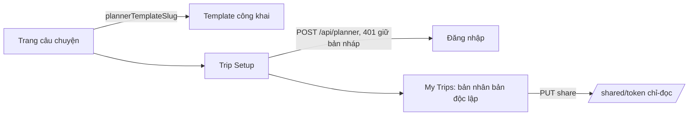

# Kiến trúc — Chuyện Nhà Hưng

🇬🇧 English version: [architecture.md](architecture.md)

Một trang kể chuyện du lịch lấy tiếng Việt làm gốc. Chuyện đi chơi, điểm đến, bản
đồ hành trình, lịch trình theo ngày, review video, và một điểm vào để thiết kế
chuyến đi. Phần lõi *backend* của Planner đã ship dưới dạng API — trip, ngày,
activity, chi phí và ngân sách — còn *giao diện* Planner vẫn thuộc phase sau; xem
[Các phase](#các-phase).

## Tổng quan nhanh

| Hạng mục | Lựa chọn | Ở đâu |
|---|---|---|
| Framework | Next.js 16, App Router, React 19 | [`src/app/`](../src/app) |
| Render | Server component, prerender toàn bộ khi build | mọi `page.tsx` |
| Ngôn ngữ | TypeScript `strict` + `noUncheckedIndexedAccess` | [`tsconfig.json`](../tsconfig.json) |
| i18n | `next-intl` 4, VI không prefix, EN ở `/en` | [`src/i18n/`](../src/i18n) |
| Styling | Tailwind v4, token `@theme` theo hướng CSS-first | [`src/app/globals.css`](../src/app/globals.css) |
| Nội dung | Dữ liệu seed TypeScript có type, không CMS | [`src/content/`](../src/content) |
| Test | Vitest 3 trên Node 24 (giờ đã nâng lên 4/5 được, nhưng chưa nâng) | [`tests/`](../tests) |
| Lưu trữ | **Không có.** Không database, không API route, không server action | — |

Không có backend. Mỗi trang là một tệp tĩnh sinh ra lúc build từ dữ liệu có type
trong repo — đó là lý do cả site chạy được mà không cần gì ngoài một file server.

## Đường đi của một request

```
request
  │
  ├─ next.config.ts redirects ......... /tour, /tours cũ → route lịch trình (308)
  │
  ├─ src/middleware.ts ................ next-intl: xác định locale + đổi pathname
  │                                     bản địa hoá → pathname nội bộ
  │                                     (bỏ qua /api, /_next, /opengraph-image, *.*)
  │
  ├─ src/app/[locale]/layout.tsx ...... font, <html lang>, header/main/footer,
  │                                     NextIntlClientProvider
  │
  └─ src/app/[locale]/**/page.tsx ..... server component
         ├─ đọc src/content/**         (dữ liệu seed có type)
         ├─ đọc messages/<locale>.json qua useTranslations/getTranslations
         ├─ ghép các src/components/**
         └─ export generateMetadata → src/lib/metadata.ts
```

Các route không phụ thuộc locale nằm ngoài `[locale]`:
[`robots.ts`](../src/app/robots.ts), [`sitemap.ts`](../src/app/sitemap.ts) và
[`opengraph-image.tsx`](../src/app/opengraph-image.tsx).

## Routing và bản địa hoá

Tiếng Việt là sản phẩm; tiếng Anh là bản dịch. VI render **không có prefix**, EN
có prefix, và `localeDetection` **tắt** có chủ đích — Accept-Language sẽ đẩy một
khách Việt dùng điện thoại cài tiếng Anh sang trang tiếng Anh.

Pathname chuẩn (nội bộ) viết bằng tiếng Anh và khớp 1:1 với cây thư mục
`app/[locale]`. URL mà khách thực sự thấy ở từng locale được định nghĩa một lần,
trong [`src/i18n/routing.ts`](../src/i18n/routing.ts):

| Nội bộ | Tiếng Việt | Tiếng Anh |
|---|---|---|
| `/` | `/` | `/en` |
| `/stories` | `/chuyen-di-choi` | `/en/stories` |
| `/stories/[slug]` | `/chuyen-di-choi/[slug]` | `/en/stories/[slug]` |
| `/destinations` | `/kham-pha` | `/en/destinations` |
| `/destinations/[slug]` | `/kham-pha/[slug]` | `/en/destinations/[slug]` |
| `/map` | `/ban-do` | `/en/map` |
| `/itineraries` | `/len-lich-trinh` | `/en/itineraries` |
| `/itineraries/[slug]` | `/len-lich-trinh/[slug]` | `/en/itineraries/[slug]` |
| `/plan-your-trip` | `/thiet-ke-chuyen-di` | `/en/plan-your-trip` |
| `/reviews` | `/goc-review` | `/en/reviews` |
| `/about` | `/ve-nha-hung` | `/en/about` |
| `/trip-setup/[template]` | `/tao-chuyen-di/[template]` | `/en/trip-setup/[template]` |
| `/sign-in` | `/dang-nhap` | `/en/sign-in` |
| `/my-trips` | `/chuyen-di-cua-toi` | `/en/my-trips` |
| `/my-trips/[id]` | `/chuyen-di-cua-toi/[id]` | `/en/my-trips/[id]` |
| `/shared/[token]` | `/chia-se/[token]` | `/en/shared/[token]` |

Hai type giữ cho điều hướng không sai: `AppPathname` là mọi route nội bộ, còn
`StaticPathname` loại bỏ các route `[slug]` để một route động không bao giờ bị
đưa vào menu như một mục phẳng trong
[`nav-items.ts`](../src/components/layout/nav-items.ts).

**Route tour là vĩnh viễn.** Tour được mô hình hoá thành lịch trình — một lịch
trình đã mang đủ thời lượng, giá tham khảo, số khách và kế hoạch từng ngày như
một tour. `/tour`, `/tours`, `/tour/:slug`, `/tours/:slug` và các bản `/en` là
redirect 308 trong [`next.config.ts`](../next.config.ts). Đổi đích hay bỏ chúng
phải có ADR được duyệt. Chi tiết:
[features/itineraries.vi.md](features/itineraries.vi.md).

Thêm một locale là ba việc làm cùng lúc: `locales` + `pathnames` trong
`routing.ts`, thêm `messages/<locale>.json`, và thêm key mới vào **mọi** field
`Localized<T>` trong `src/content/**`. `tests/i18n.test.ts` và
`tests/content.test.ts` sẽ fail đến khi làm đủ cả ba.

## Tầng nội dung

Nội dung là TypeScript có type, không phải CMS. `Localized<T>` chính là
`Record<Locale, T>`, nên chính hệ type — không phải người review — là thứ bắt lỗi
thiếu bản dịch.

| Bộ dữ liệu | File | Số lượng |
|---|---|---|
| Điểm đến | [`destinations.ts`](../src/content/destinations.ts) | 8 |
| Chuyện đi chơi | [`stories.ts`](../src/content/stories.ts) | 6 |
| Lịch trình | [`itineraries.ts`](../src/content/itineraries.ts) | 4 |
| Review video | [`video-reviews.ts`](../src/content/video-reviews.ts) | 6 |
| Site + mạng xã hội | [`site.ts`](../src/content/site.ts) | — |

Các shape nằm trong [`src/content/types.ts`](../src/content/types.ts). Hai field
có ý nghĩa kiến trúc: `coords` của điểm đến là toạ độ WGS84 thật mà bản đồ chiếu
lên, và `cover` trỏ tới tranh SVG sinh tự động đúng tinh thần thương hiệu
(`npm run covers`) để site không bao giờ có ảnh lỗi.

`site.ts` được đánh dấu **cần chủ nhà xác nhận** — các handle và email liên hệ là
giá trị hợp lý nhưng chưa được kiểm chứng.

Bên cạnh nội dung seed này còn hai bộ dữ liệu **phía server**, mỗi bộ là một
repository nằm trên một JSON document store chứ không phải database
([ADR 0001](adr/0001-travel-content-system.vi.md) §1,
[ADR 0002](adr/0002-planner-core.vi.md) §1). Chúng là hai document riêng biệt một
cách có chủ đích: nội dung biên tập và dữ liệu riêng tư của người đi chơi có yêu
cầu riêng tư, lưu trữ và sao lưu khác nhau.

| Store | File | Chứa gì | Hợp đồng |
|---|---|---|---|
| Travel content | `.data/travel-content.json` (`TRAVEL_CONTENT_STORE`) | place, story, collection, review, template | [travel-content-api.vi.md](travel-content-api.vi.md) |
| Planner | `.data/planner.json` (`PLANNER_STORE`) | planner user, session trình duyệt, trip, ngày, activity, chi phí | [features/travel-planner-core.vi.md](features/travel-planner-core.vi.md) |

Tiền ở cả hai đều là số nguyên đồng, chặn trên ở 10^12 — không bao giờ là số
thực, không bao giờ là đơn vị nhỏ. Các tổng dẫn xuất được tính lại khi đọc, không
bao giờ được lưu.

## Ranh giới module

Hướng phụ thuộc là một chiều. Tầng dưới không bao giờ gọi lên tầng trên.

```
app/[locale]/**      trang: chỉ ghép, không tự fetch
   ↓
components/**        ui/ · layout/ · cards/ · sections/ · map/ · seo/
   ↓
lib/**               format.ts · map.ts · metadata.ts   (hàm thuần)
   ↓
content/** · i18n/** · messages/**                      (dữ liệu + hợp đồng)

app/api/**           route handler: parse, phân quyền, map lỗi sang status
   ↓
server/content/** · server/planner/**    repository: toàn bộ invariant
   ↓
server/persistence/**                    document store (ghi nguyên tử + hàng đợi)
```

Phía API là một tầng thứ hai chạy song song, và hai bên chỉ gặp nhau ở đúng một
chỗ: Planner đọc hệ nội dung qua
[`PlannerCatalog`](../src/server/planner/catalog.ts), một interface chỉ-đọc với ba
phép tra cứu và không có hàm ghi. Đó là thứ khiến "clone template không bao giờ
sửa template" thành chuyện cấu trúc chứ không phải chuyện kỷ luật.

- `lib/` là tầng thuần, không side effect: format ngày/giá/thời lượng, phép chiếu
  bản đồ, dựng metadata. Đây là tầng unit test nhắm trực tiếp vào.
- `components/ui/` chứa primitive (`Button`, `Container`, `Section`, `Badge`,
  `Prose`, `CoverImage`); `sections/` chứa các khối ghép ở tầm trang; `cards/`
  mỗi bộ dữ liệu một card. Card không bao giờ tự fetch — trang truyền dữ liệu vào.
- `src/i18n/navigation.ts` là nguồn duy nhất của `Link`, `getPathname` và các
  helper cùng họ. Import thẳng `next/link` sẽ bỏ qua bản đồ pathname bản địa hoá.

## Render và ranh giới client

Mặc định là server component; `'use client'` phải có lý do nêu rõ. Hiện tại bundle
client tồn tại cho đúng hai thứ: drawer điều hướng trên mobile (bẫy focus, Escape,
tự đóng khi chuyển trang) trong
[`main-nav.tsx`](../src/components/layout/main-nav.tsx), và bộ đổi ngôn ngữ.

Bản đồ hành trình **không** phải client component, có chủ đích: đó là một SVG
silhouette với các thẻ `<a>` thật, vị trí tính bởi [`lib/map.ts`](../src/lib/map.ts),
nên nó đi được bằng bàn phím và bot vẫn đọc được khi tắt JavaScript.

## SEO

Ở đây SEO là yêu cầu cấu trúc, không phải bước đánh bóng.
[`src/lib/metadata.ts`](../src/lib/metadata.ts) dựng URL canonical cho từng trang
cùng bộ `hreflang` đầy đủ, với `x-default` trỏ về tiếng Việt. Mỗi trang export
`generateMetadata`; JSON-LD phát qua
[`components/seo/json-ld.tsx`](../src/components/seo/json-ld.tsx) ở những chỗ có
type schema.org phù hợp. `sitemap.ts` liệt kê mọi route ở mọi locale. Chi tiết:
[features/seo-and-metadata.vi.md](features/seo-and-metadata.vi.md).

## Design token

Mọi màu, font, bán kính bo, bóng đổ và easing được định nghĩa một lần, trong khối
`@theme` của [`globals.css`](../src/app/globals.css). Không nơi nào khác được
hard-code. `tests/design-tokens.test.ts` parse CSS thật và kiểm tra tương phản
WCAG AA — đó là lý do màu primary tương tác là `clay-600` chứ không phải
`clay-500`, và là lý do `--color-border-strong` tồn tại. Chi tiết:
[features/design-system.vi.md](features/design-system.vi.md).

## Kiểm chứng

| Cổng | Lệnh | Bảo vệ điều gì |
|---|---|---|
| Type | `npm run typecheck` | `Localized<T>` đủ locale, route an toàn kiểu |
| Lint | `npm run lint` | bộ rule `eslint-config-next` |
| Test | `npm run test` | nội dung, đồng bộ i18n, routing, bản đồ, token, tài liệu |
| Build | `npm run build` | mọi trang prerender được |
| UI | `npm run verify:ui` | ảnh chụp ở 375/768/1440, fail nếu tràn ngang |

## Chia sẻ chuyến đi và nhân bản từ câu chuyện

"Đi theo dấu chân nhà Hưng" ([ADR 0005](adr/0005-trip-sharing-and-story-cloning.vi.md);
hợp đồng nằm ở `.claude/contracts/follow-hung-footsteps.md`). Không thêm hệ thống con
mới: nó mở rộng Planner và thêm một đường đọc công khai.



- **Liên kết câu chuyện.** `Story.plannerTemplateSlug` (tùy chọn,
  [`types.ts`](../src/content/types.ts)) trỏ tới một template công khai. Trang câu
  chuyện chỉ hiển thị lịch trình và lời kêu gọi hành động khi template còn công khai.
- **Trường thêm vào trip**, đều tùy chọn trên dòng đã lưu: `planningStatus`
  (`draft | planned | completed`, mặc định `draft`, tách khỏi vòng đời `active |
  archived`), `visibility` (`private | unlisted | public`, mặc định `private`),
  `shareToken`, `shareTokenCreatedAt`, `duplicatedFromTripId`, và `sourceTemplate.story`
  (attribution, do server suy ra bằng `PlannerCatalog.getLinkedStory`, không bao giờ
  từ dữ liệu client).
- **Link chia sẻ.** Token ngẫu nhiên 256 bit. Chỉ mở được khi token khớp, visibility
  là `unlisted` hoặc `public`, và trip còn active; mọi trường hợp khác là một 404 giống
  hệt nhau. `GET /api/shared/[token]` và `/shared/[token]` trả bản chiếu đã lọc (không
  danh tính chủ sở hữu, không id, không `version`, không ghi chú trip, không chi phí)
  và không bao giờ thay đổi dữ liệu. Không có thư viện công khai.
- **Endpoint công khai có giới hạn tần suất** bởi
  `src/server/rate-limit.ts`: trong bộ nhớ, theo từng
  tiến trình, nên cùng điều kiện đa-instance với SQL, và khóa client chỉ đáng tin bằng
  proxy đặt `x-forwarded-for`.
- **Trang riêng tư** (`/sign-in`, `/my-trips`, `/my-trips/[id]`,
  `/trip-setup/[template]`) là `noindex` và không có trong sitemap; `/shared/[token]` là
  `noindex` trừ khi trip là `public`, và gửi `Referrer-Policy: no-referrer`.

## Các phase

Những thứ vắng mặt có chủ đích, và không được dựng sớm:

- **Giao diện Planner** — được mở một phần bởi [ADR 0005](adr/0005-trip-sharing-and-story-cloning.vi.md): chỉ gồm nhân bản story thành trip, My Trips, đăng nhập và trang chia sẻ chỉ-đọc. Trình sửa trip đầy đủ, bản đồ Planner và gợi ý AI thì chưa. Phần lõi *backend* của Planner đã ship dưới
  `/api/planner` ([ADR 0002](adr/0002-planner-core.vi.md),
  [features/travel-planner-core.vi.md](features/travel-planner-core.vi.md)):
  trip, ngày sinh tự động, activity, chi phí, ngân sách, lưu trữ/khôi phục và
  clone template. `/thiet-ke-chuyen-di` vẫn là trang nội dung chỉ có liên hệ —
  nối nó vào API là việc của frontend và chưa bắt đầu.
- **Map và gợi ý AI cho Planner.** Cố ý hoãn lại theo đề bài đã mở phase Planner.
- **Một nhà cung cấp danh tính thật.** Auth của Planner là access token cấp cho
  từng người đi chơi bởi người vận hành, và trình duyệt đổi nó lấy một session
  cookie `HttpOnly` có hạn ([ADR 0004](adr/0004-planner-identity.vi.md)). Thế là
  đủ cho nhân viên dùng và cố ý không phải một hệ danh tính: không có đăng ký
  công khai, không đặt lại mật khẩu, không OAuth, không MFA. Thêm những thứ đó là
  ADR tiếp theo, và `resolveIdentity` là đường ráp duy nhất nó phải thay.
- **SQL.** Cả hai store chỉ an toàn trong một process. Triển khai nhiều instance
  là mốc phải chuyển; schema đích và các index đã được ghi sẵn trong
  [ADR 0002](adr/0002-planner-core.vi.md#hình-dạng-sql-mà-cấu-trúc-này-sẽ-thành).
- **Phase 06 — Admin Portal & CMS (đã công bố, chưa bắt đầu).** Không mục nào bên
  dưới được dựng hay dựng sớm; mỗi mục cần ghi quyết định trước. Hướng thiết kế:
  [ADR 0006](adr/0006-unified-identity-and-roles.vi.md) (Đề xuất). Backlog phụ
  thuộc và quyết định:
  - **Nhà cung cấp danh tính** — giữ token do người vận hành cấp cộng session, hay dùng Auth.js / hosted; quyết định đăng ký, đặt lại mật khẩu, MFA cho `admin`. ADR riêng.
  - **Mô hình vai trò** — `member` / `editor` / `admin` trên một mô hình user, hàm thuần `can(identity, action, resource)`, `ADMIN_API_TOKEN` hạ thành service principal.
  - **Củng cố session admin và CSRF** — thời hạn ngắn hơn theo vai trò; `requireSameOrigin` thành chốt chịu lực cho mutation admin; token không bao giờ tới Client Component (`tests/client-boundary.test.ts`).
  - **Audit log** — ai đổi template hay vai trò nào, và mọi lần đọc trip để hỗ trợ.
  - **SQL và nhiều instance** — admin portal khiến có người ghi thứ hai vào store; store JSON và rate limiter theo process không sống nổi qua một instance.
  - **Store cho rate limit** — chặn đăng nhập admin cần store dùng chung khi có hơn một process.
  - **CMS sửa template** — chỉ qua content store; giữ các bản sửa cũ của template hay dựa vào snapshot đã clone là chưa quyết (clone vốn đã độc lập nên lịch sử là tuỳ chọn).
  - **Ranh giới template/trip** — template ở content store, trip ở planner store, chỉ nối bằng bản sao giá trị `sourceTemplate`.
  - **Bảo đảm chưa được test cần đóng trước** — xem khoảng trống trong ADR 0006 và các khoảng trống về độc lập của clone trong báo cáo Prompt 05.
- **Card video bấm được.** Chúng ta không có URL của từng video, nên card chỉ để
  trình bày. Muốn bấm được thì phải thêm field URL vào `VideoReview` và cập nhật
  `tests/content.test.ts`.
- **Ảnh thật.** Ảnh cover là SVG sinh tự động cho tới khi chủ nhà đưa ảnh thật.

## Phân quyền sở hữu

| Agent | Sở hữu |
|---|---|
| `system-architect` | Topology route, hợp đồng dữ liệu, ADR, `docs/architecture.*`, sơ đồ |
| `backend-engineer` | `src/app/api/**`, server action, lưu trữ, validation |
| `frontend-engineer` | Trang, component, token, `messages/*.json` |

Ai ship tính năng thì người đó viết tài liệu cho nó trong
[`features/`](features/README.vi.md), bằng cả hai ngôn ngữ. Quy tắc:
[`CLAUDE.md`](../CLAUDE.md).
