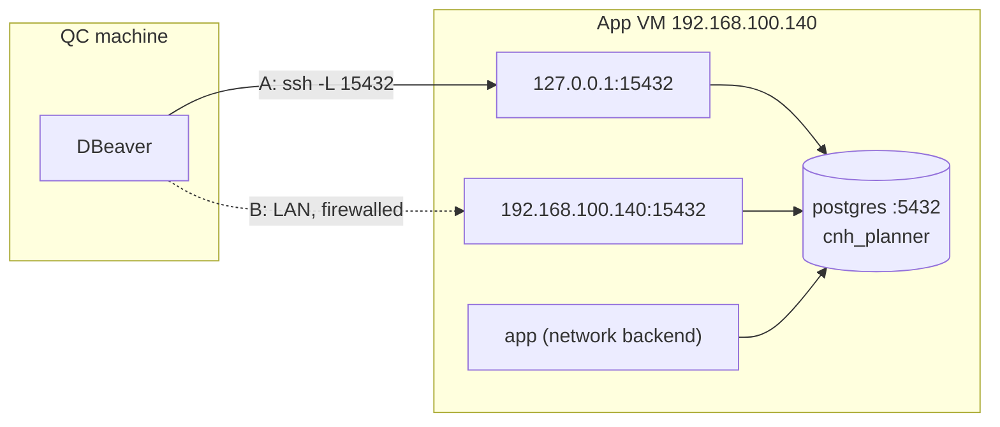

# Database access for QC — Chuyện Nhà Hưng

> Đi đâu cũng có chuyện.

How a DBA/QC person inspects the stack's PostgreSQL (local-db layout, database
`cnh_planner`) with DBeaver, read-only. There are two **optional, mutually exclusive**
Compose overlays; by default **no PostgreSQL port is published**. Nothing here is run
for you: every step on the VM is done by the owner.

🇻🇳 Bản tiếng Việt: [deploy-db-access.vi.md](deploy-db-access.vi.md)

## A. Overview of the two options

| | Option A — SSH tunnel (default) | Option B — LAN direct |
|---|---|---|
| Overlay | [`compose.postgres-ssh.yml`](../deploy/compose.postgres-ssh.yml) | [`compose.postgres-lan.yml`](../deploy/compose.postgres-lan.yml) |
| Published as | `127.0.0.1:15432 → 5432` | `192.168.100.140:15432 → 5432` |
| Who can connect | whoever can SSH into the VM | any LAN host the firewall allows |
| Needs | an SSH account on the VM | DOCKER-USER / Proxmox firewall rules |
| Choose when | always, unless the tunnel is impractical | the owner accepts a LAN-exposed port |

Rules: never both files in one command (Compose **appends** `ports`, so both bindings
would be published); never `0.0.0.0`; never a router NAT or Cloudflare Tunnel. Only
the **local-db** layout has a `postgres` service — with external-db, apply the same
idea on the DB VM yourself.

`backend` is `internal: true` and Docker publishes no ports for containers attached only
to internal networks, so both overlays also join `postgres` to a small non-internal
`dbaccess` network. `app` stays on `backend` only; `deploy/deploy.sh` is unchanged.

## B. Connection diagram



## C. Conditions of use

- Owner approval for each access window, and the QC person's name and IP written down.
- The layout is local-db and the `postgres` container is healthy.
- QC uses the `qc_readonly` role (section F), **never** `postgres` or `cnh_app`.
- Passwords are typed in the terminal or DBeaver only — not in Git, chat, `.env` or docs.
- QC gets no sudo and no `docker` group membership on the VM.
- Switch the access **off** (section D) when the work ends.

## D. Enable and disable

All commands run on the VM from the deploy directory. `$BASE` below stands for:

```bash
cd /opt/chuyennhahung/src/deploy
BASE="docker compose --project-directory . --env-file /opt/chuyennhahung/.env --profile local-db -f compose.yml -f compose.app.yml -f compose.app.bind.yml -f compose.app.local-db.yml"
```

Enabling or disabling **recreates the `postgres` container** (a few seconds without the
database; data is on the bind mount and is kept; the app reconnects by itself). Do it
off-peak, after a fresh backup (`./scripts/backup.sh local-db`).

Enable Option A:

```bash
$BASE -f compose.postgres-ssh.yml up -d --no-deps postgres
docker port chuyennhahung-postgres-1        # expect only: 5432/tcp -> 127.0.0.1:15432
ss -ltn | grep 15432                        # expect 127.0.0.1:15432, not 0.0.0.0
```

Enable Option B — only after the firewall rules of section H are in place, with
`DB_BIND_ADDR=<VM LAN IP>` in the stack's `.env` (no address is baked into the overlay;
Compose refuses to start without it; run `./deploy/deploy.sh --check` first, it refuses `0.0.0.0`):

```bash
$BASE -f compose.postgres-lan.yml up -d --no-deps postgres
docker port chuyennhahung-postgres-1        # expect only: 5432/tcp -> 192.168.100.140:15432
```

Disable either option (back to no published port):

```bash
$BASE up -d --no-deps postgres
docker port chuyennhahung-postgres-1        # expect no output
```

To switch A ↔ B, disable first, then enable the other. A normal deploy
(`deploy/deploy.sh`) only recreates `app` with `--no-deps`, so it leaves the port
mapping, the database and nginx alone. A manual `up` of `postgres` **without** the
overlay file removes the mapping.

## E. Configure DBeaver

### Create the tunnel-only SSH account (Option A)

Give QC a dedicated account that can open **this one tunnel and nothing else**: no
password, no shell, no sudo, no `docker` group. Below, `<ssh_user>` is `qc_tunnel`.

On the QC machine, make a key pair (the private key never leaves it) and send the owner
the **public** file `qc_tunnel_ed25519.pub` only:

```bash
ssh-keygen -t ed25519 -f ~/.ssh/qc_tunnel_ed25519 -C "qc-<name>"
```

On the VM, as the owner (`<PUBLIC_KEY_LINE>` is the content of the `.pub` file):

```bash
sudo adduser --disabled-password --gecos "" --shell /usr/sbin/nologin qc_tunnel
sudo install -d -m 700 -o qc_tunnel -g qc_tunnel /home/qc_tunnel/.ssh
echo 'restrict,port-forwarding,permitopen="127.0.0.1:15432" <PUBLIC_KEY_LINE>' \
  | sudo tee /home/qc_tunnel/.ssh/authorized_keys >/dev/null
sudo chown qc_tunnel:qc_tunnel /home/qc_tunnel/.ssh/authorized_keys
sudo chmod 600 /home/qc_tunnel/.ssh/authorized_keys
id qc_tunnel          # expect: no sudo, no docker group
```

`restrict` turns off shell, terminal, agent and X11 forwarding; `port-forwarding` allows
tunnels again; `permitopen` limits them to `127.0.0.1:15432`. No `sshd_config` change
is needed (if it has `AllowUsers`, add `qc_tunnel`). Check from the QC machine:

```bash
ssh -i ~/.ssh/qc_tunnel_ed25519 -N -L 15432:127.0.0.1:15432 qc_tunnel@192.168.100.140   # stays open: OK
ssh -i ~/.ssh/qc_tunnel_ed25519 qc_tunnel@192.168.100.140                              # must NOT give a shell
ssh -i ~/.ssh/qc_tunnel_ed25519 -N -L 2222:127.0.0.1:22 qc_tunnel@192.168.100.140      # forward must be refused
```

Remove access when done: `sudo deluser --remove-home qc_tunnel` (or only delete the line
in `authorized_keys` to pause it).

Option A — tunnel from the QC machine (or let DBeaver do the same on the SSH tab):

```bash
ssh -N -L 15432:127.0.0.1:15432 <ssh_user>@192.168.100.140
```

DBeaver → New connection → PostgreSQL:

| Field | Option A | Option B |
|---|---|---|
| Host | `localhost` | `192.168.100.140` |
| Port | `15432` | `15432` |
| Database | `cnh_planner` (and `cnh_content`) | same |
| User | `qc_readonly` | `qc_readonly` |
| Password | typed in DBeaver, saved only in its own secure store | same |
| SSH tab | Use SSH Tunnel: host `192.168.100.140`, user `<ssh_user>`, key auth, no local port forward needed | off |

Set the connection to **read-only** in DBeaver (Connection settings → General), as a
second guard next to the database grants.

## F. Create the `qc_readonly` role

Run once on the VM, in an interactive `psql` as the admin (the password is typed at
the prompt; `\password` does not echo it and does not log it):

```bash
docker exec -it chuyennhahung-postgres-1 psql -U postgres -d postgres
```

```sql
CREATE ROLE qc_readonly LOGIN NOSUPERUSER NOCREATEDB NOCREATEROLE NOREPLICATION;
\password qc_readonly
ALTER ROLE qc_readonly SET default_transaction_read_only = on;
ALTER ROLE qc_readonly CONNECTION LIMIT 3;
```

Then, in each database (`\c cnh_planner`, then `\c cnh_content`):

```sql
GRANT CONNECT ON DATABASE cnh_planner TO qc_readonly;   -- use the current database name
GRANT USAGE ON SCHEMA public TO qc_readonly;
GRANT SELECT ON ALL TABLES IN SCHEMA public TO qc_readonly;
ALTER DEFAULT PRIVILEGES FOR ROLE cnh_app IN SCHEMA public GRANT SELECT ON TABLES TO qc_readonly;
```

No INSERT, UPDATE, DELETE, CREATE or TRUNCATE is granted. The second statement set
makes tables created by future migrations (owned by `cnh_app`) readable too.

**Owner decision — sensitive tables.** `planner_users` holds emails and password
hashes, `planner_sessions` token digests, `planner_oauth_attempts` OAuth state. A
blanket `SELECT` lets QC read them. If QC does not need them, run in `cnh_planner`:

```sql
REVOKE SELECT ON planner_users, planner_sessions, planner_oauth_attempts FROM qc_readonly;
```

Tables created by later migrations are readable again through the default privileges,
so review this after each migration. `pg_hba.conf` is left unchanged: the image's
default already allows password logins from the Docker bridge, which is where both
options arrive from.

## G. Verify the permissions

Connect as `qc_readonly` (through the tunnel or the LAN) and run:

```sql
SELECT current_user, current_database();
SELECT count(*) FROM trips;                               -- works
INSERT INTO trips DEFAULT VALUES;                         -- must fail: permission denied
UPDATE trips SET id = id;                                 -- must fail
DELETE FROM trips;                                        -- must fail
CREATE TABLE qc_probe (x int);                            -- must fail
```

As the admin, confirm: `\du qc_readonly` shows no Superuser/Create role/Create DB, and
`SELECT has_table_privilege('qc_readonly','trips','INSERT');` returns `f`.

## H. Check the firewall

Option A needs none beyond SSH: confirm that from another LAN machine
`nc -vz 192.168.100.140 15432` is **refused/times out**.

Option B — Docker publishes through its own iptables chains, so `ufw allow/deny` rules
**do not** filter it. Restrict in `DOCKER-USER` (traffic to the container after DNAT is
matched with `conntrack`), with the QC machine's IP `<QC_IP>`:

```bash
sudo iptables -I DOCKER-USER -p tcp -m conntrack --ctorigdstport 15432 -j DROP
sudo iptables -I DOCKER-USER -p tcp -s <QC_IP> -m conntrack --ctorigdstport 15432 -j ACCEPT
sudo iptables -L DOCKER-USER -n -v --line-numbers
```

These rules are not persistent across reboot or a Docker restart; persist them with
your usual tool (e.g. `iptables-persistent`) and **remove them** when disabling
Option B. As a second layer, allow `15432` only from `<QC_IP>` in the Proxmox firewall
of the VM (Datacenter/VM → Firewall → Rules, input policy DROP). Test from `<QC_IP>`
(connects) and from another machine (refused or timeout). Check Internet exposure:
no router port forward, nothing in the Cloudflare Tunnel config for `15432`, and an
outside port scan of your public IP shows it closed.

## I. Troubleshooting

| Symptom | Likely cause |
|---|---|
| `docker port` prints nothing after enabling | overlay not in the `-f` list, or the container was not recreated |
| Mapping exists but connection hangs | Option B firewall rule, Proxmox firewall, or the QC IP is not `<QC_IP>` |
| `connection refused` on `localhost:15432` | tunnel not open, or Option A not enabled |
| `password authentication failed` | wrong password, or the role was created in another cluster |
| `permission denied for table …` | table created after the grants, or intentionally revoked (section F) |
| `permission denied for schema public` | the `GRANT USAGE` was not run in that database |
| Port in use on the VM | another process holds `15432`; `ss -ltnp \| grep 15432` |
| The app returns 503 after a switch | `postgres` was recreated; wait for `pg_isready`, then check `/api/health` |

## J. Rollback

1. Disable the option (section D, last command) — no port is published again.
2. Option B: remove the `DOCKER-USER` and Proxmox rules. Option A: remove the SSH account (`sudo deluser --remove-home qc_tunnel`).
3. Remove the role if no longer needed: in each database
   `REVOKE ALL ON ALL TABLES IN SCHEMA public FROM qc_readonly; REVOKE USAGE ON SCHEMA public FROM qc_readonly;
   REVOKE CONNECT ON DATABASE <db> FROM qc_readonly;`, then `DROP ROLE qc_readonly;`.
4. Reverting this change in Git (the two overlays and this document) needs no
   database action: nothing else references them.

## Acceptance checklist

- [ ] PostgreSQL container healthy (`docker ps` shows `healthy`).
- [ ] App still connects to the database (`/api/health` OK, a Planner page loads).
- [ ] SSH tunnel connects from DBeaver (Option A), and the SSH account has no shell.
- [ ] LAN direct connects from the allowed machine (Option B).
- [ ] A machine that is not allowed is refused (Option B).
- [ ] `qc_readonly` can only SELECT (section G).
- [ ] No PostgreSQL port reachable from the Internet.
- [ ] CI/CD unaffected: `deploy/deploy.sh` unchanged and a deploy keeps the mapping.
- [ ] No data lost (row counts before and after the recreate).
- [ ] Rollback rehearsed or understood (section J).

## Limits and open questions

- Written against the repository; not executed against the VM. `docker compose config`
  was not run where this was authored (no Docker): run it once before enabling.
- Enabling or disabling recreates `postgres` — a short outage. A tunnel avoids a
  LAN-exposed port but gives access to anyone with SSH on the VM.
- Whether QC may read the sensitive tables (section F) is an owner decision.
- Deploy integration (a `DB_ACCESS` switch in `deploy.sh`) was deliberately not
  added: it would change the deploy script that other work is editing and is not
  needed, since deploys never touch `postgres`.
