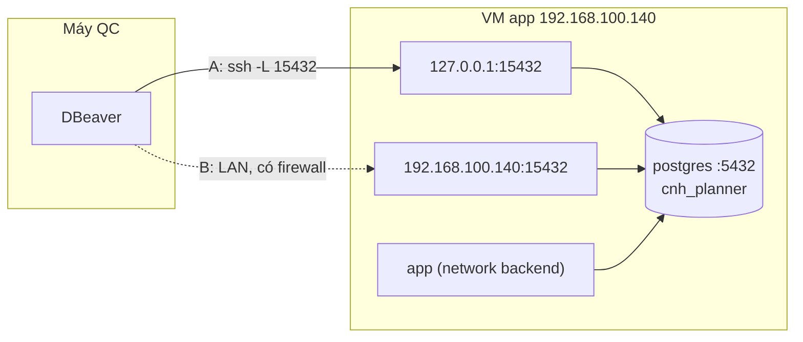

# Truy cập database cho QC — Chuyện Nhà Hưng

> Đi đâu cũng có chuyện.

Cách để DBA/QC xem PostgreSQL của stack (layout local-db, database `cnh_planner`) bằng
DBeaver ở chế độ chỉ đọc. Có hai overlay Compose **tùy chọn và loại trừ nhau**; mặc định
**không publish port PostgreSQL nào**. Không bước nào ở đây được chạy giùm: mọi bước trên VM
do owner thực hiện.

🇬🇧 English version: [deploy-db-access.md](deploy-db-access.md)

## A. Tổng quan hai phương án

| | Phương án A — SSH tunnel (mặc định) | Phương án B — LAN trực tiếp |
|---|---|---|
| Overlay | [`compose.postgres-ssh.yml`](../deploy/compose.postgres-ssh.yml) | [`compose.postgres-lan.yml`](../deploy/compose.postgres-lan.yml) |
| Publish dạng | `127.0.0.1:15432 → 5432` | `192.168.100.140:15432 → 5432` |
| Ai kết nối được | ai SSH được vào VM | máy LAN nào firewall cho phép |
| Cần | tài khoản SSH trên VM | luật DOCKER-USER / Proxmox firewall |
| Chọn khi | luôn luôn, trừ khi tunnel không khả thi | owner chấp nhận một port lộ ra LAN |

Quy tắc: không bao giờ dùng cả hai file trong một lệnh (Compose **nối thêm** `ports`, nên cả
hai binding đều được publish); không bao giờ `0.0.0.0`; không NAT router hay Cloudflare
Tunnel. Chỉ layout **local-db** có service `postgres` — với external-db, áp dụng ý tưởng
tương tự trên VM database.

`backend` là `internal: true` và Docker không publish port cho container chỉ nằm trong
network internal, nên cả hai overlay đều cho `postgres` tham gia thêm network `dbaccess`
không internal. `app` vẫn chỉ ở `backend`; `deploy/deploy.sh` không đổi.

## B. Sơ đồ kết nối



## C. Điều kiện sử dụng

- Owner duyệt từng đợt truy cập; ghi lại tên người QC và IP máy của họ.
- Layout là local-db và container `postgres` đang healthy.
- QC dùng role `qc_readonly` (mục F), **tuyệt đối không** dùng `postgres` hay `cnh_app`.
- Mật khẩu chỉ gõ trong terminal hoặc DBeaver — không đưa vào Git, chat, `.env`, tài liệu.
- QC không có sudo và không thuộc nhóm `docker` trên VM.
- **Tắt** truy cập (mục D) khi xong việc.

## D. Bật và tắt

Mọi lệnh chạy trên VM, trong thư mục deploy. `$BASE` dưới đây là:

```bash
cd /opt/chuyennhahung/src/deploy
BASE="docker compose --project-directory . --env-file /opt/chuyennhahung/.env --profile local-db -f compose.yml -f compose.app.yml -f compose.app.bind.yml -f compose.app.local-db.yml"
```

Bật hoặc tắt đều **tạo lại container `postgres`** (vài giây không có database; dữ liệu nằm
trên bind mount nên còn nguyên; app tự kết nối lại). Làm ngoài giờ cao điểm, sau một bản sao
lưu mới (`./scripts/backup.sh local-db`).

Bật phương án A:

```bash
$BASE -f compose.postgres-ssh.yml up -d --no-deps postgres
docker port chuyennhahung-postgres-1        # kỳ vọng chỉ: 5432/tcp -> 127.0.0.1:15432
ss -ltn | grep 15432                        # kỳ vọng 127.0.0.1:15432, không phải 0.0.0.0
```

Bật phương án B — chỉ sau khi đã có luật firewall ở mục H:

```bash
$BASE -f compose.postgres-lan.yml up -d --no-deps postgres
docker port chuyennhahung-postgres-1        # kỳ vọng chỉ: 5432/tcp -> 192.168.100.140:15432
```

Tắt một trong hai (về lại không publish port):

```bash
$BASE up -d --no-deps postgres
docker port chuyennhahung-postgres-1        # kỳ vọng không có output
```

Đổi A ↔ B: tắt trước, rồi bật cái kia. Một lần deploy bình thường (`deploy/deploy.sh`) chỉ
tạo lại `app` với `--no-deps`, nên không đụng port mapping, database và nginx. Chạy `up`
`postgres` thủ công **mà không** có file overlay sẽ gỡ mapping.

## E. Cấu hình DBeaver

Phương án A — tunnel từ máy QC (hoặc để DBeaver tự làm ở tab SSH):

```bash
ssh -N -L 15432:127.0.0.1:15432 <ssh_user>@192.168.100.140
```

DBeaver → New connection → PostgreSQL:

| Trường | Phương án A | Phương án B |
|---|---|---|
| Host | `localhost` | `192.168.100.140` |
| Port | `15432` | `15432` |
| Database | `cnh_planner` (và `cnh_content`) | như A |
| User | `qc_readonly` | `qc_readonly` |
| Password | gõ trong DBeaver, chỉ lưu ở kho bảo mật của nó | như A |
| Tab SSH | Use SSH Tunnel: host `192.168.100.140`, user `<ssh_user>`, đăng nhập bằng key | tắt |

Đặt connection ở chế độ **read-only** trong DBeaver (Connection settings → General), làm
lớp bảo vệ thứ hai bên cạnh quyền ở database.

## F. Tạo role `qc_readonly`

Chạy một lần trên VM, trong `psql` tương tác bằng tài khoản admin (mật khẩu gõ tại prompt;
`\password` không hiện và không ghi log):

```bash
docker exec -it chuyennhahung-postgres-1 psql -U postgres -d postgres
```

```sql
CREATE ROLE qc_readonly LOGIN NOSUPERUSER NOCREATEDB NOCREATEROLE NOREPLICATION;
\password qc_readonly
ALTER ROLE qc_readonly SET default_transaction_read_only = on;
ALTER ROLE qc_readonly CONNECTION LIMIT 3;
```

Sau đó, trong từng database (`\c cnh_planner`, rồi `\c cnh_content`):

```sql
GRANT CONNECT ON DATABASE cnh_planner TO qc_readonly;   -- dùng đúng tên database hiện tại
GRANT USAGE ON SCHEMA public TO qc_readonly;
GRANT SELECT ON ALL TABLES IN SCHEMA public TO qc_readonly;
ALTER DEFAULT PRIVILEGES FOR ROLE cnh_app IN SCHEMA public GRANT SELECT ON TABLES TO qc_readonly;
```

Không cấp INSERT, UPDATE, DELETE, CREATE hay TRUNCATE. Cụm lệnh sau cùng giúp các bảng do
migration tương lai tạo (thuộc `cnh_app`) cũng đọc được.

**Owner quyết định — bảng nhạy cảm.** `planner_users` chứa email và hash mật khẩu,
`planner_sessions` chứa digest token, `planner_oauth_attempts` chứa state OAuth. `SELECT`
toàn bộ cho phép QC đọc chúng. Nếu QC không cần, chạy trong `cnh_planner`:

```sql
REVOKE SELECT ON planner_users, planner_sessions, planner_oauth_attempts FROM qc_readonly;
```

Bảng do migration sau này tạo sẽ lại đọc được qua default privileges, nên rà lại sau mỗi
migration. `pg_hba.conf` giữ nguyên: mặc định của image đã cho đăng nhập bằng mật khẩu từ
Docker bridge, là nơi cả hai phương án đi vào.

## G. Kiểm tra quyền

Kết nối bằng `qc_readonly` (qua tunnel hoặc LAN) rồi chạy:

```sql
SELECT current_user, current_database();
SELECT count(*) FROM trips;                               -- chạy được
INSERT INTO trips DEFAULT VALUES;                         -- phải lỗi: permission denied
UPDATE trips SET id = id;                                 -- phải lỗi
DELETE FROM trips;                                        -- phải lỗi
CREATE TABLE qc_probe (x int);                            -- phải lỗi
```

Bằng admin, xác nhận: `\du qc_readonly` không có Superuser/Create role/Create DB, và
`SELECT has_table_privilege('qc_readonly','trips','INSERT');` trả về `f`.

## H. Kiểm tra firewall

Phương án A không cần gì thêm ngoài SSH: xác nhận từ một máy LAN khác
`nc -vz 192.168.100.140 15432` bị **từ chối/timeout**.

Phương án B — Docker publish qua chain iptables riêng, nên luật `ufw allow/deny`
**không** lọc được. Hạn chế trong `DOCKER-USER` (lưu lượng tới container sau DNAT được khớp
bằng `conntrack`), với IP máy QC là `<QC_IP>`:

```bash
sudo iptables -I DOCKER-USER -p tcp -m conntrack --ctorigdstport 15432 -j DROP
sudo iptables -I DOCKER-USER -p tcp -s <QC_IP> -m conntrack --ctorigdstport 15432 -j ACCEPT
sudo iptables -L DOCKER-USER -n -v --line-numbers
```

Các luật này không bền qua reboot hay khi restart Docker; lưu bằng công cụ quen dùng (ví dụ
`iptables-persistent`) và **gỡ** khi tắt phương án B. Lớp thứ hai: chỉ cho `15432` từ
`<QC_IP>` trong Proxmox firewall của VM (Datacenter/VM → Firewall → Rules, input policy
DROP). Thử từ `<QC_IP>` (kết nối được) và từ máy khác (bị từ chối hoặc timeout). Kiểm tra lộ
ra Internet: không port forward trên router, không có `15432` trong cấu hình Cloudflare
Tunnel, và quét port từ bên ngoài vào IP public thấy nó đóng.

## I. Xử lý sự cố

| Triệu chứng | Nguyên nhân có thể |
|---|---|
| `docker port` không in gì sau khi bật | overlay không nằm trong danh sách `-f`, hoặc container chưa được tạo lại |
| Có mapping nhưng kết nối treo | luật firewall phương án B, Proxmox firewall, hoặc IP QC không phải `<QC_IP>` |
| `connection refused` ở `localhost:15432` | tunnel chưa mở, hoặc chưa bật phương án A |
| `password authentication failed` | sai mật khẩu, hoặc role được tạo ở cluster khác |
| `permission denied for table …` | bảng tạo sau lúc cấp quyền, hoặc cố ý thu hồi (mục F) |
| `permission denied for schema public` | chưa chạy `GRANT USAGE` trong database đó |
| Port đã bị dùng trên VM | tiến trình khác giữ `15432`; `ss -ltnp \| grep 15432` |
| App trả 503 sau khi chuyển | `postgres` vừa được tạo lại; chờ `pg_isready`, rồi kiểm `/api/health` |

## J. Rollback

1. Tắt phương án (mục D, lệnh cuối) — không còn port nào được publish.
2. Phương án B: gỡ luật `DOCKER-USER` và Proxmox.
3. Xóa role nếu không cần nữa: trong từng database
   `REVOKE ALL ON ALL TABLES IN SCHEMA public FROM qc_readonly; REVOKE USAGE ON SCHEMA public FROM qc_readonly;
   REVOKE CONNECT ON DATABASE <db> FROM qc_readonly;`, rồi `DROP ROLE qc_readonly;`.
4. Revert thay đổi này trong Git (hai overlay và tài liệu này) không cần thao tác database:
   không có gì khác tham chiếu tới chúng.

## Checklist nghiệm thu

- [ ] Container PostgreSQL healthy (`docker ps` hiện `healthy`).
- [ ] App vẫn kết nối database (`/api/health` OK, một trang Planner tải được).
- [ ] SSH tunnel kết nối được từ DBeaver (phương án A).
- [ ] LAN trực tiếp kết nối được từ máy được phép (phương án B).
- [ ] Máy không được phép bị từ chối (phương án B).
- [ ] `qc_readonly` chỉ SELECT được (mục G).
- [ ] Không có port PostgreSQL nào truy cập được từ Internet.
- [ ] CI/CD không bị ảnh hưởng: `deploy/deploy.sh` không đổi và deploy giữ nguyên mapping.
- [ ] Không mất dữ liệu (so số dòng trước và sau khi tạo lại).
- [ ] Đã diễn tập hoặc hiểu rõ rollback (mục J).

## Giới hạn và câu hỏi mở

- Viết dựa trên repository; chưa chạy trên VM. `docker compose config` chưa chạy ở nơi soạn
  (không có Docker): chạy một lần trước khi bật.
- Bật/tắt tạo lại `postgres` — gián đoạn ngắn. Tunnel tránh việc lộ port ra LAN nhưng cho
  phép bất kỳ ai có SSH vào VM truy cập.
- Việc QC có được đọc các bảng nhạy cảm (mục F) là quyết định của owner.
- Chủ ý không tích hợp vào deploy (công tắc `DB_ACCESS` trong `deploy.sh`): sẽ sửa script
  deploy mà việc khác đang chỉnh, và không cần thiết vì deploy không bao giờ đụng `postgres`.
