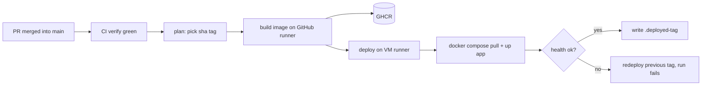

# Feature — Auto deploy to dev

🇻🇳 Bản tiếng Việt: [auto-deploy-dev.vi.md](auto-deploy-dev.vi.md)

## Summary

After a change is merged into `main` and CI is green, the dev VM runs it without a
manual step. Debugging and QC stay on the developer's machine; the dev VM is where a
settled fix lands. Decision and trade-offs: [ADR 0016](../adr/0016-auto-deploy-dev.md).

## Routes

None. The only runtime surface it touches is `GET /api/health`, used as the
post-deploy probe.

## Data

No application data. It moves a container image (`ghcr.io/<owner>/chuyennhahung-app`,
tags `sha-<commit>` and `dev`) and keeps the last deployed tag in
`/opt/chuyennhahung/.deployed-tag` on the VM. Configuration: the repository variable
`DEV_SITE_URL` (default `http://192.168.100.140`, baked into the image at build time)
and the runner label `cnh-dev`. No secret is added: the registry login uses the job's
own `GITHUB_TOKEN`.

## How it works

`plan` accepts only a green CI push to `main` or a dispatch on `main`. `build` runs on
a hosted runner (the VM is too small for `next build`). `deploy` runs on the
self-hosted runner and calls [`deploy/deploy.sh`](../../deploy/deploy.sh), which uses the
compose files of the deployed commit with the stack's `.env` and volumes. Dispatching
the workflow with `tag=sha-<old>` skips the build and redeploys that image.

## Files

| Path | Role |
|---|---|
| `.github/workflows/deploy-dev.yml` | Triggers, plan/build/deploy jobs |
| `deploy/deploy.sh` | Pull, start, health probe, rollback, state file |
| `deploy/compose.app.yml` | `image:` takes `APP_IMAGE` / `APP_IMAGE_TAG` |
| `tests/deploy-config.test.ts` | Static guards on the trust boundary and the script |
| `docs/adr/0016-auto-deploy-dev.md` | The decision |

## Tests

`tests/deploy-config.test.ts` asserts: no `pull_request`/`pull_request_target`
trigger; the green-CI-on-`main` gates are present; the deploy job targets the
self-hosted runner; deploys are serialised without cancelling; the script is valid
bash and rejects a missing or malformed tag; compose keeps the parameterised image.
**Not tested:** the pull, the restart, the health wait and the rollback — they need the
VM and are NOT RUN until the runner is registered.

## Limits and open questions

- A rollback restores the image, not the database schema; migrations must stay
  backward compatible with the previous release.
- The runner only recreates `app`. First-time setup of the stack (host directories, `.env`,
  nginx, postgres) and later changes to `deploy/nginx/` are done by hand —
  [docker-deploy.md](docker-deploy.md#updating-by-the-runner).
- One app replica, so a deploy has a short gap while the container restarts.
- The runner user must be in the `docker` group (root-equivalent on the VM); the
  runner never sees PR code only because of the triggers — do not add PR triggers.
- Dev only, over HTTP. Prod needs its own image (the URL is baked in), runner label
  and a human-controlled trigger; GitHub Free cannot require an approval click.
- Whether `docker compose` on the VM is the apt plugin and whether the GHCR package
  is readable by `GITHUB_TOKEN` are unverified assumptions until the first run.
