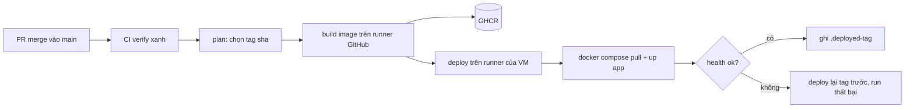

# Tính năng — Tự động deploy lên dev

🇬🇧 English version: [auto-deploy-dev.md](auto-deploy-dev.md)

## Summary

Sau khi một thay đổi được merge vào `main` và CI xanh, VM dev tự chạy nó mà không cần
bước thủ công. Debug và QC vẫn ở máy của người phát triển; VM dev là nơi bản sửa đã
chốt hạ cánh. Quyết định và đánh đổi: [ADR 0016](../adr/0016-auto-deploy-dev.vi.md).

## Routes

Không có. Bề mặt runtime duy nhất nó chạm tới là `GET /api/health`, dùng làm probe
sau deploy.

## Data

Không có dữ liệu ứng dụng. Nó di chuyển một image container
(`ghcr.io/<owner>/chuyennhahung-app`, tag `sha-<commit>` và `dev`) và giữ tag vừa
deploy gần nhất trong `/opt/chuyennhahung/.deployed-tag` trên VM. Cấu hình: biến
repository `DEV_SITE_URL` (mặc định `http://192.168.100.140`, đóng vào image lúc
build) và nhãn runner `cnh-dev`. Không thêm secret nào: đăng nhập registry dùng
`GITHUB_TOKEN` của chính job.

## How it works

`plan` chỉ nhận push `main` có CI xanh hoặc dispatch trên `main`. `build` chạy trên
runner của GitHub (VM quá nhỏ cho `next build`). `deploy` chạy trên runner tự host và
gọi [`deploy/deploy.sh`](../../deploy/deploy.sh), script dùng các file compose của
commit đang deploy cùng `.env` và volume của stack. Dispatch workflow với
`tag=sha-<cũ>` sẽ bỏ qua build và deploy lại image đó.

## Files

| Path | Role |
|---|---|
| `.github/workflows/deploy-dev.yml` | Trigger, các job plan/build/deploy |
| `deploy/deploy.sh` | Pull, khởi động, health probe, rollback, file trạng thái |
| `deploy/compose.app.yml` | `image:` nhận `APP_IMAGE` / `APP_IMAGE_TAG` |
| `tests/deploy-config.test.ts` | Test tĩnh canh ranh giới tin cậy và script |
| `docs/adr/0016-auto-deploy-dev.vi.md` | Quyết định |

## Tests

`tests/deploy-config.test.ts` kiểm tra: không có trigger `pull_request` /
`pull_request_target`; các điều kiện CI xanh trên `main` còn đó; job deploy nhắm vào
runner tự host; deploy được xếp hàng mà không huỷ cái đang chạy; script là bash hợp
lệ và từ chối tag thiếu hoặc sai dạng; compose giữ image có tham số.
**Chưa test:** pull, khởi động lại, chờ health và rollback — cần VM nên là NOT RUN
cho tới khi runner được đăng ký.

## Limits and open questions

- Rollback khôi phục image, không khôi phục schema DB; migration phải tương thích
  ngược với bản phát hành trước.
- Một replica app nên khi deploy có khoảng trống ngắn lúc container khởi động lại.
- User của runner phải thuộc nhóm `docker` (tương đương root trên VM); runner không
  thấy code PR chỉ nhờ các trigger — đừng thêm trigger PR.
- Chỉ dev, qua HTTP. Prod cần image riêng (URL bị đóng vào), nhãn runner riêng và
  trigger do người điều khiển; GitHub Free không bắt buộc được nút duyệt.
- Việc `docker compose` trên VM là plugin cài từ apt và package GHCR có đọc được bằng
  `GITHUB_TOKEN` hay không là giả định chưa kiểm chứng cho tới lần chạy đầu tiên.
