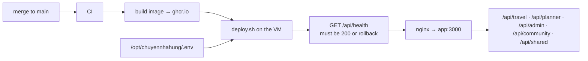

# Runbook — API operations on the dev VM

> Đi đâu cũng có chuyện.

How to call, check and troubleshoot the HTTP APIs of the deployed app, and how each
one depends on the deploy pipeline ([deploy-runner.md](deploy-runner.md),
[ADR 0016](adr/0016-auto-deploy-dev.md)). Contracts live in
[travel-content-api.md](travel-content-api.md) and
[features/travel-planner-core.md](features/travel-planner-core.md); this file is the
operating procedure.

🇻🇳 Bản tiếng Việt: [runbook-api.vi.md](runbook-api.vi.md)

## How it links to deploy



- `deploy.sh` treats `GET /api/health` as the success signal and rolls the container
  back to the previous tag if it does not answer in `WAIT_SECONDS` (default 180).
  Database migrations are **not** rolled back.
- `/api/health` touches no store on purpose, so a database outage appears as `503` on
  Planner routes, not as a failed deploy.
- Variables that change API behaviour come from `.env`
  (`ADMIN_API_TOKEN`, `PLANNER_DATABASE_URL`, `CONTENT_DATABASE_URL`,
  `TRUST_PROXY_HEADERS`, `NEXT_PUBLIC_SITE_URL`). Editing `.env` only takes effect after
  a redeploy ([runbook-google-sign-in.md](runbook-google-sign-in.md), Step 3).
- Nothing publishes port 3000: reach the app through nginx on the VM origin.

## API families and who may call them

| Family | Paths | Credential |
|---|---|---|
| Liveness | `GET /api/health` | none |
| Public content | `GET /api/travel/{stories,places,collections,reviews,templates}[/:slug]` | none; unpublished records answer `404` |
| Planner (traveller) | `/api/planner/**` | session cookie, or `Authorization: Bearer <planner access token>` |
| Planner sign-in | `/api/planner/session`, `/password`, `/oauth/google/{start,callback}` | credentials in the body; the Google routes are `404` when unconfigured |
| Shared trips | `GET /api/shared/:token` | the unguessable token in the URL |
| Community | `GET/POST /api/community/{reviews,trips}` | public reads; writes need a session |
| Admin / operator | `/api/admin/travel/**`, `/api/admin/planner/**`, `/api/admin/community/**` | `Authorization: Bearer <ADMIN_API_TOKEN>`; some content routes also accept an `editor`/`admin` session (ADR 0011) |

Every mutating call that uses a cookie must send a same-origin `Origin` or
`Sec-Fetch-Site`, otherwise `403 forbidden`. A bearer call from `curl` does not need it.

## Smoke test after a deploy

Replace `ORIGIN` with the VM origin. Never put the token on a command line you share:
read it into a shell variable first (`read -rs ADMIN_API_TOKEN`).

```bash
curl -fsS ORIGIN/api/health                                  # {"status":"ok"}
curl -fsS ORIGIN/api/travel/places | head -c 300             # public content
curl -si ORIGIN/api/planner | head -n 1                      # 401 without a credential
curl -si -H "Authorization: Bearer $ADMIN_API_TOKEN" \
  ORIGIN/api/admin/travel/integrity | head -n 1              # 200 with the token
curl -si ORIGIN/api/planner/oauth/google/start | head -n 1   # 302 if Google is set, 404 if not
```

## Reading failures

| Symptom | Likely cause | Action |
|---|---|---|
| Deploy rolled back, health never passed | The image starts but crashes, or `.env` lacks a required variable (`PLANNER_DATABASE_URL`, `NEXT_PUBLIC_SITE_URL`) | `docker compose logs --tail 60 app`, fix `.env`, redeploy |
| `503 admin_auth_unconfigured` on `/api/admin/**` | `ADMIN_API_TOKEN` empty or shorter than 32 characters | Set one: `openssl rand -base64 36`, redeploy |
| `401 unauthorized` on `/api/admin/**` | Wrong or stale token | Use the VM's token, not your local one |
| `503` on `/api/planner/**` | Database unreachable | See [deploy-database.md](deploy-database.md) (TLS, role, network) |
| `403 forbidden` on a cookie request | Missing same-origin header | Call from the site, or use a bearer token |
| `403 password_change_required` | Temporary password not changed yet | Change it at `/doi-mat-khau` |
| `429` | Rate limit or the scrypt gate | Wait; limits are in memory and reset on restart |
| `412 version_conflict` | `If-Match` is stale | Re-read the record and retry |
| `413 payload_too_large` | Body over 256 KiB | Shorten it |
| Public content is empty | Fresh store: the demo seed is skipped when `TRAVEL_CONTENT_AUTOSEED=false` | Seed or import: [travel-content-api.md](travel-content-api.md) |

## Operator tasks

| Task | Call |
|---|---|
| List or create a user | `GET` / `POST /api/admin/planner/users` |
| Reset a password | `POST /api/admin/planner/users/:userId/reset-password` (prints a temporary password once; signs the user out everywhere) |
| Sign a user out everywhere | `POST /api/admin/planner/users/:userId/rotate-token` |
| Unlink Google | `DELETE /api/admin/planner/users/:userId/google` |
| Change a role | `PATCH /api/admin/planner/users/:userId` |
| Check data integrity | `GET /api/admin/planner/integrity`, `GET /api/admin/travel/integrity` |
| Moderate community content | `/api/admin/community/{queue,reviews,trips,restrictions}` |
| Create the first admin | `docker compose … run --rm tools npm run admin:create -- --email <email>` (see [usage.md](usage.md)) |

## Rollback

Run **Deploy dev** from `main` with `tag` = `sha-<good commit>`: `deploy.sh` pulls that
image and checks `/api/health`. A schema migration that already ran is not undone;
read [deploy-database.md](deploy-database.md) before rolling back across one.

## Limits and open questions

- Verified on the dev VM (external-db overlay, nginx on port 80): `/api/health` answers
  `200` and `/api/planner/oauth/google/start` answers `302`. Not run there yet: the
  other smoke-test lines, which need `ADMIN_API_TOKEN` in your own shell.
- This lists the families and the operator calls; the exact request and response
  shapes are in the contracts linked at the top, and the source of truth for the route
  list is `src/app/api/**/route.ts`.
- The Planner map, AI suggestions and a hosted identity provider are not built (see
  `CLAUDE.md` rule 6); there is no API for them to document.
