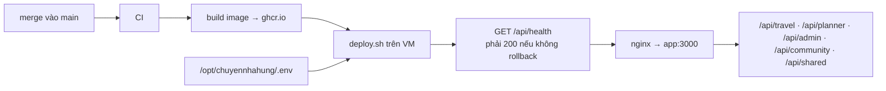

# Runbook — Vận hành API trên VM dev

> Đi đâu cũng có chuyện.

Cách gọi, kiểm tra và xử lý sự cố các API HTTP của app đã deploy, và mỗi API phụ thuộc
pipeline deploy ra sao ([deploy-runner.vi.md](deploy-runner.vi.md),
[ADR 0016](adr/0016-auto-deploy-dev.md)). Hợp đồng nằm ở
[travel-content-api.vi.md](travel-content-api.vi.md) và
[features/travel-planner-core.vi.md](features/travel-planner-core.vi.md); file này là quy
trình vận hành.

🇻🇳 English version: [runbook-api.md](runbook-api.md)

## Liên kết với deploy



- `deploy.sh` coi `GET /api/health` là tín hiệu thành công và rollback container về tag
  trước nếu nó không trả lời trong `WAIT_SECONDS` (mặc định 180). Migration database
  **không** được rollback.
- `/api/health` cố ý không chạm store nào, nên database hỏng hiện ra là `503` ở các route
  Planner, không phải deploy thất bại.
- Các biến làm đổi hành vi API đến từ `.env` (`ADMIN_API_TOKEN`, `PLANNER_DATABASE_URL`,
  `CONTENT_DATABASE_URL`, `TRUST_PROXY_HEADERS`, `NEXT_PUBLIC_SITE_URL`). Sửa `.env` chỉ có
  hiệu lực sau khi deploy lại ([runbook-google-sign-in.vi.md](runbook-google-sign-in.vi.md),
  Bước 3).
- Không có gì publish cổng 3000: truy cập app qua nginx ở origin của VM.

## Các nhóm API và ai được gọi

| Nhóm | Đường dẫn | Credential |
|---|---|---|
| Liveness | `GET /api/health` | không |
| Nội dung công khai | `GET /api/travel/{stories,places,collections,reviews,templates}[/:slug]` | không; bản ghi chưa publish trả `404` |
| Planner (người dùng) | `/api/planner/**` | cookie phiên, hoặc `Authorization: Bearer <planner access token>` |
| Đăng nhập Planner | `/api/planner/session`, `/password`, `/oauth/google/{start,callback}` | credential trong body; route Google trả `404` khi chưa cấu hình |
| Chuyến đi chia sẻ | `GET /api/shared/:token` | token khó đoán trong URL |
| Cộng đồng | `GET/POST /api/community/{reviews,trips}` | đọc công khai; ghi cần phiên |
| Admin / operator | `/api/admin/travel/**`, `/api/admin/planner/**`, `/api/admin/community/**` | `Authorization: Bearer <ADMIN_API_TOKEN>`; một số route nội dung cũng nhận phiên `editor`/`admin` (ADR 0011) |

Mọi lệnh ghi dùng cookie phải gửi `Origin` hoặc `Sec-Fetch-Site` cùng origin, nếu không
sẽ nhận `403 forbidden`. Lệnh bearer từ `curl` không cần.

## Smoke test sau khi deploy

Thay `ORIGIN` bằng origin của VM. Đừng bao giờ để token trên dòng lệnh bạn sẽ chia sẻ:
đọc vào biến shell trước (`read -rs ADMIN_API_TOKEN`).

```bash
curl -fsS ORIGIN/api/health                                  # {"status":"ok"}
curl -fsS ORIGIN/api/travel/places | head -c 300             # nội dung công khai
curl -si ORIGIN/api/planner | head -n 1                      # 401 khi không có credential
curl -si -H "Authorization: Bearer $ADMIN_API_TOKEN" \
  ORIGIN/api/admin/travel/integrity | head -n 1              # 200 khi có token
curl -si ORIGIN/api/planner/oauth/google/start | head -n 1   # 302 nếu đã có Google, 404 nếu chưa
```

## Đọc lỗi

| Triệu chứng | Nguyên nhân có thể | Việc cần làm |
|---|---|---|
| Deploy bị rollback, health không bao giờ qua | Image chạy nhưng crash, hoặc `.env` thiếu biến bắt buộc (`PLANNER_DATABASE_URL`, `NEXT_PUBLIC_SITE_URL`) | `docker compose logs --tail 60 app`, sửa `.env`, deploy lại |
| `503 admin_auth_unconfigured` ở `/api/admin/**` | `ADMIN_API_TOKEN` rỗng hoặc ngắn hơn 32 ký tự | Đặt token: `openssl rand -base64 36`, deploy lại |
| `401 unauthorized` ở `/api/admin/**` | Token sai hoặc cũ | Dùng token của VM, không phải của local |
| `503` ở `/api/planner/**` | Không tới được database | Xem [deploy-database.vi.md](deploy-database.vi.md) (TLS, role, mạng) |
| `403 forbidden` với request dùng cookie | Thiếu header cùng origin | Gọi từ site, hoặc dùng bearer token |
| `403 password_change_required` | Chưa đổi mật khẩu tạm | Đổi ở `/doi-mat-khau` |
| `429` | Chạm rate limit hoặc cổng scrypt | Chờ; giới hạn nằm trong bộ nhớ và reset khi khởi động lại |
| `412 version_conflict` | `If-Match` đã cũ | Đọc lại bản ghi rồi thử lại |
| `413 payload_too_large` | Body quá 256 KiB | Rút gọn |
| Nội dung công khai trống | Store mới: seed demo bị bỏ qua khi `TRAVEL_CONTENT_AUTOSEED=false` | Seed hoặc import: [travel-content-api.vi.md](travel-content-api.vi.md) |

## Việc của operator

| Việc | Lời gọi |
|---|---|
| Liệt kê hoặc tạo user | `GET` / `POST /api/admin/planner/users` |
| Reset mật khẩu | `POST /api/admin/planner/users/:userId/reset-password` (in mật khẩu tạm một lần; đăng xuất user ở mọi nơi) |
| Đăng xuất user ở mọi nơi | `POST /api/admin/planner/users/:userId/rotate-token` |
| Gỡ liên kết Google | `DELETE /api/admin/planner/users/:userId/google` |
| Đổi vai trò | `PATCH /api/admin/planner/users/:userId` |
| Kiểm tra toàn vẹn dữ liệu | `GET /api/admin/planner/integrity`, `GET /api/admin/travel/integrity` |
| Kiểm duyệt nội dung cộng đồng | `/api/admin/community/{queue,reviews,trips,restrictions}` |
| Tạo admin đầu tiên | `docker compose … run --rm tools npm run admin:create -- --email <email>` (xem [usage.vi.md](usage.vi.md)) |

## Rollback

Chạy **Deploy dev** từ `main` với `tag` = `sha-<commit tốt>`: `deploy.sh` kéo image đó và
kiểm tra `/api/health`. Migration schema đã chạy sẽ không được hoàn tác; đọc
[deploy-database.vi.md](deploy-database.vi.md) trước khi rollback qua một migration.

## Giới hạn và câu hỏi còn mở

- Đã kiểm chứng trên VM dev (overlay external-db, nginx cổng 80): `/api/health` trả `200`
  và `/api/planner/oauth/google/start` trả `302`. Chưa chạy ở đó: các dòng smoke test còn
  lại, cần `ADMIN_API_TOKEN` trong shell của chính bạn.
- File này liệt kê các nhóm và lời gọi của operator; hình dạng request/response chính xác
  nằm ở các hợp đồng liên kết ở đầu file, còn nguồn sự thật cho danh sách route là
  `src/app/api/**/route.ts`.
- Bản đồ Planner, gợi ý AI và nhà cung cấp định danh bên ngoài chưa được xây (xem quy tắc
  6 của `CLAUDE.md`); không có API nào để ghi tài liệu cho chúng.
