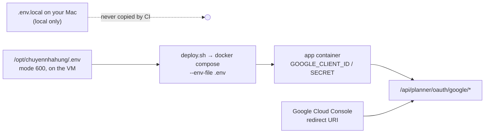

# Runbook — Google sign-in on the dev VM

> Đi đâu cũng có chuyện.

How to turn Google sign-in on, change it and fix it on the deployed stack, and how it
ties to the deploy pipeline ([deploy-runner.md](deploy-runner.md),
[ADR 0016](adr/0016-auto-deploy-dev.md)). The design is in
[ADR 0007](adr/0007-password-and-google-sign-in.md); this file is the operating
procedure. Every privileged step is done by the owner.

🇻🇳 Bản tiếng Việt: [runbook-google-sign-in.vi.md](runbook-google-sign-in.vi.md)

## How it links to deploy



- The deploy runner never sees your `.env.local`. `deploy/deploy.sh` passes
  `$STACK_DIR/.env` (default `/opt/chuyennhahung/.env`) to Compose, and
  [compose.app.yml](../deploy/compose.app.yml) forwards `GOOGLE_CLIENT_ID`,
  `GOOGLE_CLIENT_SECRET` and `GOOGLE_SIGNUP_ENABLED` into the `app` container.
- Secrets are **runtime** variables: they are not in the image and not in the
  workflow. Only `NEXT_PUBLIC_SITE_URL` is baked at build time, and the Google
  redirect URI is derived from it.
- Compose reads `.env` as the runner user; see Step 2 of
  [deploy-runner.md](deploy-runner.md) for the permission trade-off.

## Prerequisites

| Need | Where |
|---|---|
| Dev VM with the stack and runner installed | [deploy-runner.md](deploy-runner.md), [deploy-database.md](deploy-database.md) |
| An OAuth 2.0 Web client in Google Cloud Console | owner's Google account — **flag: real data, not in the repo** |
| A public origin Google accepts | see *Redirect URI* below |

## Step 1 — Register the redirect URI

In Google Cloud Console → APIs & Services → Credentials → the OAuth client, add under
**Authorised redirect URIs**, exactly:

```
<NEXT_PUBLIC_SITE_URL>/api/planner/oauth/google/callback
```

For local development that is `http://localhost:3000/api/planner/oauth/google/callback`.
For the dev VM it is `http://192.168.100.140/api/planner/oauth/google/callback` **only if
Google accepts it**: Google normally refuses a bare IP over plain HTTP (only
`localhost` is exempt). If it is refused, give the VM a real hostname (or an
`nip.io`-style one), set the repository variable `DEV_SITE_URL` to it and redeploy with
a build, because `NEXT_PUBLIC_SITE_URL` is baked into the image. `GOOGLE_REDIRECT_URI`
overrides the derived value but is **not** forwarded by `compose.app.yml` today, so use
the hostname route.

## Step 2 — Put the credentials on the VM

Type the secret only in your own terminal, never in chat or a ticket.

```bash
sudo nano /opt/chuyennhahung/.env
```

```
GOOGLE_CLIENT_ID=<from Google Cloud Console>
GOOGLE_CLIENT_SECRET=<from Google Cloud Console>
# optional: false stops a first Google sign-in from creating an account
GOOGLE_SIGNUP_ENABLED=true
```

```bash
sudo chmod 600 /opt/chuyennhahung/.env
```

Never use the `NEXT_PUBLIC_` prefix for these; `tests/client-boundary.test.ts` guards it.

## Step 3 — Roll it out

The container only reads its environment when it is created. Run **Deploy dev** from
`main` with `tag` = `sha-<current commit>` (no build): `deploy.sh` runs
`compose up -d app`, and Compose recreates a service whose resolved configuration
changed. Check it:

```bash
docker compose -f /opt/chuyennhahung/app/deploy/compose.yml ps   # app is healthy
journalctl -u <runner unit> -n 50 --no-pager                      # deploy output
```

## Step 4 — Verify

| Check | Expected |
|---|---|
| Open `/dang-nhap` | the "Continue with Google" button is visible |
| Click it | Google consent, then back on the site signed in |
| `curl -i <origin>/api/planner/oauth/google/start` | `302` to `accounts.google.com`; **`404` means a variable is missing** (fail closed) |
| A first sign-in with a new address | creates a `member`; Google never grants `editor` or `admin` |

## Day-to-day

| Task | How |
|---|---|
| Rotate the client secret | Create a new secret in Google Console, edit `.env`, redeploy (Step 3), delete the old secret |
| Close self-service signup | `GOOGLE_SIGNUP_ENABLED=false`, redeploy; existing links still sign in |
| User sees `link_required` | An account with that email exists but is not linked. Sign in with the password, then use *Link Google account* on `/doi-mat-khau` |
| User sees `account_conflict` | Google reassigned the address to another `sub`. An operator checks, then unlinks: `DELETE /api/admin/planner/users/:userId/google` (see [runbook-api.md](runbook-api.md)) |
| User sees `account_not_found` | `GOOGLE_SIGNUP_ENABLED=false` and no account yet; create one in `/quan-tri` |
| `redirect_uri_mismatch` from Google | The URI in Step 1 differs from `NEXT_PUBLIC_SITE_URL` + the callback path, character for character |
| The admin is locked out | `npm run admin:create` — see [usage.md](usage.md) *Accounts and passwords at a glance* |

## Rollback

Google sign-in is additive. To switch it off, empty both variables in `.env` and
redeploy: both routes answer `404`, the button disappears, password sign-in keeps
working. To roll back the code, run **Deploy dev** with an older `sha-<commit>` tag;
the credentials stay in `.env`.

## Limits and open questions

- Not verified on the VM yet: Google accepting the VM's origin, and the end-to-end
  sign-in from a browser on the dev network.
- The rate limits and the signup throttle are in-memory and per process, so a restart
  resets them.
- `GOOGLE_REDIRECT_URI` is not forwarded by `deploy/compose.app.yml`. Add it there
  (in a reviewed change) only if a hostname cannot be arranged.
- Credentials that have appeared in a chat, a log or a screenshot must be treated as
  leaked: rotate them.
