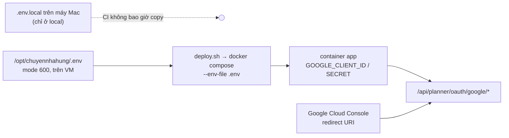

# Runbook — Đăng nhập Google trên VM dev

> Đi đâu cũng có chuyện.

Cách bật, đổi và sửa lỗi đăng nhập Google trên stack đã deploy, và nó gắn với pipeline
deploy ra sao ([deploy-runner.vi.md](deploy-runner.vi.md),
[ADR 0016](adr/0016-auto-deploy-dev.md)). Thiết kế nằm ở
[ADR 0007](adr/0007-password-and-google-sign-in.md); file này là quy trình vận hành.
Mọi bước cần quyền cao đều do chủ dự án tự làm.

🇻🇳 English version: [runbook-google-sign-in.md](runbook-google-sign-in.md)

## Liên kết với deploy



- Runner deploy không bao giờ thấy `.env.local` của bạn. `deploy/deploy.sh` đưa
  `$STACK_DIR/.env` (mặc định `/opt/chuyennhahung/.env`) cho Compose, và
  [compose.app.yml](../deploy/compose.app.yml) chuyển `GOOGLE_CLIENT_ID`,
  `GOOGLE_CLIENT_SECRET`, `GOOGLE_SIGNUP_ENABLED` vào container `app`.
- Secret là biến **runtime**: không nằm trong image, không nằm trong workflow. Chỉ
  `NEXT_PUBLIC_SITE_URL` được nhúng lúc build, và redirect URI của Google được suy ra
  từ nó.
- Compose đọc `.env` dưới user của runner; xem Bước 2 của
  [deploy-runner.vi.md](deploy-runner.vi.md) về điểm đánh đổi quyền truy cập.

## Điều kiện cần

| Cần | Ở đâu |
|---|---|
| VM dev đã có stack và runner | [deploy-runner.vi.md](deploy-runner.vi.md), [deploy-database.vi.md](deploy-database.vi.md) |
| OAuth 2.0 Web client trong Google Cloud Console | tài khoản Google của chủ dự án — **lưu ý: dữ liệu thật, không nằm trong repo** |
| Một origin công khai mà Google chấp nhận | xem *Redirect URI* bên dưới |

## Bước 1 — Đăng ký redirect URI

Trong Google Cloud Console → APIs & Services → Credentials → OAuth client, thêm vào
**Authorised redirect URIs**, đúng từng ký tự:

```
<NEXT_PUBLIC_SITE_URL>/api/planner/oauth/google/callback
```

Với local là `http://localhost:3000/api/planner/oauth/google/callback`.

Với VM dev, Google không nhận IP trần (`http://192.168.100.140/…`). Cách chạy được,
**đã kiểm chứng trên VM dev**, là hostname `nip.io` qua HTTP thường: tên
`192-168-100-140.nip.io` phân giải ra `192.168.100.140` nhờ DNS công khai của nip.io, nên
không phải tạo hay sửa gì, và nginx vốn đã nhận mọi host (`server_name _`). Vậy URI của dev
là:

```
http://192-168-100-140.nip.io/api/planner/oauth/google/callback
```

1. Thêm nó vào **Authorised redirect URIs**. Để trống **Authorised JavaScript origins**:
   luồng chạy hoàn toàn ở server, và ô đó từ chối mọi đường dẫn với thông báo
   `Invalid Origin: URIs must not contain a path or end with "/"`. Thông báo này nghĩa là
   URI đã dán nhầm ô.
2. Gán biến repository `DEV_SITE_URL` bằng `http://192-168-100-140.nip.io`
   (`gh variable set DEV_SITE_URL --body …`) rồi chạy **Deploy dev** với `tag` để trống,
   vì `NEXT_PUBLIC_SITE_URL` được nhúng vào image lúc build.
3. Đặt cùng giá trị đó cho `NEXT_PUBLIC_SITE_URL` trong `.env` của VM (Bước 2). Server suy
   ra redirect URI từ nó lúc chạy, nên giá trị cũ ở đó sẽ gửi cho Google URI cũ.

`GOOGLE_REDIRECT_URI` ghi đè giá trị suy ra nhưng hiện **không** được `compose.app.yml`
chuyển vào, nên hãy đi đường hostname.

Chỉ người cùng mạng LAN mới vào được site, và cái tên phụ thuộc việc nip.io còn hoạt động.

## Bước 2 — Đặt credential lên VM

Chỉ gõ secret trong terminal của bạn, không bao giờ trong chat hay ticket.

```bash
sudo nano /opt/chuyennhahung/.env
```

```
GOOGLE_CLIENT_ID=<lấy từ Google Cloud Console>
GOOGLE_CLIENT_SECRET=<lấy từ Google Cloud Console>
# tuỳ chọn: false thì lần đăng nhập Google đầu tiên không tạo tài khoản
GOOGLE_SIGNUP_ENABLED=true
```

```bash
sudo chmod 600 /opt/chuyennhahung/.env
```

Không bao giờ dùng tiền tố `NEXT_PUBLIC_` cho các biến này; `tests/client-boundary.test.ts`
canh chuyện đó.

## Bước 3 — Áp dụng

Container chỉ đọc biến môi trường khi được tạo. Chạy **Deploy dev** từ `main` với
`tag` = `sha-<commit hiện tại>` (không build): `deploy.sh` chạy `compose up -d app`, và
Compose tạo lại service có cấu hình đã resolve thay đổi (đã kiểm chứng: một lần chạy cùng
tag image, chỉ đổi `GOOGLE_SIGNUP_ENABLED` trong `.env`, đã tạo lại container với giá trị
mới). Kiểm tra:

```bash
docker compose -f /opt/chuyennhahung/app/deploy/compose.yml ps   # app healthy
journalctl -u <unit của runner> -n 50 --no-pager                  # output deploy
```

## Bước 4 — Kiểm chứng

| Kiểm tra | Kỳ vọng |
|---|---|
| Mở `/dang-nhap` | thấy nút "Tiếp tục với Google" |
| Bấm nút | màn hình đồng ý của Google, rồi quay lại site đã đăng nhập |
| `curl -i <origin>/api/planner/oauth/google/start` | `302` tới `accounts.google.com`; **`404` nghĩa là thiếu biến** (fail closed) |
| Lần đầu đăng nhập bằng địa chỉ mới | tạo `member`; Google không bao giờ cấp `editor` hay `admin` |

## Vận hành hằng ngày

| Việc | Cách làm |
|---|---|
| Đổi client secret | Tạo secret mới trong Google Console, sửa `.env`, deploy lại (Bước 3), xoá secret cũ |
| Đóng đăng ký tự phục vụ | `GOOGLE_SIGNUP_ENABLED=false`, deploy lại; tài khoản đã liên kết vẫn đăng nhập được |
| Người dùng gặp `link_required` | Đã có tài khoản cùng email nhưng chưa liên kết. Đăng nhập bằng mật khẩu, rồi dùng *Liên kết tài khoản Google* ở `/doi-mat-khau` |
| Người dùng gặp `account_conflict` | Google đã gán địa chỉ cho `sub` khác. Operator kiểm tra rồi gỡ liên kết: `DELETE /api/admin/planner/users/:userId/google` (xem [runbook-api.vi.md](runbook-api.vi.md)) |
| Người dùng gặp `account_not_found` | `GOOGLE_SIGNUP_ENABLED=false` và chưa có tài khoản; tạo ở `/quan-tri` |
| Google báo `redirect_uri_mismatch` | URI ở Bước 1 khác `NEXT_PUBLIC_SITE_URL` + đường dẫn callback, dù chỉ một ký tự |
| Admin bị khoá ngoài | `npm run admin:create` — xem [usage.vi.md](usage.vi.md) mục *Accounts and passwords at a glance* |

## Rollback

Đăng nhập Google là phần cộng thêm. Để tắt, để trống cả hai biến trong `.env` rồi deploy
lại: hai route trả `404`, nút biến mất, đăng nhập bằng mật khẩu vẫn chạy. Để rollback
code, chạy **Deploy dev** với tag `sha-<commit>` cũ hơn; credential vẫn nằm trong `.env`.

## Giới hạn và câu hỏi còn mở

- Đã kiểm chứng trên VM dev: Google chấp nhận redirect URI `nip.io` qua HTTP, `start` trả
  `302` với đúng `redirect_uri` đó, và đăng nhập từ trình duyệt trong mạng dev chạy được.
  Chưa kiểm chứng: đường gỡ liên kết và `account_conflict`.
- Khi `GOOGLE_SIGNUP_ENABLED=false`, địa chỉ Google chưa có tài khoản nhận
  `account_not_found`; khi `true`, ai có tài khoản Google cũng tạo được `member`. Đặt lại
  `false` khi VM dev không dùng để test mở.
- Rate limit và throttle đăng ký nằm trong bộ nhớ, theo từng process, nên khởi động lại
  là reset.
- `GOOGLE_REDIRECT_URI` không được `deploy/compose.app.yml` chuyển vào. Chỉ thêm nó ở đó
  (qua một thay đổi có review) nếu không thể có hostname.
- Credential từng xuất hiện trong chat, log hay ảnh chụp màn hình phải coi là đã lộ:
  hãy đổi mới.
