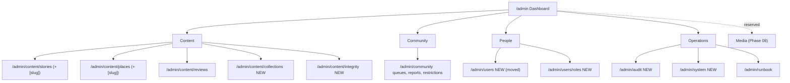

# Admin Workspace spec — review, inventory and design

🇻🇳 Bản tiếng Việt: [specs-admin-workspace.vi.md](specs-admin-workspace.vi.md)

Status: **Proposed** (2026-11-17, system-architect, main session, no subagents). Nothing in
this document is implemented. Database, API and RBAC effects and the review checklists are in
[specs-admin-workspace-impact.md](specs-admin-workspace-impact.md); the decision to change the
admin routes is [ADR 0020](adr/0020-admin-workspace-shell.md). Task Contracts, session plan and
the roadmap proposal live under `.claude/contracts/admin-workspace-index.md` (agent working files,
not part of `docs/`).

## Verdict

The admin portal is **a working set of pages without a workspace around it**. Authorization,
the user console, the story/place/review CMS and the community queues exist and are tested; what is
missing is the frame: there is no `layout.tsx` under `src/app/[locale]/admin/`, each page renders
its own header plus a flat row of six pill links (`src/components/admin/admin-nav.tsx`), `/quan-tri`
is the user table for admins and a one-paragraph stub for editors, and several backend APIs have
no screen (collections, integrity, Google unlink, token rotation). Operations (audit, system) has
no home beyond the Runbook.

Recommendation: **build the frame and the missing screens on the existing APIs, do not rewrite
anything that works.** Eight features (Task IDs `P07-10`…`P07-17`, plus `P07-18` blocked) are
proposed; five need no database change and none changes an existing endpoint's behaviour. The
Phase 10 batches 10.1–10.7 keep their scope and order; this work interleaves with them without
sharing a file except where the sequencing table says so.

## Evidence and method

Read, not scanned: `CLAUDE.md`, `.claude/roadmap/{PHASES,CURRENT,backlog,DEPLOY-STATUS}.md`,
`.claude/contracts/phase10-index.md` and contracts 10.2 and 10.5, ADR 0006/0010/0011/0017/0019,
`docs/features/admin-portal.md`, `src/server/identity/permissions.ts`,
`src/server/planner/admin-page.ts`, `src/lib/admin-gate.ts`, `src/components/admin/**`,
`src/app/[locale]/admin/**`, `src/app/api/admin/**` (route list), `src/i18n/routing.ts`.

- **State of the repository:** `main` at `9c9d8a2` (PR #111, Phase 10 contracts merged). The branch
  `feat/submission-state-machine` holds one unmerged commit (`0bce578`, batch 10.1); no PR is
  open on GitHub. Phase 10 batches 10.2–10.7 are **READY, not started**. Phase 11–15 are
  **Designed**. Phase 05 is Done; Phase 07 is In progress.
- **The DEV site** `http://192-168-100-140.nip.io/quan-tri` answers `307` to
  `/dang-nhap?returnTo=%2Fquan-tri` for an anonymous request (checked with `curl`), so the gate
  works and the host is up. **An authenticated walk-through was NOT RUN**: it needs the owner's
  credentials. "Existing" below therefore means *present in `main` with code and tests*, not
  *seen working on DEV*. `.claude/roadmap/DEPLOY-STATUS.md` still dates the VM deploy at commit
  `0216f46`, before PR #93–#105; the owner should confirm which commit DEV runs.
- **Legend:** **Existing** = shipped in `main`; **Improvement** = shipped but needs change;
  **Missing** = absent and unplanned; **Planned** = already inside another Phase or Task Contract
  (not re-planned here).

## Inventory by area

### Dashboard

| Item | Status | Evidence |
|---|---|---|
| Overview for editors: greeting, one link to stories | Existing (stub) | `src/app/[locale]/admin/page.tsx` |
| Overview for admins is the user table | Improvement | same file, `AdminConsole` |
| Counts: pending trips and reviews, drafts, users per role, integrity findings | Missing | queue and integrity APIs exist, nothing aggregates them |
| Recent activity feed | Planned | needs `audit_events` — Phase 10 batch 10.2 (`P10-1`) |

### Layout and navigation

| Item | Status | Evidence |
|---|---|---|
| Role-aware section links (`can()`), hiding is not authorization | Existing | `admin-nav.tsx`, `src/lib/admin-gate.ts` |
| Shared admin layout, sidebar, breadcrumbs, skip link | Missing | no `layout.tsx` in `src/app/[locale]/admin/` |
| Responsive navigation (375px) | Improvement | flat wrapping pill list today |
| Per-page gate with `returnTo` and `noIndex` | Existing | `requireStaff`, `noIndex` |
| Route namespace for new areas | Missing | needs ADR 0020 |

### Content management

| Item | Status | Evidence |
|---|---|---|
| Stories and places list, edit, publish/archive; review moderation, `If-Match` | Existing | ADR 0011, `src/components/admin/content/**` |
| Collections screen | Missing (API exists, token-only) | `api/admin/travel/collections/**`: no page, and no `session: true` so a browser session gets 401 |
| Integrity report screen | Missing (API exists, token-only) | `api/admin/travel/integrity`, `api/admin/planner/integrity`: same |
| Create story or place, delete in the browser | Missing | `POST` handlers use token-only `adminRoute` (ADR 0011 left them) |
| Template editor and template versioning | Missing, undecided | `P07-6`, `api/admin/travel/templates/**` token-only |
| List search, sort, pagination | Improvement | status filter only in `content-list.tsx` |

### Community moderation

| Item | Status | Evidence |
|---|---|---|
| Trip listing queue, review queue, restrictions | Existing | `src/components/admin/community/**`, `api/admin/community/**` |
| One screen with counts and a reading order | Improvement | three stacked lists on `/admin/community` |
| Reports queue and Resolve | Planned | Phase 10 batch 10.5 (`P10-3`) edits this page |
| Per-item event history | Planned | Phase 10 batch 10.2 route `GET /api/admin/community/events` |
| Submission state machine | Planned (implemented on a branch) | Phase 10 batch 10.1 |

### Users and roles

| Item | Status | Evidence |
|---|---|---|
| Create, re-role, reset password, ban/unban, soft delete, restore, purge with impact, filter | Existing | `user-table.tsx`, `create-user-form.tsx`, `filter-users.ts`, ADR 0010/0017 |
| Google unlink and token rotation in the browser | Missing (API exists) | `users/[userId]/google`, `rotate-token` — no component names them |
| Role and permission matrix view | Missing | `ROLE_ACTIONS` is the single source, never shown |
| Server-side pagination and sort | Improvement | `GET users` returns everyone |
| Who changed which role or account | Missing | batch 10.2 explicitly excludes role and user-admin events |
| MFA for `admin` | Planned later | `P07-D1`, deferred (Q6) |

### Media

| Item | Status | Evidence |
|---|---|---|
| Any upload, library or `alt` management | Planned | Phase 08 (`P08-1`, `P08-2`); not started |
| A place in the navigation | Missing | reserved only (see Sitemap) |

### Audit log and system operations

| Item | Status | Evidence |
|---|---|---|
| Runbook (allow-listed docs, `super_admin`) | Existing | ADR 0017, `admin/runbook/page.tsx` |
| Audit storage and community events | Planned | Phase 10 batch 10.2 |
| Audit viewer across users, roles, content | Missing | new, depends on 10.2 |
| System status: store mode, migration, build, flags (booleans only) | Missing | nothing renders it |
| Backups status, production environment | Planned | Phase 09, owner decision `D10` |

## Sitemap and navigation

### Sitemap

Every existing URL is kept. New routes are additive, except that `/admin` changes from "user
table" to a dashboard and the table moves to `/admin/users` (ADR 0020).

| Route (internal) | Vietnamese | Who sees it | Status |
|---|---|---|---|
| `/admin` | `/quan-tri` | any staff | exists, becomes the dashboard |
| `/admin/content/stories`, `…/[slug]`, `/places`, `/places/[slug]`, `/reviews` | `/quan-tri/noi-dung/…` | `content:write` | exists |
| `/admin/content/collections` | `/quan-tri/noi-dung/bo-suu-tap` | `content:write` | new |
| `/admin/content/integrity` | `/quan-tri/noi-dung/toan-ven` | `content:write` | new |
| `/admin/community` | `/quan-tri/cong-dong` | `community:moderate` | exists |
| `/admin/users` | `/quan-tri/nguoi-dung` | `user:provision` | new (moved) |
| `/admin/users/roles` | `/quan-tri/nguoi-dung/vai-tro` | `user:provision` | new |
| `/admin/audit` | `/quan-tri/nhat-ky` | `audit:read` | new |
| `/admin/system` | `/quan-tri/he-thong` | `runbook:read` | new |
| `/admin/runbook` | `/quan-tri/runbook` | `runbook:read` | exists |
| `/admin/media` | `/quan-tri/thu-vien` | `media:*` (future) | **reserved, not routed** until Phase 08 |

### Sidebar and layout

- One `src/app/[locale]/admin/layout.tsx` renders the shell: skip link to `<main>`, a sidebar of
  groups (Overview · Content · Community · People · Media · Operations), a breadcrumb. Each page
  keeps its own `requireStaff(…)` call (the `returnTo` redirect needs the page path) and its own
  single `<h1>`; the layout adds none.
- The sidebar is a server component fed by `can()`; hiding is still not authorization. Groups
  with no visible item disappear. `aria-current="page"` on the active link.
- At phone width the sidebar becomes a disclosure button above the content (real `<button>`,
  `aria-expanded`), targets ≥44px, visible focus, no horizontal scroll.
- Tokens only from `globals.css` `@theme` (CLAUDE.md rule 3); every string in both catalogues.
- `readStaffPageAccess` reads the cookie and the repository; the layout and the page would read
  it twice per request, so it is wrapped in React `cache()` (one read per request).

## Design by area

### Dashboard

A server-rendered grid of role-filtered cards, each a link into the owning screen: pending trip
listings and reviews (editor+), content drafts and integrity findings (editor+), accounts per
role and disabled/soft-deleted counts (admin+), recent activity (admin+, once 10.2 lands),
runtime summary (super admin). One module, `src/server/admin/overview.ts`, composes counts from
the existing repositories; the same function backs `GET /api/admin/overview`. Read-only, `no-store`,
no secrets, no new table.

### Content management

Keep the editors. Add Collections and Integrity screens; their handlers are token-only today, so
this first moves them to the session-capable `adminContentRoute` (an architect-approved amendment
in contract `P07-15`, the same pattern as ADR 0011). Then, as a separate reviewed step, session-capable create and **archive** for
stories and places; hard delete and the template editor stay token-only until the owner decides
template versioning (`P07-6`). Add search and sort to the list.

### Community moderation

Keep the three queues and their routes. Present them as one workspace with counts, a fixed
reading order (pending trips → pending reviews → held → restrictions) and, after batch 10.5, a
Reports section; after 10.2, per-item history. This is information architecture, not new
moderation rules: the state machine, events and reports belong to Phase 10.

### Users and roles

Move the console to `/admin/users` unchanged in behaviour. Add the read-only role/permission
matrix (rendered from `ROLE_ACTIONS`, pinned by a test so the page cannot drift from `can()`),
Google unlink and token rotation on the existing endpoints, and cursor pagination as an additive
API option. Role changes stay governed by `canManageRole` (ADR 0017).

### Media

No design beyond a contract: the nav group and route name are reserved, hidden until Phase 08
ships `MediaStore` and a library (P08-1). Phase 13 reuses it; this workspace does not build a
second one.

### Audit log and system operations

`/admin/audit`: a paginated, filterable read of `audit_events` (actor, target type, action, date),
admin and super admin only, plus the missing event kinds (user admin, content publish/archive).
`/admin/system`: a super-admin read of the facts an operator asks first — which store each
domain uses (JSON or PostgreSQL), last applied migration, build identifier, feature flags as
present/absent **booleans, never values**, health probe result. It shows backups as "not
configured" until the owner supplies facts (`D10`); it does not invent them.

## Gap analysis

| Gap | Why it matters | Closed by | Blocked by |
|---|---|---|---|
| No shared frame | Every new screen re-solves layout, nav, mobile | `P07-10` | ADR 0020 |
| No landing view | Staff open five pages to learn what is waiting | `P07-11` | `P07-10` |
| No audit trail for staff acts | Any admin can reset another admin's password unrecorded (ADR 0010 limit) | `P07-13` (viewer + events) — shipped | Phase 10 batch 10.2 |
| APIs without screens | Collections, integrity, unlink, rotate-token are `curl`-only | `P07-15`, `P07-12` | — |
| Create/archive only by token | Editors cannot add a story in the browser | `P07-16` | owner decision `W5` |
| Moderation screen is a list stack | Slow triage, no counts | `P07-14` | batch 10.5 |
| No operator view of the system | Runbook says what to run, not what is true now | `P07-17` | owner facts `D10` |
| No media area | Phase 08 not started | `P07-18` (reservation) | `P08-1` |

## Reuse map

| Reuse as is | Extend | Do not build |
|---|---|---|
| `can`, `ROLE_ACTIONS`, `canManageRole`, `requireStaff`, `noIndex`, `readStaffPageAccess` | `AdminNav` → sidebar in a layout; `content-list.tsx` (search, sort); `user-table.tsx` (unlink, rotate) | A second auth path, an admin-only API client, a second limiter |
| `adminContentRoute` (session-capable, `no-store`, `If-Match`) | `adminContentRoute` for create/archive routes | Direct DB access from pages |
| `src/components/admin/{content,community}/**`, `ApiError`/`api` client, `inputClass`, `LiveNotice` | Counts endpoint over existing repositories | A new design system or UI kit |
| Phase 10 events helper (10.2), reports (10.5), state machine (10.1) | Viewer and filters over `audit_events` | A parallel log table |

## Roadmap placement

No new Phase ID. The work completes **Phase 07 — Admin Portal, CMS & RBAC** (In progress, P1),
whose own scope lists audit log, CMS create/delete/template and a browser UI. It is proposed as
backlog items `P07-10`…`P07-18` (next free numbers after `P07-9`), with the audit viewer
gated by Phase 10 batch 10.2, the moderation workspace by 10.5 and the media slot by Phase 08.
Phase 10 order and scope are untouched. Details and the edit proposal for `PHASES.md` and
`backlog.md` are in the index contract; **no roadmap file is edited by this change**.

## Open decisions

| # | Decision | Recommendation |
|---|---|---|
| W1 | `/admin` becomes the dashboard and the user table moves to `/admin/users` (ADR 0020), instead of keeping `/admin` as users and adding `/admin/overview` | Move; `/quan-tri` stays a valid URL, so no redirect is needed |
| W2 | New action `audit:read` for admin and super admin only | Yes; editors keep the existing community events route |
| W3 | `/admin/system` reuses `runbook:read` (super admin) | Yes; no new action |
| W4 | Template editing and versioning (`P07-6`) | Decide later; **not contracted** |
| W5 | Browser create + **archive** for stories and places; hard delete stays token-only | Yes |
| W6 | Media entry hidden until Phase 08 | Hidden, not a disabled link |
| W7 | Users list gets cursor pagination (default page 50) | Yes, additive; older callers unaffected |
| W8 | Owner confirms the commit DEV runs and walks the authenticated admin once | Needed before `P07-10` is accepted as "no regression" |
