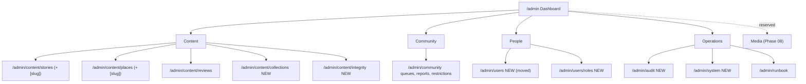

# Spec Admin Workspace — rà soát, kiểm kê và thiết kế

🇻🇳 English version: [specs-admin-workspace.md](specs-admin-workspace.md)

Trạng thái: **Đề xuất** (2026-11-17, system-architect, phiên chính, không dùng subagent). Chưa có
gì trong tài liệu này được triển khai. Ảnh hưởng tới cơ sở dữ liệu, API, RBAC và các checklist
review nằm ở [specs-admin-workspace-impact.vi.md](specs-admin-workspace-impact.vi.md); quyết định
đổi route admin là [ADR 0020](adr/0020-admin-workspace-shell.vi.md). Task Contract, kế hoạch phiên
và đề xuất roadmap nằm ở `.claude/contracts/admin-workspace-index.md` (file làm việc của agent,
không thuộc `docs/`).

## Kết luận

Admin portal hiện là **một tập trang chạy được nhưng chưa có "workspace" bao quanh**. Phân quyền,
bảng người dùng, CMS story/place/review và hàng đợi cộng đồng đã có và có test; thứ thiếu là
khung: không có `layout.tsx` trong `src/app/[locale]/admin/`, mỗi trang tự vẽ header và một hàng
sáu nút phẳng (`src/components/admin/admin-nav.tsx`), `/quan-tri` là bảng người dùng với admin và
một đoạn văn với editor, và vài API backend chưa có màn hình (collections, integrity, gỡ Google,
xoay token). Vận hành (audit, hệ thống) chưa có chỗ ngoài Runbook.

Khuyến nghị: **dựng khung và các màn hình còn thiếu trên API sẵn có, không viết lại thứ đang
chạy.** Đề xuất tám tính năng (Task ID `P07-10`…`P07-17`, thêm `P07-18` bị chặn); năm tính năng
không đổi cơ sở dữ liệu và không tính năng nào đổi hành vi của endpoint hiện có. Các batch Phase 10
(10.1–10.7) giữ nguyên phạm vi và thứ tự; việc này xen kẽ mà không dùng chung file, trừ chỗ bảng
thứ tự nói rõ.

## Bằng chứng và phương pháp

Đã đọc, không quét toàn bộ: `CLAUDE.md`, `.claude/roadmap/{PHASES,CURRENT,backlog,DEPLOY-STATUS}.md`,
`.claude/contracts/phase10-index.md` cùng contract 10.2 và 10.5, ADR 0006/0010/0011/0017/0019,
`docs/features/admin-portal.md`, `src/server/identity/permissions.ts`,
`src/server/planner/admin-page.ts`, `src/lib/admin-gate.ts`, `src/components/admin/**`,
`src/app/[locale]/admin/**`, `src/app/api/admin/**` (danh sách route), `src/i18n/routing.ts`.

- **Trạng thái repository:** `main` tại `9c9d8a2` (PR #111, contract Phase 10 đã merge). Branch
  `feat/submission-state-machine` có một commit chưa merge (`0bce578`, batch 10.1); chưa có PR mở
  trên GitHub. Batch 10.2–10.7 của Phase 10 là **READY, chưa bắt đầu**. Phase 11–15 là
  **Designed**. Phase 05 Done; Phase 07 In progress.
- **Site DEV** `http://192-168-100-140.nip.io/quan-tri` trả `307` về
  `/dang-nhap?returnTo=%2Fquan-tri` với request ẩn danh (kiểm bằng `curl`), nên cổng hoạt động và
  máy chủ đang chạy. **Chưa duyệt khi đã đăng nhập (NOT RUN)**: cần thông tin đăng nhập của chủ dự
  án. Vì vậy "Existing" dưới đây nghĩa là *có trong `main` kèm code và test*, không phải *đã thấy
  chạy trên DEV*. `.claude/roadmap/DEPLOY-STATUS.md` vẫn ghi VM deploy ở commit `0216f46`, trước
  PR #93–#105; chủ dự án nên xác nhận DEV đang chạy commit nào.
- **Chú giải:** **Existing** = đã ship trong `main`; **Improvement** = đã ship nhưng cần đổi;
  **Missing** = chưa có và chưa được lên kế hoạch; **Planned** = đã nằm trong Phase hoặc Task
  Contract khác (không lập kế hoạch lại ở đây).

## Kiểm kê theo khu vực

### Dashboard

| Hạng mục | Trạng thái | Bằng chứng |
|---|---|---|
| Overview cho editor: lời chào, một link tới story | Existing (sơ sài) | `src/app/[locale]/admin/page.tsx` |
| Overview của admin là bảng người dùng | Improvement | cùng file, `AdminConsole` |
| Số liệu: trip và review chờ duyệt, bản nháp, người dùng theo role, lỗi integrity | Missing | API hàng đợi và integrity có, chưa có gì tổng hợp |
| Dòng hoạt động gần đây | Planned | cần `audit_events` — Phase 10 batch 10.2 (`P10-1`) |

### Layout và điều hướng

| Hạng mục | Trạng thái | Bằng chứng |
|---|---|---|
| Link mục theo role (`can()`), ẩn không phải phân quyền | Existing | `admin-nav.tsx`, `src/lib/admin-gate.ts` |
| Layout admin dùng chung, sidebar, breadcrumb, skip link | Missing | không có `layout.tsx` trong `src/app/[locale]/admin/` |
| Điều hướng responsive (375px) | Improvement | hiện là hàng nút xuống dòng |
| Cổng theo trang với `returnTo` và `noIndex` | Existing | `requireStaff`, `noIndex` |
| Không gian route cho khu vực mới | Missing | cần ADR 0020 |

### Quản lý nội dung

| Hạng mục | Trạng thái | Bằng chứng |
|---|---|---|
| Danh sách, sửa, publish/archive story và place; duyệt review, `If-Match` | Existing | ADR 0011, `src/components/admin/content/**` |
| Màn hình Collections | Missing (API có, chỉ-token) | `api/admin/travel/collections/**`: chưa có trang và không có `session: true` nên session trình duyệt nhận 401 |
| Màn hình báo cáo Integrity | Missing (API có, chỉ-token) | `api/admin/travel/integrity`, `api/admin/planner/integrity`: tương tự |
| Tạo story/place, xóa trên trình duyệt | Missing | handler `POST` dùng `adminRoute` chỉ-token (ADR 0011 để lại) |
| Editor template và versioning template | Missing, chưa quyết | `P07-6`, `api/admin/travel/templates/**` chỉ-token |
| Tìm kiếm, sắp xếp, phân trang danh sách | Improvement | `content-list.tsx` chỉ có lọc trạng thái |

### Kiểm duyệt cộng đồng

| Hạng mục | Trạng thái | Bằng chứng |
|---|---|---|
| Hàng đợi đăng trip, hàng đợi review, hạn chế | Existing | `src/components/admin/community/**`, `api/admin/community/**` |
| Một màn hình có số đếm và thứ tự đọc | Improvement | ba danh sách xếp chồng ở `/admin/community` |
| Hàng đợi báo cáo và Resolve | Planned | Phase 10 batch 10.5 (`P10-3`) sửa trang này |
| Lịch sử sự kiện theo mục | Planned | Phase 10 batch 10.2, route `GET /api/admin/community/events` |
| Máy trạng thái đăng bài | Planned (đã code trên branch) | Phase 10 batch 10.1 |

### Người dùng và vai trò

| Hạng mục | Trạng thái | Bằng chứng |
|---|---|---|
| Tạo, đổi role, reset mật khẩu, ban/unban, xóa mềm, khôi phục, purge kèm impact, lọc | Existing | `user-table.tsx`, `create-user-form.tsx`, `filter-users.ts`, ADR 0010/0017 |
| Gỡ Google và xoay token trên trình duyệt | Missing (API có) | `users/[userId]/google`, `rotate-token` — không component nào nhắc tới |
| Màn hình ma trận role/quyền | Missing | `ROLE_ACTIONS` là nguồn duy nhất nhưng chưa hiển thị |
| Phân trang và sắp xếp phía server | Improvement | `GET users` trả toàn bộ |
| Ai đổi role hay tài khoản nào | Missing | batch 10.2 loại trừ rõ sự kiện role và quản trị user |
| MFA cho `admin` | Planned về sau | `P07-D1`, hoãn (Q6) |

### Media

| Hạng mục | Trạng thái | Bằng chứng |
|---|---|---|
| Mọi thứ về upload, thư viện, quản lý `alt` | Planned | Phase 08 (`P08-1`, `P08-2`); chưa bắt đầu |
| Một chỗ trong điều hướng | Missing | chỉ để dành (xem Sitemap) |

### Audit log và vận hành hệ thống

| Hạng mục | Trạng thái | Bằng chứng |
|---|---|---|
| Runbook (tài liệu allow-list, `super_admin`) | Existing | ADR 0017, `admin/runbook/page.tsx` |
| Lưu trữ audit và sự kiện cộng đồng | Planned | Phase 10 batch 10.2 |
| Trình xem audit xuyên user, role, nội dung | Missing | mới, phụ thuộc 10.2 |
| Trạng thái hệ thống: chế độ store, migration, build, cờ (chỉ boolean) | Missing | chưa có gì hiển thị |
| Trạng thái sao lưu, môi trường production | Planned | Phase 09, quyết định chủ dự án `D10` |

## Sitemap và điều hướng

### Sitemap

Mọi URL hiện có được giữ. Route mới chỉ thêm vào, trừ việc `/admin` đổi từ "bảng người dùng"
thành dashboard và bảng chuyển sang `/admin/users` (ADR 0020).

| Route (nội bộ) | Tiếng Việt | Ai thấy | Trạng thái |
|---|---|---|---|
| `/admin` | `/quan-tri` | mọi staff | đã có, thành dashboard |
| `/admin/content/stories`, `…/[slug]`, `/places`, `/places/[slug]`, `/reviews` | `/quan-tri/noi-dung/…` | `content:write` | đã có |
| `/admin/content/collections` | `/quan-tri/noi-dung/bo-suu-tap` | `content:write` | mới |
| `/admin/content/integrity` | `/quan-tri/noi-dung/toan-ven` | `content:write` | mới |
| `/admin/community` | `/quan-tri/cong-dong` | `community:moderate` | đã có |
| `/admin/users` | `/quan-tri/nguoi-dung` | `user:provision` | mới (chuyển) |
| `/admin/users/roles` | `/quan-tri/nguoi-dung/vai-tro` | `user:provision` | mới |
| `/admin/audit` | `/quan-tri/nhat-ky` | `audit:read` | mới |
| `/admin/system` | `/quan-tri/he-thong` | `runbook:read` | mới |
| `/admin/runbook` | `/quan-tri/runbook` | `runbook:read` | đã có |
| `/admin/media` | `/quan-tri/thu-vien` | `media:*` (tương lai) | **để dành, chưa tạo route** tới Phase 08 |

### Sidebar và layout

- Một `src/app/[locale]/admin/layout.tsx` vẽ khung: skip link tới `<main>`, sidebar theo nhóm
  (Overview · Content · Community · People · Media · Operations), breadcrumb. Mỗi trang giữ lời
  gọi `requireStaff(…)` của mình (redirect `returnTo` cần đường dẫn trang) và một `<h1>` duy nhất;
  layout không thêm `<h1>`.
- Sidebar là server component lấy dữ liệu từ `can()`; ẩn vẫn không phải phân quyền. Nhóm không có
  mục nào hiển thị thì biến mất. `aria-current="page"` trên link đang xem.
- Ở khổ điện thoại, sidebar thành nút mở rộng phía trên nội dung (`<button>` thật,
  `aria-expanded`), vùng bấm ≥44px, focus nhìn thấy, không cuộn ngang.
- Chỉ dùng token trong `@theme` của `globals.css` (CLAUDE.md quy tắc 3); mọi chuỗi có ở cả hai catalogue.
- `readStaffPageAccess` đọc cookie và repository; layout và trang sẽ đọc hai lần mỗi request, nên
  bọc bằng React `cache()` (một lần đọc mỗi request).

## Thiết kế theo khu vực

### Dashboard

Lưới thẻ render phía server, lọc theo role, mỗi thẻ là link vào màn hình sở hữu: trip và review
chờ duyệt (editor trở lên), bản nháp và lỗi integrity (editor trở lên), số tài khoản theo role và
số bị khóa/xóa mềm (admin trở lên), hoạt động gần đây (admin trở lên, khi 10.2 xong), tóm tắt
runtime (super admin). Một module `src/server/admin/overview.ts` tổng hợp số liệu từ các
repository sẵn có; cùng hàm đó phục vụ `GET /api/admin/overview`. Chỉ đọc, `no-store`, không
secret, không bảng mới.

### Quản lý nội dung

Giữ các editor. Thêm màn Collections và Integrity; handler của chúng hiện chỉ-token, nên trước hết
chuyển sang `adminContentRoute` nhận session (bản sửa đổi do architect duyệt trong contract
`P07-15`, cùng mẫu với ADR 0011). Sau đó, như một bước riêng có review, thêm tạo và **archive** story/place qua session; xóa cứng và
editor template vẫn chỉ-token cho tới khi chủ dự án quyết định versioning template (`P07-6`). Thêm
tìm kiếm và sắp xếp cho danh sách.

### Kiểm duyệt cộng đồng

Giữ ba hàng đợi và route của chúng. Trình bày thành một workspace có số đếm, thứ tự đọc cố định
(trip chờ duyệt → review chờ duyệt → held → hạn chế) và, sau batch 10.5, phần Reports; sau 10.2,
lịch sử theo mục. Đây là kiến trúc thông tin, không phải luật kiểm duyệt mới: máy trạng thái, sự
kiện và báo cáo thuộc Phase 10.

### Người dùng và vai trò

Chuyển console sang `/admin/users`, hành vi không đổi. Thêm ma trận role/quyền chỉ đọc (render từ
`ROLE_ACTIONS`, có test khóa để trang không lệch khỏi `can()`), gỡ Google và xoay token trên
endpoint sẵn có, và phân trang cursor như tùy chọn API bổ sung. Đổi role vẫn do `canManageRole`
quản (ADR 0017).

### Media

Không thiết kế ngoài một contract: nhóm điều hướng và tên route được để dành, ẩn cho tới khi
Phase 08 ship `MediaStore` và thư viện (P08-1). Phase 13 dùng lại; workspace này không xây cái
thứ hai.

### Audit log và vận hành hệ thống

`/admin/audit`: đọc `audit_events` có phân trang và lọc (actor, loại đối tượng, hành động, ngày),
chỉ admin và super admin, cộng các loại sự kiện còn thiếu (quản trị user, publish/archive nội
dung). `/admin/system`: màn super admin cho những điều người vận hành hỏi đầu tiên — mỗi miền dùng
store nào (JSON hay PostgreSQL), migration áp gần nhất, mã build, cờ tính năng dạng **boolean có/
không, không bao giờ hiện giá trị**, kết quả health probe. Sao lưu hiện "chưa cấu hình" cho tới
khi chủ dự án cung cấp dữ kiện (`D10`); không bịa.

## Phân tích khoảng trống

| Khoảng trống | Vì sao quan trọng | Đóng bởi | Bị chặn bởi |
|---|---|---|---|
| Chưa có khung chung | Mỗi màn mới phải tự giải layout, nav, mobile | `P07-10` | ADR 0020 |
| Chưa có màn hình đầu | Staff mở năm trang mới biết việc đang chờ | `P07-11` | `P07-10` |
| Chưa có dấu vết cho hành động staff | Admin nào cũng reset mật khẩu admin khác mà không ghi (giới hạn ADR 0010) | `P07-13` (viewer + sự kiện) — đã làm | Phase 10 batch 10.2 |
| API chưa có màn hình | Collections, integrity, gỡ Google, rotate-token chỉ dùng được bằng `curl` | `P07-15`, `P07-12` | — |
| Tạo/archive chỉ bằng token | Editor không thêm được story trên trình duyệt | `P07-16` | quyết định `W5` |
| Màn kiểm duyệt là chồng danh sách | Phân loại chậm, không có số đếm | `P07-14` | batch 10.5 |
| Chưa có góc nhìn vận hành | Runbook nói chạy gì, không nói hiện đang thế nào | `P07-17` | dữ kiện chủ dự án `D10` |
| Chưa có khu Media | Phase 08 chưa bắt đầu | `P07-18` (để dành) | `P08-1` |

## Bản đồ tái sử dụng

| Dùng nguyên | Mở rộng | Không xây |
|---|---|---|
| `can`, `ROLE_ACTIONS`, `canManageRole`, `requireStaff`, `noIndex`, `readStaffPageAccess` | `AdminNav` → sidebar trong layout; `content-list.tsx` (tìm, sắp xếp); `user-table.tsx` (gỡ Google, xoay token) | Đường xác thực thứ hai, API client riêng cho admin, limiter thứ hai |
| `adminContentRoute` (nhận session, `no-store`, `If-Match`) | `adminContentRoute` cho route tạo/archive | Truy cập DB trực tiếp từ trang |
| `src/components/admin/{content,community}/**`, client `ApiError`/`api`, `inputClass`, `LiveNotice` | Endpoint số đếm trên repository sẵn có | Design system hay UI kit mới |
| Helper sự kiện Phase 10 (10.2), báo cáo (10.5), máy trạng thái (10.1) | Viewer và bộ lọc trên `audit_events` | Bảng log song song |

## Vị trí trên roadmap

Không có Phase ID mới. Công việc hoàn thiện **Phase 07 — Admin Portal, CMS & RBAC** (In
progress, P1), vốn đã liệt kê audit log, CMS create/delete/template và UI trình duyệt. Đề xuất
thành các mục backlog `P07-10`…`P07-18` (số trống kế tiếp sau `P07-9`), trong đó viewer audit bị
chặn bởi Phase 10 batch 10.2, workspace kiểm duyệt bởi 10.5 và chỗ Media bởi Phase 08. Thứ tự và
phạm vi Phase 10 không đổi. Chi tiết và đề xuất sửa `PHASES.md`, `backlog.md` nằm ở contract
index; **thay đổi này không sửa file roadmap nào**.

## Quyết định còn mở

| # | Quyết định | Khuyến nghị |
|---|---|---|
| W1 | `/admin` thành dashboard và bảng người dùng chuyển sang `/admin/users` (ADR 0020), thay vì giữ `/admin` là users và thêm `/admin/overview` | Chuyển; `/quan-tri` vẫn là URL hợp lệ nên không cần redirect |
| W2 | Action mới `audit:read` chỉ cho admin và super admin | Đồng ý; editor giữ route sự kiện cộng đồng hiện có |
| W3 | `/admin/system` dùng lại `runbook:read` (super admin) | Đồng ý; không thêm action |
| W4 | Sửa và versioning template (`P07-6`) | Quyết sau; **chưa lập contract** |
| W5 | Tạo + **archive** story/place trên trình duyệt; xóa cứng vẫn chỉ-token | Đồng ý |
| W6 | Mục Media ẩn tới Phase 08 | Ẩn, không phải link bị vô hiệu |
| W7 | Danh sách user có phân trang cursor (mặc định 50) | Đồng ý, bổ sung; caller cũ không ảnh hưởng |
| W8 | Chủ dự án xác nhận commit DEV đang chạy và duyệt admin đã đăng nhập một lần | Cần trước khi nghiệm thu `P07-10` là "không hồi quy" |
