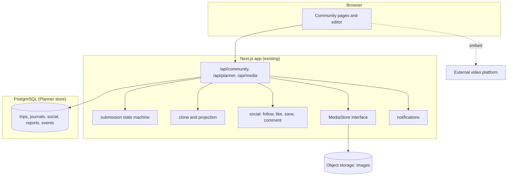

# Community Platform spec — architecture

🇻🇳 Bản tiếng Việt: [specs-community-architecture.vi.md](specs-community-architecture.vi.md)

Status: **Proposed**. Labels **[C] [P] [A]** are defined in
[specs-community-overview.md](specs-community-overview.md). Facts about today's code are
in its repository assessment; this document does not repeat them.

## Goals and scope

Fit the Community Platform into the existing system with the fewest new moving parts:
the same Next.js app, the Planner store, the session cookie, `can()`, and the admin
portal. Out of scope: any change to the Travel Content store, to Phases 00–09.

## Requirements

- **A1** Community data lives beside the trips in the Planner store, as ADR
  [0014](adr/0014-community-trips-and-reviews.md) did for reviews; Travel Content has one
  admin principal and no users. [C]
- **A2** One shared moderation state machine for every curated content type, not one per
  type. [P]
- **A3** Storage, video hosting and notifications sit behind small interfaces so the
  homelab can move to the cloud by swapping an adapter. [P]
- **A4** No new framework. New runtime dependencies (rich-text editor, image library) each
  need their own ADR. [C]
- **A5** Each phase that adds a write path can be switched off, and the contribution gate (`contributionOpen`, open on `main`) stays in force. [C]

## Design

### Decisions

| # | Decision | Label |
|---|---|---|
| D1 | Two independent axes on a trip: **sharing** (`visibility`: link) and **publication** (`listing`: community). UI shows two toggles, "Share by link" and "Publish to community" | [C] ADR 0005, 0014 |
| D2 | One pure `submission` module defines states and transitions; trips, journals and vlogs call it. Roles are checked outside it, by `can()` | [P] |
| D3 | Journal, blog and vlog are **one entity**, `Journal`, with `kind` `journal`/`blog`/`vlog`; a vlog is a journal whose lead block is an external video | [P] |
| D4 | Body is a **versioned block document** (JSON), rendered by React, never raw HTML. Reuse the story block renderer `src/components/story/story-blocks.tsx` if its block set fits | [P], [A] reuse unverified |
| D5 | Clone copies structure and place references through an allow-list into a private draft owned by the cloner, with `origin`; no link back for writes | [C] |
| D6 | `MediaStore` interface (`createUpload`, `commit`, `url`, `delete`) with a local-disk adapter for dev and an S3-compatible adapter; see [media](specs-community-media.md) | [P] |
| D7 | Notifications are in-app rows polled by the page, from Phase 15; earlier phases show status and reason in "My posts"; no email sender exists | [P] |
| D8 | Rate limiting moves to a shared PostgreSQL-backed store before any write path with public reach beyond today's reviews | [P] |
| D9 | Moderation actions append to `audit_events` (PHASES.md P10-1), the missing audit log, community actions first | [P] |
| D10 | Search is PostgreSQL full-text over published content only, with an unaccented column for Vietnamese | [P], [A] `unaccent` availability unverified |

### Module layout

| Path | Role |
|---|---|
| `src/server/community/submission.ts` | State machine, pure, unit-tested like `budget.ts` |
| `src/server/community/clone.ts` | Clone allow-list and attribution rule |
| `src/server/community/journals.ts` | Journal repository operations |
| `src/server/community/social.ts` | Follow, like, save, comment, report |
| `src/server/community/public.ts` | Existing public read module, extended |
| `src/server/media/**` | `MediaStore`, validation, processing |
| `src/server/identity/permissions.ts` | New actions only, no restructure |

## Flows and failure states

- **Publish a trip:** owner sets `visibility: public`, requests publication, state
  `pending`; staff decide. Edit after approval returns it to `pending` (ADR 0014 decision 4).
  Failure: contribution gate closed → control disabled with a neutral notice.
- **Use this trip:** reader requests a copy of a published trip; server reads the allow-list
  projection, creates a private draft with `origin`. Failure: source unpublished between page
  load and click → `404 not_found`; copy quota exceeded → `429 rate_limited`.
- **Source withdrawn or deleted:** copies stay intact; `origin` keeps the title text only if
  the author was shown by name, and its link is removed.
- **Media still processing:** the post can be saved as draft but cannot be submitted until
  every attached asset is `ready`.

## Dependencies and security

The trip editor (Phase 04), sharing and cloning (Phase 05), PostgreSQL persistence (ADR 0008/0009/0013), and the Phase 07 portal for the queue.
Trust boundaries moved by this design: user-authored rich text, user uploads, outbound
embeds. All three are detailed in [security](specs-community-security.md) and are
recommendations for an on-demand `security` review before Phase 13 and Phase 14.

## Test scenarios

Transition table of `submission.ts` exhaustively; clone leaves the source byte-identical;
projection allow-list enumeration; adapter contract tests run against both `MediaStore`
adapters. Full list in [QC](specs-community-qc.md).

## Open questions

| # | Question | Recommended |
|---|---|---|
| 1 | Can the story block set render journals unchanged? | Check in Phase 12; extend rather than fork |
| 2 | JSON-file store parity for new tables, or PostgreSQL only for community? | Parity, as ADR 0009 kept it |
