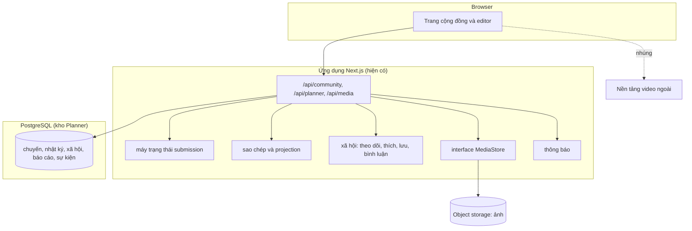

# Spec Community Platform — kiến trúc

🇻🇳 English version: [specs-community-architecture.md](specs-community-architecture.md)

Trạng thái: **Đề xuất**. Nhãn **[C] [P] [A]** được định nghĩa trong
[specs-community-overview.vi.md](specs-community-overview.vi.md). Sự thật về code hiện tại
nằm ở phần đánh giá repository của tài liệu đó; tài liệu này không lặp lại.

## Mục tiêu và phạm vi

Đặt Community Platform vào hệ thống hiện có với ít bộ phận chuyển động mới nhất: cùng ứng
dụng Next.js, kho Planner, cookie session, `can()` và cổng quản trị. Ngoài phạm vi: mọi
thay đổi với kho Travel Content, các Phase 00–09.

## Yêu cầu

- **A1** Dữ liệu cộng đồng nằm cạnh các chuyến trong kho Planner, như ADR
  [0014](adr/0014-community-trips-and-reviews.vi.md) đã làm cho đánh giá; Travel Content
  chỉ có một principal admin và không có user. [C]
- **A2** Một máy trạng thái kiểm duyệt dùng chung cho mọi loại nội dung tuyển chọn, không
  phải mỗi loại một cái. [P]
- **A3** Lưu trữ, nền tảng video và thông báo nằm sau các interface nhỏ để homelab chuyển
  lên cloud bằng cách đổi adapter. [P]
- **A4** Không framework mới. Dependency runtime mới (editor rich text, thư viện ảnh) mỗi
  cái cần ADR riêng. [C]
- **A5** Mỗi phase thêm đường ghi đều tắt được, và cổng đóng góp (`contributionOpen`, đang mở trên `main`) vẫn có hiệu lực. [C]

## Thiết kế

### Các quyết định

| # | Quyết định | Nhãn |
|---|---|---|
| D1 | Hai trục độc lập trên một chuyến: **chia sẻ** (`visibility`: link) và **đăng** (`listing`: cộng đồng). UI có hai công tắc, "Chia sẻ bằng link" và "Đăng lên cộng đồng" | [C] ADR 0005, 0014 |
| D2 | Một module `submission` thuần định nghĩa trạng thái và chuyển trạng thái; chuyến, nhật ký, vlog đều gọi nó. Vai trò được kiểm tra bên ngoài, bằng `can()` | [P] |
| D3 | Nhật ký, blog, vlog là **một thực thể**, `Journal`, với `kind` `journal`/`blog`/`vlog`; vlog là nhật ký có block đầu là video ngoài | [P] |
| D4 | Nội dung là **tài liệu block có phiên bản** (JSON), React render, không bao giờ HTML thô. Dùng lại renderer story `src/components/story/story-blocks.tsx` nếu bộ block phù hợp | [P], [A] chưa kiểm chứng việc dùng lại |
| D5 | Sao chép lấy cấu trúc và tham chiếu địa điểm qua danh sách cho phép vào bản nháp riêng của người sao chép, kèm `origin`; không có liên kết ghi ngược về nguồn | [C] |
| D6 | Interface `MediaStore` (`createUpload`, `commit`, `url`, `delete`), adapter đĩa cục bộ cho dev và adapter tương thích S3; xem [media](specs-community-media.vi.md) | [P] |
| D7 | Thông báo là các dòng trong ứng dụng, trang tự poll, từ Phase 15; các phase trước hiện trạng thái và lý do trong "Bài của tôi"; chưa có bộ gửi email | [P] |
| D8 | Giới hạn tốc độ chuyển sang kho dùng chung trên PostgreSQL trước mọi đường ghi công khai rộng hơn đánh giá hiện nay | [P] |
| D9 | Hành động kiểm duyệt ghi nối vào `audit_events` (PHASES.md P10-1), audit log còn thiếu, hành động cộng đồng trước | [P] |
| D10 | Tìm kiếm là full-text PostgreSQL chỉ trên nội dung đã đăng, có cột không dấu cho tiếng Việt | [P], [A] chưa kiểm chứng `unaccent` |

### Bố cục module

| Đường dẫn | Vai trò |
|---|---|
| `src/server/community/submission.ts` | Máy trạng thái, thuần, unit test như `budget.ts` |
| `src/server/community/clone.ts` | Danh sách cho phép khi sao chép và quy tắc ghi công |
| `src/server/community/journals.ts` | Thao tác repository cho nhật ký |
| `src/server/community/social.ts` | Theo dõi, thích, lưu, bình luận, báo cáo |
| `src/server/community/public.ts` | Module đọc công khai hiện có, mở rộng |
| `src/server/media/**` | `MediaStore`, kiểm tra hợp lệ, xử lý |
| `src/server/identity/permissions.ts` | Chỉ thêm action mới, không tái cấu trúc |

## Luồng xử lý và trạng thái lỗi

- **Đăng một chuyến:** chủ chuyến đặt `visibility: public`, xin đăng, trạng thái `pending`;
  nhân viên quyết định. Sửa sau khi duyệt đưa về `pending` (ADR 0014 quyết định 4). Lỗi:
  cổng đóng góp đóng → điều khiển bị vô hiệu kèm thông báo trung tính.
- **Dùng chuyến này:** người đọc xin bản sao của chuyến đã đăng; server đọc projection danh
  sách cho phép, tạo bản nháp riêng có `origin`. Lỗi: nguồn bị gỡ giữa lúc tải trang và lúc
  bấm → `404 not_found`; vượt hạn mức sao chép → `429 rate_limited`.
- **Nguồn bị rút hoặc xóa:** bản sao nguyên vẹn; `origin` chỉ giữ chữ tiêu đề nếu tác giả
  được hiện tên, và link bị gỡ.
- **Media đang xử lý:** bài lưu nháp được nhưng không gửi duyệt được cho tới khi mọi tài
  sản đính kèm `ready`.

## Phụ thuộc và bảo mật

Trình soạn chuyến (Phase 04), chia sẻ và sao chép (Phase 05), lưu trữ PostgreSQL (ADR 0008/0009/0013), và cổng Phase 07 cho hàng đợi. Các
ranh giới tin cậy bị dịch chuyển: rich text người dùng viết, file người dùng tải lên, embed
đi ra ngoài. Cả ba chi tiết trong [bảo mật](specs-community-security.vi.md) và là khuyến
nghị chạy `security` theo yêu cầu trước Phase 13 và Phase 14.

## Kịch bản kiểm thử

Bảng chuyển trạng thái của `submission.ts` đầy đủ; sao chép để nguồn giống hệt từng byte;
liệt kê danh sách cho phép của projection; test hợp đồng adapter chạy trên cả hai adapter
`MediaStore`. Danh sách đầy đủ ở [QC](specs-community-qc.vi.md).

## Câu hỏi còn mở

| # | Câu hỏi | Khuyến nghị |
|---|---|---|
| 1 | Bộ block của story có render nhật ký không cần sửa được không? | Kiểm ở Phase 12; mở rộng thay vì rẽ nhánh |
| 2 | Kho JSON có tương đương cho bảng mới, hay cộng đồng chỉ PostgreSQL? | Tương đương, như ADR 0009 giữ |
