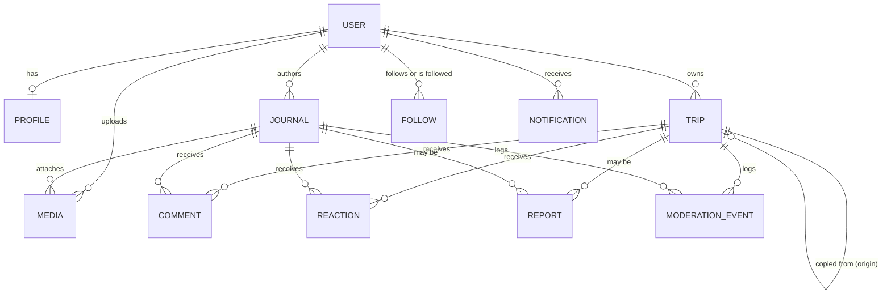

# Community Platform spec — database

🇻🇳 Bản tiếng Việt: [specs-community-database.vi.md](specs-community-database.vi.md)

Status: **Proposed**. Labels **[C] [P] [A]**: see
[specs-community-overview.md](specs-community-overview.md). Next free migration number is
`0010` (`db/migrations/0009_super_admin_and_account_state.sql` exists). No migration is
written or run by this document.

## Goals and scope

Define the data model, relationships and indexes the Community Platform needs, in the
repo's conventions: no foreign keys, ids as text, JSONB for nested documents, additive
nullable columns, JSON-file parity for local development.

## Requirements

- **DB1** Additive only; a store written before a phase loads unchanged. [C] (ADR 0007, 0014)
- **DB2** No foreign keys; integrity is the application's job, tested through both stores. [C] (ADR 0013)
- **DB3** Personal data (emails, tokens, preferences) never appears in a community table
  except by `userId`. [P]
- **DB4** Deleting or soft-deleting a user removes or anonymises everything they authored
  in public view; see Flows. [P]
- **DB5** **Write scale.** The Planner store's transaction loads and rewrites the whole
  store under one advisory lock (ADR [0009](adr/0009-postgres-persistence.md)); that is
  fine for trips but not for likes and comments. Community tables get **their own
  per-row access path** in the same database, still behind a repository interface. This
  refines architecture decision A1: same database, not the same document. [P], [A] contention not measured
- **DB6** Counters (likes, comments, follows) are derived or maintained in the same
  transaction; they are never trusted from the client. [P]

## Design

### Entities

`pk` = primary key, `uq` = unique, `ix` = indexed. Status enums are defined in
[moderation](specs-community-moderation.md).

| Entity (table) | Key fields | Notes |
|---|---|---|
| `Trip` (existing) | + `origin` JSONB null: `{ sourceToken, sourceTitle, authorDisplay }`; `listing` gains `changes_requested`, `unpublished` | `origin` holds no author when the source was anonymous |
| `Profile` (`community_profiles`) | `userId` pk, `publicSlug` uq null, `bio` ≤280, `avatarAssetId` null, `visibility` `private`/`public`, `updatedAt` | Off by default; slug is not `handle` |
| `Journal` (`community_journals`) | `id` pk, `authorId` ix, `kind` `journal`/`blog`/`vlog`, `slug` uq, `title`, `summary`, `coverAssetId`, `body` JSONB blocks, `bodyVersion`, `lang`, `placeSlugs[]`, `tags[]`, `status`, moderation fields, `publishedAt`, `revision`, timestamps | `revision` for `If-Match` |
| `MediaAsset` (`community_media`) | `id` pk, `ownerId` ix, `kind` `image`, `status`, `mime`, `bytes`, `width`, `height`, `storageKey`, `variants` JSONB, `attachedTo` `{kind,id}` null, `createdAt`, `deletedAt` | Video is never a row here; it is an embed inside `body` |
| `Follow` | `followerId`, `followeeId`; pk pair | Self-follow refused |
| `Reaction` | `userId`, `targetKind`, `targetId`, `kind` `like`; pk tuple | One like per user per target |
| `SavedItem` | `userId`, `targetKind`, `targetId`, `createdAt`; pk tuple | Private |
| `Comment` | `id` pk, `authorId`, `targetKind`, `targetId`, `parentId` null, `body` ≤1000, `status` `visible`/`removed`, `createdAt` | One reply level only |
| `Report` | `id` pk, `reporterId` null, `clientKey`, `targetKind`, `targetId`, `reason`, `note` ≤500, `status` `open`/`actioned`/`dismissed`, handler fields | Feeds the queue |
| `Notification` | `id` pk, `userId` ix, `kind`, `payload` JSONB allow-list, `readAt`, `createdAt` | No email |
| `ModerationEvent` | `id` pk, `targetKind`, `targetId`, `actorId`, `action`, `fromStatus`, `toStatus`, `reason`, `createdAt` | Append-only |
| `CommunityReview` (existing) | unchanged | ADR 0014/0015 |

### Relationships (logical, not enforced)

### Indexes

| Table | Index | For |
|---|---|---|
| `community_journals` | `(status, publishedAt desc)` | Explore feed |
| | `(authorId, status)` | Author's list, profile |
| | GIN `tsv` over title, summary, plain body, plus an unaccented copy | Search |
| | GIN `placeSlugs`, `tags` | Filter |
| `trips` | partial `(listing->>'status')` where approved | Gallery |
| `Follow` | `(followeeId)` | Follower count and list |
| `Reaction` | `(targetKind, targetId)` | Like count |
| `Comment` | `(targetKind, targetId, createdAt)` | Thread |
| `Report` | `(status, createdAt)` | Queue |
| `Notification` | `(userId, readAt, createdAt desc)` | Bell |
| `MediaAsset` | `(status, createdAt)` | Orphan sweep |

### Migrations (proposed numbering)

`0010` trip `origin` + profile · `0011` journals + media · `0012` social, reports,
notifications, events · `0013` search columns. Each with rollback note, import/export
update, and a test through both stores (ADR 0014 precedent). One migration per phase.

## Flows and failure states

- **User soft-deleted or banned (ADR 0017):** their published content is hidden from
  public reads at once; rows are kept for the retention window; hard delete anonymises
  `authorId` and drops `origin.authorDisplay` on copies.
- **Journal revision conflict:** `If-Match` mismatch → `412 version_conflict`, as the trip editor.
- **Duplicate like/follow:** idempotent; unique key makes the second a no-op.
- **Orphan media:** unattached after 24 h is swept; see [media](specs-community-media.md).
- **Search unavailable:** if the unaccent extension cannot be created, fall back to an
  application-normalised column; never fail the feed.

## Dependencies and security

Stage 6 engine, the existing `listing` column (migration `0005`), `plannerUsers`. Public
projections never select `authorId` for anonymous content. Notification payloads are
allow-listed to ids and titles, never user text beyond a trimmed title.

## Test scenarios

Migration up/down on both stores; import/export round trip; unique-key idempotency;
anonymous author never present in any public read; soft-delete hides then restore shows;
concurrent likes (50 parallel) end at the right count.

## Open questions

| # | Question | Recommended |
|---|---|---|
| 1 | Separate per-row repository for community tables (DB5) or reuse the document store? | Separate; measure first at C5 |
| 2 | Is `CREATE EXTENSION unaccent` allowed on the PostgreSQL VM role? | Check in [deploy-database.md](deploy-database.md) role setup |
| 3 | Retention for removed content and logs? | 30 days content, 1 year `ModerationEvent` |
