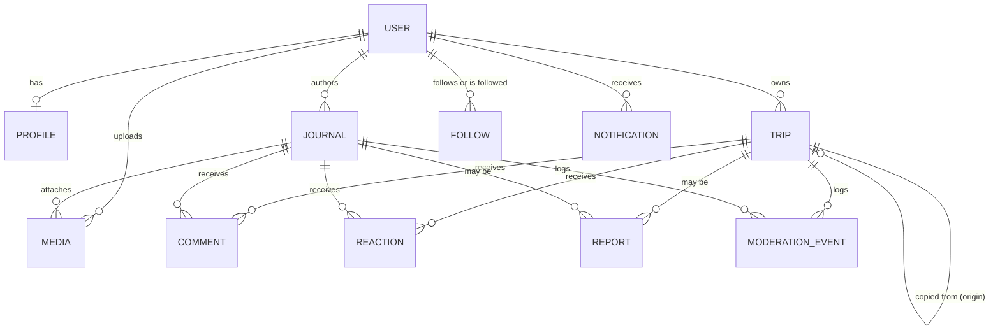

# Spec Community Platform — cơ sở dữ liệu

🇻🇳 English version: [specs-community-database.md](specs-community-database.md)

Trạng thái: **Đề xuất**. Nhãn **[C] [P] [A]**: xem
[specs-community-overview.vi.md](specs-community-overview.vi.md). Số migration trống kế
tiếp là `0010` (đã có `db/migrations/0009_super_admin_and_account_state.sql`). Tài liệu
này không viết hay chạy migration nào.

## Mục tiêu và phạm vi

Định nghĩa mô hình dữ liệu, quan hệ và chỉ mục mà Community Platform cần, theo quy ước của
repo: không khóa ngoại, id dạng text, JSONB cho tài liệu lồng, cột nullable cộng thêm,
tương đương với file JSON cho phát triển cục bộ.

## Yêu cầu

- **DB1** Chỉ cộng thêm; kho ghi trước một phase vẫn nạp không đổi. [C] (ADR 0007, 0014)
- **DB2** Không khóa ngoại; toàn vẹn là việc của ứng dụng, test trên cả hai kho. [C] (ADR 0013)
- **DB3** Dữ liệu cá nhân (email, token, sở thích) không bao giờ xuất hiện trong bảng cộng
  đồng ngoài `userId`. [P]
- **DB4** Xóa hoặc xóa mềm user thì xóa hoặc ẩn danh mọi thứ họ viết ở góc nhìn công khai;
  xem Luồng. [P]
- **DB5** **Quy mô ghi.** Transaction của kho Planner nạp và ghi lại toàn bộ kho dưới một
  advisory lock (ADR [0009](adr/0009-postgres-persistence.vi.md)); ổn với chuyến nhưng
  không ổn với thích và bình luận. Bảng cộng đồng có **đường truy cập theo từng dòng
  riêng** trong cùng database, vẫn sau một interface repository. Điều này tinh chỉnh quyết
  định kiến trúc A1: cùng database, không cùng tài liệu. [P], [A] chưa đo tranh chấp
- **DB6** Bộ đếm (thích, bình luận, theo dõi) được suy ra hoặc cập nhật trong cùng
  transaction; không bao giờ tin từ client. [P]

## Thiết kế

### Thực thể

`pk` = khóa chính, `uq` = duy nhất, `ix` = có chỉ mục. Enum trạng thái định nghĩa ở
[kiểm duyệt](specs-community-moderation.vi.md).

| Thực thể (bảng) | Trường chính | Ghi chú |
|---|---|---|
| `Trip` (có sẵn) | + `origin` JSONB null: `{ sourceToken, sourceTitle, authorDisplay }`; `listing` thêm `changes_requested`, `unpublished` | `origin` không giữ tác giả khi nguồn ẩn danh |
| `Profile` (`community_profiles`) | `userId` pk, `publicSlug` uq null, `bio` ≤280, `avatarAssetId` null, `visibility` `private`/`public`, `updatedAt` | Mặc định tắt; slug không phải `handle` |
| `Journal` (`community_journals`) | `id` pk, `authorId` ix, `kind` `journal`/`blog`/`vlog`, `slug` uq, `title`, `summary`, `coverAssetId`, `body` JSONB block, `bodyVersion`, `lang`, `placeSlugs[]`, `tags[]`, `status`, trường kiểm duyệt, `publishedAt`, `revision`, mốc thời gian | `revision` cho `If-Match` |
| `MediaAsset` (`community_media`) | `id` pk, `ownerId` ix, `kind` `image`, `status`, `mime`, `bytes`, `width`, `height`, `storageKey`, `variants` JSONB, `attachedTo` `{kind,id}` null, `createdAt`, `deletedAt` | Video không bao giờ là một dòng ở đây; nó là embed trong `body` |
| `Follow` | `followerId`, `followeeId`; pk là cặp | Không tự theo dõi |
| `Reaction` | `userId`, `targetKind`, `targetId`, `kind` `like`; pk là bộ | Mỗi người một lượt thích cho mỗi đích |
| `SavedItem` | `userId`, `targetKind`, `targetId`, `createdAt`; pk là bộ | Riêng tư |
| `Comment` | `id` pk, `authorId`, `targetKind`, `targetId`, `parentId` null, `body` ≤1000, `status` `visible`/`removed`, `createdAt` | Chỉ một cấp trả lời |
| `Report` | `id` pk, `reporterId` null, `clientKey`, `targetKind`, `targetId`, `reason`, `note` ≤500, `status` `open`/`actioned`/`dismissed`, trường người xử lý | Đổ vào hàng đợi |
| `Notification` | `id` pk, `userId` ix, `kind`, `payload` JSONB danh sách cho phép, `readAt`, `createdAt` | Không email |
| `ModerationEvent` | `id` pk, `targetKind`, `targetId`, `actorId`, `action`, `fromStatus`, `toStatus`, `reason`, `createdAt` | Chỉ nối thêm |
| `CommunityReview` (có sẵn) | không đổi | ADR 0014/0015 |

### Quan hệ (logic, không ép buộc)

### Chỉ mục

| Bảng | Chỉ mục | Cho |
|---|---|---|
| `community_journals` | `(status, publishedAt desc)` | Feed khám phá |
| | `(authorId, status)` | Danh sách của tác giả, hồ sơ |
| | GIN `tsv` trên title, summary, body thuần, cộng một bản không dấu | Tìm kiếm |
| | GIN `placeSlugs`, `tags` | Lọc |
| `trips` | một phần `(listing->>'status')` khi approved | Thư viện |
| `Follow` | `(followeeId)` | Số và danh sách người theo dõi |
| `Reaction` | `(targetKind, targetId)` | Số lượt thích |
| `Comment` | `(targetKind, targetId, createdAt)` | Chuỗi bình luận |
| `Report` | `(status, createdAt)` | Hàng đợi |
| `Notification` | `(userId, readAt, createdAt desc)` | Chuông |
| `MediaAsset` | `(status, createdAt)` | Dọn tài sản mồ côi |

### Migration (đánh số đề xuất)

`0010` `origin` của chuyến + hồ sơ · `0011` nhật ký + media · `0012` xã hội, báo cáo, thông
báo, sự kiện · `0013` cột tìm kiếm. Mỗi cái kèm ghi chú rollback, cập nhật import/export,
và test trên cả hai kho (tiền lệ ADR 0014). Một migration mỗi phase.

## Luồng xử lý và trạng thái lỗi

- **User bị xóa mềm hoặc cấm (ADR 0017):** nội dung đã đăng của họ bị ẩn khỏi mọi lượt đọc
  công khai ngay; dòng được giữ trong thời gian lưu giữ; xóa cứng ẩn danh `authorId` và bỏ
  `origin.authorDisplay` trên các bản sao.
- **Xung đột phiên bản nhật ký:** `If-Match` lệch → `412 version_conflict`, như trình soạn chuyến.
- **Thích/theo dõi trùng:** idempotent; khóa duy nhất khiến lần hai không làm gì.
- **Media mồ côi:** không gắn sau 24 giờ thì bị dọn; xem [media](specs-community-media.vi.md).
- **Tìm kiếm không dùng được:** nếu không tạo được extension unaccent, dùng cột chuẩn hóa
  ở ứng dụng; không bao giờ làm hỏng feed.

## Phụ thuộc và bảo mật

Engine Stage 6, cột `listing` có sẵn (migration `0005`), `plannerUsers`. Projection công
khai không bao giờ chọn `authorId` cho nội dung ẩn danh. Payload thông báo là danh sách
cho phép chỉ gồm id và tiêu đề, không có văn bản người dùng ngoài tiêu đề đã cắt gọn.

## Kịch bản kiểm thử

Migration lên/xuống trên cả hai kho; vòng import/export; idempotency của khóa duy nhất;
tác giả ẩn danh không bao giờ có mặt trong mọi lượt đọc công khai; xóa mềm thì ẩn, khôi
phục thì hiện; 50 lượt thích song song kết thúc đúng số đếm.

## Câu hỏi còn mở

| # | Câu hỏi | Khuyến nghị |
|---|---|---|
| 1 | Repository theo từng dòng riêng cho bảng cộng đồng (DB5) hay dùng lại kho tài liệu? | Riêng; đo trước ở C5 |
| 2 | Role trên VM PostgreSQL có được `CREATE EXTENSION unaccent` không? | Kiểm ở phần cấu hình role trong [deploy-database.vi.md](deploy-database.vi.md) |
| 3 | Thời gian lưu giữ cho nội dung bị gỡ và log? | 30 ngày nội dung, 1 năm `ModerationEvent` |
