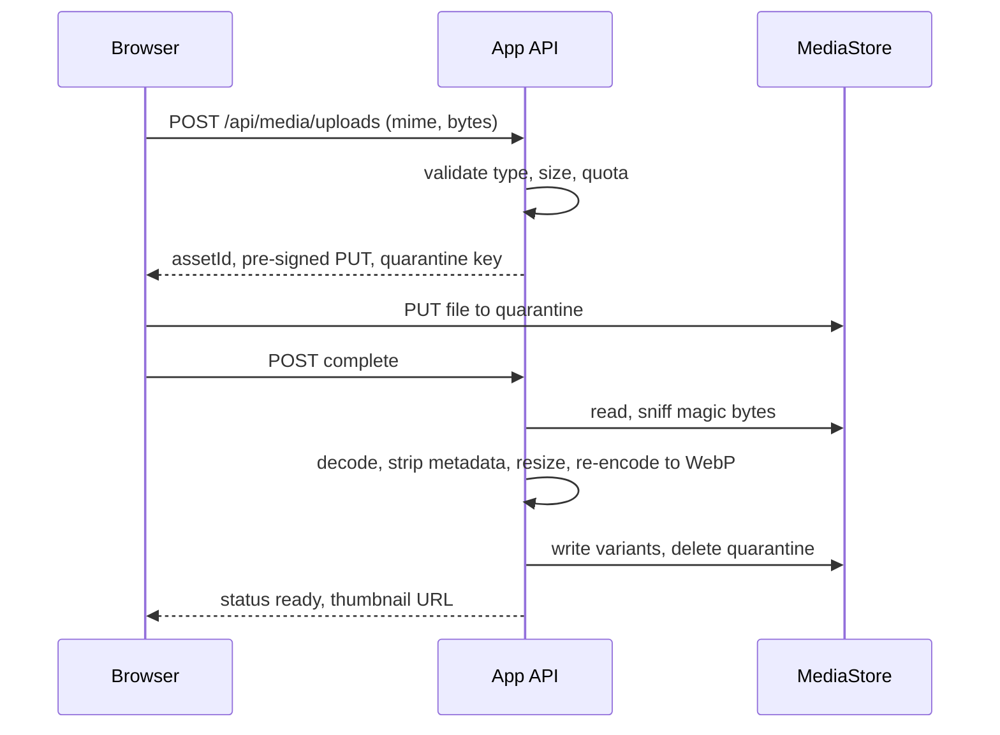

# Community Platform spec — media

🇻🇳 Bản tiếng Việt: [specs-community-media.vi.md](specs-community-media.vi.md)

Status: **Proposed**. Labels **[C] [P] [A]**: see
[specs-community-overview.md](specs-community-overview.md). Today the repository has no
upload, no storage SDK and no image library (`package.json` dependencies are `next
next-intl pg react react-dom zod`); remote images are limited to `images.unsplash.com`
(`next.config.ts:53`). Everything below is new.

## Goals and scope

Let travellers attach photos to journals, trips and profiles, and show vlogs, on a homelab
VM with 16 GB RAM running Docker Compose behind Cloudflare Tunnel, with a path to cloud
storage. **Hybrid, as decided:** images are stored by us; video lives on an external
platform and is embedded. [C] Video files are never stored in the database or on the app
disk. [C]

## Requirements

- **ME1** Images only (JPEG, PNG, WebP). SVG, GIF, HEIC and PDF are refused at first. [P]
- **ME2** Every stored image is **re-encoded** server-side, which removes EXIF (including
  GPS), embedded scripts and polyglot payloads. [P]
- **ME3** Storage sits behind a `MediaStore` interface; adapters swap without touching
  callers. [P]
- **ME4** An asset is private until its parent is `published`; staff can preview it in the
  queue. [P]
- **ME5** Per-user quotas and per-upload limits are enforced on the server, never trusted
  from the client. [P]
- **ME6** Video is an allow-listed embed (provider and id parsed from a pasted URL), not
  an upload. [P]
- **ME7** Nothing in the page makes a third-party request until the reader opts in to play
  a video (privacy-enhanced embed, click to load). [P]
- **ME8** No new runtime dependency without an ADR, including the image library. [C]

## Design

### Storage options

| Option | For | Against | Fit |
|---|---|---|---|
| A. Bind-mounted volume on the app VM | Zero new services, simplest backup with the existing VM backup | Fills the VM disk, no CDN, no horizontal scale, blocks a second app instance | Dev, and C3 pilot only |
| B. Self-hosted S3-compatible (for example MinIO) in Docker Compose | Same API as cloud; data stays at home | One more service to patch and back up; RAM and disk on a 16 GB host; Cloudflare may limit serving media through a free tunnel [A] | Viable early |
| C. Managed S3-compatible object storage (Cloudflare R2, Backblaze B2, others) | No local disk or RAM; built-in durability; egress behaviour differs per vendor | Recurring cost; data off-site; a vendor account | Recommended once images go public |
| D. Cloud image CDN service | Resizing included | Lock-in, per-transform cost | Not now |

**Recommendation [P]:** write one S3-compatible adapter plus the local-disk adapter. Run
**A** in development and the C3 pilot, and move to **C** before public launch. Do not
publish prices here: cost and free-tier limits change and are not in the repository.

### Upload pipeline

States: `uploading → processing → ready`, or `rejected` with a reason; `deleted` after
removal. A pre-signed URL lives 5 minutes and is bound to one key and one maximum size.

### Limits (proposed, to confirm)

| Limit | Value |
|---|---|
| Declared size per image | 10 MB |
| Longest side kept | 2560 px; variants 320, 960, 1920 |
| Images per journal | 30 |
| Uploads per user per day | 30 |
| Stored bytes per user | 500 MB |
| Avatar | one image, cropped square, 512 px |

### Serving

Published variants are served from a stable public path with long-lived cache headers and
`next/image` `sizes`. Unpublished assets are reachable only through a short-lived signed
URL minted for the owner or staff. The allowed image host is added to `remotePatterns`;
no wildcard.

### Video

| Item | Rule |
|---|---|
| Providers | YouTube and Vimeo first; others by decision |
| Input | A pasted URL, parsed to `{ provider, id }`; the raw URL is never rendered |
| Render | Iframe from the provider's privacy-enhanced domain, **after a click**; brand placeholder before |
| CSP | `frame-src` lists exactly the allowed provider hosts (the site-wide headers are covered by `tests/security-headers.test.ts`) |
| Thumbnail | The author's uploaded cover image; no hot-linked provider thumbnails |
| Uploaded vlogs (own hosting) | Not in scope; a managed video service is a later ADR |

### Scanning

Re-encoding is the primary defence, because a decoded and re-encoded pixel buffer carries
no active content. An antivirus daemon (for example ClamAV) is optional: it needs on the
order of a gigabyte of resident RAM for signatures, which is significant on 16 GB shared
with PostgreSQL clients, nginx and the app. Recommended: skip for images in C3, revisit if
non-image uploads are ever allowed. [P], [A] memory figure to verify

### Retention and backup

| Item | Rule |
|---|---|
| Orphan (never attached) | Deleted after 24 h by a sweep |
| Parent removed or rejected | Asset kept 30 days, then purged |
| Account deleted | Purged within 30 days |
| Backup | Object store durability or VM snapshot for adapter A; metadata is in PostgreSQL and covered by [deploy-database.md](deploy-database.md); a `media:verify` check lists rows whose object is missing |

## Flows and failure states

| Situation | Behaviour |
|---|---|
| Wrong MIME or magic bytes | `rejected: not_an_image`; asset deleted |
| Over size or pixel count (decompression bomb) | Refused before decode, limit on pixels as well as bytes |
| Quota exceeded | `429 rate_limited` or `422` with remaining quota |
| Processing times out | `rejected: processing_failed`; author can retry |
| Storage unavailable | Editor shows a retry; published pages fall back to a placeholder; no 500 |
| Submit with an asset not `ready` | Blocked with the asset named |
| Pasted video URL not on the allow-list | `422 validation_failed` |

## Dependencies and security

Needs C1 (ownership), the shared rate limiter, and an ADR for the image library (a native
module would also need an `allowScripts` entry, a supply-chain boundary per
`.claude/context/project-context.md`). Security detail in
[security](specs-community-security.md): SSRF is avoided by never fetching user-supplied
URLs server-side; the server reads only from its own store.

## Test scenarios

Adapter contract tests on both adapters; polyglot, truncated and oversize fixtures;
EXIF-with-GPS fixture proving the output has no metadata; quota edge; unpublished asset
not reachable without a signature; signed URL expiry; sweep deletes only orphans;
unsupported video host refused.

## Open questions

| # | Question | Recommended |
|---|---|---|
| 1 | Is the app served only through Cloudflare Tunnel, and does that limit serving images? | Verify against Cloudflare's current terms before choosing A or B |
| 2 | Which image library, given a native dependency needs an ADR and approval? | Decide in the C3 ADR |
| 3 | ClamAV for images? | No |
| 4 | Is YouTube plus Vimeo enough? | Yes |
| 5 | Quotas above | Owner to confirm |
