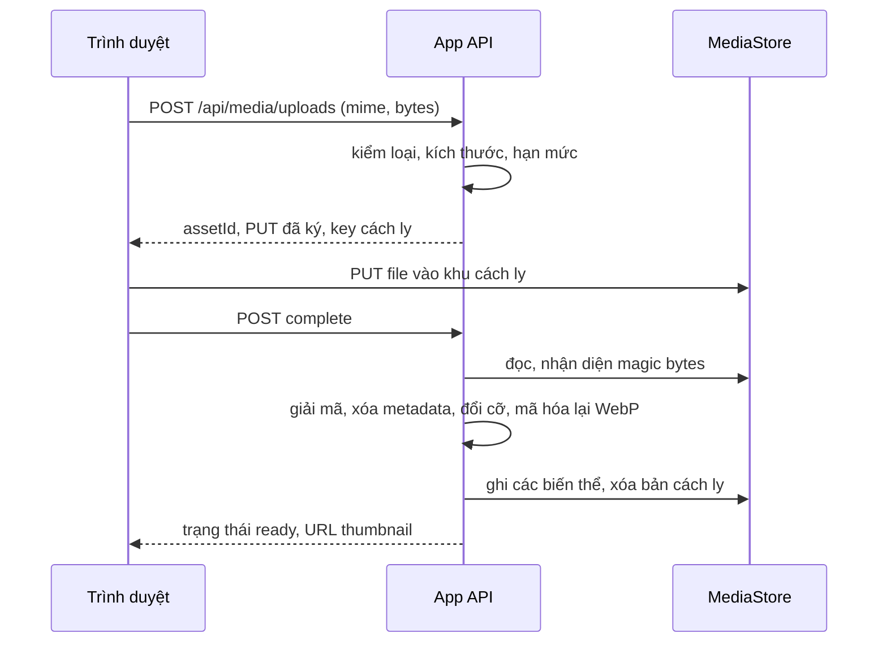

# Spec Community Platform — media

🇻🇳 English version: [specs-community-media.md](specs-community-media.md)

Trạng thái: **Đề xuất**. Nhãn **[C] [P] [A]**: xem
[specs-community-overview.vi.md](specs-community-overview.vi.md). Hiện repository không có
upload, SDK lưu trữ hay thư viện ảnh (dependency trong `package.json` chỉ là `next
next-intl pg react react-dom zod`); ảnh remote chỉ cho `images.unsplash.com`
(`next.config.ts:53`). Mọi thứ dưới đây đều mới.

## Mục tiêu và phạm vi

Cho người đi đính ảnh vào nhật ký, chuyến và hồ sơ, và hiển thị vlog, trên một VM homelab
16 GB RAM chạy Docker Compose sau Cloudflare Tunnel, có đường lên lưu trữ cloud. **Lai, như
đã quyết:** ảnh do ta lưu; video ở nền tảng ngoài và được nhúng. [C] File video không bao
giờ nằm trong database hay đĩa của app. [C]

## Yêu cầu

- **ME1** Chỉ ảnh (JPEG, PNG, WebP). SVG, GIF, HEIC và PDF bị từ chối lúc đầu. [P]
- **ME2** Mọi ảnh lưu đều được **mã hóa lại** phía server, loại bỏ EXIF (gồm GPS), script
  nhúng và payload đa định dạng. [P]
- **ME3** Lưu trữ nằm sau interface `MediaStore`; đổi adapter không đụng nơi gọi. [P]
- **ME4** Tài sản ở chế độ riêng tư tới khi bài cha `published`; nhân viên xem trước được
  trong hàng đợi. [P]
- **ME5** Hạn mức mỗi user và giới hạn mỗi lần upload được ép ở server, không tin client. [P]
- **ME6** Video là embed trong danh sách cho phép (provider và id tách từ URL dán vào),
  không phải upload. [P]
- **ME7** Trang không gửi request bên thứ ba nào cho tới khi người đọc chọn phát video
  (embed tăng cường riêng tư, bấm để tải). [P]
- **ME8** Không thêm dependency runtime nếu chưa có ADR, kể cả thư viện ảnh. [C]

## Thiết kế

### Các phương án lưu trữ

| Phương án | Ưu | Nhược | Phù hợp |
|---|---|---|---|
| A. Volume bind-mount trên VM app | Không thêm dịch vụ, sao lưu đơn giản cùng backup VM hiện có | Đầy đĩa VM, không CDN, không mở rộng ngang, chặn instance app thứ hai | Dev và pilot Phase 13 |
| B. Tương thích S3 tự host (ví dụ MinIO) trong Docker Compose | Cùng API với cloud; dữ liệu ở nhà | Thêm một dịch vụ phải vá và sao lưu; RAM và đĩa trên host 16 GB; Cloudflare có thể giới hạn phục vụ media qua tunnel miễn phí [A] | Dùng được sớm |
| C. Object storage tương thích S3 có quản lý (Cloudflare R2, Backblaze B2, v.v.) | Không tốn đĩa hay RAM cục bộ; bền vững sẵn; chính sách egress khác nhau theo nhà cung cấp | Chi phí định kỳ; dữ liệu ở ngoài; một tài khoản nhà cung cấp | Khuyến nghị khi ảnh ra công khai |
| D. Dịch vụ CDN ảnh trên cloud | Có sẵn resize | Khóa nhà cung cấp, tính phí mỗi phép biến đổi | Chưa dùng |

**Khuyến nghị [P]:** viết một adapter tương thích S3 cộng adapter đĩa cục bộ. Chạy **A** khi
phát triển và pilot Phase 13, chuyển sang **C** trước khi ra công khai. Không công bố giá ở đây:
chi phí và hạn mức miễn phí thay đổi và không có trong repository.

### Pipeline upload

Trạng thái: `uploading → processing → ready`, hoặc `rejected` kèm lý do; `deleted` sau khi xóa.
URL đã ký sống 5 phút, gắn một key và một kích thước tối đa.

### Giới hạn (đề xuất, cần xác nhận)

| Giới hạn | Giá trị |
|---|---|
| Kích thước khai báo mỗi ảnh | 10 MB |
| Cạnh dài giữ lại | 2560 px; biến thể 320, 960, 1920 |
| Ảnh mỗi nhật ký | 30 |
| Upload mỗi user mỗi ngày | 30 |
| Byte lưu mỗi user | 500 MB |
| Avatar | một ảnh, cắt vuông, 512 px |

### Phục vụ

Biến thể đã đăng được phục vụ từ đường dẫn công khai ổn định với header cache dài và
`sizes` của `next/image`. Tài sản chưa đăng chỉ truy cập được qua URL ký ngắn hạn cấp cho
chủ hoặc nhân viên. Host ảnh được phép thêm vào `remotePatterns`; không dùng wildcard.

### Video

| Mục | Quy tắc |
|---|---|
| Provider | YouTube và Vimeo trước; thêm khác theo quyết định |
| Đầu vào | URL dán vào, tách thành `{ provider, id }`; URL thô không bao giờ được render |
| Hiển thị | Iframe từ domain tăng cường riêng tư của provider, **sau một cú bấm**; có placeholder thương hiệu trước đó |
| CSP | `frame-src` liệt kê chính xác host provider được phép (header toàn site được `tests/security-headers.test.ts` phủ) |
| Thumbnail | Ảnh bìa do tác giả tải lên; không hotlink thumbnail của provider |
| Vlog tự host | Ngoài phạm vi; dịch vụ video có quản lý là ADR sau |

### Quét mã độc

Mã hóa lại là tuyến phòng thủ chính, vì bộ đệm điểm ảnh đã giải mã và mã hóa lại không
mang nội dung hoạt động. Daemon diệt virus (ví dụ ClamAV) là tùy chọn: nó cần cỡ một
gigabyte RAM thường trú cho chữ ký, đáng kể trên 16 GB chia với PostgreSQL client, nginx
và app. Khuyến nghị: bỏ qua cho ảnh ở Phase 13, xem lại nếu từng cho phép upload không phải ảnh.
[P], [A] con số bộ nhớ cần kiểm chứng

### Lưu giữ và sao lưu

| Mục | Quy tắc |
|---|---|
| Mồ côi (chưa từng gắn) | Xóa sau 24 giờ bằng tác vụ dọn |
| Bài cha bị gỡ hoặc từ chối | Giữ tài sản 30 ngày rồi xóa hẳn |
| Tài khoản bị xóa | Xóa hẳn trong 30 ngày |
| Sao lưu | Độ bền của object store hoặc snapshot VM với adapter A; metadata nằm trong PostgreSQL và được [deploy-database.vi.md](deploy-database.vi.md) phủ; kiểm tra `media:verify` liệt kê dòng thiếu object |

## Luồng xử lý và trạng thái lỗi

| Tình huống | Hành vi |
|---|---|
| Sai MIME hoặc magic bytes | `rejected: not_an_image`; xóa tài sản |
| Quá kích thước hoặc số điểm ảnh (bom giải nén) | Từ chối trước khi giải mã, giới hạn cả điểm ảnh lẫn byte |
| Vượt hạn mức | `429 rate_limited` hoặc `422` kèm hạn mức còn lại |
| Xử lý quá thời gian | `rejected: processing_failed`; tác giả thử lại được |
| Lưu trữ không khả dụng | Editor hiện nút thử lại; trang đã đăng dùng placeholder; không 500 |
| Gửi duyệt khi có tài sản chưa `ready` | Bị chặn, nêu tên tài sản |
| URL video dán vào không thuộc danh sách cho phép | `422 validation_failed` |

## Phụ thuộc và bảo mật

Cần Phase 08 (thư viện media), Phase 10 (audit log, limiter dùng chung), và một ADR cho thư viện ảnh (module
native còn cần mục `allowScripts`, một ranh giới chuỗi cung ứng theo
`.claude/context/project-context.md`). Chi tiết bảo mật ở
[bảo mật](specs-community-security.vi.md): tránh SSRF bằng cách không bao giờ fetch URL do
người dùng cung cấp ở phía server; server chỉ đọc từ kho của chính nó.

## Kịch bản kiểm thử

Test hợp đồng adapter trên cả hai adapter; fixture đa định dạng, bị cắt, quá lớn; fixture
EXIF có GPS chứng minh đầu ra không còn metadata; biên hạn mức; tài sản chưa đăng không
truy cập được nếu không có chữ ký; URL ký hết hạn; tác vụ dọn chỉ xóa mồ côi; host video
không hỗ trợ bị từ chối.

## Câu hỏi còn mở

| # | Câu hỏi | Khuyến nghị |
|---|---|---|
| 1 | App chỉ phục vụ qua Cloudflare Tunnel, và điều đó có giới hạn việc phục vụ ảnh không? | Kiểm theo điều khoản Cloudflare hiện hành trước khi chọn A hay B |
| 2 | Thư viện ảnh nào, khi dependency native cần ADR và phê duyệt? | Quyết trong ADR của Phase 13 |
| 3 | ClamAV cho ảnh? | Không |
| 4 | YouTube cộng Vimeo đã đủ chưa? | Đủ |
| 5 | Các hạn mức ở trên | Chủ dự án xác nhận |
