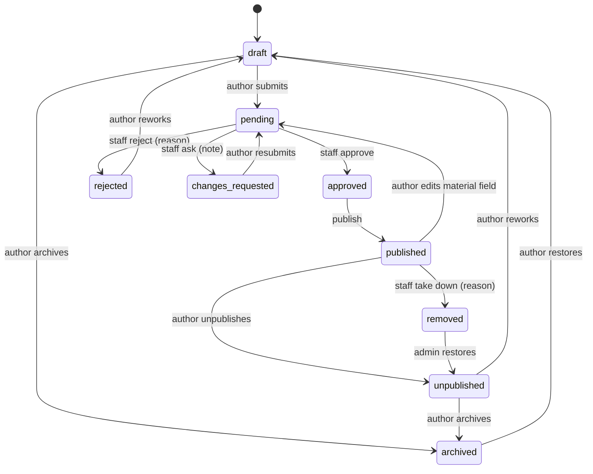

# Community Platform spec — moderation

🇻🇳 Bản tiếng Việt: [specs-community-moderation.vi.md](specs-community-moderation.vi.md)

Status: **Proposed**. Labels **[C] [P] [A]**: see
[specs-community-overview.md](specs-community-overview.md). Builds on ADR
[0014](adr/0014-community-trips-and-reviews.md) and [0015](adr/0015-community-review-author-controls.md).

## Goals and scope

One curated workflow for long-form public content: trips, journals, blogs and vlogs.
Short place reviews and guest reviews are **out** of this workflow and keep ADR 0014/0015
(live at once, staff remove or hold). [C] Comments are post-moderated through reports. [P]

## Requirements

- **M1** Nothing curated reaches a public page without a staff decision. [C]
- **M2** Approval is a statement about the content as reviewed: a material edit to a
  live item returns it to review. [C] (ADR 0014 decision 4)
- **M3** Every transition records actor, time, from, to and reason in `ModerationEvent`. [P]
- **M4** Reject and request-changes carry a reason the author can read. [P]
- **M5** Staff can take down a live item at once, without the author's consent, with a reason. [P]
- **M6** The author is told of each decision through an in-app notification. [P]
- **M7** The existing `listing` states map onto this model with no data loss. [P]

## Design

### State machine

**Approve and publish.** The staff action "Approve" performs `approved` then `published`
in one step (two events) by default, so behaviour matches today's trip listing, where
`approved` means live. A later setting may let the author publish on their own schedule
(open question 2). [P]

### Mapping from today

| Existing `listing.status` | New state |
|---|---|
| `none` | no submission (`draft` on a journal) |
| `pending` | `pending` |
| `approved` | `published` |
| `rejected` | `rejected` |

No data migration of existing rows is needed; the new states are additive. [P]

### Roles and rights

| Action | Visitor | Member / author | Editor (today) | Moderator [P] | Admin |
|---|---|---|---|---|---|
| Read published | yes | yes | yes | yes | yes |
| Submit own draft, unpublish, archive own | no | yes | yes | yes | yes |
| Approve, reject, request changes | no | no | yes | yes | yes |
| Take down (`removed`) | no | no | yes | yes | yes |
| Restore a removed item | no | no | no | no | yes |
| Handle reports | no | no | yes | yes | yes |
| Restrict a user (`community:restrict`) | no | no | no | no | yes |
| Read the moderation log | no | own items only | yes | yes | yes |

**Conflict to resolve:** the brief names a Moderator role, but the repository has none
and ADR [0006](adr/0006-unified-identity-and-roles.md) deferred it; editors hold
`community:moderate` today. Interim: editors moderate. A `moderator` role (moderate and
reports, no content-write) needs its own ADR. [P]

### Reported content

1. A signed-in or guest reader files a report with a reason from a fixed list (spam,
   harassment, personal data, copyright, misleading, other) and an optional note.
2. It appears in the staff queue; duplicates by one reporter on one target are ignored.
3. Staff resolve it: dismissed, or actioned (unpublish, remove, restrict user).
4. Comments reported by three distinct users are **held from view** until staff look, and
   restored on dismissal. Trips and journals are never auto-hidden. [P], brigading risk in
   [roadmap](specs-community-roadmap.md)

### Queue

Sorted oldest first; shows kind, author display, language, report count, and the diff
against the last approved revision when the item is a re-review. Target: first decision
within 3 days — an owner expectation to confirm, not a technical guarantee. [A]

## Flows and failure states

- **Staff decide on a stale revision:** the decision carries the revision seen; a newer
  one → `412 version_conflict`, the queue reloads.
- **Author edits while `pending`:** allowed; the revision updates and the queue shows the
  new one. Editing a `published` item with only typo-level fields is **not** a special
  case in M2 (owner-confirmed for trips); open question 3 asks about journals.
- **Moderator removes an item with copies:** copies stay; the source line loses its link.
- **No staff available:** items wait; sections that depend on approved content hide when
  empty (ADR 0014 decision 9). No auto-approve, ever.
- **Rejected repeatedly:** a user may resubmit at most 3 times per item per 7 days.

## Dependencies and security

`submission.ts` ([architecture](specs-community-architecture.md)), the `ModerationEvent`
table ([database](specs-community-database.md)), notifications. Decisions are
`community:moderate`-gated at the route and again in the state machine's caller; a
`service` principal may decide but is logged as such.

## Test scenarios

Every edge of the diagram; every forbidden edge returns `invalid_state`; role × action
matrix; mapping of legacy `listing` rows; report dedupe; threshold hide and restore;
material edit re-queues; takedown hides within one request.

## Open questions

| # | Question | Recommended |
|---|---|---|
| 1 | Moderator role now or editors until C5? | Editors until C5 |
| 2 | May authors publish an approved item later themselves? | No in C2; add only if asked |
| 3 | Do journal typo edits skip re-review? | No; same rule as trips until volume hurts |
| 4 | Comments: post-moderated only, or pre-moderated for new accounts? | Post-moderated |
| 5 | Is a 3-day first-decision target acceptable to publish? | Owner to confirm |
