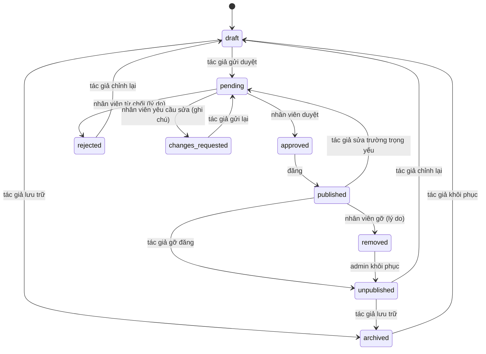

# Spec Community Platform — kiểm duyệt

🇻🇳 English version: [specs-community-moderation.md](specs-community-moderation.md)

Trạng thái: **Đề xuất**. Nhãn **[C] [P] [A]**: xem
[specs-community-overview.vi.md](specs-community-overview.vi.md). Dựa trên ADR
[0014](adr/0014-community-trips-and-reviews.vi.md) và [0015](adr/0015-community-review-author-controls.vi.md).

## Mục tiêu và phạm vi

Một quy trình tuyển chọn cho nội dung công khai dài: chuyến, nhật ký, blog và vlog. Đánh
giá địa điểm ngắn và đánh giá khách **không** thuộc quy trình này và giữ ADR 0014/0015
(lên ngay, nhân viên gỡ hoặc giữ lại). [C] Bình luận được hậu kiểm qua báo cáo. [P]

## Yêu cầu

- **M1** Không nội dung tuyển chọn nào lên trang công khai nếu thiếu quyết định của nhân viên. [C]
- **M2** Duyệt là lời xác nhận về nội dung như đã xem: sửa trọng yếu một mục đang hiển thị
  đưa nó về hàng duyệt. [C] (ADR 0014 quyết định 4)
- **M3** Mọi chuyển trạng thái ghi người thực hiện, thời gian, từ, đến và lý do vào
  `AuditEvent` (`audit_events`). [P]
- **M4** Từ chối và yêu cầu sửa kèm lý do tác giả đọc được. [P]
- **M5** Nhân viên gỡ một mục đang hiển thị ngay, không cần tác giả đồng ý, kèm lý do. [P]
- **M6** Tác giả thấy từng quyết định và lý do ngay trên mục trong "Bài của tôi"; thông báo trong ứng dụng đến ở Phase 15. [P]
- **M7** Các trạng thái `listing` hiện có ánh xạ vào mô hình này không mất dữ liệu. [P]

## Thiết kế

### Máy trạng thái

**Duyệt và đăng.** Thao tác "Duyệt" của nhân viên thực hiện `approved` rồi `published` trong
một bước (hai sự kiện) theo mặc định, để hành vi khớp việc đăng chuyến hiện nay, nơi
`approved` nghĩa là đang hiển thị. Một thiết lập sau này có thể cho tác giả tự đăng theo
lịch của mình (câu hỏi mở 2). [P]

### Ánh xạ từ hiện tại

| `listing.status` hiện có | Trạng thái mới |
|---|---|
| `none` | không có bài gửi (`draft` với nhật ký) |
| `pending` | `pending` |
| `approved` | `published` |
| `rejected` | `rejected` |

Không cần migrate dữ liệu các dòng hiện có; trạng thái mới là cộng thêm. [P]

### Vai trò và quyền

| Hành động | Khách | Member / tác giả | Editor (hiện nay) | Moderator [P] | Admin |
|---|---|---|---|---|---|
| Đọc nội dung đã đăng | có | có | có | có | có |
| Gửi duyệt bản nháp của mình, gỡ đăng, lưu trữ | không | có | có | có | có |
| Duyệt, từ chối, yêu cầu sửa | không | không | có | có | có |
| Gỡ (`removed`) | không | không | có | có | có |
| Khôi phục mục đã gỡ | không | không | không | không | có |
| Xử lý báo cáo | không | không | có | có | có |
| Hạn chế user (`community:restrict`) | không | không | không | không | có |
| Đọc log kiểm duyệt | không | chỉ mục của mình | có | có | có |

**Xung đột cần giải quyết:** brief nêu vai trò Moderator, nhưng repository không có và ADR
[0006](adr/0006-unified-identity-and-roles.vi.md) đã hoãn; hiện editor giữ
`community:moderate`. Tạm thời: editor kiểm duyệt. Vai trò `moderator` (kiểm duyệt và báo
cáo, không ghi nội dung) cần ADR riêng. [P]

### Nội dung bị báo cáo

1. Người đọc đã đăng nhập hoặc khách gửi báo cáo với lý do từ danh sách cố định (spam,
   quấy rối, dữ liệu cá nhân, bản quyền, gây hiểu lầm, khác) và ghi chú tùy chọn.
2. Báo cáo vào hàng đợi nhân viên; một người báo cùng một đích nhiều lần chỉ tính một.
3. Nhân viên xử lý: bác bỏ, hoặc hành động (gỡ đăng, xóa, hạn chế user).
4. Bình luận bị ba người khác nhau báo cáo sẽ **bị giữ khỏi hiển thị** cho tới khi nhân
   viên xem, và được khôi phục nếu bác bỏ. Chuyến và nhật ký không bao giờ tự ẩn. [P], rủi
   ro brigading ở [roadmap](specs-community-roadmap.vi.md)

### Hàng đợi

Sắp xếp cũ nhất trước; hiện loại, tên tác giả, ngôn ngữ, số báo cáo, và khác biệt so với
bản đã duyệt gần nhất khi là duyệt lại. Mục tiêu: quyết định đầu tiên trong 3 ngày — một
kỳ vọng của chủ dự án cần xác nhận, không phải cam kết kỹ thuật. [A]

## Luồng xử lý và trạng thái lỗi

- **Nhân viên quyết định trên bản cũ:** quyết định kèm phiên bản đã xem; có bản mới hơn →
  `412 version_conflict`, hàng đợi tải lại.
- **Tác giả sửa khi `pending`:** được phép; phiên bản cập nhật và hàng đợi hiện bản mới.
  Sửa một mục `published` chỉ ở mức lỗi chính tả **không** là trường hợp đặc biệt của M2
  (chủ dự án đã xác nhận cho chuyến); câu hỏi mở 3 hỏi về nhật ký.
- **Moderator gỡ mục đã có bản sao:** bản sao ở lại; dòng nguồn mất liên kết.
- **Không có nhân viên:** mục chờ; các phần phụ thuộc nội dung đã duyệt ẩn khi rỗng (ADR
  0014 quyết định 9). Không bao giờ tự duyệt.
- **Bị từ chối nhiều lần:** một user gửi lại tối đa 3 lần cho mỗi mục trong 7 ngày.

## Phụ thuộc và bảo mật

`submission.ts` ([kiến trúc](specs-community-architecture.vi.md)), bảng `AuditEvent` (`audit_events`)
([cơ sở dữ liệu](specs-community-database.vi.md)), thông báo. Quyết định bị chặn bởi
`community:moderate` ở route và lần nữa ở nơi gọi máy trạng thái; principal `service` được
quyết định nhưng được ghi rõ là service.

## Kịch bản kiểm thử

Mọi cạnh của sơ đồ; mọi cạnh bị cấm trả `invalid_state`; ma trận vai trò × hành động; ánh
xạ các dòng `listing` cũ; loại trùng báo cáo; ẩn và khôi phục theo ngưỡng; sửa trọng yếu
xếp hàng lại; gỡ bài ẩn ngay trong một request.

## Câu hỏi còn mở

| # | Câu hỏi | Khuyến nghị |
|---|---|---|
| 1 | Vai trò moderator ngay hay editor tới Phase 15? | Editor tới Phase 15 |
| 2 | Tác giả có được tự đăng sau khi mục đã duyệt không? | Không ở Phase 10; chỉ thêm nếu được yêu cầu |
| 3 | Sửa lỗi chính tả nhật ký có bỏ qua duyệt lại không? | Không; cùng quy tắc với chuyến tới khi khối lượng gây khó |
| 4 | Bình luận: chỉ hậu kiểm, hay tiền kiểm cho tài khoản mới? | Hậu kiểm |
| 5 | Mục tiêu 3 ngày cho quyết định đầu tiên có chấp nhận được để công bố không? | Chủ dự án xác nhận |
