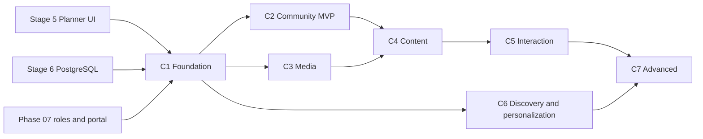

# Community Platform spec — roadmap

🇻🇳 Bản tiếng Việt: [specs-community-roadmap.vi.md](specs-community-roadmap.vi.md)

Status: **Proposed**. Labels **[C] [P] [A]**: see
[specs-community-overview.md](specs-community-overview.md). This roadmap adds phases
**after** the ones in [specs-roadmap.md](specs-roadmap.md) and changes none of them:
stages 1–9 and Phase 07 keep their scope and status. New phases carry the prefix **C** so
no number collides.

## Goals and scope

Order the Community Platform so each phase ships on its own, behind the contribution gate,
and can be switched off. Delivery is per phase, never all at once. [C]

## Requirements

- **R1** Foundation before features: ownership, visibility, moderation, a shared limiter. [C]
- **R2** Each phase has deliverables, acceptance criteria, a security gate and an exit
  condition. [C]
- **R3** Every phase that adds a table, a route or a trust boundary has its own ADR written
  first. [C]
- **R4** No phase starts before the exit condition of its dependency. [P]
- **R5** Go-live of any public write path waits for the owner's contribution terms and
  takedown contact (`contributionOpen`). [C]

## Design

### Dependencies

Stage 5 is "Partly open" in [specs-roadmap.md](specs-roadmap.md): C2 needs its trip editor
as the copy target, which has shipped (`docs/features/trip-editor.md`).

### Phases

| Phase | Theme | Deliverables | Security gate | Exit condition |
|---|---|---|---|---|
| **C1** | Foundation | `submission.ts` state machine, `ModerationEvent`, shared PostgreSQL-backed rate limiter, `Profile` with opt-in slug, `Trip.origin`, report entity and queue extension, notification-ready actions in `permissions.ts` | Threat model above reviewed; limiter test across two instances | Matrix and mapping tests green; existing stages unchanged |
| **C2** | Community MVP | Draft/published/changes-requested/unpublish for trips, gallery filters, **Use this trip** with attribution, Report control | `/sec-check` on the copy allow-list and anonymity | Anonymity enumeration test green; gate open |
| **C3** | Media | `MediaStore`, local and S3-compatible adapters, image upload pipeline, avatars, quotas, sweep | `/sec-check` on upload and signed URLs; ADR for the image library | GPS and polyglot fixtures green; backup of media verified |
| **C4** | Content | `Journal` (journal, blog, vlog), block editor, video embeds, moderation of journals | `/sec-check` on rich text, CSP for embeds; ADR for the editor | XSS corpus inert; staff can review and take down |
| **C5** | Interaction | Follow, like, save, comment, notifications, public profile, staff MFA decision, `moderator` role decision | `/sec-check` on abuse limits and privacy; load test of the write path | Counts correct under concurrency; deletion cascade proven |
| **C6** | Discovery and personalization | Search with Vietnamese unaccented matching, preferences, `scoreMatch`, "Suggested for you", [personalization spec](specs-planner-personalization.md) slices P1–P3, P6 | Preferences absent from every public projection | No-profile pages identical to `main` |
| **C7** | Advanced | Reputation, affiliate links, recommendations beyond rules | Own ADR each; not designed here | Opened only by owner decision |

C6 depends only on C1, so P1–P3 of the personalization spec may be built while C2–C5 wait
for the gate.

### Technical debt this work meets

Per-process rate limiter (ADR 0005); whole-store transaction (ADR 0009); no email sender;
MFA absent; auto deploy never run end to end (ADR 0016); the older `listing` three-state
model; `moderator` role deferred (ADR 0006).

## Flows and failure states

| Situation | Handling |
|---|---|
| A phase fails its security gate | BLOCKED stops the phase; at most two review/fix cycles, then escalate to the owner |
| Gate (`contributionOpen`) still closed | C1, C3 internals and C6 proceed; no public write path goes live |
| Measured contention on the store (DB5) | Move that table group to the per-row repository before C5 |
| Moderation backlog grows | Hold C4 and C5 launch; do not auto-approve |

## Dependencies and security

External: owner terms and takedown contact; Cloudflare Tunnel terms for media [A]; the
PostgreSQL VM role (extensions); the deploy runner registration (ADR 0016).

### Agent execution plan

Single-Agent First (CLAUDE.md). The main session wears the roles in order: architect,
backend, frontend. A subagent is the exception and needs the owner's approval first. [C]

| Role | Owns | Reads only |
|---|---|---|
| Architect | ADR, contract per phase, `docs/architecture.*`, these specs | The overview, the phase's spec, `permissions.ts` |
| Backend | `src/server/community/**`, `src/server/media/**`, `src/app/api/**`, `db/migrations/**` | Architecture, database, API, media, moderation, security specs |
| Frontend | `src/app/[locale]/**` markup, `src/components/community/**`, `messages/*.json`, `globals.css` tokens | The FE spec, the API spec |
| QC (on demand) | Verdict only | QC spec, the diff |
| Security (on demand) | Verdict only | Security spec, the diff |

Token budget rules: one session per phase and PR; `/compact` near 150k context; each role
reads only its list; no re-review of unchanged work; the survey in
[overview](specs-community-overview.md) is reused, not repeated. Subagents: **0** unless
approved; at most **two** at once, main session included at most three; disjoint file
sets; never two agents on one file. `qc` and `security` run only when the owner asks.

## Test scenarios

Per-phase acceptance in [QC](specs-community-qc.md); exit conditions above are checked by
those tests plus the regression net.

## Open questions

See the decision log below and each spec's own list; the questions that block the first
ADR are 1–4 here.

## Risk register

| ID | Risk | Type | Likelihood | Impact | Mitigation |
|---|---|---|---|---|---|
| RK1 | Likes and comments serialise on the whole-store lock | Performance | Medium | High | Per-row repository for community tables; load test before C5 |
| RK2 | Stored XSS through rich text | Security | Medium | High | Block documents, no HTML path, XSS corpus test, CSP |
| RK3 | GPS leaks from photos | Privacy | High if unmitigated | High | Re-encode strips EXIF; fixture test |
| RK4 | Spoofable per-process limiter lets abuse through | Security | High | Medium | Shared limiter in C1 |
| RK5 | Moderation backlog stalls content | Operations | Medium | Medium | Visible queue age, hide empty sections, owner SLA decision |
| RK6 | Disk and backup growth on the homelab | Cost, operations | Medium | Medium | Quotas, sweep, move to managed object storage before public launch |
| RK7 | Cloudflare Tunnel limits serving media | Operations | Unknown [A] | Medium | Verify terms; serve media from a storage host, not through the tunnel |
| RK8 | Native image library enters the supply chain | Security | Medium | Medium | ADR, `allowScripts` pinned review |
| RK9 | RAM pressure on 16 GB (image processing, optional antivirus) | Performance | Medium | Medium | Bound concurrency, size caps, skip antivirus for images |
| RK10 | First user content brings defamation, copyright, personal data | Legal | Medium | High | Contribution gate, takedown contact, curated review |
| RK11 | Report brigading hides honest comments | Abuse | Medium | Low | Threshold holds only comments, staff decide, logged |
| RK12 | Anonymous author exposed through copies or notifications | Privacy | Low | High | Allow-lists and an enumerating test |
| RK13 | Scope creep into social-network features | Scope | High | Medium | "Not in scope" list, one ADR per feature |
| RK14 | Auto deploy never run end to end | Operations | Medium | Medium | Owner registers the runner before C2 ships |
| RK15 | Vietnamese search misses unaccented queries | Product | Medium | Low | Unaccented column, fallback normalisation |

## Decision log

| # | Decision | Date | Source |
|---|---|---|---|
| 1 | Moderation is curated for long-form public content | 2026-11-16 | Owner brief |
| 2 | Short place reviews keep ADR 0014/0015 (live at once, staff remove) | 2026-11-16 | Owner answer |
| 3 | Media is hybrid: own storage for images, external platform for video | 2026-11-16 | Owner brief |
| 4 | Clone is personal and independent; no sync back | 2026-11-16 | Owner brief |
| 5 | Delivery is per phase, not all at once | 2026-11-16 | Owner brief |
| 6 | Agents are limited to save tokens and cost | 2026-11-16 | Owner brief |
| 7 | "Phase 05" and "Phase 06" mean Stage 5 and Stage 6; new phases are C1–C7 | 2026-11-16 | Owner answer |
| 8 | The spec set is ten documents, bilingual, short | 2026-11-16 | Owner answer |
| 9 | Any edit to a listed trip returns it to review | 2026-11-14 | ADR 0014 |
| 10 | Contribution terms and takedown contact are owner-supplied | 2026-11-14 | ADR 0014 |

Open: moderator role (editors until C5), public slug versus `handle`, image library,
editor library, storage choice, quotas and limits, MFA for staff, first-decision target.

## Phase summary

| Phase | Feature | Priority | Dependencies | Owner | Spec file | Acceptance criteria | Status |
|---|---|---|---|---|---|---|---|
| C1 | State machine, event log, shared limiter | P0 | Stages 5, 6, Phase 07 | Backend | [moderation](specs-community-moderation.md), [architecture](specs-community-architecture.md) | Transition and mapping tests | Proposed |
| C1 | Profile and opt-in slug | P0 | None | Backend, Frontend | [database](specs-community-database.md) | Opt-in default off | Proposed |
| C2 | Publish trip, changes requested, unpublish | P0 | C1 | Backend, Frontend | [moderation](specs-community-moderation.md) | Every edge tested | Proposed |
| C2 | Use this trip with attribution | P0 | C1, report control | Backend, Frontend | [api](specs-community-api.md) | Source unchanged, anonymity holds | Proposed |
| C2 | Report control and queue | P0 | C1 | Backend, Frontend | [moderation](specs-community-moderation.md) | Dedupe, queue visible | Proposed |
| C2 | Gallery filters | P1 | None | Backend | [api](specs-community-api.md) | Allow-listed query | Proposed |
| C3 | Image upload and storage | P0 | C1, ADR | Backend | [media](specs-community-media.md) | GPS stripped, quotas | Proposed |
| C4 | Journal, blog, vlog | P0 | C2, C3, ADR | Backend, Frontend | [fe](specs-community-fe.md) | XSS inert, review flow | Proposed |
| C4 | Video embed | P1 | C4 editor | Frontend | [media](specs-community-media.md) | Click to load, allow-list | Proposed |
| C5 | Follow, like, save | P1 | C4 | Backend, Frontend | [database](specs-community-database.md) | Concurrency correct | Proposed |
| C5 | Comment and notifications | P1 | C4 | Backend, Frontend | [api](specs-community-api.md) | Post-moderated, held at threshold | Proposed |
| C5 | Public profile | P2 | C5 follow | Frontend | [fe](specs-community-fe.md) | Anonymous never listed | Proposed |
| C6 | Search | P1 | C4 | Backend | [database](specs-community-database.md) | Unaccented match | Proposed |
| C6 | Preferences and matching | P2 | C1 | Backend, Frontend | [personalization](specs-planner-personalization.md) | No-profile identical | Proposed |
| C7 | Reputation, affiliate, recommendations | P3 | C5, C6 | Architect first | none yet | Own ADR | Not designed |
