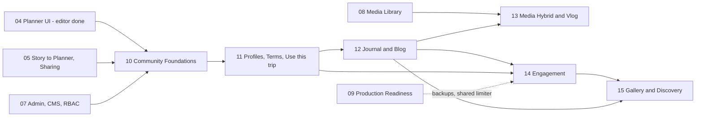

# Community Platform spec — roadmap

🇻🇳 Bản tiếng Việt: [specs-community-roadmap.vi.md](specs-community-roadmap.vi.md)

Status: **Proposed**. Labels **[C] [P] [A]**: see
[specs-community-overview.md](specs-community-overview.md). The roadmap identity is the
**Phase ID** in `.claude/roadmap/PHASES.md`: Phases 00–09 are fixed and untouched, and the
community work continues as **Phase 10–15** (defined in PR #107, "Roadmap Reconciliation").
The names **C1–C7** used in earlier drafts survive only as **spec groups** (a way to name a
bundle of features across these documents); they are not phases and never appear as a
roadmap ID. If PR #107 is not on `main` yet, this document depends on it.

## Goals and scope

Order the Community Platform so each phase ships on its own and can be switched off.
Delivery is per phase, never all at once. [C]

## Requirements

- **R1** Foundation before features: audit log, reports, terms acceptance, a shared write
  limiter. [C]
- **R2** Each phase has deliverables, acceptance criteria, a security gate and an exit
  condition. [C]
- **R3** Every phase that adds a table, a route or a trust boundary has its own ADR written
  first. [C]
- **R4** No phase starts before the exit condition of its dependency. [P]
- **R5** The contribution gate (`contributionOpen`) is **open on `main`** today: terms and a
  takedown contact are filled in `src/content/site.ts`. Any new public write path ships only
  while it stays true, and the owner confirms that the contact is a real, monitored mailbox
  (PR #107, Q8). [C]
- **R6** Phases 05–09 keep their ID, scope and status; this roadmap changes none. [C]

## Design

### Dependencies

Recommended order, as in `PHASES.md`: **05 → 07 → 10 → 11 → 12 → 06 → 08 → 13 → 14 → 09 → 15**.

### Phases

| Phase | Theme | Deliverables | Security gate | Exit condition |
|---|---|---|---|---|
| **10** | Community Foundations | `10-S0` (ADR 0014/0015, already coded); `audit_events` with the submission state machine (P10-1); `terms_acceptances` (P10-2); `reports` and the Report control and queue (P10-3); shared write limiter (P10-6); trip publication states `changes_requested` and `unpublished`, gallery filters; backups, `metadataBase`, HSTS fixed (P10-7); findings from the 2026-11-16 reviews (P10-11 to P10-16: HMAC `guestKey`, forwarded-header hardening, 429 and PostgreSQL tests, server-side gate decision, guest-name impersonation); [ADR 0019](adr/0019-community-foundation.md) | P10-5 (reviews of the existing community surface) is done: security PASS_WITH_WARNINGS, qc PASS_WITH_NOTES, no BLOCKED; `/sec-check` again on the new audit log and limiter | Transition and mapping tests green; limiter test across two simulated instances; backup restore proven on the dev VM |
| **11** | Member Profiles, Creator Terms, Use this trip | `member_profiles` (private by default, public opt-in page, no avatar upload); Terms version acceptance and text matching what exists; **Use this trip** with attribution, `origin` and a per-trip creator switch for copying (Terms Article 3); owner-supplied privacy policy (P11-D1) | `/sec-check` on the copy allow-list and anonymity | Anonymity enumeration test green; per-trip copy switch and republish scope decided (see risk RK16) |
| **12** | Travel Journal and Blog (curated) | `journal_posts` kind `journal`/`blog`, trip link, block document, curated review; **text only, no uploaded images** | `/sec-check` on rich text and CSP; ADR for the editor | XSS corpus inert; staff review and take down |
| **13** | Media Hybrid and Vlog | `media_assets`, image upload pipeline, avatars, quotas, vlog as `journal_posts.kind=vlog` with allow-listed embeds; built on Phase 08's media library | `/sec-check` required (XL, trust boundary); ADR for the image library and storage | GPS and polyglot fixtures green; media backup verified |
| **14** | Engagement | `saves`, `follows`, `likes`, `comments` (live at once, plus Report and hold), restriction extended to all targets | `/sec-check` on abuse limits and privacy; load test of the write path | Counts correct under concurrency; deletion cascade proven; shared limiter verified; MFA decision recorded |
| **15** | Curated Gallery and Discovery | Search with Vietnamese unaccented matching, gallery filter and pagination, editor collections, notifications, preferences and `scoreMatch` ([personalization spec](specs-planner-personalization.md)), `moderator` role decision | Preferences absent from every public projection | No-profile pages identical to `main` |
| 16 | Not designed | Reputation | Own ADR | Opened only by the owner |

**Affiliate links stay in Phase 06** (AI Planner, Affiliate and Optimization); the community
spec set adds none. Phase 08 builds the site-wide media library, Phase 13 consumes it for
member uploads and vlogs; both use one `MediaStore` interface.

### Spec groups to Phase mapping

| Spec group (draft name) | Lands in |
|---|---|
| C1 Foundation: state machine, event log, shared limiter | Phase 10 (event log is `audit_events`, P10-1; limiter is P10-6) |
| C2 Community MVP: publication states, gallery filters, Report | Phase 10 |
| C2 Use this trip | Phase 11 |
| Profile and public profile page | Phase 11 |
| C3 Media | Phase 08 (library), Phase 13 (member upload, avatars) |
| C4 Journal and blog | Phase 12 |
| C4 Vlog and video embed | Phase 13 |
| C5 Follow, like, save, comment | Phase 14 |
| C5 Notifications | Phase 15 (earlier phases show status and reason in "My posts") |
| C6 Search, personalization | Phase 15 |
| C7 Reputation | Phase 16, not designed |
| C7 Affiliate | Phase 06, out of this set |

### Technical debt this work meets

Shared write limiter not verified across instances (PHASES.md P09-1, Q12); whole-store
transaction (ADR 0009); no email sender; MFA absent (PR #107 Q6 defers it); dev VM backups
failing (Q10); the older three-state `listing`; `moderator` role deferred (ADR 0006).

## Flows and failure states

| Situation | Handling |
|---|---|
| A phase fails its security gate | BLOCKED stops the phase; at most two review/fix cycles, then escalate to the owner |
| `contributionOpen` becomes false | Public write paths return `503`; reads continue |
| Measured contention on the store | Move that table group to the per-row repository before Phase 14 |
| Moderation backlog grows | Hold Phase 12 and 14 launches; do not auto-approve |

## Dependencies and security

External: privacy policy and legal basis from the owner (Q9); a decision on the per-trip copy switch and on republishing copies (Terms Article 3 already covers copying when the creator turns it on); Cloudflare Tunnel terms for media [A]; the PostgreSQL VM role (extensions);
dev VM backups.

### Agent execution plan

Single-Agent First (CLAUDE.md). The main session wears the roles in order: architect,
backend, frontend. A subagent is the exception and needs the owner's approval first. [C]

| Role | Owns | Reads only |
|---|---|---|
| Architect | ADR, contract per phase, `docs/architecture.*`, these specs | The overview, the phase's spec, `permissions.ts` |
| Backend | `src/server/community/**`, `src/server/media/**`, `src/app/api/**`, `db/migrations/**` | Architecture, database, API, media, moderation, security specs |
| Frontend | `src/app/[locale]/**` markup, `src/components/community/**`, `messages/*.json`, `globals.css` tokens | The FE spec, the API spec |
| QC (on demand) | Verdict only | QC spec, the diff |
| Security (on demand) | Verdict only | Security spec, the diff |

Token budget rules: one session per phase and PR; `/compact` near 150k context; each role
reads only its list; no re-review of unchanged work; the survey in
[overview](specs-community-overview.md) is reused, not repeated. Subagents: **0** unless
approved; at most **two** at once, at most three counting the main session; disjoint file
sets; never two agents on one file. `qc` and `security` run only when the owner asks.

## Test scenarios

Per-phase acceptance in [QC](specs-community-qc.md); exit conditions above are checked by
those tests plus the regression net.

## Open questions

See the decision log below and each spec's own list. The ones that block the Phase 10 ADR:
backups (Q10), the real takedown mailbox (Q8), the privacy policy (Q9), and whether
"Use this trip" belongs in Phase 11 as proposed.

## Risk register

| ID | Risk | Type | Likelihood | Impact | Mitigation |
|---|---|---|---|---|---|
| RK1 | Likes and comments serialise on the whole-store lock | Performance | Medium | High | Per-row repository for community tables; load test before Phase 14 |
| RK2 | Stored XSS through rich text | Security | Medium | High | Block documents, no HTML path, XSS corpus test, CSP |
| RK3 | GPS leaks from photos | Privacy | High if unmitigated | High | Re-encode strips EXIF; fixture test |
| RK4 | Per-process limiter resets on every deploy and does not span instances; anonymous keys are spoofable | Security | High | Medium | Shared limiter in Phase 10 fixes persistence and multi-instance; authenticated writes keyed by `userId`; trusted-proxy header question open (ADR 0019) |
| RK5 | Moderation backlog stalls content | Operations | Medium | Medium | Visible queue age, hide empty sections, owner SLA decision |
| RK6 | Disk and backup growth on the homelab | Cost, operations | Medium | Medium | Quotas, sweep, move to managed object storage before public launch |
| RK7 | Cloudflare Tunnel limits serving media | Operations | Unknown [A] | Medium | Verify terms; serve media from a storage host, not through the tunnel |
| RK8 | Native image library enters the supply chain | Security | Medium | Medium | ADR, `allowScripts` pinned review |
| RK9 | RAM pressure on 16 GB (image processing, optional antivirus) | Performance | Medium | Medium | Bound concurrency, size caps, skip antivirus for images |
| RK10 | User content brings defamation, copyright, personal data | Legal | Medium | High | Contribution gate, takedown contact, curated review |
| RK11 | Report brigading hides honest comments | Abuse | Medium | Low | Threshold holds only comments, staff decide, logged |
| RK12 | Anonymous author exposed through copies or notifications | Privacy | Low | High | Allow-lists and an enumerating test |
| RK13 | Scope creep into social-network features | Scope | High | Medium | "Not in scope" list, one ADR per feature |
| RK14 | Deploy evidence is old: the dev VM run (2026-11-15) predates PR #93–#105 | Operations | Medium | Medium | Re-run the deploy test before Phase 10 ships |
| RK15 | Vietnamese search misses unaccented queries | Product | Medium | Low | Unaccented column, fallback normalisation |
| RK16 | Terms Article 3 allows copying only when the creator turns it on, but no per-trip switch exists in the code and the scope for republishing a copy is undefined | Legal, product | Medium | Medium | Add the per-trip switch (default off) and a republish rule in Phase 11; counsel reads Article 3 against the feature |
| RK17 | Live community content while the Report control and audit log do not exist yet | Safety | Medium | High | Phase 10 first; backups before new user content (Q10) |
| RK18 | Two roadmaps drift (`.claude/roadmap/` and these specs) | Process | Medium | Low | The spec-group mapping table above; PHASES.md is authoritative for IDs |

## Decision log

| # | Decision | Date | Source |
|---|---|---|---|
| 1 | Moderation is curated for long-form public content | 2026-11-16 | Owner brief |
| 2 | Short place reviews keep ADR 0014/0015 (live at once, staff remove) | 2026-11-16 | Owner answer, PR #107 Q1 |
| 3 | Media is hybrid: own storage for images, external platform for video | 2026-11-16 | Owner brief |
| 4 | Clone is personal and independent; no sync back | 2026-11-16 | Owner brief |
| 5 | Delivery is per phase, not all at once | 2026-11-16 | Owner brief |
| 6 | Agents are limited to save tokens and cost | 2026-11-16 | Owner brief |
| 7 | Phase 05–09 are the IDs in `.claude/roadmap/PHASES.md` (05 Story to Planner, 06 AI Planner, 07 Admin, 08 Media, 09 Production) and stay untouched. This replaces an earlier wrong reading ("Stage 5 and 6") | 2026-11-16 | Review of PR #106 against #107 |
| 8 | Community phases are **Phase 10–15**; C1–C7 are spec groups only | 2026-11-16 | Owner instruction |
| 9 | The spec set is ten documents, bilingual, short | 2026-11-16 | Owner answer |
| 10 | Any edit to a listed trip returns it to review | 2026-11-14 | ADR 0014 |
| 11 | Journal/blog/vlog curated; comments live at once plus Report and hold | 2026-11-16 | PR #107 Q2 |
| 12 | Embed vlogs first (YouTube), upload images later | 2026-11-16 | PR #107 Q7 |
| 13 | Creator Terms Article 3 already covers copying when the creator turns it on; what is missing is a per-trip switch and a republish rule (corrects an earlier claim that the Terms gave no such right) | 2026-11-16 | Review of `src/content/site.ts` |

Open: moderator role (editors until Phase 15), public slug versus `handle`, image library,
editor library, storage choice, quotas, MFA for staff, first-decision target, per-trip copy switch and republish scope (Terms Article 3).

## Phase summary

| Phase | Feature | Priority | Dependencies | Owner | Spec file | Acceptance criteria | Status |
|---|---|---|---|---|---|---|---|
| 10 | Audit log and state machine | P1 | 07 | Backend | [moderation](specs-community-moderation.md), [ADR 0019](adr/0019-community-foundation.md) | Transition and mapping tests | Proposed |
| 10 | Shared write limiter | P1 | 07 | Backend | [ADR 0019](adr/0019-community-foundation.md) | Two-instance test, fail closed | Proposed |
| 10 | Reports, Report control, queue | P1 | audit log | Backend, Frontend | [moderation](specs-community-moderation.md) | Dedupe, queue visible | Proposed |
| 10 | Terms acceptance | P1 | audit log | Backend, Frontend | [security](specs-community-security.md) | Writes blocked without version | Proposed |
| 10 | Trip publication states, gallery filters | P1 | audit log | Backend, Frontend | [api](specs-community-api.md) | Every edge tested | Proposed |
| 11 | Member profile, public opt-in page | P1 | 10, privacy policy | Backend, Frontend | [database](specs-community-database.md) | Opt-in default off | Proposed |
| 11 | Use this trip with attribution | P1 | 10, copy switch (Terms Art. 3) | Backend, Frontend | [api](specs-community-api.md) | Source unchanged, anonymity holds | Proposed |
| 12 | Journal and blog | P2 | 10, 11 | Backend, Frontend | [fe](specs-community-fe.md) | XSS inert, review flow | Proposed |
| 13 | Image upload, avatars | P2 | 08, 12 | Backend | [media](specs-community-media.md) | GPS stripped, quotas | Proposed |
| 13 | Vlog and video embed | P2 | 12, 13 media | Frontend | [media](specs-community-media.md) | Click to load, allow-list | Proposed |
| 14 | Save, follow, like | P3 | 10, 11, 12 | Backend, Frontend | [database](specs-community-database.md) | Correct under concurrency | Proposed |
| 14 | Comment | P3 | 14, limiter verified | Backend, Frontend | [api](specs-community-api.md) | Live, Report, hold at threshold | Proposed |
| 15 | Search, filter, pagination | P4 | 12, 14 | Backend | [database](specs-community-database.md) | Unaccented match | Proposed |
| 15 | Notifications | P4 | 14 | Backend, Frontend | [api](specs-community-api.md) | Allow-listed payloads | Proposed |
| 15 | Preferences and matching | P4 | 10 | Backend, Frontend | [personalization](specs-planner-personalization.md) | No-profile identical | Proposed |
| 16 | Reputation | P5 | 14, 15 | Architect first | none yet | Own ADR | Not designed |
