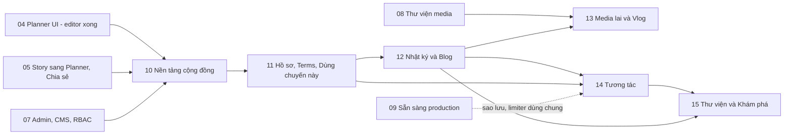

# Spec Community Platform — roadmap

🇻🇳 English version: [specs-community-roadmap.md](specs-community-roadmap.md)

Trạng thái: **Đề xuất**. Nhãn **[C] [P] [A]**: xem
[specs-community-overview.vi.md](specs-community-overview.vi.md). Định danh roadmap là
**Phase ID** trong `.claude/roadmap/PHASES.md`: Phase 00–09 cố định và không bị chạm tới, còn
phần cộng đồng tiếp tục là **Phase 10–15** (định nghĩa ở PR #107, "Roadmap Reconciliation").
Tên **C1–C7** ở các bản nháp trước chỉ còn là **nhóm spec** (cách gọi một bó tính năng xuyên
các tài liệu này); chúng không phải phase và không bao giờ xuất hiện làm ID roadmap. Nếu PR
#107 chưa nằm trên `main`, tài liệu này phụ thuộc vào nó.

## Mục tiêu và phạm vi

Sắp xếp Community Platform sao cho mỗi phase ra mắt riêng và có thể tắt. Triển khai theo
từng phase, không bao giờ đồng loạt. [C]

## Yêu cầu

- **R1** Nền tảng trước tính năng: audit log, báo cáo, ghi nhận đồng ý Terms, limiter ghi
  dùng chung. [C]
- **R2** Mỗi phase có sản phẩm bàn giao, tiêu chí nghiệm thu, cổng bảo mật và điều kiện
  thoát. [C]
- **R3** Mọi phase thêm bảng, route hay ranh giới tin cậy đều có ADR riêng viết trước. [C]
- **R4** Không phase nào bắt đầu trước điều kiện thoát của phase nó phụ thuộc. [P]
- **R5** Cổng đóng góp (`contributionOpen`) hiện **đang mở trên `main`**: điều khoản và liên
  hệ gỡ bài đã được điền trong `src/content/site.ts`. Mọi đường ghi công khai mới chỉ ra mắt
  khi nó còn true, và chủ dự án xác nhận liên hệ đó là hộp thư thật, có người theo dõi (PR
  #107, Q8). [C]
- **R6** Phase 05–09 giữ ID, phạm vi và trạng thái; roadmap này không đổi cái nào. [C]

## Thiết kế

### Phụ thuộc

Thứ tự khuyến nghị, như trong `PHASES.md`: **05 → 07 → 10 → 11 → 12 → 06 → 08 → 13 → 14 → 09 → 15**.

### Các phase

| Phase | Chủ đề | Sản phẩm bàn giao | Cổng bảo mật | Điều kiện thoát |
|---|---|---|---|---|
| **10** | Nền tảng cộng đồng | `10-S0` (ADR 0014/0015, đã có code); `audit_events` cùng máy trạng thái submission (P10-1); `terms_acceptances` (P10-2); `reports`, điều khiển Báo cáo và hàng đợi (P10-3); limiter ghi dùng chung (P10-6); trạng thái đăng chuyến `changes_requested` và `unpublished`, bộ lọc thư viện; sửa sao lưu, `metadataBase`, HSTS (P10-7); các phát hiện từ review 2026-11-16 (P10-11 đến P10-16: HMAC cho `guestKey`, tăng cường header chuyển tiếp, test 429 và PostgreSQL, quyết định chặn ở server, giả danh trong tên khách); [ADR 0019](adr/0019-community-foundation.vi.md) | P10-5 (review bề mặt cộng đồng hiện có) đã xong: security PASS_WITH_WARNINGS, qc PASS_WITH_NOTES, không BLOCKED; `/sec-check` lại cho audit log và limiter mới | Test chuyển trạng thái và ánh xạ xanh; test limiter qua hai instance mô phỏng; khôi phục sao lưu chứng minh được trên dev VM |
| **11** | Hồ sơ thành viên, Creator Terms, Dùng chuyến này | `member_profiles` (mặc định riêng tư, trang công khai tự nguyện, không upload avatar); đồng ý Terms theo phiên bản và text khớp thực tế; **Dùng chuyến này** kèm ghi công, `origin` và công tắc sao chép theo từng chuyến của người tạo (Điều 3 Terms); chính sách riêng tư do chủ dự án cung cấp (P11-D1) | `/sec-check` về danh sách cho phép khi sao chép và tính ẩn danh | Test liệt kê ẩn danh xanh; công tắc sao chép theo chuyến và phạm vi đăng lại đã được quyết (xem rủi ro RK16) |
| **12** | Nhật ký và Blog (tuyển chọn) | `journal_posts` kind `journal`/`blog`, gắn chuyến, tài liệu block, duyệt tuyển chọn; **chỉ văn bản, không ảnh tải lên** | `/sec-check` về rich text và CSP; ADR cho editor | Bộ XSS vô hại; nhân viên duyệt và gỡ được |
| **13** | Media lai và Vlog | `media_assets`, pipeline upload ảnh, avatar, hạn mức, vlog là `journal_posts.kind=vlog` với embed trong danh sách cho phép; xây trên thư viện media của Phase 08 | `/sec-check` bắt buộc (XL, ranh giới tin cậy); ADR cho thư viện ảnh và lưu trữ | Fixture GPS và đa định dạng xanh; sao lưu media được xác minh |
| **14** | Tương tác | `saves`, `follows`, `likes`, `comments` (lên ngay, kèm Báo cáo và giữ lại), hạn chế mở rộng cho mọi đích | `/sec-check` về giới hạn lạm dụng và quyền riêng tư; load test đường ghi | Số đếm đúng khi đồng thời; chuỗi xóa được chứng minh; limiter dùng chung được xác minh; quyết định MFA được ghi lại |
| **15** | Thư viện tuyển chọn và Khám phá | Tìm kiếm khớp tiếng Việt không dấu, lọc và phân trang thư viện, bộ sưu tập của editor, thông báo, sở thích và `scoreMatch` ([spec cá nhân hóa](specs-planner-personalization.vi.md)), quyết định vai trò `moderator` | Sở thích vắng mặt trong mọi projection công khai | Trang không có hồ sơ giống hệt `main` |
| 16 | Chưa thiết kế | Danh tiếng | ADR riêng | Chỉ mở theo quyết định của chủ dự án |

**Link affiliate vẫn thuộc Phase 06** (AI Planner, Affiliate và Optimization); bộ spec cộng
đồng không thêm cái nào. Phase 08 xây thư viện media toàn site, Phase 13 dùng nó cho upload
của thành viên và vlog; cả hai dùng một interface `MediaStore`.

### Ánh xạ nhóm spec sang Phase

| Nhóm spec (tên bản nháp) | Rơi vào |
|---|---|
| C1 Nền tảng: máy trạng thái, log sự kiện, limiter dùng chung | Phase 10 (log sự kiện là `audit_events`, P10-1; limiter là P10-6) |
| C2 Community MVP: trạng thái đăng, bộ lọc thư viện, Báo cáo | Phase 10 |
| C2 Dùng chuyến này | Phase 11 |
| Hồ sơ và trang hồ sơ công khai | Phase 11 |
| C3 Media | Phase 08 (thư viện), Phase 13 (upload của thành viên, avatar) |
| C4 Nhật ký và blog | Phase 12 |
| C4 Vlog và embed video | Phase 13 |
| C5 Theo dõi, thích, lưu, bình luận | Phase 14 |
| C5 Thông báo | Phase 15 (các phase trước hiện trạng thái và lý do trong "Bài của tôi") |
| C6 Tìm kiếm, cá nhân hóa | Phase 15 |
| C7 Danh tiếng | Phase 16, chưa thiết kế |
| C7 Affiliate | Phase 06, ngoài bộ này |

### Nợ kỹ thuật công việc này gặp

Limiter ghi dùng chung chưa xác minh qua nhiều instance (PHASES.md P09-1, Q12); transaction
toàn kho (ADR 0009); chưa có bộ gửi email; chưa có MFA (PR #107 Q6 hoãn); sao lưu dev VM
đang lỗi (Q10); mô hình `listing` ba trạng thái cũ; vai trò `moderator` bị hoãn (ADR 0006).

## Luồng xử lý và trạng thái lỗi

| Tình huống | Xử lý |
|---|---|
| Một phase trượt cổng bảo mật | BLOCKED dừng phase; tối đa hai vòng review/sửa, rồi báo chủ dự án |
| `contributionOpen` thành false | Đường ghi công khai trả `503`; đọc vẫn chạy |
| Đo được tranh chấp trên kho | Chuyển nhóm bảng đó sang repository theo từng dòng trước Phase 14 |
| Hàng đợi kiểm duyệt tồn đọng tăng | Hoãn ra mắt Phase 12 và 14; không tự duyệt |

## Phụ thuộc và bảo mật

Bên ngoài: chính sách riêng tư và cơ sở pháp lý từ chủ dự án (Q9); quyết định về công tắc sao chép theo chuyến và việc đăng lại bản sao (Điều 3 Terms đã cho phép sao chép khi người tạo bật); điều khoản Cloudflare Tunnel cho media [A]; role trên VM PostgreSQL
(extension); sao lưu dev VM.

### Kế hoạch thực thi agent

Single-Agent First (CLAUDE.md). Phiên chính đóng các vai theo thứ tự: architect, backend,
frontend. Subagent là ngoại lệ và cần chủ dự án duyệt trước. [C]

| Vai | Sở hữu | Chỉ đọc |
|---|---|---|
| Architect | ADR, contract mỗi phase, `docs/architecture.*`, các spec này | Tổng quan, spec của phase, `permissions.ts` |
| Backend | `src/server/community/**`, `src/server/media/**`, `src/app/api/**`, `db/migrations/**` | Các spec kiến trúc, cơ sở dữ liệu, API, media, kiểm duyệt, bảo mật |
| Frontend | Markup `src/app/[locale]/**`, `src/components/community/**`, `messages/*.json`, token `globals.css` | Spec FE, spec API |
| QC (theo yêu cầu) | Chỉ kết luận | Spec QC, diff |
| Security (theo yêu cầu) | Chỉ kết luận | Spec bảo mật, diff |

Quy tắc ngân sách token: một phiên cho mỗi phase và PR; `/compact` gần 150k ngữ cảnh; mỗi vai
chỉ đọc danh sách của mình; không review lại việc không đổi; khảo sát trong
[tổng quan](specs-community-overview.vi.md) được dùng lại, không lặp lại. Subagent: **0** trừ
khi được duyệt; tối đa **hai** cùng lúc, tính cả phiên chính tối đa ba; tập file tách biệt;
không bao giờ hai agent trên một file. `qc` và `security` chỉ chạy khi chủ dự án yêu cầu.

## Kịch bản kiểm thử

Nghiệm thu theo phase ở [QC](specs-community-qc.vi.md); các điều kiện thoát ở trên được kiểm
bằng các test đó cùng lưới hồi quy.

## Câu hỏi còn mở

Xem nhật ký quyết định bên dưới và danh sách riêng của từng spec. Các câu chặn ADR của Phase
10: sao lưu (Q10), hộp thư gỡ bài thật (Q8), chính sách riêng tư (Q9), và "Dùng chuyến này"
có thuộc Phase 11 như đề xuất không.

## Sổ đăng ký rủi ro

| ID | Rủi ro | Loại | Khả năng | Tác động | Giảm thiểu |
|---|---|---|---|---|---|
| RK1 | Thích và bình luận bị xếp hàng trên khóa toàn kho | Hiệu năng | Trung bình | Cao | Repository theo từng dòng cho bảng cộng đồng; load test trước Phase 14 |
| RK2 | XSS lưu trữ qua rich text | Bảo mật | Trung bình | Cao | Tài liệu block, không có đường HTML, test bộ XSS, CSP |
| RK3 | Lộ GPS từ ảnh | Riêng tư | Cao nếu không xử lý | Cao | Mã hóa lại xóa EXIF; test fixture |
| RK4 | Limiter theo tiến trình reset mỗi lần deploy và không phủ nhiều instance; khóa ẩn danh giả mạo được | Bảo mật | Cao | Trung bình | Limiter dùng chung ở Phase 10 sửa tính bền vững và đa instance; lệnh ghi đã đăng nhập khóa theo `userId`; câu hỏi header proxy đáng tin còn mở (ADR 0019) |
| RK5 | Hàng đợi kiểm duyệt tồn đọng làm nội dung ngưng trệ | Vận hành | Trung bình | Trung bình | Hiện tuổi hàng đợi, ẩn phần rỗng, quyết định SLA của chủ dự án |
| RK6 | Đĩa và sao lưu tăng trên homelab | Chi phí, vận hành | Trung bình | Trung bình | Hạn mức, tác vụ dọn, chuyển sang object storage có quản lý trước khi ra công khai |
| RK7 | Cloudflare Tunnel giới hạn phục vụ media | Vận hành | Chưa rõ [A] | Trung bình | Kiểm điều khoản; phục vụ media từ host lưu trữ, không qua tunnel |
| RK8 | Thư viện ảnh native vào chuỗi cung ứng | Bảo mật | Trung bình | Trung bình | ADR, rà soát `allowScripts` ghim phiên bản |
| RK9 | Áp lực RAM trên 16 GB (xử lý ảnh, diệt virus tùy chọn) | Hiệu năng | Trung bình | Trung bình | Giới hạn đồng thời, giới hạn kích thước, bỏ diệt virus cho ảnh |
| RK10 | Nội dung người dùng kéo theo phỉ báng, bản quyền, dữ liệu cá nhân | Pháp lý | Trung bình | Cao | Cổng đóng góp, liên hệ gỡ bài, duyệt tuyển chọn |
| RK11 | Báo cáo đồng loạt ẩn bình luận trung thực | Lạm dụng | Trung bình | Thấp | Ngưỡng chỉ giữ bình luận, nhân viên quyết định, có log |
| RK12 | Tác giả ẩn danh lộ qua bản sao hay thông báo | Riêng tư | Thấp | Cao | Danh sách cho phép và test liệt kê |
| RK13 | Phình phạm vi thành tính năng mạng xã hội | Phạm vi | Cao | Trung bình | Danh sách "ngoài phạm vi", mỗi tính năng một ADR |
| RK14 | Bằng chứng deploy đã cũ: lần chạy dev VM (2026-11-15) có trước PR #93–#105 | Vận hành | Trung bình | Trung bình | Chạy lại bài test deploy trước khi Phase 10 ra mắt |
| RK15 | Tìm kiếm tiếng Việt bỏ sót truy vấn không dấu | Sản phẩm | Trung bình | Thấp | Cột không dấu, chuẩn hóa dự phòng |
| RK16 | Điều 3 Terms chỉ cho sao chép khi người tạo bật, nhưng code chưa có công tắc theo chuyến và phạm vi đăng lại một bản sao chưa được định nghĩa | Pháp lý, sản phẩm | Trung bình | Trung bình | Thêm công tắc theo chuyến (mặc định tắt) và quy tắc đăng lại ở Phase 11; luật sư đọc Điều 3 so với tính năng |
| RK17 | Nội dung cộng đồng đang lên sóng khi điều khiển Báo cáo và audit log chưa tồn tại | An toàn | Trung bình | Cao | Phase 10 trước; sao lưu trước khi có thêm nội dung người dùng (Q10) |
| RK18 | Hai roadmap lệch nhau (`.claude/roadmap/` và các spec này) | Quy trình | Trung bình | Thấp | Bảng ánh xạ nhóm spec ở trên; PHASES.md là nguồn chuẩn cho ID |

## Nhật ký quyết định

| # | Quyết định | Ngày | Nguồn |
|---|---|---|---|
| 1 | Kiểm duyệt tuyển chọn cho nội dung công khai dài | 2026-11-16 | Brief của chủ dự án |
| 2 | Đánh giá địa điểm ngắn giữ ADR 0014/0015 (lên ngay, nhân viên gỡ) | 2026-11-16 | Trả lời của chủ dự án, PR #107 Q1 |
| 3 | Media lai: lưu ảnh nội bộ, video dùng nền tảng ngoài | 2026-11-16 | Brief của chủ dự án |
| 4 | Sao chép là cá nhân và độc lập; không đồng bộ ngược | 2026-11-16 | Brief của chủ dự án |
| 5 | Triển khai theo phase, không đồng loạt | 2026-11-16 | Brief của chủ dự án |
| 6 | Giới hạn agent để tiết kiệm token và chi phí | 2026-11-16 | Brief của chủ dự án |
| 7 | Phase 05–09 là các ID trong `.claude/roadmap/PHASES.md` (05 Story sang Planner, 06 AI Planner, 07 Admin, 08 Media, 09 Production) và giữ nguyên. Việc này thay cho cách hiểu sai trước đó ("Stage 5 và 6") | 2026-11-16 | Review PR #106 đối chiếu #107 |
| 8 | Phase cộng đồng là **Phase 10–15**; C1–C7 chỉ là nhóm spec | 2026-11-16 | Chỉ thị của chủ dự án |
| 9 | Bộ spec gồm mười tài liệu, song ngữ, ngắn gọn | 2026-11-16 | Trả lời của chủ dự án |
| 10 | Mọi chỉnh sửa chuyến đã đăng đưa nó về hàng duyệt | 2026-11-14 | ADR 0014 |
| 11 | Nhật ký/blog/vlog tuyển chọn; bình luận lên ngay kèm Báo cáo và giữ lại | 2026-11-16 | PR #107 Q2 |
| 12 | Vlog embed trước (YouTube), upload ảnh sau | 2026-11-16 | PR #107 Q7 |
| 13 | Điều 3 Creator Terms đã cho phép sao chép khi người tạo bật; còn thiếu là công tắc theo chuyến và quy tắc đăng lại (sửa nhận định trước đó rằng Terms không có quyền này) | 2026-11-16 | Rà `src/content/site.ts` |

Còn mở: vai trò moderator (editor tới Phase 15), slug công khai so với `handle`, thư viện ảnh,
thư viện editor, lựa chọn lưu trữ, hạn mức, MFA cho nhân viên, mục tiêu quyết định đầu tiên,
công tắc sao chép theo chuyến và phạm vi đăng lại (Điều 3 Terms).

## Tổng hợp theo phase

| Phase | Tính năng | Ưu tiên | Phụ thuộc | Chủ trì | File spec | Tiêu chí nghiệm thu | Trạng thái |
|---|---|---|---|---|---|---|---|
| 10 | Audit log và máy trạng thái | P1 | 07 | Backend | [kiểm duyệt](specs-community-moderation.vi.md), [ADR 0019](adr/0019-community-foundation.vi.md) | Test chuyển trạng thái và ánh xạ | Đề xuất |
| 10 | Limiter ghi dùng chung | P1 | 07 | Backend | [ADR 0019](adr/0019-community-foundation.vi.md) | Test hai instance, từ chối khi lỗi | Đề xuất |
| 10 | Báo cáo, điều khiển Báo cáo, hàng đợi | P1 | audit log | Backend, Frontend | [kiểm duyệt](specs-community-moderation.vi.md) | Loại trùng, hàng đợi thấy được | Đề xuất |
| 10 | Ghi nhận đồng ý Terms | P1 | audit log | Backend, Frontend | [bảo mật](specs-community-security.vi.md) | Chặn ghi khi thiếu phiên bản | Đề xuất |
| 10 | Trạng thái đăng chuyến, bộ lọc thư viện | P1 | audit log | Backend, Frontend | [api](specs-community-api.vi.md) | Mọi cạnh được test | Đề xuất |
| 11 | Hồ sơ thành viên, trang công khai tự nguyện | P1 | 10, chính sách riêng tư | Backend, Frontend | [cơ sở dữ liệu](specs-community-database.vi.md) | Mặc định tắt | Đề xuất |
| 11 | Dùng chuyến này kèm ghi công | P1 | 10, công tắc sao chép (Điều 3 Terms) | Backend, Frontend | [api](specs-community-api.vi.md) | Nguồn không đổi, ẩn danh giữ vững | Đề xuất |
| 12 | Nhật ký và blog | P2 | 10, 11 | Backend, Frontend | [fe](specs-community-fe.vi.md) | XSS vô hại, luồng duyệt | Đề xuất |
| 13 | Upload ảnh, avatar | P2 | 08, 12 | Backend | [media](specs-community-media.vi.md) | Xóa GPS, hạn mức | Đề xuất |
| 13 | Vlog và embed video | P2 | 12, media của 13 | Frontend | [media](specs-community-media.vi.md) | Bấm để tải, danh sách cho phép | Đề xuất |
| 14 | Lưu, theo dõi, thích | P3 | 10, 11, 12 | Backend, Frontend | [cơ sở dữ liệu](specs-community-database.vi.md) | Đúng khi đồng thời | Đề xuất |
| 14 | Bình luận | P3 | 14, limiter đã xác minh | Backend, Frontend | [api](specs-community-api.vi.md) | Lên ngay, Báo cáo, giữ ở ngưỡng | Đề xuất |
| 15 | Tìm kiếm, lọc, phân trang | P4 | 12, 14 | Backend | [cơ sở dữ liệu](specs-community-database.vi.md) | Khớp không dấu | Đề xuất |
| 15 | Thông báo | P4 | 14 | Backend, Frontend | [api](specs-community-api.vi.md) | Payload theo danh sách cho phép | Đề xuất |
| 15 | Sở thích và khớp | P4 | 10 | Backend, Frontend | [cá nhân hóa](specs-planner-personalization.vi.md) | Không hồ sơ thì giống hệt | Đề xuất |
| 16 | Danh tiếng | P5 | 14, 15 | Architect trước | chưa có | ADR riêng | Chưa thiết kế |
