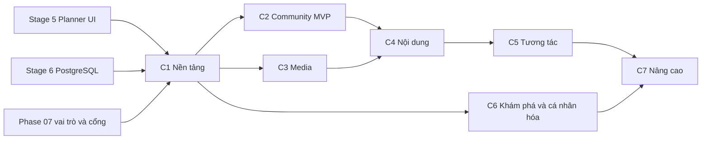

# Spec Community Platform — roadmap

🇻🇳 English version: [specs-community-roadmap.md](specs-community-roadmap.md)

Trạng thái: **Đề xuất**. Nhãn **[C] [P] [A]**: xem
[specs-community-overview.vi.md](specs-community-overview.vi.md). Roadmap này thêm các
phase **sau** những phase trong [specs-roadmap.vi.md](specs-roadmap.vi.md) và không đổi cái
nào: stage 1–9 và Phase 07 giữ phạm vi và trạng thái. Phase mới mang tiền tố **C** để không
số nào trùng.

## Mục tiêu và phạm vi

Sắp xếp Community Platform sao cho mỗi phase ra mắt riêng, sau cổng đóng góp, và có thể tắt.
Triển khai theo từng phase, không bao giờ đồng loạt. [C]

## Yêu cầu

- **R1** Nền tảng trước tính năng: quyền sở hữu, khả năng hiển thị, kiểm duyệt, bộ giới hạn
  dùng chung. [C]
- **R2** Mỗi phase có sản phẩm bàn giao, tiêu chí nghiệm thu, cổng bảo mật và điều kiện
  thoát. [C]
- **R3** Mọi phase thêm bảng, route hay ranh giới tin cậy đều có ADR riêng viết trước. [C]
- **R4** Không phase nào bắt đầu trước điều kiện thoát của phase nó phụ thuộc. [P]
- **R5** Lên sóng mọi đường ghi công khai chờ điều khoản đóng góp và liên hệ gỡ bài của chủ
  dự án (`contributionOpen`). [C]

## Thiết kế

### Phụ thuộc

Stage 5 là "Mở một phần" trong [specs-roadmap.vi.md](specs-roadmap.vi.md): C2 cần trình soạn
chuyến của nó làm đích sao chép, đã ra mắt (`docs/features/trip-editor.md`).

### Các phase

| Phase | Chủ đề | Sản phẩm bàn giao | Cổng bảo mật | Điều kiện thoát |
|---|---|---|---|---|
| **C1** | Nền tảng | Máy trạng thái `submission.ts`, `ModerationEvent`, bộ giới hạn tốc độ dùng chung trên PostgreSQL, `Profile` với slug tự nguyện, `Trip.origin`, thực thể báo cáo và mở rộng hàng đợi, action sẵn cho thông báo trong `permissions.ts` | Mô hình đe dọa ở trên được rà; test bộ giới hạn qua hai instance | Test ma trận và ánh xạ xanh; các stage hiện có không đổi |
| **C2** | Community MVP | Nháp/đã đăng/cần sửa/gỡ đăng cho chuyến, bộ lọc thư viện, **Dùng chuyến này** kèm ghi công, điều khiển Báo cáo | `/sec-check` về danh sách cho phép khi sao chép và tính ẩn danh | Test liệt kê ẩn danh xanh; cổng mở |
| **C3** | Media | `MediaStore`, adapter cục bộ và tương thích S3, pipeline upload ảnh, avatar, hạn mức, tác vụ dọn | `/sec-check` về upload và URL ký; ADR cho thư viện ảnh | Fixture GPS và đa định dạng xanh; sao lưu media được xác minh |
| **C4** | Nội dung | `Journal` (nhật ký, blog, vlog), editor block, embed video, kiểm duyệt nhật ký | `/sec-check` về rich text, CSP cho embed; ADR cho editor | Bộ XSS vô hại; nhân viên duyệt và gỡ được |
| **C5** | Tương tác | Theo dõi, thích, lưu, bình luận, thông báo, hồ sơ công khai, quyết định MFA cho nhân viên, quyết định vai trò `moderator` | `/sec-check` về giới hạn lạm dụng và quyền riêng tư; load test đường ghi | Số đếm đúng khi đồng thời; chuỗi xóa được chứng minh |
| **C6** | Khám phá và cá nhân hóa | Tìm kiếm khớp tiếng Việt không dấu, sở thích, `scoreMatch`, "Gợi ý cho bạn", các lát P1–P3, P6 của [spec cá nhân hóa](specs-planner-personalization.vi.md) | Sở thích vắng mặt trong mọi projection công khai | Trang không có hồ sơ giống hệt `main` |
| **C7** | Nâng cao | Uy tín, link tiếp thị liên kết, gợi ý vượt quá luật | Mỗi cái một ADR; chưa thiết kế ở đây | Chỉ mở theo quyết định của chủ dự án |

C6 chỉ phụ thuộc C1, nên P1–P3 của spec cá nhân hóa có thể xây trong khi C2–C5 chờ cổng.

### Nợ kỹ thuật công việc này gặp

Bộ giới hạn tốc độ theo tiến trình (ADR 0005); transaction toàn kho (ADR 0009); chưa có bộ
gửi email; chưa có MFA; auto deploy chưa chạy đầu-cuối (ADR 0016); mô hình `listing` ba
trạng thái cũ; vai trò `moderator` bị hoãn (ADR 0006).

## Luồng xử lý và trạng thái lỗi

| Tình huống | Xử lý |
|---|---|
| Một phase trượt cổng bảo mật | BLOCKED dừng phase; tối đa hai vòng review/sửa, rồi báo chủ dự án |
| Cổng (`contributionOpen`) vẫn đóng | C1, phần bên trong C3 và C6 vẫn tiến hành; không đường ghi công khai nào lên sóng |
| Đo được tranh chấp trên kho (DB5) | Chuyển nhóm bảng đó sang repository theo từng dòng trước C5 |
| Hàng đợi kiểm duyệt tồn đọng tăng | Hoãn ra mắt C4 và C5; không tự duyệt |

## Phụ thuộc và bảo mật

Bên ngoài: điều khoản đóng góp và liên hệ gỡ bài của chủ dự án; điều khoản Cloudflare Tunnel
cho media [A]; role trên VM PostgreSQL (extension); đăng ký runner deploy (ADR 0016).

### Kế hoạch thực thi agent

Single-Agent First (CLAUDE.md). Phiên chính đóng các vai theo thứ tự: architect, backend,
frontend. Subagent là ngoại lệ và cần chủ dự án duyệt trước. [C]

| Vai | Sở hữu | Chỉ đọc |
|---|---|---|
| Architect | ADR, contract mỗi phase, `docs/architecture.*`, các spec này | Tổng quan, spec của phase, `permissions.ts` |
| Backend | `src/server/community/**`, `src/server/media/**`, `src/app/api/**`, `db/migrations/**` | Các spec kiến trúc, cơ sở dữ liệu, API, media, kiểm duyệt, bảo mật |
| Frontend | Markup `src/app/[locale]/**`, `src/components/community/**`, `messages/*.json`, token `globals.css` | Spec FE, spec API |
| QC (theo yêu cầu) | Chỉ kết luận | Spec QC, diff |
| Security (theo yêu cầu) | Chỉ kết luận | Spec bảo mật, diff |

Quy tắc ngân sách token: một phiên cho mỗi phase và PR; `/compact` gần 150k ngữ cảnh; mỗi
vai chỉ đọc danh sách của mình; không review lại việc không đổi; khảo sát trong
[tổng quan](specs-community-overview.vi.md) được dùng lại, không lặp lại. Subagent: **0**
trừ khi được duyệt; tối đa **hai** cùng lúc, kể cả phiên chính tối đa ba; tập file tách
biệt; không bao giờ hai agent trên một file. `qc` và `security` chỉ chạy khi chủ dự án yêu
cầu.

## Kịch bản kiểm thử

Nghiệm thu theo phase ở [QC](specs-community-qc.vi.md); các điều kiện thoát ở trên được
kiểm bằng các test đó cùng lưới hồi quy.

## Câu hỏi còn mở

Xem nhật ký quyết định bên dưới và danh sách riêng của từng spec; các câu chặn ADR đầu tiên
là 1–4 ở đây.

## Sổ đăng ký rủi ro

| ID | Rủi ro | Loại | Khả năng | Tác động | Giảm thiểu |
|---|---|---|---|---|---|
| RK1 | Thích và bình luận bị xếp hàng trên khóa toàn kho | Hiệu năng | Trung bình | Cao | Repository theo từng dòng cho bảng cộng đồng; load test trước C5 |
| RK2 | XSS lưu trữ qua rich text | Bảo mật | Trung bình | Cao | Tài liệu block, không có đường HTML, test bộ XSS, CSP |
| RK3 | Lộ GPS từ ảnh | Riêng tư | Cao nếu không xử lý | Cao | Mã hóa lại xóa EXIF; test fixture |
| RK4 | Bộ giới hạn theo tiến trình giả mạo được để lạm dụng lọt qua | Bảo mật | Cao | Trung bình | Bộ giới hạn dùng chung ở C1 |
| RK5 | Hàng đợi kiểm duyệt tồn đọng làm nội dung ngưng trệ | Vận hành | Trung bình | Trung bình | Hiện tuổi hàng đợi, ẩn phần rỗng, quyết định SLA của chủ dự án |
| RK6 | Đĩa và sao lưu tăng trên homelab | Chi phí, vận hành | Trung bình | Trung bình | Hạn mức, tác vụ dọn, chuyển sang object storage có quản lý trước khi ra công khai |
| RK7 | Cloudflare Tunnel giới hạn phục vụ media | Vận hành | Chưa rõ [A] | Trung bình | Kiểm điều khoản; phục vụ media từ host lưu trữ, không qua tunnel |
| RK8 | Thư viện ảnh native vào chuỗi cung ứng | Bảo mật | Trung bình | Trung bình | ADR, rà soát `allowScripts` ghim phiên bản |
| RK9 | Áp lực RAM trên 16 GB (xử lý ảnh, diệt virus tùy chọn) | Hiệu năng | Trung bình | Trung bình | Giới hạn đồng thời, giới hạn kích thước, bỏ diệt virus cho ảnh |
| RK10 | Nội dung người dùng đầu tiên kéo theo phỉ báng, bản quyền, dữ liệu cá nhân | Pháp lý | Trung bình | Cao | Cổng đóng góp, liên hệ gỡ bài, duyệt tuyển chọn |
| RK11 | Báo cáo đồng loạt ẩn bình luận trung thực | Lạm dụng | Trung bình | Thấp | Ngưỡng chỉ giữ bình luận, nhân viên quyết định, có log |
| RK12 | Tác giả ẩn danh lộ qua bản sao hay thông báo | Riêng tư | Thấp | Cao | Danh sách cho phép và test liệt kê |
| RK13 | Phình phạm vi thành tính năng mạng xã hội | Phạm vi | Cao | Trung bình | Danh sách "ngoài phạm vi", mỗi tính năng một ADR |
| RK14 | Auto deploy chưa chạy đầu-cuối | Vận hành | Trung bình | Trung bình | Chủ dự án đăng ký runner trước khi C2 ra mắt |
| RK15 | Tìm kiếm tiếng Việt bỏ sót truy vấn không dấu | Sản phẩm | Trung bình | Thấp | Cột không dấu, chuẩn hóa dự phòng |

## Nhật ký quyết định

| # | Quyết định | Ngày | Nguồn |
|---|---|---|---|
| 1 | Kiểm duyệt tuyển chọn cho nội dung công khai dài | 2026-11-16 | Brief của chủ dự án |
| 2 | Đánh giá địa điểm ngắn giữ ADR 0014/0015 (lên ngay, nhân viên gỡ) | 2026-11-16 | Trả lời của chủ dự án |
| 3 | Media lai: lưu ảnh nội bộ, video dùng nền tảng ngoài | 2026-11-16 | Brief của chủ dự án |
| 4 | Sao chép là cá nhân và độc lập; không đồng bộ ngược | 2026-11-16 | Brief của chủ dự án |
| 5 | Triển khai theo phase, không đồng loạt | 2026-11-16 | Brief của chủ dự án |
| 6 | Giới hạn agent để tiết kiệm token và chi phí | 2026-11-16 | Brief của chủ dự án |
| 7 | "Phase 05" và "Phase 06" là Stage 5 và Stage 6; phase mới là C1–C7 | 2026-11-16 | Trả lời của chủ dự án |
| 8 | Bộ spec gồm mười tài liệu, song ngữ, ngắn gọn | 2026-11-16 | Trả lời của chủ dự án |
| 9 | Mọi chỉnh sửa chuyến đã đăng đưa nó về hàng duyệt | 2026-11-14 | ADR 0014 |
| 10 | Điều khoản đóng góp và liên hệ gỡ bài do chủ dự án cung cấp | 2026-11-14 | ADR 0014 |

Còn mở: vai trò moderator (editor tới C5), slug công khai so với `handle`, thư viện ảnh, thư
viện editor, lựa chọn lưu trữ, hạn mức và giới hạn, MFA cho nhân viên, mục tiêu quyết định
đầu tiên.

## Tổng hợp theo phase

| Phase | Tính năng | Ưu tiên | Phụ thuộc | Chủ trì | File spec | Tiêu chí nghiệm thu | Trạng thái |
|---|---|---|---|---|---|---|---|
| C1 | Máy trạng thái, log sự kiện, bộ giới hạn dùng chung | P0 | Stage 5, 6, Phase 07 | Backend | [kiểm duyệt](specs-community-moderation.vi.md), [kiến trúc](specs-community-architecture.vi.md) | Test chuyển trạng thái và ánh xạ | Đề xuất |
| C1 | Hồ sơ và slug tự nguyện | P0 | Không | Backend, Frontend | [cơ sở dữ liệu](specs-community-database.vi.md) | Mặc định tắt | Đề xuất |
| C2 | Đăng chuyến, cần sửa, gỡ đăng | P0 | C1 | Backend, Frontend | [kiểm duyệt](specs-community-moderation.vi.md) | Mọi cạnh được test | Đề xuất |
| C2 | Dùng chuyến này kèm ghi công | P0 | C1, điều khiển báo cáo | Backend, Frontend | [api](specs-community-api.vi.md) | Nguồn không đổi, ẩn danh giữ vững | Đề xuất |
| C2 | Điều khiển báo cáo và hàng đợi | P0 | C1 | Backend, Frontend | [kiểm duyệt](specs-community-moderation.vi.md) | Loại trùng, hàng đợi thấy được | Đề xuất |
| C2 | Bộ lọc thư viện | P1 | Không | Backend | [api](specs-community-api.vi.md) | Query theo danh sách cho phép | Đề xuất |
| C3 | Upload và lưu trữ ảnh | P0 | C1, ADR | Backend | [media](specs-community-media.vi.md) | Xóa GPS, hạn mức | Đề xuất |
| C4 | Nhật ký, blog, vlog | P0 | C2, C3, ADR | Backend, Frontend | [fe](specs-community-fe.vi.md) | XSS vô hại, luồng duyệt | Đề xuất |
| C4 | Embed video | P1 | Editor C4 | Frontend | [media](specs-community-media.vi.md) | Bấm để tải, danh sách cho phép | Đề xuất |
| C5 | Theo dõi, thích, lưu | P1 | C4 | Backend, Frontend | [cơ sở dữ liệu](specs-community-database.vi.md) | Đúng khi đồng thời | Đề xuất |
| C5 | Bình luận và thông báo | P1 | C4 | Backend, Frontend | [api](specs-community-api.vi.md) | Hậu kiểm, giữ ở ngưỡng | Đề xuất |
| C5 | Hồ sơ công khai | P2 | Theo dõi C5 | Frontend | [fe](specs-community-fe.vi.md) | Ẩn danh không bao giờ được liệt kê | Đề xuất |
| C6 | Tìm kiếm | P1 | C4 | Backend | [cơ sở dữ liệu](specs-community-database.vi.md) | Khớp không dấu | Đề xuất |
| C6 | Sở thích và khớp | P2 | C1 | Backend, Frontend | [cá nhân hóa](specs-planner-personalization.vi.md) | Không hồ sơ thì giống hệt | Đề xuất |
| C7 | Uy tín, tiếp thị liên kết, gợi ý | P3 | C5, C6 | Architect trước | chưa có | ADR riêng | Chưa thiết kế |
