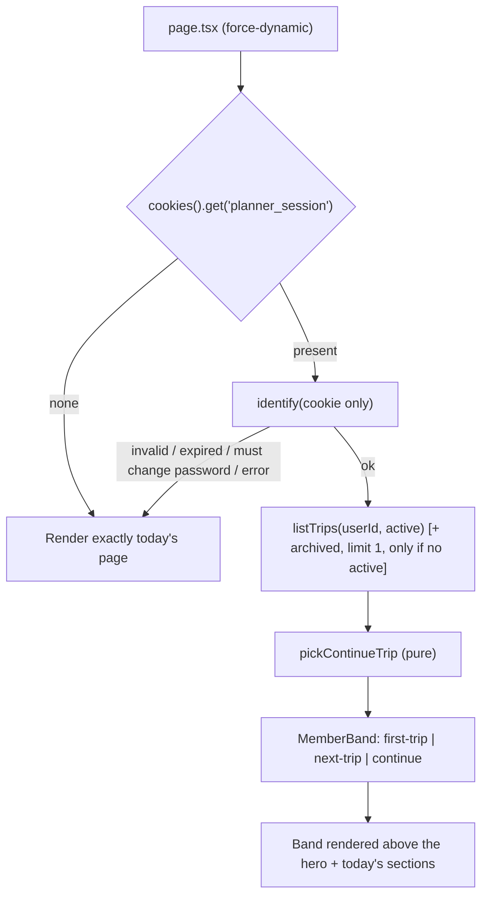

# Spec — Personalized home MVP: first trip and Continue Planning

🇻🇳 Bản tiếng Việt: [specs-home-mvp.vi.md](specs-home-mvp.vi.md)

## Status and scope

- **Status:** Proposed — an impact assessment, a spec and a small Task Contract. No
  application code was changed. The decision it rests on is drafted as
  [ADR 0021](adr/0021-home-mvp-server-session.md) (Proposed).
- **Date:** 2026-11-17
- **Owner:** system-architect (design), project owner (decisions in
  [Open questions](#open-questions))
- **Risk class:** **M** — one new server module, one server component and a few message
  keys on the most visited page. No new route, endpoint, table or migration; no change
  to `src/content/types.ts`; tour redirects untouched.
- **Relation to the larger spec:** this is the smallest slice of
  [specs-home-personalization.md](specs-home-personalization.md). It **changes one of
  that spec's decisions for the MVP**: the session is read on the server, not in the
  browser (see [ADR 0021](adr/0021-home-mvp-server-session.md)). Everything else there
  (onboarding steps, "For you", activity list, `GET /api/planner/home`) stays out of
  the MVP.

**MVP, as requested**

| Visitor | The home page shows |
|---|---|
| Guest | The current home page, byte for byte |
| Member with no trip | The current page plus one band: **create your first trip** |
| Member with a trip | The current page plus one band: **Continue Planning** |

Stories, destinations, community trips and reviews are unchanged for everyone.

## Assessment

### Current state

Read from the repository on 2026-11-17.

| Fact | Evidence |
|---|---|
| `/` is `force-dynamic` and carries no request data | `src/app/[locale]/page.tsx` |
| The header learns the session **in the browser** (`useAccount`); a test forbids request data in the layout and header, **not** in `page.tsx` | `src/components/layout/account-menu.tsx`, `tests/header-account.test.ts` |
| Server components **already read the session cookie** and call `identify` with only the cookie forwarded (admin pages, ADR 0010 §7) | `src/server/planner/admin-page.ts` `readAdminPageAccess`, `readStaffPageAccess` |
| Cookie name `planner_session`; the owner always comes from the validated session | `src/server/planner/auth.ts`, `src/server/planner/http.ts` |
| `listTrips(ownerId, { status })` is owner-filtered, active by default, sorted soonest departure first, undated newest first | `src/server/planner/repository.ts` |
| A `Trip` has `title`, `destinationSlug`, `durationDays`, `startDate`, `planningStatus`, `updatedAt` — and also `ownerId`, `shareToken`, `note`, `budget` that must never be rendered here | `src/server/planner/schemas.ts` |
| My Trips and the trip editor exist at `/my-trips`, `/my-trips/new`, `/my-trips/[id]`, all `noindex` | `src/app/[locale]/my-trips/**` |
| Pages may not import `server/content/(repository\|store)`; a Planner import is not covered by that rule | `tests/client-boundary.test.ts` |
| No shared cache in the deploy: the nginx config has no `proxy_cache` or cache directives | `deploy/nginx-app.conf`, `deploy/nginx/` |
| Phase 10 work (contracts `phase10-*`, ADR 0019) touches `src/server/community/**`, moderation methods in `repository.ts`, `rate-limit.ts`, `planner-rows.ts`, `planner-transfer.ts`, `db/migrations/0010_*` | ADR 0019 "Affects"; branch `claude/phase10-task-contract-c8faa8` |

### Impact on existing contracts

| Area | Impact |
|---|---|
| Public SEO | None for crawlers: a request without the cookie renders exactly today's HTML. `generateMetadata`, canonical, JSON-LD, sitemap are untouched and must stay cookie-free |
| Route map / `pathnames` / tour redirects | None |
| Data contracts, migrations, stores | None; read-only use of `listTrips` |
| Auth and roles | None; the same `identify` the admin pages use |
| `/my-trips`, share links, Planner API | None; the band only links to them |
| Phase 10 | None, provided the file list in [Files to change](#files-to-change) is kept |
| Caching | `/` becomes a per-user document **for requests that carry the cookie**; guests' document is unchanged. Rule in [ADR 0021](adr/0021-home-mvp-server-session.md) |
| `docs/architecture.*` | Update in the same change: home page now reads the session on the server (module boundary and rendering note) |

## Design

### Behaviour per state

| State | Condition | Band |
|---|---|---|
| **guest** | no cookie, invalid or expired session, password change pending, or any failure while reading | none — the page is exactly today's |
| **first-trip** | valid session, no trip at all (no active, no archived) | "Create your first trip" |
| **next-trip** | valid session, no unfinished trip (active trips all `completed`, or only archived trips) | "Start a new trip" (same target, different words) |
| **continue** | valid session, at least one active trip that is not `completed` | "Continue Planning" with that trip |

Any failure while reading falls back to **guest**, never to an error page — the same
rule `getCommunityTrips` follows.

### Server flow



One new module, `src/server/planner/home-page.ts`, mirrors `admin-page.ts`: it reads
the cookie, forwards **only** the cookie to `identify`, and returns an allow-listed
value — never a `Trip`.

```ts
type HomeMember =
  | { status: 'guest' }
  | { status: 'first-trip' }
  | { status: 'next-trip' }
  | { status: 'continue'; trip: ContinueTrip };

interface ContinueTrip {          // allow-list; no ownerId, shareToken, note, budget, version
  id: string;
  title: string;
  destinationSlug: string;
  durationDays: number;
  startDate: string | null;
  daysUntilStart: number | null;  // Vietnam calendar day; null if no date or past
  planningStatus: 'draft' | 'planned' | 'completed';
}
```

### Choosing the trip to continue

Pure function in `src/lib/home/continue-trip.ts`, so it is unit-tested without a store.
Candidates are active trips whose `planningStatus` is not `completed`. Prefer, in order:

1. the **earliest `startDate` on or after today** (Vietnam calendar day);
2. else the **most recently updated undated** trip;
3. else (dates all in the past) the **most recently updated** one.

Ties break on `updatedAt` newest, then `id` ascending, so the result is deterministic.

### Wireframes

The band is one compact block above the hero. The hero keeps the only `<h1>`; the band
uses an `<h2>`.

Mobile (≈375 px) — continue

```
┌─────────────────────────┐
│ header (existing)        │
├─────────────────────────┤
│ TIẾP TỤC LÊN KẾ HOẠCH    │  eyebrow
│ Đà Lạt cuối tuần   (h2)  │  trip title, plain text
│ Đà Lạt · 4 ngày · Còn 12 ngày │
│ (Bản nháp)               │  Badge from planning.*
│ [Tiếp tục chỉnh sửa]     │  → /my-trips/[id], ≥44px
│ Tất cả chuyến đi →       │  → /my-trips
├─────────────────────────┤
│ Hero … (today's page)    │
└─────────────────────────┘
```

Mobile — first trip / next trip

```
┌─────────────────────────┐
│ BẮT ĐẦU                  │
│ Tạo chuyến đầu tiên (h2) │  next-trip: "Bắt đầu một chuyến mới"
│ Chọn một chuyện của Hưng │
│ làm mẫu hoặc đi từ trang trắng │
│ [Tạo chuyến đi]          │  → /my-trips/new
├─────────────────────────┤
│ Hero … (today's page)    │
└─────────────────────────┘
```

Desktop (≥1024 px): the same band in the `wide` container, one row — text left, the
button right; a thin `border-b` separates it from the hero. No new colours or tokens:
`Container`, `Badge`, `ButtonLink`, `text-eyebrow`, existing surface tokens.

### States and copy

| Case | Behaviour |
|---|---|
| Loading | None to show: the band is part of the server response, so there is no skeleton and no layout shift |
| Error reading trips or session | Guest page, no notice (the visitor did nothing wrong; the failure is logged by name only) |
| Trip title very long | Clamped to two lines with ellipsis; full title is on the trip page |
| No `startDate` | No countdown; shows "Dates not set" |
| `startDate` today | "Leaving today" |
| `startDate` in the past, not completed | No countdown; no pressure language |
| Locale | Strings in `messages/vi.json` **and** `messages/en.json` under `home.member.*`; dates through `formatDate`, counts through ICU plurals |

Copy stays in the brand's voice: a couple's invitation, no streaks or urgency.

## Private data and SEO

| Concern | Rule |
|---|---|
| Owner | Taken from the validated session cookie only; no parameter selects a user |
| Allow-list | Only the seven `ContinueTrip` fields reach the component; `shareToken`, `note`, `budget`, `ownerId`, `version`, email, handle are never passed down |
| Rendering | Title and names are React text nodes, never `dangerouslySetInnerHTML` |
| URLs | Only the trip `id` appears in a link, as it already does in `/my-trips/[id]`; no title, status or count in any query string |
| Metadata | `generateMetadata` stays cookie-free: the page `<title>`, description, canonical, OG image and JSON-LD never depend on the member |
| Caching | A response to a request **with** the cookie must be `private, no-store`; a guest response is unchanged. To be asserted by a test, and if Next does not emit it for a dynamic render, added as a conditional header rule (`has` cookie) in `next.config.ts` |
| Crawlers | They send no cookie, so they receive the guest page: SEO and structured data are unchanged. Showing signed-in members an extra band is personalization, not cloaking |
| Layout and header | Still never read request data (`tests/header-account.test.ts` stays as it is) |
| Logs | A failure logs the error name only; no trip or user field |
| Shared device | Signing out already ends the session; the next request has no cookie and renders the guest page. Browser back may show a cached member page, which is why the `private, no-store` rule matters |

## Task Contract (proposed)

**Task Contract: HOME-MVP-1 — Continue Planning band**

- **Class:** M
- **Desired outcome:** a signed-in member sees a first-trip or Continue Planning band on
  `/`; guests and crawlers see today's page unchanged.
- **Scope IN:** the server module, the pure picker, one server component, message keys,
  the `page.tsx` hook, tests, the feature document, the architecture note.
- **Scope OUT:** any endpoint, client component, store, migration or `src/content/types.ts`
  change; onboarding steps, "For you", activity list, saved items; layout/header changes;
  anything listed under [Files that must not change](#files-that-must-not-change).
- **Evidence:** table in [Current state](#current-state).
- **Constraints:** Server Components first; no new client JavaScript; no database; guest
  HTML byte-identical; Phase 10 files untouched.
- **Architecture decision:** [ADR 0021](adr/0021-home-mvp-server-session.md) must be
  Accepted before code.
- **Interface contract:** `HomeMember` and `ContinueTrip` above; `pickContinueTrip(trips, today)`.
- **Tasks by owner:** Architect — accept ADR 0021, update `docs/architecture.*`.
  Backend role — `home-page.ts`, `continue-trip.ts` and their tests. Frontend role —
  component, messages, `page.tsx`, feature document. QC and Security — **on the owner's
  request only**.
- **File ownership:** backend role owns `src/server/planner/home-page.ts` and
  `src/lib/home/**`; frontend role owns `src/components/home/**`, `messages/*.json`,
  `src/app/[locale]/page.tsx`. No file has two owners; roles run in sequence.
- **Security and migration risks:** see [Private data and SEO](#private-data-and-seo);
  no migration.
- **Rollback:** revert the single PR; or remove the `<HomeMemberBand />` line from
  `page.tsx` (the module becomes dead code). No data to undo.
- **Budget:** single agent, no subagents; stop if the cache-header check fails and
  return to the architect role.
- **State:** DESIGNED
- **Feature document owner:** frontend role, `docs/features/home-continue-planning.md`
  + `.vi.md`, registered in both feature indexes.
- **Architecture/usage updates:** `docs/architecture.md` + `.vi.md` (rendering of `/`);
  `docs/usage.*` not needed.

### Files to change

| File | Change | Owner |
|---|---|---|
| `src/server/planner/home-page.ts` | **new** — `readHomeMember()` (cookie → `identify` → `listTrips` → allow-list) | backend |
| `src/lib/home/continue-trip.ts` | **new** — pure `pickContinueTrip`, `daysUntil` (Vietnam day) | backend |
| `src/components/home/home-member-band.tsx` | **new** — server component, three variants | frontend |
| `src/app/[locale]/page.tsx` | add one `await readHomeMember()` and one `<HomeMemberBand />` above `<Hero />`; nothing else | frontend |
| `messages/vi.json`, `messages/en.json` | add `home.member.*` (inside the existing `home` object) | frontend |
| `tests/home-continue-trip.test.ts` | **new** — picker and day maths | backend |
| `tests/home-member.test.ts` | **new** — states, isolation, allow-list, failure fallback | backend |
| `tests/home-page-boundary.test.ts` | **new** — `generateMetadata` and layout stay cookie-free; guest path reads no store | frontend |
| `docs/features/home-continue-planning.md` + `.vi.md`, `docs/features/README.md` + `.vi.md` | **new** / register | frontend |
| `docs/architecture.md` + `.vi.md` | note on `/` | architect |
| `.claude/context/project-context.md` | one line under "Other critical modules" | architect |
| `next.config.ts` | **only if** the cache-header check fails: a conditional `has: cookie` rule | architect |

### Files that must not change

`src/server/planner/repository.ts` (Phase 10 edits moderation methods there),
`src/server/community/**`, `src/server/rate-limit.ts`,
`src/server/persistence/**`, `db/migrations/**`, `src/server/identity/permissions.ts`,
`src/content/types.ts`, `src/i18n/routing.ts`, `src/components/layout/**`,
`src/app/[locale]/layout.tsx`, `src/app/api/**`, any Phase 10 contract or ADR 0019.
The messages files are shared with Phase 10: add keys **only** inside `home`, so merges
touch a different region.

### Order of work

Backend before frontend, in one branch and one PR (rule 9):
1. Accept ADR 0021.
2. `continue-trip.ts` + test, then `home-page.ts` + tests (the `HomeMember` type is the
   contract).
3. Component, messages, `page.tsx`.
4. Cache-header check; `typecheck`, `lint`, `test`, `build`; feature and architecture docs.

### Migration and rollback

No migration. Deploying changes nothing for guests. Rolling back is a revert; nothing
persisted.

## Acceptance criteria

| # | Criterion |
|---|---|
| A-1 | No cookie → the home response is **byte-identical** to `main` (same HTML) |
| A-2 | Invalid, expired or garbage cookie → guest page, status 200, no error |
| A-3 | Password change pending → guest page (the change-password flow is unchanged) |
| A-4 | Member with no trips at all → first-trip band; archived-only or all-completed → next-trip band; both link to `/my-trips/new` |
| A-5 | Member with an active unfinished trip → Continue Planning with that trip; the primary link is `/my-trips/[id]`, the secondary `/my-trips` |
| A-6 | Picker: upcoming date beats undated beats past; ties deterministic; `completed` never chosen to continue |
| A-7 | **Isolation:** with members A and B, A's page never contains B's trip title or id |
| A-8 | The component receives only `ContinueTrip` fields; a test fails if `shareToken`, `note`, `budget`, `ownerId` or `version` can reach it |
| A-9 | A request with the cookie is answered `private, no-store`; a guest response is unchanged |
| A-10 | `generateMetadata`, layout and header read no request data; `tests/header-account.test.ts` unchanged and green |
| A-11 | Store or session failure → guest page, one log line with the error name only |
| A-12 | One `<h1>` on the page; band uses `<h2>` with `aria-labelledby`; links are real `<a>` ≥ 44 px with visible focus; no new colour |
| A-13 | VI and EN keys both present (`tests/i18n.test.ts`); 375 px with Vietnamese strings has no horizontal scroll |
| A-14 | No new client component or client JavaScript; no new request from the browser |
| A-15 | `typecheck`, `lint`, `test`, `build` pass with the output stated; `/qc-check` and `/sec-check` are **NOT RUN** until the owner asks (recommended: the A-1, A-7, A-9 group) |

## Relation to other specs

| Spec | Relation |
|---|---|
| [specs-home-personalization.md](specs-home-personalization.md) | The MVP is its first slice with one changed decision (server session read). Its `GET /api/planner/home`, onboarding steps, "For you", activity list and Phase 16 proposal are **deferred, not cancelled**. If a shared cache or CDN is introduced (Phase 09) or the personal part grows, the client-island design is the documented path |
| [ADR 0020](adr/0020-personalized-home.md) | Superseded for the MVP by ADR 0021; remains the target design for the full spec |
| Phase 10 ([ADR 0019](adr/0019-community-foundation.md)) | No shared files; see [Files that must not change](#files-that-must-not-change) |
| Phase 11–15 | Not touched: no preferences, saved items, comments or search |

## Open questions

| # | Question | Recommendation |
|---|---|---|
| Q1 | Accept the server-side session read on `/` for the MVP (ADR 0021)? | **Accepted 2026-11-17**, with the A-9 cache-header check as a gate |
| Q2 | Place the band above the hero or directly under it? | **Above**, compact — a returning member's first screen is their trip; the hero keeps the single `<h1>` |
| Q3 | Distinguish "first trip" from "next trip" (needs one extra archived query only for members with no unfinished trip)? | **Yes**; the words "first trip" are wrong for someone who archived all theirs |
| Q4 | Show activity count or progress in the band? | **Not in the MVP** — it needs a full `getTrip` read; add with the full spec |
| Q5 | Does the deploy ever put a CDN or shared cache in front of `/`? | **Decide before Phase 09**; if yes, `/` must bypass the cache for cookie requests or move to the client-island design |

## Not in scope

Onboarding steps, "For you", community activity, saved items, notifications, stored
preferences, a new endpoint or client component, any change to Phase 10 files, to the
tour redirects or to `pathnames`, analytics or tracking, and changes to sign-in, roles
or the stores. Each needs its own decision before it is built.
