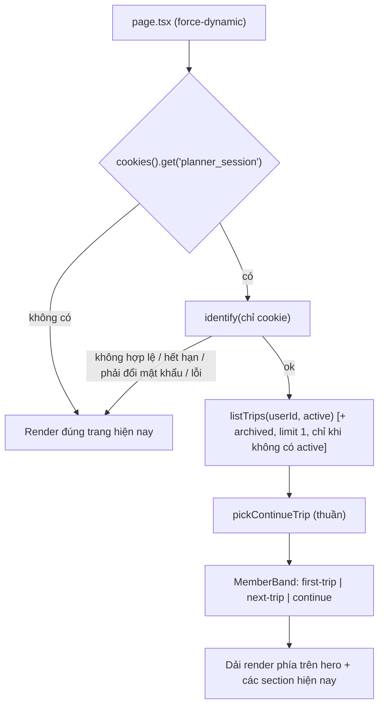

# Spec — MVP trang chủ cá nhân hóa: chuyến đầu tiên và Continue Planning

🇬🇧 English version: [specs-home-mvp.md](specs-home-mvp.md)

## Trạng thái và phạm vi

- **Trạng thái:** Đề xuất — đánh giá tác động, spec và một Task Contract nhỏ. Không sửa
  application code. Quyết định nó dựa vào được soạn thành
  [ADR 0022](adr/0022-home-mvp-server-session.vi.md) (Đề xuất).
- **Ngày:** 2026-11-17
- **Chủ trì:** system-architect (thiết kế), chủ dự án (quyết định trong
  [Câu hỏi mở](#câu-hỏi-mở))
- **Cấp rủi ro:** **M** — một module server mới, một server component và vài khóa message
  trên trang được xem nhiều nhất. Không route, endpoint, bảng hay migration mới; không đổi
  `src/content/types.ts`; redirect tour không đụng tới.
- **Quan hệ với spec lớn:** đây là slice nhỏ nhất của
  [specs-home-personalization.vi.md](specs-home-personalization.vi.md). Nó **đổi một quyết
  định của spec đó cho MVP**: phiên được đọc ở server, không phải ở trình duyệt (xem
  [ADR 0022](adr/0022-home-mvp-server-session.vi.md)). Mọi thứ khác ở đó (các bước
  onboarding, "Dành cho bạn", danh sách hoạt động, `GET /api/planner/home`) nằm ngoài MVP.

**MVP, đúng như yêu cầu**

| Người xem | Trang chủ hiển thị |
|---|---|
| Khách | Trang chủ hiện có, từng byte |
| Thành viên chưa có chuyến | Trang hiện có cộng một dải: **tạo chuyến đầu tiên** |
| Thành viên có chuyến | Trang hiện có cộng một dải: **Continue Planning** |

Stories, destinations, chuyến cộng đồng và review không đổi với mọi người.

## Đánh giá

### Hiện trạng

Đọc từ repository ngày 2026-11-17.

| Sự thật | Bằng chứng |
|---|---|
| `/` là `force-dynamic` và không mang dữ liệu request | `src/app/[locale]/page.tsx` |
| Header biết phiên **trong trình duyệt** (`useAccount`); một test cấm dữ liệu request trong layout và header, **không** cấm trong `page.tsx` | `src/components/layout/account-menu.tsx`, `tests/header-account.test.ts` |
| Server component **đã đọc cookie phiên** và gọi `identify` chỉ với cookie (trang admin, ADR 0010 §7) | `src/server/planner/admin-page.ts` `readAdminPageAccess`, `readStaffPageAccess` |
| Tên cookie `planner_session`; chủ luôn lấy từ phiên đã xác thực | `src/server/planner/auth.ts`, `src/server/planner/http.ts` |
| `listTrips(ownerId, { status })` lọc theo chủ, mặc định chuyến đang dùng, sắp khởi hành sớm nhất trước, chuyến không ngày mới nhất trước | `src/server/planner/repository.ts` |
| `Trip` có `title`, `destinationSlug`, `durationDays`, `startDate`, `planningStatus`, `updatedAt` — và cả `ownerId`, `shareToken`, `note`, `budget` tuyệt đối không được render ở đây | `src/server/planner/schemas.ts` |
| My Trips và trình sửa chuyến đã có ở `/my-trips`, `/my-trips/new`, `/my-trips/[id]`, đều `noindex` | `src/app/[locale]/my-trips/**` |
| Trang không được import `server/content/(repository\|store)`; import Planner không thuộc quy tắc đó | `tests/client-boundary.test.ts` |
| Deploy không có cache dùng chung: cấu hình nginx không có `proxy_cache` hay chỉ thị cache | `deploy/nginx-app.conf`, `deploy/nginx/` |
| Việc Phase 10 (contract `phase10-*`, ADR 0019) đụng `src/server/community/**`, các phương thức kiểm duyệt trong `repository.ts`, `rate-limit.ts`, `planner-rows.ts`, `planner-transfer.ts`, `db/migrations/0010_*` | "Ảnh hưởng" của ADR 0019; branch `claude/phase10-task-contract-c8faa8` |

### Tác động lên các hợp đồng hiện có

| Khu vực | Tác động |
|---|---|
| SEO công khai | Không với crawler: request không có cookie render đúng HTML hiện nay. `generateMetadata`, canonical, JSON-LD, sitemap không đụng và phải tiếp tục không đọc cookie |
| Bản đồ route / `pathnames` / redirect tour | Không |
| Hợp đồng dữ liệu, migration, store | Không; chỉ đọc qua `listTrips` |
| Xác thực và vai trò | Không; dùng đúng `identify` mà trang admin dùng |
| `/my-trips`, liên kết chia sẻ, Planner API | Không; dải chỉ liên kết tới chúng |
| Phase 10 | Không, miễn là giữ đúng danh sách ở [Tệp cần đổi](#tệp-cần-đổi) |
| Cache | `/` thành tài liệu theo từng người **với request có mang cookie**; tài liệu của khách không đổi. Quy tắc ở [ADR 0022](adr/0022-home-mvp-server-session.vi.md) |
| `docs/architecture.*` | Cập nhật trong cùng thay đổi: trang chủ giờ đọc phiên ở server (ranh giới module và ghi chú render) |

## Thiết kế

### Hành vi theo trạng thái

| Trạng thái | Điều kiện | Dải |
|---|---|---|
| **guest** | không cookie, phiên không hợp lệ hoặc hết hạn, đang chờ đổi mật khẩu, hoặc bất kỳ lỗi nào khi đọc | không có — trang đúng như hiện nay |
| **first-trip** | phiên hợp lệ, không có chuyến nào (không đang dùng, không đã lưu trữ) | "Tạo chuyến đầu tiên" |
| **next-trip** | phiên hợp lệ, không có chuyến chưa xong (các chuyến đang dùng đều `completed`, hoặc chỉ còn chuyến đã lưu trữ) | "Bắt đầu một chuyến mới" (cùng đích, lời khác) |
| **continue** | phiên hợp lệ, có ít nhất một chuyến đang dùng chưa `completed` | "Continue Planning" kèm chuyến đó |

Mọi lỗi khi đọc đều lùi về **guest**, không bao giờ về trang lỗi — cùng quy tắc với
`getCommunityTrips`.

### Luồng ở server



Một module mới, `src/server/planner/home-page.ts`, giống `admin-page.ts`: đọc cookie, chuyển
**chỉ** cookie cho `identify`, và trả một giá trị allow-list — không bao giờ là `Trip`.

```ts
type HomeMember =
  | { status: 'guest' }
  | { status: 'first-trip' }
  | { status: 'next-trip' }
  | { status: 'continue'; trip: ContinueTrip };

interface ContinueTrip {          // allow-list; không ownerId, shareToken, note, budget, version
  id: string;
  title: string;
  destinationSlug: string;
  durationDays: number;
  startDate: string | null;
  daysUntilStart: number | null;  // ngày lịch Việt Nam; null nếu không có ngày hoặc đã qua
  planningStatus: 'draft' | 'planned' | 'completed';
}
```

### Chọn chuyến để tiếp tục

Hàm thuần ở `src/lib/home/continue-trip.ts`, để unit test được mà không cần store. Ứng viên là
các chuyến đang dùng có `planningStatus` khác `completed`. Ưu tiên theo thứ tự:

1. **`startDate` sớm nhất từ hôm nay trở đi** (ngày lịch Việt Nam);
2. nếu không, chuyến **không ngày được cập nhật gần nhất**;
3. nếu không (mọi ngày đều đã qua), chuyến **được cập nhật gần nhất**.

Hòa thì xét `updatedAt` mới nhất, rồi `id` tăng dần, nên kết quả tất định.

### Wireframe

Dải là một khối gọn phía trên hero. Hero giữ `<h1>` duy nhất; dải **không thêm phần tử
heading nào** — tên chuyến là một `<p>` gắn nhãn cho `<section>` qua `aria-labelledby` — nên
cấu trúc heading vẫn bắt đầu bằng h1.

Mobile (≈375 px) — continue

```
┌─────────────────────────┐
│ header (hiện có)         │
├─────────────────────────┤
│ TIẾP TỤC LÊN KẾ HOẠCH    │  eyebrow
│ Đà Lạt cuối tuần         │  tên chuyến, một <p> gắn nhãn
│ Đà Lạt · 4 ngày · Còn 12 ngày │
│ (Bản nháp)               │  Badge từ planning.*
│ [Tiếp tục chỉnh sửa]     │  → /my-trips/[id], ≥44px
│ Tất cả chuyến đi →       │  → /my-trips
├─────────────────────────┤
│ Hero … (trang hiện nay)  │
└─────────────────────────┘
```

Mobile — first trip / next trip

```
┌─────────────────────────┐
│ BẮT ĐẦU                  │
│ Tạo chuyến đầu tiên      │  next-trip: "Bắt đầu một chuyến mới"
│ Chọn một chuyện của Hưng │
│ làm mẫu hoặc đi từ trang trắng │
│ [Tạo chuyến đi]          │  → /my-trips/new
├─────────────────────────┤
│ Hero … (trang hiện nay)  │
└─────────────────────────┘
```

Desktop (≥1024 px): cùng dải trong container `wide`, một hàng — chữ bên trái, nút bên phải;
một `border-b` mảnh tách khỏi hero. Không màu hay token mới: `Container`, `Badge`,
`ButtonLink`, `text-eyebrow`, các token bề mặt hiện có.

### Trạng thái và lời

| Trường hợp | Hành vi |
|---|---|
| Đang tải | Không có gì để hiện: dải nằm trong phản hồi của server, nên không có khung chờ và không xô lệch bố cục |
| Lỗi đọc chuyến hoặc phiên | Trang khách, không thông báo (người xem không làm gì sai; lỗi chỉ log tên) |
| Tên chuyến rất dài | Cắt hai dòng có dấu chấm lửng; tên đầy đủ ở trang chuyến |
| Không có `startDate` | Không đếm ngược; hiện "Chưa chọn ngày" |
| `startDate` là hôm nay | "Khởi hành hôm nay" |
| `startDate` đã qua, chưa hoàn thành | Không đếm ngược; hiện chính ngày đó; không dùng lời thúc ép |
| Ngôn ngữ | Chuỗi trong `messages/vi.json` **và** `messages/en.json` dưới `home.member.*`; ngày qua `formatDate`, số đếm qua ICU plural |

Lời giữ giọng thương hiệu: lời mời của một cặp đôi, không chuỗi ngày hay thúc ép.

## Dữ liệu riêng tư và SEO

| Mối quan tâm | Quy tắc |
|---|---|
| Chủ | Chỉ lấy từ cookie phiên đã xác thực; không tham số nào chọn người dùng |
| Allow-list | Chỉ bảy trường của `ContinueTrip` tới component; `shareToken`, `note`, `budget`, `ownerId`, `version`, email, handle không bao giờ được truyền xuống |
| Render | Tên chuyến và tên là text node của React, không `dangerouslySetInnerHTML` |
| URL | Chỉ `id` chuyến xuất hiện trong liên kết, như hiện đã có ở `/my-trips/[id]`; không tên, trạng thái hay số đếm nào trong query string |
| Metadata | `generateMetadata` vẫn không đọc cookie: `<title>`, mô tả, canonical, ảnh OG và JSON-LD của trang không bao giờ phụ thuộc thành viên |
| Cache | Phản hồi cho request **có** cookie là `private, no-store`: được nêu bằng một luật header có điều kiện (`has` cookie) trong `next.config.ts` cho `/` và `/en`, được khẳng định bằng `tests/home-page-boundary.test.ts`, và cũng là mặc định của Next cho render động (đã kiểm trên bản build production). Phản hồi cho khách không đổi |
| Cookie rác | Token không thể là token phiên (không phải 32–128 ký tự base64url) bị loại trước `identify`, nên trang công khai không tốn một lần đọc snapshot store cho mỗi cookie rác |
| Tác dụng phụ của phiên | `identify` có thể gia hạn cửa sổ trượt của phiên và dọn phiên hết hạn, y như các trang admin; mở `/` với cookie hợp lệ vì vậy làm mới nó |
| Crawler | Họ không gửi cookie nên nhận trang khách: SEO và dữ liệu có cấu trúc không đổi. Cho thành viên đã đăng nhập thấy thêm một dải là cá nhân hóa, không phải cloaking |
| Layout và header | Vẫn không bao giờ đọc dữ liệu request (`tests/header-account.test.ts` giữ nguyên) |
| Log | Lỗi chỉ log tên lỗi; không trường chuyến hay người dùng nào |
| Máy dùng chung | Đăng xuất đã kết thúc phiên; request kế tiếp không có cookie và render trang khách. Nút Back của trình duyệt có thể hiện trang thành viên đã cache, vì vậy quy tắc `private, no-store` quan trọng |

## Task Contract (đề xuất)

**Task Contract: HOME-MVP-1 — dải Continue Planning**

- **Cấp:** M
- **Kết quả mong muốn:** thành viên đã đăng nhập thấy dải chuyến đầu tiên hoặc Continue
  Planning ở `/`; khách và crawler thấy trang hiện nay không đổi.
- **Trong phạm vi:** module server, hàm chọn thuần, một server component, khóa message,
  điểm gắn vào `page.tsx`, test, feature document, ghi chú kiến trúc.
- **Ngoài phạm vi:** mọi endpoint, client component, store, migration hay đổi
  `src/content/types.ts`; các bước onboarding, "Dành cho bạn", danh sách hoạt động, mục đã
  lưu; thay đổi layout/header; mọi thứ ở [Tệp không được đổi](#tệp-không-được-đổi).
- **Bằng chứng:** bảng ở [Hiện trạng](#hiện-trạng).
- **Ràng buộc:** Server Components trước; không thêm JavaScript client; không database; HTML
  của khách giống hệt từng byte; không đụng tệp Phase 10.
- **Quyết định kiến trúc:** [ADR 0022](adr/0022-home-mvp-server-session.vi.md) phải được
  Chấp nhận trước khi viết code.
- **Hợp đồng giao diện:** `HomeMember` và `ContinueTrip` ở trên; `pickContinueTrip(trips, today)`.
- **Việc theo chủ:** Architect — chấp nhận ADR 0022, cập nhật `docs/architecture.*`.
  Vai backend — `home-page.ts`, `continue-trip.ts` và test của chúng. Vai frontend —
  component, messages, `page.tsx`, feature document. QC và Security — **chỉ khi chủ dự án
  yêu cầu**.
- **Sở hữu tệp:** vai backend sở hữu `src/server/planner/home-page.ts` và `src/lib/home/**`;
  vai frontend sở hữu `src/components/home/**`, `messages/*.json`,
  `src/app/[locale]/page.tsx`. Không tệp nào có hai chủ; các vai chạy tuần tự.
- **Rủi ro bảo mật và migration:** xem [Dữ liệu riêng tư và SEO](#dữ-liệu-riêng-tư-và-seo);
  không migration.
- **Rollback:** revert PR duy nhất; hoặc bỏ dòng `<HomeMemberBand />` khỏi `page.tsx` (module
  thành mã chết). Không có dữ liệu để hoàn tác.
- **Ngân sách:** một agent, không subagent; dừng nếu kiểm tra header cache thất bại và quay
  lại vai architect.
- **Trạng thái:** DESIGNED
- **Chủ feature document:** vai frontend, `docs/features/home-continue-planning.md`
  + `.vi.md`, đăng ký ở cả hai index tính năng.
- **Cập nhật kiến trúc/usage:** `docs/architecture.md` + `.vi.md` (cách render `/`);
  `docs/usage.*` không cần.

### Tệp cần đổi

| Tệp | Thay đổi | Chủ |
|---|---|---|
| `src/server/planner/home-page.ts` | **mới** — `readHomeMember()` (cookie → `identify` → `listTrips` → allow-list) | backend |
| `src/lib/home/continue-trip.ts` | **mới** — `pickContinueTrip` thuần, `daysUntil` (ngày Việt Nam) | backend |
| `src/components/home/home-member-band.tsx` | **mới** — server component, ba biến thể | frontend |
| `src/app/[locale]/page.tsx` | thêm một `await readHomeMember()` và một `<HomeMemberBand />` phía trên `<Hero />`; không gì khác | frontend |
| `messages/vi.json`, `messages/en.json` | thêm `home.member.*` (bên trong object `home` hiện có) | frontend |
| `tests/home-continue-trip.test.ts` | **mới** — hàm chọn và tính ngày | backend |
| `tests/home-member.test.ts` | **mới** — các trạng thái, cách ly, allow-list, lùi về khi lỗi | backend |
| `tests/home-page-boundary.test.ts` | **mới** — `generateMetadata` và layout không đọc cookie; đường của khách không đọc store | frontend |
| `docs/features/home-continue-planning.md` + `.vi.md`, `docs/features/README.md` + `.vi.md` | **mới** / đăng ký | frontend |
| `docs/architecture.md` + `.vi.md` | ghi chú về `/` | architect |
| `.claude/context/project-context.md` | một dòng ở "Other critical modules" | architect |
| `next.config.ts` | một luật `has: cookie` có điều kiện trả `private, no-store` cho `/` và `/en` | architect |

### Tệp không được đổi

`src/server/planner/repository.ts` (Phase 10 sửa các phương thức kiểm duyệt ở đó),
`src/server/community/**`, `src/server/rate-limit.ts`, `src/server/persistence/**`,
`db/migrations/**`, `src/server/identity/permissions.ts`, `src/content/types.ts`,
`src/i18n/routing.ts`, `src/components/layout/**`, `src/app/[locale]/layout.tsx`,
`src/app/api/**`, mọi contract hay ADR 0019 của Phase 10. Các tệp messages dùng chung với
Phase 10: chỉ thêm khóa **bên trong** `home`, để merge chạm vùng khác.

### Thứ tự thực hiện

Backend trước frontend, trong một branch và một PR (quy tắc 9):
1. Chấp nhận ADR 0022.
2. `continue-trip.ts` + test, rồi `home-page.ts` + test (kiểu `HomeMember` là hợp đồng).
3. Component, messages, `page.tsx`.
4. Kiểm tra header cache; `typecheck`, `lint`, `test`, `build`; feature document và tài liệu
   kiến trúc.

### Migration và rollback

Không migration. Deploy không đổi gì với khách. Rollback là revert; không có gì được lưu.

## Tiêu chí chấp nhận

| # | Tiêu chí |
|---|---|
| A-1 | Không cookie → phản hồi trang chủ **giống hệt từng byte** với `main` (cùng HTML) |
| A-2 | Cookie không hợp lệ, hết hạn hoặc rác → trang khách, status 200, không lỗi |
| A-3 | Đang chờ đổi mật khẩu → trang khách (luồng đổi mật khẩu không đổi) |
| A-4 | Thành viên không có chuyến nào → dải first-trip; chỉ có chuyến đã lưu trữ hoặc toàn `completed` → dải next-trip; cả hai liên kết `/my-trips/new` |
| A-5 | Thành viên có chuyến đang dùng chưa xong → Continue Planning kèm chuyến đó; liên kết chính `/my-trips/[id]`, phụ `/my-trips` |
| A-6 | Hàm chọn: có ngày sắp tới thắng không ngày thắng đã qua; hòa tất định; chuyến `completed` không bao giờ được chọn để tiếp tục |
| A-7 | **Cách ly:** với thành viên A và B, trang của A không bao giờ chứa tên hay id chuyến của B |
| A-8 | Component chỉ nhận các trường `ContinueTrip`; test fail nếu `shareToken`, `note`, `budget`, `ownerId` hay `version` có thể tới được nó |
| A-9 | Request có cookie được trả `private, no-store`; phản hồi cho khách không đổi (test trên luật `next.config.ts`; đã kiểm một lần trên bản build production) |
| A-10 | `generateMetadata`, layout và header không đọc dữ liệu request; `tests/header-account.test.ts` không đổi và xanh |
| A-11 | Store hoặc phiên lỗi → trang khách, một dòng log chỉ có tên lỗi |
| A-12 | Một `<h1>` trên trang; dải không thêm heading và được gắn nhãn bằng `aria-labelledby`; liên kết là `<a>` thật ≥ 44 px, focus nhìn thấy; không màu mới |
| A-13 | Khóa VI và EN đều có (`tests/i18n.test.ts`); 375 px với chuỗi tiếng Việt không cuộn ngang |
| A-14 | Không client component hay JavaScript client mới; không request mới từ trình duyệt |
| A-15 | `typecheck`, `lint`, `test`, `build` đạt và nêu đầu ra; `/qc-check` và `/sec-check` là **NOT RUN** cho đến khi chủ dự án yêu cầu (khuyến nghị: nhóm A-1, A-7, A-9) |

## Quan hệ với các spec khác

| Spec | Quan hệ |
|---|---|
| [specs-home-personalization.vi.md](specs-home-personalization.vi.md) | MVP là slice đầu của nó với một quyết định đổi (đọc phiên ở server). `GET /api/planner/home`, các bước onboarding, "Dành cho bạn", danh sách hoạt động và đề xuất Phase 16 được **hoãn, không hủy**. Nếu có cache dùng chung hoặc CDN (Phase 09) hay phần cá nhân lớn lên, thiết kế đảo client là lối đã ghi sẵn |
| [ADR 0021](adr/0021-personalized-home.vi.md) | Được ADR 0022 thay thế cho MVP; vẫn là thiết kế đích của spec đầy đủ |
| Phase 10 ([ADR 0019](adr/0019-community-foundation.vi.md)) | Không tệp dùng chung; xem [Tệp không được đổi](#tệp-không-được-đổi) |
| Phase 11–15 | Không đụng: không sở thích, mục đã lưu, bình luận hay tìm kiếm |

## Câu hỏi mở

| # | Câu hỏi | Khuyến nghị |
|---|---|---|
| Q1 | Chấp nhận việc đọc phiên ở server trên `/` cho MVP (ADR 0022)? | **Đã chấp nhận 2026-11-17**, với kiểm tra header cache A-9 làm cổng |
| Q2 | Đặt dải phía trên hero hay ngay dưới nó? | **Phía trên**, gọn — màn đầu của thành viên quay lại là chuyến của họ; hero giữ `<h1>` duy nhất |
| Q3 | Phân biệt "chuyến đầu tiên" với "chuyến tiếp theo" (cần thêm một query archived, chỉ cho thành viên không có chuyến chưa xong)? | **Có**; chữ "chuyến đầu tiên" sai với người đã lưu trữ hết chuyến của mình |
| Q4 | Hiện số hoạt động hay tiến độ trong dải? | **Chưa ở MVP** — cần đọc đầy đủ `getTrip`; thêm cùng spec đầy đủ |
| Q5 | Deploy có bao giờ đặt CDN hay cache dùng chung trước `/` không? | **Quyết trước Phase 09**; nếu có, `/` phải bỏ qua cache với request có cookie hoặc chuyển sang thiết kế đảo client |

## Ngoài phạm vi

Các bước onboarding, "Dành cho bạn", hoạt động cộng đồng, mục đã lưu, thông báo, sở thích
lưu lại, endpoint hay client component mới, mọi thay đổi tệp Phase 10, redirect tour hay
`pathnames`, analytics hay theo dõi, và thay đổi đăng nhập, vai trò hay các store. Mỗi mục cần
quyết định riêng trước khi xây.
