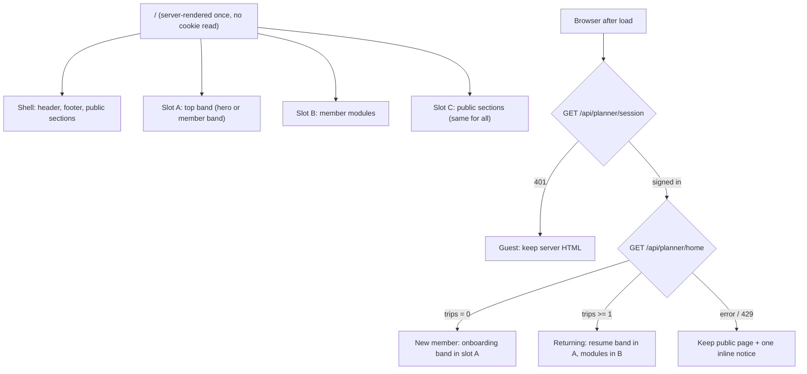
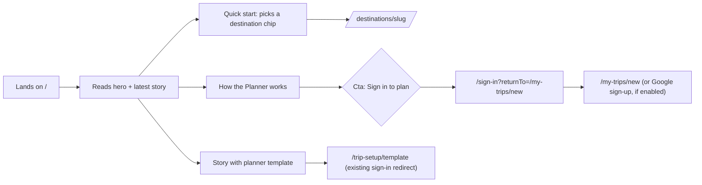
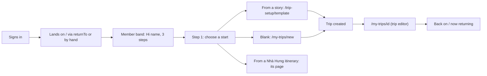
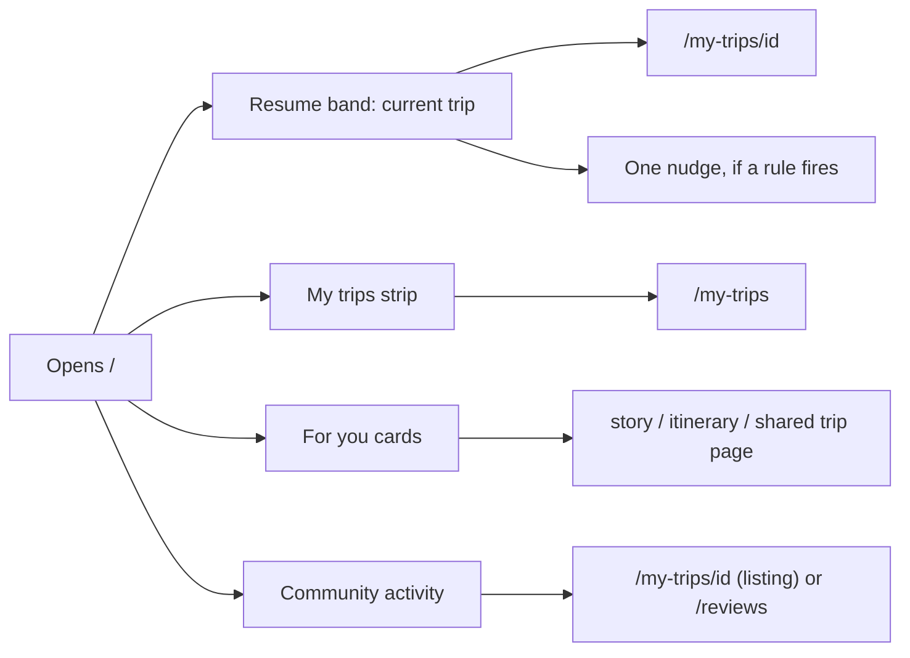
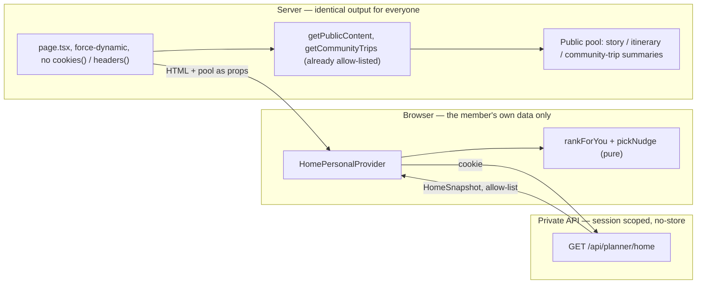

# Spec — Personalized home page

🇻🇳 Bản tiếng Việt: [specs-home-personalization.vi.md](specs-home-personalization.vi.md)

## Status and scope

- **Status:** Proposed — a UX specification and an architecture proposal. Nothing here is
  built; no application code was changed to write it. The one decision that needs
  recording is drafted as [ADR 0021](adr/0021-personalized-home.md) (Proposed).
- **MVP:** the first slice, with one changed decision (server-side session read), is
  [specs-home-mvp.md](specs-home-mvp.md).
- **Date:** 2026-11-16
- **Owner:** system-architect (design), project owner (decisions in
  [Open questions](#open-questions))
- **Risk class:** **L** — a new authenticated read endpoint, a privacy and cache
  boundary on the most visited page, and work across backend, frontend and messages.
  No route is added, renamed or redirected, and `src/content/types.ts` does not change,
  so CLAUDE.md rule 2 is not triggered.

**Goal.** One home page at `/` whose content adapts to who is looking, in three states:

| State | Who | What the page is for |
|---|---|---|
| **Guest** | No session | Inspire, help find a place, show what the Planner is |
| **New member** | Signed in, no trips yet | Onboard, get the first trip created |
| **Returning member** | Signed in, at least one trip | Resume the Planner, relevant picks, the member's own community status |

It is **not** two home pages. There is one route, one server-rendered document shared
by everyone, and a thin personal layer that fills slots in it after the page loads.

**Out of scope** (each belongs to another phase — see
[Roadmap mapping](#9-roadmap-mapping)): stored traveller preferences, profiles,
saving and following, comments and likes, notifications, "Use this trip", full-text
search, AI suggestions, a hosted identity provider.

## Current state (audit of the home page)

Read from the repository on 2026-11-16.

| Fact | Evidence |
|---|---|
| One route, `force-dynamic`, identical for everyone; reads stories from the content repository per request (ADR 0012) and up to 3 approved community trips | `src/app/[locale]/page.tsx` |
| Section order today: Hero → Latest stories → Explored destinations → Map preview → Featured itineraries → Community trips → Community reviews → Plan-a-trip CTA → Video reviews → About | same file |
| The hero is a single large editorial block (headline, two CTAs, three stats, offset cover) | `src/components/sections/hero.tsx` |
| The Planner is **only** a closing CTA, and it links to the contact-only `/plan-your-trip` page, not to the Planner (`/my-trips`) | `src/components/sections/plan-trip-cta.tsx` |
| Community trips hide themselves when empty (no filler); the store failing returns `[]` so the page never breaks | `community-trips-section.tsx`, `src/server/community/public.ts` |
| Who is signed in is learnt **in the browser** with `GET /api/planner/session`, deliberately not from a cookie read in the layout, so pages stay uncacheable-free and cookie-free | `useAccount()` in `src/components/layout/account-menu.tsx` |
| Trip data a home page could use already exists per owner: `listTrips`, `planningStatus`, `startDate`, `activityCount`, `destinationSlug`, `travelStyle`, `pace`, `listing`; own reviews via `GET /api/planner/reviews` | `src/server/planner/schemas.ts`, `src/app/api/planner/**` |
| Planner private routes answer `no-store`; a trip owner is always taken from the session, never from a query | `src/server/planner/http.ts` |
| Public pages must not import the repository or store | `tests/client-boundary.test.ts` |
| Sign-in exists with a validated `returnTo`; **password self-sign-up is not open** (Google sign-up only when `GOOGLE_SIGNUP_ENABLED`) | `src/lib/return-to.ts`, [specs-roadmap.md](specs-roadmap.md#not-open-yet) |
| Contributions to the community are open on `main` | ADR [0019](adr/0019-community-foundation.md) context |
| There is **no search**, **no saved items**, **no notifications**, **no member profile** in the codebase | grep of `src/`; Phase 11–15 in `.claude/roadmap/PHASES.md` |

What this means for the design: the Planner is invisible on the home page, a member
looks exactly like a guest, and three of the things the brief asks for (search, saved
content, community activity beyond one's own submissions) do not exist yet. The spec
says where each is a thin stand-in now and which phase replaces it.

## Principles

1. **One document for everyone; personal content is added in the browser.** The server
   never reads a cookie to render `/`. This is the privacy and cache rule, and every
   other decision follows it ([ADR 0021](adr/0021-personalized-home.md)).
2. **The guest page is the default, the fallback and the crawler's page.** Any
   failure in the personal layer degrades to it, never to an empty page.
3. **Rule-based, explainable, deterministic.** Every personal item says why it is shown.
   Same inputs, same order. No model, no score a person cannot read.
4. **Reuse what exists.** Stories, itineraries, destinations, community trips, the trip
   editor and `/my-trips` are linked, not rebuilt.
5. **A member's own data is never inferred from, or sent to, anything but their own
   browser.** Ranking happens in the browser over a public pool (section 6).
6. **Brand first.** Same tokens, same Lora/Be Vietnam Pro voice, same warm clay/jade
   palette, same "a couple telling you about a trip" tone — no feed, no streaks, no
   badges, no countdown pressure.
7. **Mobile-first**: the order of sections on a 375 px screen is the specification; desktop
   is the same order given more columns.
8. **No dead controls.** A section whose target does not exist yet is not rendered.

## 1. Information architecture

### One page, three states



Slots are fixed places in the document, so the page has the same skeleton in every
state and layout shift is bounded.

### State resolution

Computed on the server inside `GET /api/planner/home` from the session (never from a
query), returned as the single field `state`:

| Condition | `state` |
|---|---|
| No valid session (the call answers 401) | client treats as **guest** |
| Valid session, 0 trips of any status (active **and** archived) | `new` |
| Valid session, at least 1 trip of any status | `returning` |
| Valid session, password change pending | endpoint refuses like other Planner routes; the page shows only the "change your password" notice (R-X1) |

A member whose trips are all archived is `returning` with no resume trip; the band
says "Start your next trip" (rule R-R2). Role (`editor`, `admin`, `super_admin`) does
**not** change the home page; staff reach the admin portal from the existing account
menu.

### Section order per state

Rows are top to bottom on mobile. "slot" is A/B/C above.

| # | Section | Slot | Guest | New member | Returning member |
|---|---|---|---|---|---|
| 1 | **Hero** (headline, CTAs, stats, cover) | A | ✓ full | — (replaced) | — (replaced) |
| 2 | **Member band** — greeting + onboarding steps | A | — | ✓ | — |
| 3 | **Resume band** — greeting + resume trip + one nudge | A | — | — | ✓ |
| 4 | **Quick start** — "Where to?" destination chips | A/B | ✓ | ✓ compact | — |
| 5 | **My trips strip** (up to 3, then "All my trips") | B | — | — | ✓ |
| 6 | **For you** (3 rule-ranked cards with a reason) | B | — | — | ✓ |
| 7 | **Your community activity** (own submissions' status) | B | — | — | ✓ if any, else hidden |
| 8 | **Saved** | B | — | — | hidden until Phase 14 |
| 9 | Latest stories | C | ✓ | ✓ | ✓ |
| 10 | **How the Planner works** (3 steps + sign-in CTA) | C | ✓ | — (done by band) | — |
| 11 | Explored destinations | C | ✓ | ✓ | ✓ |
| 12 | Map preview | C | ✓ | ✓ | collapsed to a link row |
| 13 | Featured itineraries | C | ✓ | ✓ (feeds onboarding) | ✓ |
| 14 | Community trips (approved) | C | ✓ | ✓ | ✓ |
| 15 | Community reviews | C | ✓ | ✓ | ✓ |
| 16 | Plan-a-trip contact CTA (the existing one, reworded to what it is: *personal help from the couple*) | C | ✓ | ✓ | ✓ |
| 17 | Video reviews | C | ✓ | ✓ | ✓ |
| 18 | About | C | ✓ | ✓ | ✓ |

Rules for the table: Slot C is rendered by the server and is **identical for all three
states**; a state only changes which slot-C rows are *visually collapsed* (map preview
for returning members) — never what is in the HTML. Slot A and B are the only parts
that differ.

## 2. UX flows

### Guest



- Inspire: hero, latest stories, itineraries, map.
- "Search" for a guest in v1 is **wayfinding, not text search**: the Quick start chips
  (destinations, and style chips that link to the destinations and itineraries lists).
  Real search is Phase 15 and is not scaffolded.
- Discover the Planner: the "How the Planner works" strip uses only shipped
  capabilities — start from one of our stories or a blank trip, edit days and
  expenses, share a read-only link. CTA label is **"Sign in to plan"** (never
  "Register" — password sign-up is closed; Google sign-up opens on the sign-in page
  when enabled).
- The existing contact page stays as the *secondary*, human route.

### New member



- Three steps, all derived from server facts, none stored: **1** choose where
  (always available), **2** create the first trip (done when `trips.total ≥ 1`),
  **3** add a first activity and share (shown only after step 2).
- Because the band disappears the moment a trip exists, there is **no dismiss state to
  store** in v1 (a per-browser dismiss would be cosmetic and is not built).
- The member sees the same public sections below, so reading is never blocked by
  onboarding.

### Returning member



- First screen answers "where was I?": the trip, how far along it is, and the next
  sensible step.
- "For you" is optional reading, never a wall: 3 cards, each with a reason chip.
- Community activity is the member's **own** submissions' status plus a link to the
  public gallery; reactions and followers do not exist until Phase 14.

### Transitions and edge cases

| Situation | Behaviour |
|---|---|
| Sign-out | Personal DOM is removed, the hint (section 6) cleared, the page returns to guest content without a full reload |
| Browser back (bfcache) after sign-out | On `pageshow` with `persisted`, the personal layer re-probes before showing anything |
| Session expires while the page is open | A 401 from any personal call falls back to guest and clears the hint; no redirect (the home page is public) |
| First trip created in another tab | Next visit resolves `returning`; no live sync is built |
| Locale switch (`/` ↔ `/en`) | Same state, strings and dates re-rendered in the other locale; the endpoint is locale-free |
| JavaScript disabled or blocked | Guest page, complete and usable; nothing personal is ever promised in the HTML |
| Slow network | Personal slots show the skeleton at most 5 s, then fall back to the error state with a retry |

## 3. Wireframes

Conventions: `▓` image, `[ ]` button/link, `( )` chip, `░` skeleton. The first block
in each state is slot A; everything is a single column on mobile.

### Mobile (≈375 px)

Guest

```
┌─────────────────────────┐
│ ☰  Chuyện Nhà Hưng  VI/EN│  existing header (h = 56)
├─────────────────────────┤
│ CHUYỆN NHÀ HƯNG          │
│ Đi đâu cũng              │  h1 (the only one)
│ có chuyện.               │
│ lead, 3 lines            │
│ [Đọc chuyện mới nhất]    │  full-width, ≥44px
│ [Xem bản đồ]             │
│ ▓▓▓▓▓▓▓▓▓▓▓▓▓▓▓▓▓▓▓▓▓▓▓  │  cover 4:3
│  Bạn muốn đi đâu?        │  Quick start
│ (Đà Lạt)(Hội An)(Hà Giang)→ │  h-scroll chips, snap
├─────────────────────────┤
│ Chuyện mới nhất  [Xem tất cả] │
│ ▓ card ▓ card (stack)    │
│ Planner hoạt động ra sao │  3 steps, icon + 1 line each
│ ① Chọn chuyện  ② Chỉnh ngày ③ Chia sẻ │
│ [Đăng nhập để lên kế hoạch] │
│ Điểm đến · Bản đồ · Lịch trình │
│ Chuyến đi cộng đồng · Review │
│ Cần người dựng giúp? [Liên hệ] │
│ Video · Về chúng tôi     │
└─────────────────────────┘
```

New member

```
┌─────────────────────────┐
│ header (account menu)    │
├─────────────────────────┤
│ Chào Lan 👋 → no emoji (brand) │
│ Chào Lan, bắt đầu thôi.  │  h1
│ ┌─────────────────────┐ │
│ │ ① Chọn nơi muốn đi   │ │  step cards = <ol>
│ │ ② Tạo chuyến đầu tiên│ │
│ │ ③ Thêm hoạt động     │ │  locked until ②
│ └─────────────────────┘ │
│ [Bắt đầu từ một chuyện] │  → /trip-setup/…
│ [Bắt đầu từ trang trắng]│  → /my-trips/new
│ Gợi ý khởi đầu           │
│ (Đà Lạt)(Hội An)(Hà Giang) │
├─────────────────────────┤
│ Chuyện mới nhất … (slot C)│
└─────────────────────────┘
```

Returning member

```
┌─────────────────────────┐
│ header (account menu)    │
├─────────────────────────┤
│ Chào mừng trở lại, Lan   │  h1
│ ┌─────────────────────┐ │
│ │ ĐANG LÊN KẾ HOẠCH    │ │  Resume card
│ │ Đà Lạt 4 ngày        │ │
│ │ Còn 12 ngày · 9 hoạt động│ │
│ │ [Tiếp tục chỉnh sửa] │ │  → /my-trips/[id]
│ └─────────────────────┘ │
│ ▸ Chuyến sắp đi: chốt lịch → │  ≤1 nudge
│ Chuyến đi của tôi  [Tất cả] │
│ ▢ Hội An 3 ngày  nháp    │  up to 3 rows
│ ▢ Hà Giang 5 ngày hoàn thành │
│ Gợi ý cho bạn            │
│ ▓ card — Vì bạn đang lên kế hoạch Đà Lạt │
│ ▓ card … ▓ card …        │
│ Hoạt động của bạn        │
│ • Chuyến "Hà Giang" đã được duyệt │
│ [Xem chuyến đi cộng đồng]│
├─────────────────────────┤
│ Chuyện mới nhất … (slot C)│
└─────────────────────────┘
```

### Desktop (≥1024 px)

Guest — close to today's hero, with Quick start under it and the Planner strip moved
up beside the stories.

```
┌──────────────────────────────────────────────────────────────┐
│ logo   Trang chủ Chuyện Điểm đến Lịch trình Cộng đồng Review  VI|EN  Đăng nhập │
├───────────────────────────────┬──────────────────────────────┤
│ CHUYỆN NHÀ HƯNG               │                              │
│ Đi đâu cũng có chuyện.  (h1)  │   ▓▓▓▓▓▓▓▓▓▓▓▓▓▓▓▓▓▓▓▓▓▓▓    │
│ lead                           │   ▓  cover (offset plate) ▓  │
│ [Đọc chuyện mới nhất][Bản đồ] │   ▓▓▓▓▓▓▓▓▓▓▓▓▓▓▓▓▓▓▓▓▓▓▓    │
│ 12 điểm đến · 30 chuyện · 5 năm│   └ caption card            │
├───────────────────────────────┴──────────────────────────────┤
│ Bạn muốn đi đâu?  (Đà Lạt)(Hội An)(Hà Giang)(Phú Quốc) …      │
├───────────────────────────────────────────────────────────────┤
│ Chuyện mới nhất                          [Xem tất cả]         │
│ [card] [card] [card]                                          │
├───────────────────────────────────────────────────────────────┤
│ Planner hoạt động ra sao        ① Chọn ② Chỉnh ngày ③ Chia sẻ │
│                                 [Đăng nhập để lên kế hoạch]   │
└───────────────────────────────────────────────────────────────┘
```

Returning member — two columns; the resume trip leads, the rest supports.

```
┌──────────────────────────────────────────────────────────────┐
│ header (account menu)                                         │
├────────────────────────────────────┬─────────────────────────┤
│ Chào mừng trở lại, Lan (h1)        │ Chuyến đi của tôi [Tất cả] │
│ ┌────────────────────────────────┐ │  ▢ Hội An 3 ngày  nháp   │
│ │ Resume: Đà Lạt 4 ngày          │ │  ▢ Hà Giang 5 ngày  xong │
│ │ Còn 12 ngày · 9 hoạt động      │ │ ─────────────────────── │
│ │ [Tiếp tục chỉnh sửa]           │ │ Hoạt động của bạn       │
│ └────────────────────────────────┘ │  • "Hà Giang" đã duyệt   │
│ ▸ nudge (one)                      │  [Xem chuyến cộng đồng]  │
├────────────────────────────────────┴─────────────────────────┤
│ Gợi ý cho bạn   [card + reason] [card + reason] [card + reason]│
├───────────────────────────────────────────────────────────────┤
│ Chuyện mới nhất … (slot C, same HTML as guest)                │
└───────────────────────────────────────────────────────────────┘
```

New member on desktop: the same band as mobile in a 12-column grid — steps left (7),
Quick start chips and the "from a story" picker right (5).

## 4. Component inventory

New components are marked **N**; existing ones are reused or re-ordered.
Locations follow the repository's current layout.

| Component | Kind | Where | State | Notes |
|---|---|---|---|---|
| `Hero` | existing, server | `sections/hero.tsx` | reused unchanged | rendered as the **default child** of the top slot |
| `HomePersonalProvider` **N** | client | `components/home/` | context | owns the one fetch of `/api/planner/home`; exposes `{ status: loading|guest|new|returning|error, data }`; shares the session probe with the header |
| `AccountProvider` **N** | client | `components/layout/` | context | lifts `useAccount()` so header and home share **one** `/session` request; header API unchanged |
| `HomeTopSlot` **N** | client | `components/home/` | — | takes `<Hero/>` as `children`; renders it for guest/loading/error, replaces it for members; guarantees exactly one `<h1>` |
| `MemberBand` **N** | client | `components/home/` | new variant | greeting, `OnboardingSteps` |
| `OnboardingSteps` **N** | client | `components/home/` | — | semantic `<ol>`; step state derived from `data.trips.total` |
| `ResumeCard` **N** | client | `components/home/` | — | one trip; countdown, status `Badge`, activity count, one primary `ButtonLink` |
| `NudgeLine` **N** | client | `components/home/` | — | at most one rule-selected suggestion (R-N*), a real link |
| `MyTripsStrip` **N** | client | `components/home/` | — | up to 3 rows + "All my trips" → `/my-trips`; reuses `Badge` and `formatDate` |
| `ForYouSection` **N** | client | `components/home/` | — | 3 cards from the ranked pool with a reason chip |
| `ForYouCard` **N** | client | `components/home/` | — | thin card over `CoverImage`, `Badge`; links to a story, itinerary or `/shared/[token]` |
| `ActivityList` **N** | client | `components/home/` | — | own listing/review statuses only; plain text, no moderator notes |
| `QuickStart` **N** | server | `components/sections/` | — | destination chips (links to `/destinations/[slug]`), same HTML for all |
| `PlannerSteps` **N** | server | `components/sections/` | — | "How the Planner works" for guests; replaces the planner copy of `PlanTripCta` |
| `HomeSkeleton` **N** | client | `components/home/` | — | `aria-hidden` blocks with reserved heights + one `role="status"` line |
| `HomeNotice` **N** | client | `components/home/` | — | inline error/limited states with a retry `<button>` and a real fallback link |
| `PlanTripCta` | existing | `sections/plan-trip-cta.tsx` | reworded | stays a link to `/plan-your-trip`; copy says it is personal help, not the Planner |
| `LatestStories`, `ExploredDestinations`, `MapPreview`, `FeaturedItineraries`, `CommunityTripsSection`, `CommunityReviewsSection`, `VideoReviewsSection`, `AboutSection` | existing, server | `sections/*` | reused | slot C; no change except `MapPreview` gets an optional compact variant for members |
| `Container`, `Section`, `SectionHeader`, `Badge`, `ButtonLink`, `CoverImage` | existing | `ui/*` | reused | no new tokens |

Pure logic, no UI: `src/lib/home/state.ts` (`resolveHomeState`, shared type),
`src/lib/home/rank.ts` (`rankForYou`, `pickNudge`), `src/lib/home/pool.ts` (the public
pool type). They are pure so the rules are unit-tested without a browser.

Messages: one new namespace `homePersonal` in `messages/vi.json` **and**
`messages/en.json` (greetings, step copy, nudge lines, reason chips, notices, skeleton
label). Counts and dates use ICU plurals and `formatDate`, like the existing `days`
keys. `tests/i18n.test.ts` already enforces parity.

### Empty, loading and error states

| Module | Loading | Empty | Error |
|---|---|---|---|
| Top slot | Hero stays visible (guest-safe) or the member skeleton if the hint says member; reserved height | n/a | Hero stays; `HomeNotice` below it: "Could not load your part." + **[Try again]** + link to `/my-trips` |
| Resume card | skeleton, 1 block | no active trip → "Start your next trip" with `/my-trips/new` | covered by the top-slot error |
| My trips strip | 3 skeleton rows | 0 active but ≥1 archived → "Your trips are archived" + link; never shown for `new` | inline, section-level retry |
| For you | 3 skeleton cards | cannot happen: no signal → falls back to the guest "latest" picks, labelled as such | section hidden, no notice (non-critical) |
| Community activity | skeleton line | **section hidden** | section hidden |
| Quick start / stories / public sections | server-rendered, no loading | existing rules (community trips hide when empty) | existing rules (store failure → `[]`) |
| 429 | — | — | same notice with the wait time from `Retry-After`; no automatic retry loop |
| Password change pending | — | — | single notice: "Change your password to continue" → `/account/password`; every other personal module hidden |

Notices and errors are announced once (`role="status"` / `role="alert"` for the
retry-needed case); the skeleton swap itself is not announced.

## 5. Personalization rules matrix

All rules run in the browser over data the member already owns. No rule uses party
size, budget, notes, email, role, or any moderation text. Rules are **explainable**:
each output carries a `reason` key that becomes a visible chip.

### Signals (v1, existing data only)

| ID | Signal | From | Notes |
|---|---|---|---|
| S1 | session present | `/session` | guest vs member |
| S2 | `trips.total`, `trips.active` | `/home` | counts only |
| S3 | resume trip | `/home` | chosen by R-R1 |
| S4 | `planningStatus` of a trip | `/home` | `draft`, `planned`, `completed` |
| S5 | `daysUntilStart` | `/home` | whole days, Vietnam calendar day, `null` if no date |
| S6 | `activityCount` of a trip | `/home` | |
| S7 | own `destinationSlug`s, with whether the trip is active or completed | `/home` | slugs only |
| S8 | modal `travelStyle` and `pace` of own trips | `/home` | derived on the server, ties → none |
| S9 | own listing status (`pending`, `approved`, `rejected`) and own review status | `/home` | status only, no reason text |
| S10 | locale | request | already known |

### Rules

| Rule | When | Output | Reason chip |
|---|---|---|---|
| **R-G1** | guest or loading or error | server HTML as is (featured story hero, latest stories) | — |
| **R-N1** | `state = new` | `MemberBand` with onboarding steps replaces the hero | "Your first trip" |
| **R-R1** | `returning`, ≥1 active trip | resume trip = the active trip with the **earliest `startDate` ≥ today within 30 days**, else the **most recently updated** active trip | — |
| **R-R2** | `returning`, no active trip (all archived) | band says "Start your next trip" → `/my-trips/new`; strip shows a link to archived trips | — |
| **R-N-1** | resume trip has 0 activities | nudge: add the first activity → `/my-trips/[id]` | "No activities yet" |
| **R-N-2** | resume trip is `draft`, `daysUntilStart ≤ 14` | nudge: lock the plan → `/my-trips/[id]` | "Leaving in N days" |
| **R-N-3** | `daysUntilStart < 0`, status ≠ `completed` | nudge: mark the trip completed | "The dates have passed" |
| **R-N-4** | status `completed`, no listing, `contributionOpen` | nudge: offer it to the community gallery (the share panel on the trip page) | "Finished — share the story" |
| **R-N-5** | a listing is `rejected` | nudge: open the trip (reason is read there, never on home) | "Needs your attention" |
| **R-N-6** | a review is `held` | nudge: link to `/reviews` | "The team has a question" |
| **R-X1** | password change pending | the only personal output: change-password notice | — |
| **R-F1** | pool item is a story/itinerary/community trip for the **resume trip's destination** | +3 | "Because you are planning {destination}" |
| **R-F2** | community trip's `travelStyle` = member's modal style | +2 | "Matches how you travel" |
| **R-F3** | itinerary `pace` = member's modal pace | +1 | "Your usual pace" |
| **R-F4** | no resume trip and item's destination not among own destinations | +2 | "A place new to you" |
| **R-F5** | tie | newer `publishedAt`/`approvedAt` first, then `slug` ascending | — |
| **R-F6** | all scores 0 | show the guest "latest" picks, labelled "Latest from Nhà Hưng" | "Latest" |

Only **one nudge** shows, chosen by the lowest rule number that fires (R-N-1 beats
R-N-2 …). **For you** shows **3** cards, at most 2 of one kind. The same inputs always
give the same output; the unit tests pin that.

Not used in v1, on purpose: browsing history (nothing is tracked), party size, budget,
notes, time of day, location. Stored preferences and "people like you" belong to
Phase 11 and 15 (see the next-but-one section), and the pool has no popularity count
because none is stored.

## 6. Server/client data boundary

The boundary is the specification's central rule. It is the same shape the header
already uses for the session.



| Concern | Rule |
|---|---|
| **What the server renders** | Exactly the guest page plus a small **public** pool (≤ 12 stories, ≤ 6 itineraries, ≤ 6 community cards, each reduced to `kind`, `slug`/`token`, localized title, cover, destination slug(s), `travelStyle`/`pace`, date). Same bytes for a guest and for a signed-in member who requests `/`. |
| **What the server must not do** | Read a session cookie, call `identify`, import the Planner repository, set `Set-Cookie`, vary by `Cookie`, or take a user id from anywhere. `tests/client-boundary.test.ts` keeps public pages off the repository; a new test keeps `page.tsx` off `cookies()`/`headers()`. |
| **What crosses to the browser** | One response, `HomeSnapshot` (section 7), built by an allow-list projection — never a `Trip` row. |
| **Where ranking happens** | In the browser, over the public pool and the member's `HomeSnapshot`. The member's signals are never sent anywhere. |
| **Caching** | `/` carries no user data, so it is safe in any shared cache. `/api/planner/home` is `Cache-Control: no-store` (and `Vary: Cookie`, belt and braces); nothing personal is put in `localStorage`, `sessionStorage`, `IndexedDB` or a service worker. |
| **The one stored hint** | `localStorage` key holding only the string `member` (never an id, name or count), set after a successful `/home`, cleared on sign-out or any 401. It only chooses *which skeleton* to draw first. It is untrusted and never decides what is shown. |
| **Logs and analytics** | No personal field in logs; the endpoint logs status and duration only. No analytics or third-party script is added (ADR 0005 keeps them off shared pages; this page adds none either). |
| **URLs** | No state, name, count or trip title in any query string. Links carry only existing ids already in `/my-trips/[id]`. |
| **Rendering of text** | Trip titles and the display name are React text nodes, never `dangerouslySetInnerHTML`. A display name containing `@` is not used for the greeting; the neutral greeting is shown. |

**Why not read the cookie on the server?** Because then `/` becomes a per-user
document: it can never sit in a shared cache, one missing `Vary` away from showing one
member's trips to another, and every request pays a store read. The cost of the chosen
design is a short moment where a member sees guest content or a skeleton; section 8
bounds it.

## 7. API and data requirements

### `GET /api/planner/home` (new)

A single new route handler, `src/app/api/planner/home/route.ts`, built with
`plannerRoute` like its siblings; `dynamic = 'force-dynamic'`; the owner is the
session's user, never a parameter. It answers 401 without a session (the client treats
it as guest), `no-store` always, and 429 from a small per-session limiter (30/min,
`createRateLimiter`). It refuses with the standard error when a password change is
pending.

```ts
// Allow-list. Built from the repository's own views; never spread a Trip.
interface HomeSnapshot {
  state: 'new' | 'returning';
  displayName: string;            // as already returned by /session
  trips: { total: number; active: number };
  resume: TripBrief | null;       // rule R-R1
  others: TripBrief[];            // ≤ 3, most recently updated, excludes resume
  signals: {
    destinations: { slug: string; completed: boolean }[]; // own trips, deduped
    travelStyle: TravelStyle | null;
    pace: Pace | null;
  };
  activity: ActivityItem[];       // ≤ 5, newest first
}
interface TripBrief {
  id: string;
  title: string;
  destinationSlug: string;
  durationDays: number;
  startDate: string | null;       // ISO date
  daysUntilStart: number | null;  // Vietnam calendar day, computed on the server
  planningStatus: 'draft' | 'planned' | 'completed';
  activityCount: number;
  listing: 'none' | 'pending' | 'approved' | 'rejected';
}
type ActivityItem =
  | { kind: 'listing'; tripId: string; title: string; status: 'pending' | 'approved' | 'rejected'; at: string }
  | { kind: 'review'; placeSlug: string; status: 'pending' | 'approved' | 'held' | 'removed'; at: string };
```

Must **not** appear in the response (asserted by a strict zod schema and a test):
`ownerId`, `shareToken`, `shareTokenCreatedAt`, `note`, `budget`, `partySize`,
`expenses`, `version`, `sourceTemplate`, moderator or reviewer identities, any
moderation reason text, `email`, `handle`, `googleSub`, role, token or session
fields. `displayName` is the single identity field and is the one `/session` already
exposes to the same browser.

Cost and limits: one `listTrips` (active and archived) and one `listOwnReviews`, both
already filtered by owner; O(trips) on the JSON store, indexed on PostgreSQL. Target
p95 < 300 ms and a payload ≤ 4 KB gzip. Counts are computed, not stored.

### The public pool

No new endpoint. The page already reads stories (`getPublicContent`) and community
trips (`getCommunityTrips`); itineraries are static content. The server maps them to a
`PoolItem` array and passes it as props. It contains **nothing about the viewer**, so
it is cache-safe and identical for all states.

### What does not change

| Not changed | Why |
|---|---|
| Existing routes, tour redirects, `pathnames` | No new page; rule 2 untouched |
| `src/content/types.ts` | Pool and snapshot types live beside the new modules |
| `Trip`, `CommunityTripCard`, stores, migrations | No schema change; the snapshot is a projection |
| `GET /api/planner/session`, `/api/planner`, `/api/planner/reviews` | Reused as they are; they return more fields than home needs, which is why a projection exists |
| Roles, `can()`, permissions | Home is not an authorization surface |

Documents that change when this is built: `docs/runbook.md` (+ `.vi.md`) lists every
route handler and `tests/runbook.test.ts` enforces it; `docs/runbook-api.md`,
`docs/architecture.md` (+ `.vi.md`) for the new module and the boundary;
`docs/features/personalized-home.md` (+ `.vi.md`, registered in both indexes);
`.claude/context/project-context.md`.

## 8. Acceptance criteria

Each line is verifiable. **NOT RUN** until someone runs it; this spec ran nothing.

### UX and accessibility

| # | Criterion |
|---|---|
| UX-1 | One `<h1>` in every state; the member band replaces the hero's `<h1>`, never adds one |
| UX-2 | Heading order never skips a level; every section has `aria-labelledby` |
| UX-3 | Every interactive element is a real `<a>`/`<button>`, ≥ 44 px, visible focus; no `href="#"` |
| UX-4 | Quick start chips and the member steps are keyboard-operable; the chip row scrolls without trapping focus |
| UX-5 | Skeletons are `aria-hidden` with one `role="status"` line; the swap does not move focus; errors needing action use `role="alert"` once |
| UX-6 | Works at 320 px with no horizontal page scroll; reads correctly with `prefers-reduced-motion` and at 200 % zoom |
| UX-7 | VI strings (longer) fit at 375 px; all text exists in both catalogues (`tests/i18n.test.ts`) |
| UX-8 | Cumulative layout shift on first load ≤ 0.1 in the member case (slots have reserved heights) |
| UX-9 | No personal control is rendered for a guest; no dead control for a missing feature (Saved is absent, not disabled) |
| UX-10 | Contrast meets WCAG AA with the existing tokens; no new colour is introduced |

### QC

| # | Criterion |
|---|---|
| QC-1 | `resolveHomeState` unit tests: 0 trips, only archived, mixed, pending password change |
| QC-2 | `rankForYou` / `pickNudge`: deterministic (same input twice → same output), tie-break stable, 3-card cap, ≤ 2 of a kind, zero-score fallback |
| QC-3 | `GET /api/planner/home`: 401 without a session; correct for a member with no trips, one trip, many trips, only archived |
| QC-4 | **Isolation:** with two members A and B, A's `/home` contains none of B's ids, titles or statuses |
| QC-5 | Page test: `/` response is **byte-identical** with and without a valid session cookie |
| QC-6 | Failure test: store down → public sections still render; `/home` 500 → `HomeNotice` and guest content, no blank page |
| QC-7 | Component tests for each empty/loading/error cell in section 4 |
| QC-8 | Sign-out and bfcache restore leave no personal DOM or hint behind |
| QC-9 | Visual run `npm run verify:ui` at 375, 768, 1280 px for the three states; screenshots reviewed |
| QC-10 | `typecheck`, `lint`, `test`, `build` pass with the output stated |

### Security

| # | Criterion |
|---|---|
| SEC-1 | The response matches the strict zod allow-list; a test fails if any forbidden field (section 7) appears |
| SEC-2 | `Cache-Control: no-store` on every response of the endpoint, including errors |
| SEC-3 | `page.tsx` and the components it renders on the server never call `cookies()`/`headers()` or import the Planner repository (`tests/client-boundary.test.ts` extended) |
| SEC-4 | The owner comes from the session; there is no query or body parameter that selects another user, and a test sends one and checks it is ignored |
| SEC-5 | Rate limit: 31st request in a minute → 429 with `Retry-After`; no auto-retry loop in the client |
| SEC-6 | Nothing personal in `localStorage`/`sessionStorage`/IndexedDB except the `member` hint; no personal value in any URL, log line or analytics call |
| SEC-7 | No `dangerouslySetInnerHTML`; trip titles and names render as text; `@` in a display name falls back to the neutral greeting |
| SEC-8 | No new third-party request or script; CSP and the security headers test are unchanged |
| SEC-9 | Moderation reason text and reviewer identity never appear in the payload |
| SEC-10 | `/sec-check` and `/qc-check` recommended before merge of the endpoint slice; **NOT RUN** until the owner asks |

## 9. Roadmap mapping

Phase IDs are fixed (`.claude/roadmap/PHASES.md`); this work is **a presentation layer
over finished or in-flight phases, not a new capability**, so it is mapped rather than
squeezed into Phase 10–15.

| Piece | Built on | Overlaps Phase 10–15? | Decision |
|---|---|---|---|
| Guest page re-order, Quick start, Planner steps | T1 (public site), Phase 04/05 (Planner UI, sharing) | No | This spec |
| `GET /api/planner/home`, snapshot, provider, slots | Phase 03/05 repository, ADR 0004 session | No | This spec, ADR 0021 |
| New-member onboarding | Phase 04/05 (`/trip-setup`, `/my-trips/new`) | No | This spec |
| Resume, My trips strip, nudges | Phase 04/05 | No | This spec |
| Community activity (own submissions) | Phase 10-S0 (ADR 0014/0015) | No — reads existing statuses | This spec |
| "For you" rules | public content + own trips | **Edge with Phase 15** (discovery) and the personalization spec's slices P1–P3 | v1 uses only existing data; stored preferences and "people like you" stay in [Phase 11 / 15](specs-planner-personalization.md#delivery-slices) |
| Saved items on home | — | **Phase 14** | Slot reserved and hidden; not built |
| Followers, likes, comments, notifications on home | — | **Phase 14 / 15** | Not built; the activity list is the stand-in |
| "Use this trip" on community cards | — | **Phase 11** | Cards link to `/shared/[token]` as today |
| Text search | — | **Phase 15** | Quick start chips only |
| AI suggestions | — | Phase 06 | Not built; rules are pure functions so a model can later replace them behind the same type |
| Profile and display name | — | **Phase 11** | v1 uses the existing `displayName` |

**Proposed home in the roadmap:** a new **Phase 16 — Personalized Home** (new phases take
the next ID; Phase 00–15 are not renumbered), priority P2, hard dependency 05 (done)
and 10-S0 (coded), soft hooks into 11, 14, 15. The alternative is to fold slice H1–H3
into Phase 04 ("Interactive Planner UI"). **The owner decides; `PHASES.md` is not
edited by this spec.**

### Delivery slices

Each slice is one branch and one PR (rule 9) with its feature document (rule 11).
FE depends on BE only through the `HomeSnapshot` type, which slice H1 freezes.

| Slice | Content | Roles (in sequence) | Class |
|---|---|---|---|
| **H0** | Accept ADR 0021 (and decide the open questions) | architect | S |
| **H1** | `/home` route + schema + tests; `AccountProvider`; slot skeleton; guest page re-order, Quick start, Planner steps | backend, then frontend | L |
| **H2** | New-member band, onboarding steps, notices | frontend | M |
| **H3** | Resume card, My trips strip, nudges, activity list | frontend | M |
| **H4** | Public pool, `rankForYou`, For you, reason chips | frontend | M |
| **H5** | Accessibility and visual pass, docs, **on the owner's request** `/qc-check` and `/sec-check` | frontend, architect | M |

Token plan: single-agent first, one session per slice, no subagents without approval.
`explorer`-style searches are inline `grep`s.

## Open questions

Answers are the owner's. Recommendations in **bold**.

| # | Question | Recommendation |
|---|---|---|
| Q1 | Is "search" for guests satisfied by Quick start chips in v1, with real search left to Phase 15? | **Yes** — a text index is the Phase 15 feature |
| Q2 | Guest CTA label when password sign-up is closed: "Sign in to plan"? | **Yes**; switch to "Sign up" only if Google sign-up is enabled in the environment |
| Q3 | New phase ID (Phase 16) or fold into Phase 04? | **Phase 16**, to keep Phase 04's Planner-map scope intact |
| Q4 | Is a one-line, per-browser `member` hint in `localStorage` acceptable? | **Yes**; it carries no personal data and is removable without loss |
| Q5 | Should the returning home hide the map and videos behind links to keep the first screens short? | **Collapse the map; keep the rest** (SEO-neutral, same HTML) |
| Q6 | Nudge N-4 (invite to share a finished trip) — wanted, given contributions are open? | **Yes**, one line, never repeated once a listing exists |
| Q7 | Is the display name ever an email address in production data? | **Check before H2**; the `@` fallback covers it either way |
| Q8 | Where does an author read a `held` review question today? | **Verify before R-N-6**; if there is no page, drop the rule |

## Not in scope

Stored preferences; member profile page; Save, Follow, Like, Comment; notifications;
"Use this trip"; text search and filters; AI suggestions; recommendations from other
people's behaviour; popularity ranking; analytics, A/B testing and tracking of any
kind; a separate member home route; changes to authentication, roles, admin pages,
community moderation or the stores; real photography or the Planner map. Each needs
its own decision before it is scaffolded.
