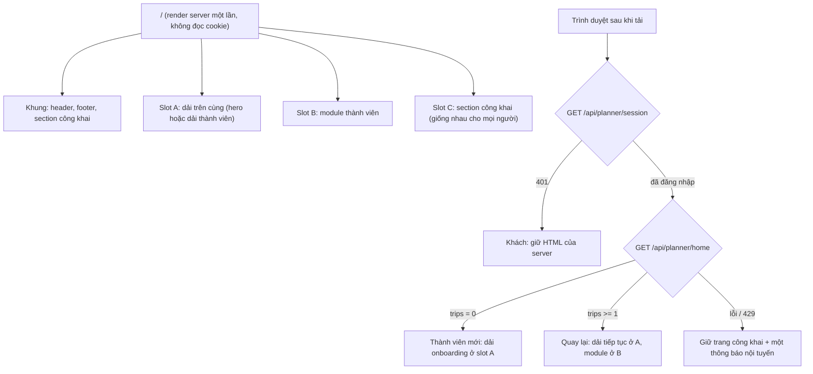
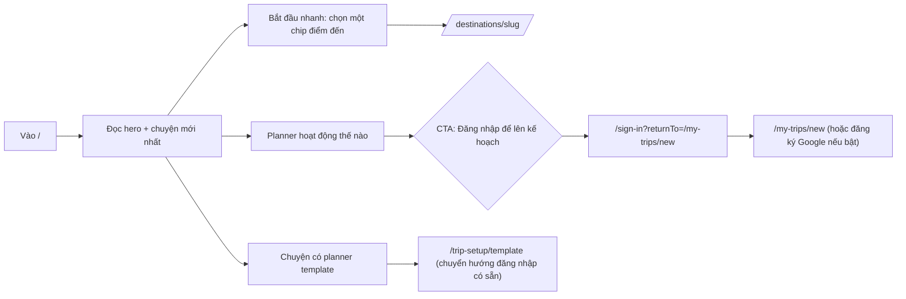
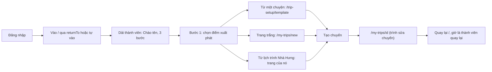
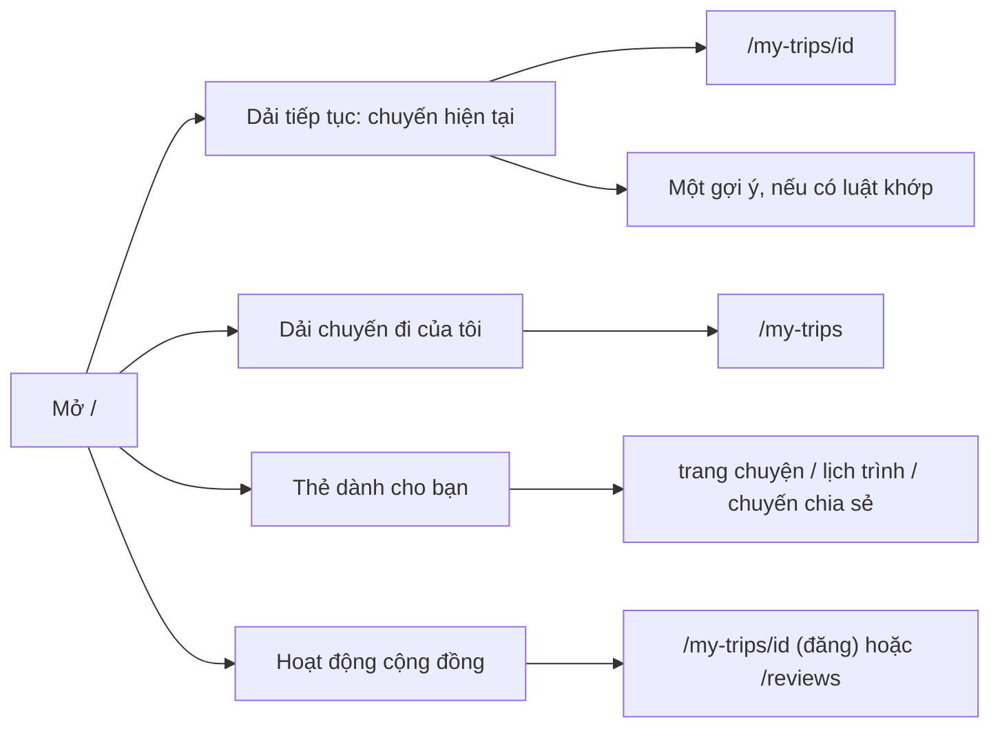
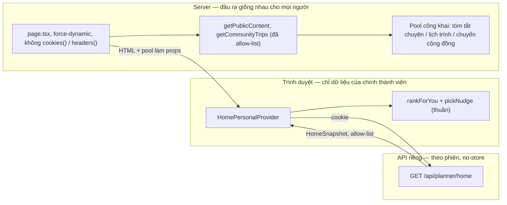

# Spec — Trang chủ cá nhân hóa

🇬🇧 English version: [specs-home-personalization.md](specs-home-personalization.md)

## Trạng thái và phạm vi

- **Trạng thái:** Đề xuất — đặc tả UX và đề xuất kiến trúc. Chưa có gì được xây; không
  sửa application code để viết tài liệu này. Quyết định duy nhất cần ghi lại được soạn
  thành [ADR 0021](adr/0021-personalized-home.vi.md) (Đề xuất).
- **MVP:** slice đầu, với một quyết định đổi (đọc phiên ở server), nằm ở
  [specs-home-mvp.vi.md](specs-home-mvp.vi.md).
- **Ngày:** 2026-11-16
- **Chủ trì:** system-architect (thiết kế), chủ dự án (quyết định trong
  [Câu hỏi mở](#câu-hỏi-mở))
- **Cấp rủi ro:** **L** — một endpoint đọc có xác thực mới, một ranh giới riêng tư và cache
  trên trang được xem nhiều nhất, và việc trải qua backend, frontend và messages. Không
  thêm, đổi tên hay redirect route nào, và `src/content/types.ts` không đổi, nên quy tắc 2
  trong CLAUDE.md không bị kích hoạt.

**Mục tiêu.** Một trang chủ duy nhất tại `/` có nội dung thích ứng theo người xem, ba trạng thái:

| Trạng thái | Ai | Trang phục vụ việc gì |
|---|---|---|
| **Khách** | Chưa có phiên | Truyền cảm hứng, giúp tìm nơi đi, cho thấy Planner là gì |
| **Thành viên mới** | Đã đăng nhập, chưa có chuyến nào | Hướng dẫn làm quen, tạo chuyến đầu tiên |
| **Thành viên quay lại** | Đã đăng nhập, có ít nhất một chuyến | Tiếp tục Planner, gợi ý phù hợp, trạng thái cộng đồng của chính mình |

Đây **không** phải hai trang chủ. Chỉ có một route, một tài liệu render ở server dùng chung
cho mọi người, và một lớp cá nhân mỏng điền vào các slot sau khi trang tải xong.

**Ngoài phạm vi** (mỗi mục thuộc phase khác — xem
[Ánh xạ vào roadmap](#9-ánh-xạ-vào-roadmap)): sở thích du lịch lưu lại, hồ sơ, lưu và theo
dõi, bình luận và thích, thông báo, "Dùng chuyến này", tìm kiếm toàn văn, gợi ý AI, nhà
cung cấp danh tính ngoài.

## Hiện trạng (kiểm tra trang chủ)

Đọc từ repository ngày 2026-11-16.

| Sự thật | Bằng chứng |
|---|---|
| Một route, `force-dynamic`, giống nhau cho mọi người; đọc stories từ content repository mỗi request (ADR 0012) và tối đa 3 chuyến cộng đồng đã duyệt | `src/app/[locale]/page.tsx` |
| Thứ tự section hiện nay: Hero → Chuyện mới nhất → Điểm đến → Bản đồ → Lịch trình nổi bật → Chuyến cộng đồng → Review cộng đồng → CTA lên kế hoạch → Video review → Giới thiệu | cùng file |
| Hero là một khối biên tập lớn (tiêu đề, hai CTA, ba số liệu, ảnh bìa lệch) | `src/components/sections/hero.tsx` |
| Planner **chỉ** là một CTA cuối trang, và nó dẫn tới trang liên hệ `/plan-your-trip`, không dẫn tới Planner (`/my-trips`) | `src/components/sections/plan-trip-cta.tsx` |
| Chuyến cộng đồng tự ẩn khi rỗng (không độn); store lỗi trả `[]` nên trang không vỡ | `community-trips-section.tsx`, `src/server/community/public.ts` |
| Ai đang đăng nhập được biết **trong trình duyệt** bằng `GET /api/planner/session`, cố ý không đọc cookie ở layout, để các trang không bị ép động và không phụ thuộc cookie | `useAccount()` trong `src/components/layout/account-menu.tsx` |
| Dữ liệu chuyến đi mà trang chủ dùng được đã có theo từng chủ: `listTrips`, `planningStatus`, `startDate`, `activityCount`, `destinationSlug`, `travelStyle`, `pace`, `listing`; review của chính mình qua `GET /api/planner/reviews` | `src/server/planner/schemas.ts`, `src/app/api/planner/**` |
| Route riêng của Planner trả `no-store`; chủ chuyến luôn lấy từ phiên, không bao giờ từ query | `src/server/planner/http.ts` |
| Trang công khai không được import repository hay store | `tests/client-boundary.test.ts` |
| Đăng nhập đã có với `returnTo` được kiểm tra; **tự đăng ký bằng mật khẩu chưa mở** (chỉ đăng ký Google khi `GOOGLE_SIGNUP_ENABLED`) | `src/lib/return-to.ts`, [specs-roadmap.vi.md](specs-roadmap.vi.md#chưa-mở) |
| Đóng góp cho cộng đồng đã mở trên `main` | ngữ cảnh ADR [0019](adr/0019-community-foundation.vi.md) |
| **Chưa có** tìm kiếm, mục đã lưu, thông báo, hồ sơ thành viên trong codebase | grep `src/`; Phase 11–15 trong `.claude/roadmap/PHASES.md` |

Ý nghĩa với thiết kế: Planner vô hình trên trang chủ, thành viên trông y hệt khách, và ba
thứ brief yêu cầu (tìm kiếm, nội dung đã lưu, hoạt động cộng đồng ngoài các bài của chính
mình) chưa tồn tại. Spec nêu chỗ nào là bản thay thế mỏng lúc này và phase nào sẽ thay nó.

## Nguyên tắc

1. **Một tài liệu cho mọi người; nội dung cá nhân được thêm ở trình duyệt.** Server không
   bao giờ đọc cookie để render `/`. Đây là quy tắc riêng tư và cache, mọi quyết định khác
   đều theo từ đó ([ADR 0021](adr/0021-personalized-home.vi.md)).
2. **Trang khách là mặc định, là phương án dự phòng và là trang của crawler.** Lớp cá nhân
   lỗi thì lùi về nó, không bao giờ về trang trống.
3. **Dựa trên luật, giải thích được, tất định.** Mỗi mục cá nhân đều nói vì sao nó hiện.
   Cùng đầu vào, cùng thứ tự. Không mô hình, không điểm số người dùng không đọc được.
4. **Tái dùng cái đã có.** Stories, lịch trình, điểm đến, chuyến cộng đồng, trình sửa chuyến
   và `/my-trips` được liên kết tới, không xây lại.
5. **Dữ liệu của thành viên không bao giờ được suy ra từ, hay gửi tới, nơi nào ngoài chính
   trình duyệt của họ.** Việc xếp hạng chạy trong trình duyệt trên một pool công khai
   (mục 6).
6. **Thương hiệu trước.** Cùng token, cùng giọng Lora/Be Vietnam Pro, cùng bảng màu clay/jade
   ấm, cùng tông "hai vợ chồng kể về một chuyến đi" — không feed, không chuỗi ngày, không
   huy hiệu, không áp lực đếm ngược.
7. **Mobile-first**: thứ tự section trên màn 375 px chính là đặc tả; desktop là cùng thứ tự
   với nhiều cột hơn.
8. **Không có điều khiển chết.** Section nào có đích đến chưa tồn tại thì không render.

## 1. Kiến trúc thông tin

### Một trang, ba trạng thái



Slot là các vị trí cố định trong tài liệu, nên trang có cùng bộ khung ở mọi trạng thái và
độ xô lệch bố cục bị chặn.

### Xác định trạng thái

Tính ở server trong `GET /api/planner/home` từ phiên (không bao giờ từ query), trả về trong
một trường `state`:

| Điều kiện | `state` |
|---|---|
| Không có phiên hợp lệ (lời gọi trả 401) | client coi là **khách** |
| Phiên hợp lệ, 0 chuyến ở mọi trạng thái (đang dùng **và** đã lưu trữ) | `new` |
| Phiên hợp lệ, có ít nhất 1 chuyến ở mọi trạng thái | `returning` |
| Phiên hợp lệ, đang chờ đổi mật khẩu | endpoint từ chối như các route Planner khác; trang chỉ hiện thông báo "đổi mật khẩu" (R-X1) |

Thành viên chỉ còn chuyến đã lưu trữ là `returning` nhưng không có chuyến để tiếp tục; dải
hiện "Bắt đầu chuyến tiếp theo" (luật R-R2). Vai trò (`editor`, `admin`, `super_admin`)
**không** làm đổi trang chủ; nhân sự vào cổng quản trị từ menu tài khoản có sẵn.

### Thứ tự section theo trạng thái

Các dòng đi từ trên xuống dưới trên mobile. "slot" là A/B/C ở trên.

| # | Section | Slot | Khách | Thành viên mới | Thành viên quay lại |
|---|---|---|---|---|---|
| 1 | **Hero** (tiêu đề, CTA, số liệu, ảnh bìa) | A | ✓ đầy đủ | — (được thay) | — (được thay) |
| 2 | **Dải thành viên** — lời chào + các bước onboarding | A | — | ✓ | — |
| 3 | **Dải tiếp tục** — lời chào + chuyến tiếp tục + một gợi ý | A | — | — | ✓ |
| 4 | **Bắt đầu nhanh** — chip điểm đến "Bạn muốn đi đâu?" | A/B | ✓ | ✓ gọn | — |
| 5 | **Dải chuyến đi của tôi** (tối đa 3, rồi "Tất cả chuyến đi") | B | — | — | ✓ |
| 6 | **Dành cho bạn** (3 thẻ xếp hạng theo luật, có lý do) | B | — | — | ✓ |
| 7 | **Hoạt động cộng đồng của bạn** (trạng thái bài của chính mình) | B | — | — | ✓ nếu có, không thì ẩn |
| 8 | **Đã lưu** | B | — | — | ẩn đến Phase 14 |
| 9 | Chuyện mới nhất | C | ✓ | ✓ | ✓ |
| 10 | **Planner hoạt động thế nào** (3 bước + CTA đăng nhập) | C | ✓ | — (dải đã làm) | — |
| 11 | Điểm đến đã khám phá | C | ✓ | ✓ | ✓ |
| 12 | Xem trước bản đồ | C | ✓ | ✓ | ✓ thu gọn thành một hàng liên kết |
| 13 | Lịch trình nổi bật | C | ✓ | ✓ (nuôi onboarding) | ✓ |
| 14 | Chuyến đi cộng đồng (đã duyệt) | C | ✓ | ✓ | ✓ |
| 15 | Review cộng đồng | C | ✓ | ✓ | ✓ |
| 16 | CTA liên hệ lên kế hoạch (cái hiện có, sửa lời cho đúng bản chất: *nhờ hai vợ chồng giúp trực tiếp*) | C | ✓ | ✓ | ✓ |
| 17 | Video review | C | ✓ | ✓ | ✓ |
| 18 | Giới thiệu | C | ✓ | ✓ | ✓ |

Quy tắc của bảng: Slot C do server render và **giống hệt nhau ở cả ba trạng thái**; một
trạng thái chỉ đổi những dòng slot C nào được *thu gọn về mặt hiển thị* (xem trước bản đồ
cho thành viên quay lại) — không bao giờ đổi nội dung HTML. Chỉ slot A và B là khác nhau.

## 2. Luồng UX

### Khách



- Truyền cảm hứng: hero, chuyện mới nhất, lịch trình, bản đồ.
- "Tìm kiếm" cho khách ở v1 là **chỉ đường, không phải tìm kiếm văn bản**: các chip Bắt đầu
  nhanh (điểm đến, và chip phong cách dẫn tới danh sách điểm đến và lịch trình). Tìm kiếm
  thật là Phase 15 và không dựng sườn.
- Khám phá Planner: dải "Planner hoạt động thế nào" chỉ dùng năng lực đã có — bắt đầu từ
  một chuyện của chúng tôi hoặc chuyến trắng, sửa ngày và chi phí, chia sẻ liên kết chỉ
  đọc. Nhãn CTA là **"Đăng nhập để lên kế hoạch"** (không bao giờ "Đăng ký" — đăng ký bằng
  mật khẩu đang đóng; đăng ký Google mở ở trang đăng nhập khi được bật).
- Trang liên hệ hiện có vẫn là lối *phụ*, lối con người.

### Thành viên mới



- Ba bước, đều suy ra từ sự thật ở server, không lưu gì: **1** chọn nơi đi (luôn có),
  **2** tạo chuyến đầu tiên (xong khi `trips.total ≥ 1`), **3** thêm hoạt động đầu tiên và
  chia sẻ (chỉ hiện sau bước 2).
- Vì dải biến mất ngay khi có chuyến, v1 **không có trạng thái "đóng" nào để lưu** (đóng
  theo từng trình duyệt chỉ là trang trí và không xây).
- Thành viên vẫn thấy các section công khai bên dưới, nên việc đọc không bao giờ bị
  onboarding chặn.

### Thành viên quay lại



- Màn đầu trả lời "tôi đang làm tới đâu?": chuyến đó, tiến độ, và bước hợp lý kế tiếp.
- "Dành cho bạn" là đọc thêm tùy chọn, không bao giờ là bức tường: 3 thẻ, mỗi thẻ có chip lý do.
- Hoạt động cộng đồng là trạng thái bài **của chính** thành viên cùng liên kết tới thư viện
  công khai; phản ứng và người theo dõi chưa tồn tại đến Phase 14.

### Chuyển trạng thái và trường hợp biên

| Tình huống | Hành vi |
|---|---|
| Đăng xuất | DOM cá nhân bị gỡ, gợi ý (mục 6) bị xóa, trang trở về nội dung khách mà không tải lại toàn trang |
| Nút Back (bfcache) sau đăng xuất | Khi `pageshow` có `persisted`, lớp cá nhân dò lại trước khi hiện bất cứ gì |
| Phiên hết hạn khi trang đang mở | 401 từ bất kỳ lời gọi cá nhân nào lùi về khách và xóa gợi ý; không chuyển hướng (trang chủ là công khai) |
| Tạo chuyến đầu tiên ở tab khác | Lần ghé sau là `returning`; không xây đồng bộ trực tiếp |
| Đổi ngôn ngữ (`/` ↔ `/en`) | Cùng trạng thái, chuỗi và ngày render lại theo ngôn ngữ kia; endpoint không phụ thuộc ngôn ngữ |
| Tắt hoặc chặn JavaScript | Trang khách, đầy đủ và dùng được; HTML không bao giờ hứa điều gì mang tính cá nhân |
| Mạng chậm | Slot cá nhân hiện khung chờ tối đa 5 giây, rồi chuyển sang trạng thái lỗi có nút thử lại |

## 3. Wireframe

Quy ước: `▓` ảnh, `[ ]` nút/liên kết, `( )` chip, `░` khung chờ. Khối đầu tiên của mỗi
trạng thái là slot A; trên mobile mọi thứ là một cột.

### Mobile (≈375 px)

Khách

```
┌─────────────────────────┐
│ ☰  Chuyện Nhà Hưng  VI/EN│  header hiện có (h = 56)
├─────────────────────────┤
│ CHUYỆN NHÀ HƯNG          │
│ Đi đâu cũng              │  h1 (duy nhất)
│ có chuyện.               │
│ lead, 3 dòng             │
│ [Đọc chuyện mới nhất]    │  full-width, ≥44px
│ [Xem bản đồ]             │
│ ▓▓▓▓▓▓▓▓▓▓▓▓▓▓▓▓▓▓▓▓▓▓▓  │  ảnh bìa 4:3
│  Bạn muốn đi đâu?        │  Bắt đầu nhanh
│ (Đà Lạt)(Hội An)(Hà Giang)→ │  chip cuộn ngang, snap
├─────────────────────────┤
│ Chuyện mới nhất  [Xem tất cả] │
│ ▓ thẻ ▓ thẻ (xếp dọc)    │
│ Planner hoạt động ra sao │  3 bước, icon + 1 dòng
│ ① Chọn chuyện  ② Chỉnh ngày ③ Chia sẻ │
│ [Đăng nhập để lên kế hoạch] │
│ Điểm đến · Bản đồ · Lịch trình │
│ Chuyến đi cộng đồng · Review │
│ Cần người dựng giúp? [Liên hệ] │
│ Video · Về chúng tôi     │
└─────────────────────────┘
```

Thành viên mới

```
┌─────────────────────────┐
│ header (menu tài khoản)  │
├─────────────────────────┤
│ Chào Lan, bắt đầu thôi.  │  h1 (không emoji — theo thương hiệu)
│ ┌─────────────────────┐ │
│ │ ① Chọn nơi muốn đi   │ │  thẻ bước = <ol>
│ │ ② Tạo chuyến đầu tiên│ │
│ │ ③ Thêm hoạt động     │ │  khóa tới khi xong ②
│ └─────────────────────┘ │
│ [Bắt đầu từ một chuyện] │  → /trip-setup/…
│ [Bắt đầu từ trang trắng]│  → /my-trips/new
│ Gợi ý khởi đầu           │
│ (Đà Lạt)(Hội An)(Hà Giang) │
├─────────────────────────┤
│ Chuyện mới nhất … (slot C)│
└─────────────────────────┘
```

Thành viên quay lại

```
┌─────────────────────────┐
│ header (menu tài khoản)  │
├─────────────────────────┤
│ Chào mừng trở lại, Lan   │  h1
│ ┌─────────────────────┐ │
│ │ ĐANG LÊN KẾ HOẠCH    │ │  Thẻ tiếp tục
│ │ Đà Lạt 4 ngày        │ │
│ │ Còn 12 ngày · 9 hoạt động│ │
│ │ [Tiếp tục chỉnh sửa] │ │  → /my-trips/[id]
│ └─────────────────────┘ │
│ ▸ Chuyến sắp đi: chốt lịch → │  ≤1 gợi ý
│ Chuyến đi của tôi  [Tất cả] │
│ ▢ Hội An 3 ngày  nháp    │  tối đa 3 hàng
│ ▢ Hà Giang 5 ngày hoàn thành │
│ Gợi ý cho bạn            │
│ ▓ thẻ — Vì bạn đang lên kế hoạch Đà Lạt │
│ ▓ thẻ … ▓ thẻ …          │
│ Hoạt động của bạn        │
│ • Chuyến "Hà Giang" đã được duyệt │
│ [Xem chuyến đi cộng đồng]│
├─────────────────────────┤
│ Chuyện mới nhất … (slot C)│
└─────────────────────────┘
```

### Desktop (≥1024 px)

Khách — gần với hero hiện nay, có Bắt đầu nhanh bên dưới và dải Planner đưa lên cạnh các chuyện.

```
┌──────────────────────────────────────────────────────────────┐
│ logo   Trang chủ Chuyện Điểm đến Lịch trình Cộng đồng Review  VI|EN  Đăng nhập │
├───────────────────────────────┬──────────────────────────────┤
│ CHUYỆN NHÀ HƯNG               │                              │
│ Đi đâu cũng có chuyện.  (h1)  │   ▓▓▓▓▓▓▓▓▓▓▓▓▓▓▓▓▓▓▓▓▓▓▓    │
│ lead                           │   ▓  ảnh bìa (tấm lệch)   ▓  │
│ [Đọc chuyện mới nhất][Bản đồ] │   ▓▓▓▓▓▓▓▓▓▓▓▓▓▓▓▓▓▓▓▓▓▓▓    │
│ 12 điểm đến · 30 chuyện · 5 năm│   └ thẻ chú thích            │
├───────────────────────────────┴──────────────────────────────┤
│ Bạn muốn đi đâu?  (Đà Lạt)(Hội An)(Hà Giang)(Phú Quốc) …      │
├───────────────────────────────────────────────────────────────┤
│ Chuyện mới nhất                          [Xem tất cả]         │
│ [thẻ] [thẻ] [thẻ]                                             │
├───────────────────────────────────────────────────────────────┤
│ Planner hoạt động ra sao        ① Chọn ② Chỉnh ngày ③ Chia sẻ │
│                                 [Đăng nhập để lên kế hoạch]   │
└───────────────────────────────────────────────────────────────┘
```

Thành viên quay lại — hai cột; chuyến tiếp tục dẫn đầu, phần còn lại hỗ trợ.

```
┌──────────────────────────────────────────────────────────────┐
│ header (menu tài khoản)                                       │
├────────────────────────────────────┬─────────────────────────┤
│ Chào mừng trở lại, Lan (h1)        │ Chuyến đi của tôi [Tất cả] │
│ ┌────────────────────────────────┐ │  ▢ Hội An 3 ngày  nháp   │
│ │ Tiếp tục: Đà Lạt 4 ngày        │ │  ▢ Hà Giang 5 ngày  xong │
│ │ Còn 12 ngày · 9 hoạt động      │ │ ─────────────────────── │
│ │ [Tiếp tục chỉnh sửa]           │ │ Hoạt động của bạn       │
│ └────────────────────────────────┘ │  • "Hà Giang" đã duyệt   │
│ ▸ gợi ý (một)                      │  [Xem chuyến cộng đồng]  │
├────────────────────────────────────┴─────────────────────────┤
│ Gợi ý cho bạn   [thẻ + lý do] [thẻ + lý do] [thẻ + lý do]     │
├───────────────────────────────────────────────────────────────┤
│ Chuyện mới nhất … (slot C, cùng HTML với khách)               │
└───────────────────────────────────────────────────────────────┘
```

Thành viên mới trên desktop: cùng dải như mobile trên lưới 12 cột — các bước bên trái (7),
chip Bắt đầu nhanh và bộ chọn "từ một chuyện" bên phải (5).

## 4. Danh mục component

Component mới đánh dấu **N**; component hiện có được tái dùng hoặc sắp lại. Vị trí theo cấu
trúc repository hiện nay.

| Component | Loại | Ở đâu | Trạng thái | Ghi chú |
|---|---|---|---|---|
| `Hero` | hiện có, server | `sections/hero.tsx` | tái dùng nguyên | render làm **con mặc định** của slot trên cùng |
| `HomePersonalProvider` **N** | client | `components/home/` | context | giữ lời gọi duy nhất tới `/api/planner/home`; cung cấp `{ status: loading|guest|new|returning|error, data }`; dùng chung lần dò phiên với header |
| `AccountProvider` **N** | client | `components/layout/` | context | nâng `useAccount()` lên để header và trang chủ dùng chung **một** request `/session`; API của header không đổi |
| `HomeTopSlot` **N** | client | `components/home/` | — | nhận `<Hero/>` làm `children`; render nó cho khách/đang tải/lỗi, thay nó cho thành viên; đảm bảo đúng một `<h1>` |
| `MemberBand` **N** | client | `components/home/` | biến thể mới | lời chào, `OnboardingSteps` |
| `OnboardingSteps` **N** | client | `components/home/` | — | `<ol>` ngữ nghĩa; trạng thái bước suy từ `data.trips.total` |
| `ResumeCard` **N** | client | `components/home/` | — | một chuyến; đếm ngược, `Badge` trạng thái, số hoạt động, một `ButtonLink` chính |
| `NudgeLine` **N** | client | `components/home/` | — | tối đa một gợi ý do luật chọn (R-N-*), là liên kết thật |
| `MyTripsStrip` **N** | client | `components/home/` | — | tối đa 3 hàng + "Tất cả chuyến đi" → `/my-trips`; dùng lại `Badge` và `formatDate` |
| `ForYouSection` **N** | client | `components/home/` | — | 3 thẻ từ pool đã xếp hạng, có chip lý do |
| `ForYouCard` **N** | client | `components/home/` | — | thẻ mỏng trên `CoverImage`, `Badge`; liên kết tới chuyện, lịch trình hoặc `/shared/[token]` |
| `ActivityList` **N** | client | `components/home/` | — | chỉ trạng thái đăng/review của chính mình; văn bản thuần, không có ghi chú của người kiểm duyệt |
| `QuickStart` **N** | server | `components/sections/` | — | chip điểm đến (liên kết `/destinations/[slug]`), cùng HTML cho mọi người |
| `PlannerSteps` **N** | server | `components/sections/` | — | "Planner hoạt động thế nào" cho khách; thay phần nội dung Planner của `PlanTripCta` |
| `HomeSkeleton` **N** | client | `components/home/` | — | khối `aria-hidden` có chiều cao dành sẵn + một dòng `role="status"` |
| `HomeNotice` **N** | client | `components/home/` | — | trạng thái lỗi/giới hạn nội tuyến, có `<button>` thử lại và liên kết dự phòng thật |
| `PlanTripCta` | hiện có | `sections/plan-trip-cta.tsx` | sửa lời | vẫn là liên kết tới `/plan-your-trip`; lời nói rõ đó là nhờ giúp trực tiếp, không phải Planner |
| `LatestStories`, `ExploredDestinations`, `MapPreview`, `FeaturedItineraries`, `CommunityTripsSection`, `CommunityReviewsSection`, `VideoReviewsSection`, `AboutSection` | hiện có, server | `sections/*` | tái dùng | slot C; không đổi, trừ `MapPreview` có thêm biến thể gọn tùy chọn cho thành viên |
| `Container`, `Section`, `SectionHeader`, `Badge`, `ButtonLink`, `CoverImage` | hiện có | `ui/*` | tái dùng | không token mới |

Logic thuần, không UI: `src/lib/home/state.ts` (`resolveHomeState`, kiểu dùng chung),
`src/lib/home/rank.ts` (`rankForYou`, `pickNudge`), `src/lib/home/pool.ts` (kiểu pool công
khai). Chúng thuần để các luật được unit test mà không cần trình duyệt.

Messages: một namespace mới `homePersonal` trong `messages/vi.json` **và**
`messages/en.json` (lời chào, nội dung bước, dòng gợi ý, chip lý do, thông báo, nhãn khung
chờ). Số đếm và ngày dùng ICU plural và `formatDate`, như các khóa `days` hiện có.
`tests/i18n.test.ts` đã kiểm tra đồng bộ.

### Trạng thái rỗng, đang tải và lỗi

| Module | Đang tải | Rỗng | Lỗi |
|---|---|---|---|
| Slot trên cùng | Hero vẫn hiện (an toàn cho khách) hoặc khung chờ thành viên nếu gợi ý nói là thành viên; chiều cao dành sẵn | không áp dụng | Hero vẫn hiện; `HomeNotice` bên dưới: "Không tải được phần của bạn." + **[Thử lại]** + liên kết tới `/my-trips` |
| Thẻ tiếp tục | khung chờ, 1 khối | không có chuyến đang dùng → "Bắt đầu chuyến tiếp theo" tới `/my-trips/new` | do lỗi của slot trên cùng bao phủ |
| Dải chuyến đi của tôi | 3 hàng khung chờ | 0 đang dùng nhưng ≥1 đã lưu trữ → "Các chuyến của bạn đã lưu trữ" + liên kết; không bao giờ hiện cho `new` | nội tuyến, thử lại ở mức section |
| Dành cho bạn | 3 thẻ khung chờ | không thể xảy ra: không có tín hiệu → lùi về gợi ý "mới nhất" như khách, có ghi nhãn | ẩn section, không thông báo (không quan trọng) |
| Hoạt động cộng đồng | một dòng khung chờ | **ẩn section** | ẩn section |
| Bắt đầu nhanh / chuyện / section công khai | render ở server, không có tải | quy tắc hiện có (chuyến cộng đồng ẩn khi rỗng) | quy tắc hiện có (store lỗi → `[]`) |
| 429 | — | — | cùng thông báo, kèm thời gian chờ từ `Retry-After`; không vòng lặp tự thử lại |
| Đang chờ đổi mật khẩu | — | — | một thông báo: "Đổi mật khẩu để tiếp tục" → `/account/password`; mọi module cá nhân khác bị ẩn |

Thông báo và lỗi được đọc ra một lần (`role="status"` / `role="alert"` khi cần thử lại);
việc hoán đổi khung chờ không được đọc ra.

## 5. Ma trận luật cá nhân hóa

Mọi luật chạy trong trình duyệt trên dữ liệu thành viên vốn đã sở hữu. Không luật nào dùng
số người đi, ngân sách, ghi chú, email, vai trò, hay bất kỳ văn bản kiểm duyệt nào. Luật
**giải thích được**: mỗi đầu ra mang một khóa `reason` thành chip hiển thị.

### Tín hiệu (v1, chỉ dữ liệu đã có)

| ID | Tín hiệu | Từ | Ghi chú |
|---|---|---|---|
| S1 | có phiên | `/session` | khách hay thành viên |
| S2 | `trips.total`, `trips.active` | `/home` | chỉ là số đếm |
| S3 | chuyến tiếp tục | `/home` | chọn theo R-R1 |
| S4 | `planningStatus` của chuyến | `/home` | `draft`, `planned`, `completed` |
| S5 | `daysUntilStart` | `/home` | số ngày nguyên, theo ngày lịch Việt Nam, `null` nếu không có ngày |
| S6 | `activityCount` của chuyến | `/home` | |
| S7 | `destinationSlug` của các chuyến mình, kèm chuyến đang dùng hay đã hoàn thành | `/home` | chỉ slug |
| S8 | `travelStyle` và `pace` phổ biến nhất trong các chuyến mình | `/home` | suy ra ở server, hòa → không có |
| S9 | trạng thái đăng (`pending`, `approved`, `rejected`) và trạng thái review của mình | `/home` | chỉ trạng thái, không lý do |
| S10 | ngôn ngữ | request | đã biết sẵn |

### Luật

| Luật | Khi nào | Đầu ra | Chip lý do |
|---|---|---|---|
| **R-G1** | khách hoặc đang tải hoặc lỗi | HTML server như cũ (hero chuyện nổi bật, chuyện mới nhất) | — |
| **R-N1** | `state = new` | `MemberBand` với các bước onboarding thay hero | "Chuyến đầu tiên của bạn" |
| **R-R1** | `returning`, ≥1 chuyến đang dùng | chuyến tiếp tục = chuyến đang dùng có **`startDate` ≥ hôm nay sớm nhất trong 30 ngày**, nếu không thì chuyến **cập nhật gần nhất** | — |
| **R-R2** | `returning`, không có chuyến đang dùng (đều đã lưu trữ) | dải ghi "Bắt đầu chuyến tiếp theo" → `/my-trips/new`; dải chuyến có liên kết tới các chuyến đã lưu trữ | — |
| **R-N-1** | chuyến tiếp tục có 0 hoạt động | gợi ý: thêm hoạt động đầu tiên → `/my-trips/[id]` | "Chưa có hoạt động" |
| **R-N-2** | chuyến tiếp tục là `draft`, `daysUntilStart ≤ 14` | gợi ý: chốt kế hoạch → `/my-trips/[id]` | "Còn N ngày nữa khởi hành" |
| **R-N-3** | `daysUntilStart < 0`, trạng thái ≠ `completed` | gợi ý: đánh dấu hoàn thành | "Ngày đi đã qua" |
| **R-N-4** | trạng thái `completed`, chưa đăng, `contributionOpen` | gợi ý: gửi lên thư viện cộng đồng (khung chia sẻ ở trang chuyến) | "Đã xong — kể lại chuyến đi" |
| **R-N-5** | một bài đăng bị `rejected` | gợi ý: mở chuyến (lý do đọc ở đó, không bao giờ ở trang chủ) | "Cần bạn xem lại" |
| **R-N-6** | một review đang `held` | gợi ý: liên kết `/reviews` | "Đội ngũ có câu hỏi" |
| **R-X1** | đang chờ đổi mật khẩu | đầu ra cá nhân duy nhất: thông báo đổi mật khẩu | — |
| **R-F1** | mục pool là chuyện/lịch trình/chuyến cộng đồng của **điểm đến chuyến tiếp tục** | +3 | "Vì bạn đang lên kế hoạch {điểm đến}" |
| **R-F2** | `travelStyle` của chuyến cộng đồng = phong cách phổ biến của thành viên | +2 | "Hợp với cách bạn đi" |
| **R-F3** | `pace` của lịch trình = nhịp phổ biến của thành viên | +1 | "Nhịp quen thuộc của bạn" |
| **R-F4** | không có chuyến tiếp tục và điểm đến của mục không nằm trong điểm đến của mình | +2 | "Một nơi mới với bạn" |
| **R-F5** | hòa điểm | `publishedAt`/`approvedAt` mới hơn trước, rồi `slug` tăng dần | — |
| **R-F6** | mọi điểm bằng 0 | hiện gợi ý "mới nhất" như khách, ghi nhãn "Mới nhất từ Nhà Hưng" | "Mới nhất" |

Chỉ hiện **một gợi ý**, chọn theo số luật nhỏ nhất khớp (R-N-1 thắng R-N-2 …). **Dành cho
bạn** hiện **3** thẻ, tối đa 2 thẻ cùng loại. Cùng đầu vào luôn cho cùng đầu ra; unit test
ghim điều đó.

Cố ý không dùng ở v1: lịch sử duyệt (không theo dõi gì), số người đi, ngân sách, ghi chú,
giờ trong ngày, vị trí. Sở thích lưu lại và "người giống bạn" thuộc Phase 11 và 15 (xem mục
Ánh xạ vào roadmap), và pool không có số đếm phổ biến vì không lưu số đó.

## 6. Ranh giới dữ liệu server/client

Ranh giới là quy tắc trung tâm của đặc tả. Nó cùng hình dạng với cách header đang xử lý phiên.



| Mối quan tâm | Quy tắc |
|---|---|
| **Server render gì** | Đúng trang khách cộng một **pool công khai** nhỏ (≤ 12 chuyện, ≤ 6 lịch trình, ≤ 6 thẻ cộng đồng, mỗi mục rút gọn còn `kind`, `slug`/`token`, tiêu đề theo ngôn ngữ, ảnh bìa, slug điểm đến, `travelStyle`/`pace`, ngày). Cùng từng byte cho khách và cho thành viên đã đăng nhập khi yêu cầu `/`. |
| **Server không được làm** | Đọc cookie phiên, gọi `identify`, import Planner repository, đặt `Set-Cookie`, thay đổi theo `Cookie`, hay lấy user id từ bất cứ đâu. `tests/client-boundary.test.ts` giữ trang công khai tránh xa repository; một test mới giữ `page.tsx` tránh xa `cookies()`/`headers()`. |
| **Gì sang trình duyệt** | Một phản hồi, `HomeSnapshot` (mục 7), dựng bằng phép chiếu allow-list — không bao giờ là một dòng `Trip`. |
| **Xếp hạng ở đâu** | Trong trình duyệt, trên pool công khai và `HomeSnapshot` của thành viên. Tín hiệu của thành viên không bao giờ được gửi đi đâu. |
| **Cache** | `/` không mang dữ liệu người dùng nên an toàn trong mọi cache dùng chung. `/api/planner/home` là `Cache-Control: no-store` (và `Vary: Cookie`, thêm cho chắc); không đưa gì cá nhân vào `localStorage`, `sessionStorage`, `IndexedDB` hay service worker. |
| **Gợi ý duy nhất được lưu** | Một khóa `localStorage` chỉ chứa chuỗi `member` (không bao giờ là id, tên hay số đếm), đặt sau khi `/home` thành công, xóa khi đăng xuất hoặc bất kỳ 401 nào. Nó chỉ chọn *khung chờ nào* vẽ trước. Nó không đáng tin và không bao giờ quyết định cái gì được hiện. |
| **Log và analytics** | Không có trường cá nhân trong log; endpoint chỉ log trạng thái và thời lượng. Không thêm analytics hay script bên thứ ba (ADR 0005 giữ chúng khỏi trang chia sẻ; trang này cũng không thêm). |
| **URL** | Không có trạng thái, tên, số đếm hay tiêu đề chuyến trong query string. Liên kết chỉ mang id đã có sẵn trong `/my-trips/[id]`. |
| **Render văn bản** | Tiêu đề chuyến và tên hiển thị là text node của React, không bao giờ `dangerouslySetInnerHTML`. Tên hiển thị chứa `@` không dùng cho lời chào; hiện lời chào trung tính. |

**Vì sao không đọc cookie ở server?** Vì khi đó `/` trở thành tài liệu theo từng người: nó
không bao giờ nằm được trong cache dùng chung, chỉ cách một thiếu sót `Vary` là lộ chuyến
của thành viên này cho thành viên khác, và mỗi request đều tốn một lần đọc store. Cái giá của
thiết kế được chọn là một khoảnh khắc ngắn thành viên thấy nội dung khách hoặc khung chờ;
mục 8 chặn trên nó.

## 7. Yêu cầu API và dữ liệu

### `GET /api/planner/home` (mới)

Một route handler mới duy nhất, `src/app/api/planner/home/route.ts`, dựng bằng
`plannerRoute` như các route anh em; `dynamic = 'force-dynamic'`; chủ là người dùng của
phiên, không bao giờ là tham số. Trả 401 khi không có phiên (client coi là khách), luôn
`no-store`, và 429 từ một limiter nhỏ theo phiên (30/phút, `createRateLimiter`). Từ chối
bằng lỗi chuẩn khi đang chờ đổi mật khẩu.

```ts
// Allow-list. Dựng từ các view của repository; không bao giờ spread một Trip.
interface HomeSnapshot {
  state: 'new' | 'returning';
  displayName: string;            // như /session đã trả
  trips: { total: number; active: number };
  resume: TripBrief | null;       // luật R-R1
  others: TripBrief[];            // ≤ 3, cập nhật gần nhất, trừ resume
  signals: {
    destinations: { slug: string; completed: boolean }[]; // chuyến của mình, đã khử trùng
    travelStyle: TravelStyle | null;
    pace: Pace | null;
  };
  activity: ActivityItem[];       // ≤ 5, mới nhất trước
}
interface TripBrief {
  id: string;
  title: string;
  destinationSlug: string;
  durationDays: number;
  startDate: string | null;       // ngày ISO
  daysUntilStart: number | null;  // ngày lịch Việt Nam, tính ở server
  planningStatus: 'draft' | 'planned' | 'completed';
  activityCount: number;
  listing: 'none' | 'pending' | 'approved' | 'rejected';
}
type ActivityItem =
  | { kind: 'listing'; tripId: string; title: string; status: 'pending' | 'approved' | 'rejected'; at: string }
  | { kind: 'review'; placeSlug: string; status: 'pending' | 'approved' | 'held' | 'removed'; at: string };
```

**Không được** xuất hiện trong phản hồi (được khẳng định bằng zod schema strict và một
test): `ownerId`, `shareToken`, `shareTokenCreatedAt`, `note`, `budget`, `partySize`,
`expenses`, `version`, `sourceTemplate`, danh tính người kiểm duyệt hay người review, bất
kỳ văn bản lý do kiểm duyệt nào, `email`, `handle`, `googleSub`, vai trò, trường token hay
phiên. `displayName` là trường danh tính duy nhất và là trường `/session` vốn đã lộ cho
cùng trình duyệt đó.

Chi phí và giới hạn: một `listTrips` (đang dùng và đã lưu trữ) và một `listOwnReviews`, đều
đã lọc theo chủ; O(số chuyến) trên JSON store, có chỉ mục trên PostgreSQL. Mục tiêu p95 <
300 ms và payload ≤ 4 KB gzip. Số đếm được tính, không lưu.

### Pool công khai

Không có endpoint mới. Trang vốn đã đọc stories (`getPublicContent`) và chuyến cộng đồng
(`getCommunityTrips`); lịch trình là nội dung tĩnh. Server ánh xạ chúng thành mảng
`PoolItem` và truyền xuống làm props. Nó **không chứa gì về người xem**, nên an toàn cho
cache và giống hệt nhau ở mọi trạng thái.

### Điều không đổi

| Không đổi | Vì sao |
|---|---|
| Route hiện có, redirect tour, `pathnames` | Không có trang mới; quy tắc 2 không bị đụng |
| `src/content/types.ts` | Kiểu pool và snapshot nằm cạnh các module mới |
| `Trip`, `CommunityTripCard`, store, migration | Không đổi schema; snapshot là một phép chiếu |
| `GET /api/planner/session`, `/api/planner`, `/api/planner/reviews` | Tái dùng nguyên; chúng trả nhiều trường hơn trang chủ cần, và đó là lý do có phép chiếu |
| Vai trò, `can()`, quyền | Trang chủ không phải bề mặt phân quyền |

Tài liệu đổi khi xây: `docs/runbook.md` (+ `.vi.md`) liệt kê mọi route handler và
`tests/runbook.test.ts` bắt buộc điều đó; `docs/runbook-api.md`, `docs/architecture.md`
(+ `.vi.md`) cho module mới và ranh giới; `docs/features/personalized-home.md`
(+ `.vi.md`, đăng ký ở cả hai index); `.claude/context/project-context.md`.

## 8. Tiêu chí chấp nhận

Mỗi dòng kiểm chứng được. **NOT RUN** cho đến khi có người chạy; spec này không chạy gì.

### UX và khả năng truy cập

| # | Tiêu chí |
|---|---|
| UX-1 | Một `<h1>` ở mọi trạng thái; dải thành viên thay `<h1>` của hero, không bao giờ thêm một cái |
| UX-2 | Thứ tự heading không nhảy cấp; mọi section có `aria-labelledby` |
| UX-3 | Mọi phần tử tương tác là `<a>`/`<button>` thật, ≥ 44 px, focus nhìn thấy được; không `href="#"` |
| UX-4 | Chip Bắt đầu nhanh và các bước của thành viên thao tác được bằng bàn phím; hàng chip cuộn không kẹt focus |
| UX-5 | Khung chờ là `aria-hidden` với một dòng `role="status"`; việc hoán đổi không dời focus; lỗi cần hành động dùng `role="alert"` một lần |
| UX-6 | Chạy ở 320 px không cuộn ngang trang; đọc đúng với `prefers-reduced-motion` và ở mức phóng 200 % |
| UX-7 | Chuỗi VI (dài hơn) vừa ở 375 px; mọi chữ có ở cả hai catalogue (`tests/i18n.test.ts`) |
| UX-8 | Cumulative layout shift ở lần tải đầu ≤ 0,1 với thành viên (slot có chiều cao dành sẵn) |
| UX-9 | Không render điều khiển cá nhân nào cho khách; không điều khiển chết cho tính năng còn thiếu (Đã lưu vắng mặt, không bị vô hiệu) |
| UX-10 | Độ tương phản đạt WCAG AA với token hiện có; không thêm màu mới |

### QC

| # | Tiêu chí |
|---|---|
| QC-1 | Unit test `resolveHomeState`: 0 chuyến, chỉ đã lưu trữ, hỗn hợp, đang chờ đổi mật khẩu |
| QC-2 | `rankForYou` / `pickNudge`: tất định (cùng đầu vào hai lần → cùng đầu ra), hòa điểm ổn định, trần 3 thẻ, ≤ 2 thẻ cùng loại, lùi về khi điểm bằng 0 |
| QC-3 | `GET /api/planner/home`: 401 khi không có phiên; đúng với thành viên không chuyến, một chuyến, nhiều chuyến, chỉ đã lưu trữ |
| QC-4 | **Cách ly:** với hai thành viên A và B, `/home` của A không chứa id, tiêu đề hay trạng thái nào của B |
| QC-5 | Test trang: phản hồi `/` **giống hệt từng byte** khi có và không có cookie phiên hợp lệ |
| QC-6 | Test lỗi: store sập → section công khai vẫn render; `/home` 500 → `HomeNotice` và nội dung khách, không có trang trống |
| QC-7 | Test component cho từng ô rỗng/đang tải/lỗi ở mục 4 |
| QC-8 | Đăng xuất và khôi phục bfcache không để lại DOM hay gợi ý cá nhân |
| QC-9 | Chạy trực quan `npm run verify:ui` ở 375, 768, 1280 px cho ba trạng thái; xem lại ảnh chụp |
| QC-10 | `typecheck`, `lint`, `test`, `build` đạt và nêu đầu ra |

### Bảo mật

| # | Tiêu chí |
|---|---|
| SEC-1 | Phản hồi khớp zod allow-list strict; test fail nếu bất kỳ trường bị cấm (mục 7) xuất hiện |
| SEC-2 | `Cache-Control: no-store` trên mọi phản hồi của endpoint, kể cả lỗi |
| SEC-3 | `page.tsx` và các component nó render ở server không bao giờ gọi `cookies()`/`headers()` hay import Planner repository (mở rộng `tests/client-boundary.test.ts`) |
| SEC-4 | Chủ lấy từ phiên; không có tham số query hay body nào chọn người dùng khác, và một test gửi thử một tham số rồi kiểm tra nó bị bỏ qua |
| SEC-5 | Giới hạn tốc độ: request thứ 31 trong một phút → 429 kèm `Retry-After`; client không tự thử lại theo vòng lặp |
| SEC-6 | Không gì cá nhân trong `localStorage`/`sessionStorage`/IndexedDB ngoài gợi ý `member`; không giá trị cá nhân trong URL, dòng log hay lời gọi analytics |
| SEC-7 | Không `dangerouslySetInnerHTML`; tiêu đề chuyến và tên render dạng văn bản; `@` trong tên hiển thị lùi về lời chào trung tính |
| SEC-8 | Không có request hay script bên thứ ba mới; CSP và test security headers không đổi |
| SEC-9 | Văn bản lý do kiểm duyệt và danh tính người review không bao giờ xuất hiện trong payload |
| SEC-10 | Khuyến nghị `/sec-check` và `/qc-check` trước khi merge slice endpoint; **NOT RUN** cho đến khi chủ dự án yêu cầu |

## 9. Ánh xạ vào roadmap

Phase ID là cố định (`.claude/roadmap/PHASES.md`); công việc này là **một lớp trình bày trên
các phase đã xong hoặc đang chạy, không phải năng lực mới**, nên được ánh xạ chứ không nhét
vào Phase 10–15.

| Phần | Xây trên | Chồng Phase 10–15? | Quyết định |
|---|---|---|---|
| Sắp lại trang khách, Bắt đầu nhanh, các bước Planner | T1 (site công khai), Phase 04/05 (Planner UI, chia sẻ) | Không | Spec này |
| `GET /api/planner/home`, snapshot, provider, slot | repository Phase 03/05, phiên ADR 0004 | Không | Spec này, ADR 0021 |
| Onboarding thành viên mới | Phase 04/05 (`/trip-setup`, `/my-trips/new`) | Không | Spec này |
| Tiếp tục, dải chuyến của tôi, gợi ý | Phase 04/05 | Không | Spec này |
| Hoạt động cộng đồng (bài của mình) | Phase 10-S0 (ADR 0014/0015) | Không — đọc trạng thái đã có | Spec này |
| Luật "Dành cho bạn" | nội dung công khai + chuyến của mình | **Giáp Phase 15** (khám phá) và các slice P1–P3 của spec cá nhân hóa | v1 chỉ dùng dữ liệu đã có; sở thích lưu và "người giống bạn" ở lại [Phase 11 / 15](specs-planner-personalization.vi.md#các-slice-giao-hàng) |
| Mục đã lưu trên trang chủ | — | **Phase 14** | Giữ slot và ẩn; không xây |
| Người theo dõi, thích, bình luận, thông báo trên trang chủ | — | **Phase 14 / 15** | Không xây; danh sách hoạt động là bản thay thế |
| "Dùng chuyến này" trên thẻ cộng đồng | — | **Phase 11** | Thẻ vẫn liên kết `/shared/[token]` như nay |
| Tìm kiếm văn bản | — | **Phase 15** | Chỉ chip Bắt đầu nhanh |
| Gợi ý AI | — | Phase 06 | Không xây; luật là hàm thuần nên sau này mô hình có thể thay thế qua cùng một kiểu |
| Hồ sơ và tên hiển thị | — | **Phase 11** | v1 dùng `displayName` hiện có |

**Chỗ đề xuất trong roadmap:** một **Phase 16 — Trang chủ cá nhân hóa** mới (phase mới lấy
ID kế tiếp; Phase 00–15 không đánh số lại), ưu tiên P2, phụ thuộc cứng vào 05 (xong) và
10-S0 (đã có code), móc mềm vào 11, 14, 15. Phương án thay thế là gộp slice H1–H3 vào
Phase 04 ("Interactive Planner UI"). **Chủ dự án quyết định; spec này không sửa
`PHASES.md`.**

### Các slice giao hàng

Mỗi slice là một branch và một PR (quy tắc 9) kèm feature document (quy tắc 11). FE phụ
thuộc BE chỉ qua kiểu `HomeSnapshot`, mà slice H1 đóng băng.

| Slice | Nội dung | Vai trò (theo thứ tự) | Cấp |
|---|---|---|---|
| **H0** | Chấp nhận ADR 0021 (và quyết các câu hỏi mở) | architect | S |
| **H1** | route `/home` + schema + test; `AccountProvider`; khung slot; sắp lại trang khách, Bắt đầu nhanh, các bước Planner | backend, rồi frontend | L |
| **H2** | Dải thành viên mới, các bước onboarding, thông báo | frontend | M |
| **H3** | Thẻ tiếp tục, dải chuyến của tôi, gợi ý, danh sách hoạt động | frontend | M |
| **H4** | Pool công khai, `rankForYou`, Dành cho bạn, chip lý do | frontend | M |
| **H5** | Rà soát khả năng truy cập và trực quan, tài liệu, **khi chủ dự án yêu cầu** `/qc-check` và `/sec-check` | frontend, architect | M |

Kế hoạch token: một agent trước, một session mỗi slice, không subagent khi chưa được duyệt.
Việc tìm kiếm kiểu `explorer` là `grep` ngay tại chỗ.

## Câu hỏi mở

Câu trả lời là của chủ dự án. Khuyến nghị in **đậm**.

| # | Câu hỏi | Khuyến nghị |
|---|---|---|
| Q1 | "Tìm kiếm" cho khách ở v1 có đủ bằng chip Bắt đầu nhanh, còn tìm kiếm thật để Phase 15? | **Có** — chỉ mục văn bản là tính năng của Phase 15 |
| Q2 | Nhãn CTA cho khách khi đăng ký bằng mật khẩu đang đóng: "Đăng nhập để lên kế hoạch"? | **Có**; chỉ đổi sang "Đăng ký" nếu đăng ký Google được bật ở môi trường |
| Q3 | ID phase mới (Phase 16) hay gộp vào Phase 04? | **Phase 16**, để giữ nguyên phạm vi Planner map của Phase 04 |
| Q4 | Một gợi ý `member` một dòng, theo từng trình duyệt, trong `localStorage` có chấp nhận được? | **Có**; nó không mang dữ liệu cá nhân và gỡ đi không mất gì |
| Q5 | Trang chủ của thành viên quay lại có nên giấu bản đồ và video sau liên kết để màn đầu ngắn? | **Thu gọn bản đồ; giữ phần còn lại** (không ảnh hưởng SEO, cùng HTML) |
| Q6 | Gợi ý N-4 (mời chia sẻ chuyến đã xong) — có muốn không, khi đóng góp đã mở? | **Có**, một dòng, không bao giờ lặp lại khi đã có bài đăng |
| Q7 | Tên hiển thị trong dữ liệu production có bao giờ là địa chỉ email không? | **Kiểm tra trước H2**; lùi về khi có `@` đã bao phủ cả hai trường hợp |
| Q8 | Hiện nay tác giả đọc câu hỏi của review `held` ở đâu? | **Xác minh trước R-N-6**; nếu không có trang nào, bỏ luật |

## Ngoài phạm vi

Sở thích lưu lại; trang hồ sơ thành viên; Lưu, Theo dõi, Thích, Bình luận; thông báo; "Dùng
chuyến này"; tìm kiếm văn bản và bộ lọc; gợi ý AI; gợi ý từ hành vi của người khác; xếp hạng
theo độ phổ biến; analytics, A/B testing và theo dõi dưới mọi hình thức; một route trang
chủ thành viên riêng; thay đổi xác thực, vai trò, trang quản trị, kiểm duyệt cộng đồng hay
các store; ảnh thật hay Planner map. Mỗi mục cần quyết định riêng trước khi dựng sườn.
