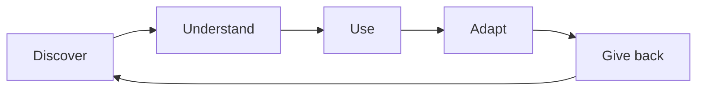

# Spec — Planner personalization and Planner community

🇻🇳 Bản tiếng Việt: [specs-planner-personalization.vi.md](specs-planner-personalization.vi.md)

- **Status:** Proposed — a direction to decide on, not an accepted decision. Nothing
  here is built. Each slice in [Delivery slices](#delivery-slices) needs its own ADR
  before code, as [specs-roadmap.md](specs-roadmap.md#not-open-yet) requires.
- **Superseded in part:** the Community half is expanded by the
  [Community Platform spec set](specs-community-overview.md); slices P1–P3 and P6 are
  Phase 15 of [its roadmap](specs-community-roadmap.md).
- **Date:** 2026-11-16
- **Owner:** system-architect (design), project owner (decisions in
  [Open questions](#open-questions))

## Purpose

Two ideas, one product loop. **Personalization** makes the Planner start from what
this traveller likes instead of a blank form. **Community** lets travellers learn from
each other's real trips instead of only from Nhà Hưng's. The loop: a traveller states
how they travel, sees trips and places that fit, copies one into their own trip, adapts
it, and may give the result back.

The brand stays the centre. This is a couple telling you about a trip, not a
marketplace: no ranking by popularity contests, no feed that tries to keep you
scrolling.

## Where we are

Facts read from the repository on 2026-11-16, so the design builds on them instead of
re-inventing them.

| Capability | State | Evidence |
|---|---|---|
| Trip has `travelStyle`, `pace`, `partySize`, `budget` | Shipped, entered per trip, never remembered | `src/server/planner/schemas.ts` `tripCoreInputSchema` |
| Style values | `romantic`, `family`, `solo`, `friends`, `adventure`, `budget`, `foodie`, `relaxed` | `travelStyleSchema` in `src/server/content/schemas.ts` |
| Pace values | `relaxed`, `balanced`, `active` | `paceSchema`, same file |
| User profile | `displayName`, `handle`, credentials, role; **no preferences** | `plannerUserSchema` |
| Clone a story or template into a trip | Shipped | ADR [0005](adr/0005-trip-sharing-and-story-cloning.md) |
| Duplicate a trip | Shipped for the **owner's own** trip only | `PlannerRepository.duplicateTrip` calls `requireOwnedTrip` |
| Share links, read-only view | Shipped | ADR 0005 |
| Community gallery of trips | Shipped; staff approve first; any edit re-queues | ADR [0014](adr/0014-community-trips-and-reviews.md) |
| Place reviews | Shipped; live at once; staff can remove or hold | ADR 0014, [0015](adr/0015-community-review-author-controls.md) |
| Contribution gate | Open: terms and takedown contact are filled | `contributionOpen` in `src/content/site.ts` |
| Planner map, AI suggestions | Not open | [specs-roadmap.md](specs-roadmap.md#not-open-yet) |

What is missing, in one line each: the Planner does not remember the traveller, the
gallery cannot be filtered or matched to anyone, and a community trip can be read but
not used.

## Principles

1. **Explicit before inferred.** A preference the traveller typed beats a guess. Where
   we do infer, we say why ("because you chose: foodie") and let them correct it.
2. **Rules, not models.** Matching is a transparent scoring function over a few fields.
   AI suggestions are not open; this spec does not open them.
3. **No new tracking.** No click logging, no third-party analytics, no behavioural
   profile table. Implicit signals are computed on read from the traveller's own trips.
4. **Private by default, public by choice.** Preferences are never in any public
   projection. Community output stays an allow-list, as in ADR 0005 and 0014.
5. **Nothing personal breaks the page.** With no profile the Planner behaves exactly as
   it does today. Personalization only reorders and pre-fills; it never hides content.
6. **Trust before reach.** Every community feature has a takedown path before it has a
   growth path.

## Personalization

### Traveller preferences

One optional object on the user, absent meaning "no preferences". Edited at a new
account page, readable and deletable by its owner at any time.

| Field | Values | Used for |
|---|---|---|
| `styles` | up to 3 of the eight `travelStyle` values | Ranking, trip defaults |
| `pace` | the three `pace` values, or none | Trip defaults, ranking |
| `typicalPartySize` | integer 1–50, or none | Trip default |
| `budgetBand` | `tight`, `comfortable`, `generous`, or none | Ranking, budget default hint |
| `homeRegion` | a region of Vietnam, or none | Transport hints, "near you" |
| `interests` | up to 5 tags from a fixed list (food, coast, mountain, culture, nightlife, photography, …) | Ranking |
| `interestInDestinations` | up to 10 `Destination.slug` values, a "want to go" list | Ranking, empty-state suggestions |

The interest tag list is a fixed enumeration owned by the owner and editors, not free
text, so it can be translated and matched. `budgetBand` is relative on purpose: the
product holds no price data and must not invent any.

### Where it shows up

| Surface | Change | Without a profile |
|---|---|---|
| Trip creation forms | Pre-fill style, pace, party size from preferences | Empty, as now |
| `/trip-setup/[template]` | Same defaults, plus a note when the template's style differs from the traveller's | Unchanged |
| `/my-trips` empty state | "Suggested for you": up to 3 stories or templates scored against preferences | Newest stories |
| Community gallery | Optional "Matches you" sort and a visible reason chip per card | Newest first |
| Destination and story pages | A small "fits your style" cue when the traveller is signed in and has styles set | Nothing |

Personalization is a **sort and a hint**, never a filter the traveller cannot turn off.
Every personalized list has a visible "Show all" control.

### Matching

A pure function, `scoreMatch(preferences, candidate) → { score, reasons[] }`, in the
server module, unit-tested like `budget.ts`. Inputs are fields already on stories,
templates and community trip cards (`travelStyle`, `pace`, `destinationSlug`,
`durationDays`, `partySize`). Weights live in one constant table. `reasons` is what the
UI shows, so the explanation is the computation, not a separate copy that can drift.

Implicit signals (destinations of the traveller's own trips, the styles they chose most)
may add a small bonus. They are derived at request time from the traveller's own trips
and are never stored. If this proves too weak, a stored signal needs its own ADR.

### Privacy and control

- Opt-in: the preferences form is never shown as a gate and is never required.
- Visible in one place, deletable in one click; deleting returns every surface to its
  no-profile behaviour.
- Never returned by `GET /api/planner/session` (a minimal user, see PR #105 on `main`),
  never in `SharedTripView`, never in `CommunityTripCard`.
- Account deletion or soft delete (ADR [0017](adr/0017-super-admin-role.md)) removes it
  with the user row; there is no second copy.
- It is personal data: the privacy statement the owner supplies for contributors must
  also cover it.

## Community

### Where we want to get to

| Step | Today | Next |
|---|---|---|
| Discover | Newest approved trips, no filters | Filter by destination, duration, style, party size; optional "Matches you" sort |
| Understand | The shared trip view with projected budget overrun | A "based on" line, review count of the places in the trip |
| Use | Not possible for someone else's trip | **Use this trip**: copy into the traveller's own private draft |
| Adapt | Trip editor on the copy | Same; the copy remembers where it came from |
| Give back | Request a listing, write place reviews | Optionally list the adapted trip; credit to the source trip |

### Use this trip

The central new capability. A signed-in traveller copies an **approved listed** trip
into their own account.

- Reuses the `duplicateTrip` row-cloning logic, but the source is read through the
  allow-list projection, not by owner id. The copy carries **structure and place
  references**, not the author's free-text notes, private expense amounts or share
  token. Which fields travel is an allow-list with a test, like ADR 0005.
- The copy is a private draft owned by the new traveller. It stores
  `origin: { shareToken, authorDisplay }` only when the source's author chose to be
  shown by name; for an anonymous author it stores no author at all.
- **Attribution is a rule, not a courtesy.** A copy that is later listed keeps a
  visible "adapted from" line unless the source was withdrawn. Withdrawing a source
  never deletes copies; it only removes the line's link.
- Copying is rate-limited per user and the source's author is not told who copied
  (no notification in this slice).

### Discovery

Server-side filtering on the existing `GET /api/community/trips`, with an allow-listed
query (`destination`, `durationMax`, `style`, `partySize`, `sort`). No free-text search
in this slice: free text over traveller-written titles invites abuse and needs its own
moderation thought.

### Traveller profile (public, opt-in)

A small public page per traveller who chooses one, at a handle URL. It shows display
name, the approved listed trips and approved reviews, and nothing else. Off by default.
Anonymous trips and reviews never appear on it, and unpublishing the profile does not
change the trips' own listing state. Adding it exposes `handle` publicly, so it needs a
decision on whether handle is already considered public (ADR 0018).

### Saving and lightweight reactions

- **Save** a community trip or a place to a private list. Feeds the "want to go" signal.
  Nobody else sees it.
- **Helpful** on a review: one count, no downvote, no ranking by it. A reaction is the
  only new public number, so it is deferred to the last slice and needs the owner's yes.
- Explicitly not planned: comments, replies, follows, direct messages, photo upload,
  leaderboards. Each carries moderation and abuse cost the current volume does not
  justify (ADR 0014 already lists replies, likes and photos as separate decisions).

### Trust and safety

| Need | Design |
|---|---|
| Readers can flag a problem | A **Report** control on trips and reviews, rate-limited, reason from a fixed list, feeds the existing moderation queue and `community:moderate`. Required before "Use this trip" ships. |
| Takedown | Existing: staff approve, reject, hold, remove. Copies are never auto-removed. |
| Abuse by a user | Existing `ReviewRestriction` (ADR 0015) extended to listing and copying. |
| Copy farming | A per-user daily cap on copies; a trip cannot be copied from the author's own copies of it. |
| Staff load | Report volume is the signal for adding a `moderator` role (ADR 0006); not built here. |

## How the two connect

| Community fact | Personalization use | Guard |
|---|---|---|
| Listed trip's `travelStyle`, `pace`, `destinationSlug` | Scored against preferences for the "Matches you" sort | Only fields already in `CommunityTripCard` |
| Review count per place | "Reviewed by N travellers" cue | Hidden below 3, as in ADR 0014 |
| Copy of a listed trip | Counts as a mild style/destination signal for the copier | Computed on read from the traveller's own trips |
| Traveller's own listed trips | Never read to personalize someone else's view | No cross-user profile building |

There is **no collaborative filtering** ("people like you also…"). It needs behavioural
data on other people and is the step where this turns into tracking.

## Data and API changes

Everything is additive and optional, so a store written before it loads unchanged
(ADR 0007's rule).

| Change | Where | Notes |
|---|---|---|
| `PlannerUser.preferences` | Planner store; PostgreSQL nullable JSONB column | Absent = none. Stripped from every public projection. |
| `Trip.origin` | Planner store; nullable JSONB on `trips` | `null` for trips not copied from the community. |
| `SavedItem` | New Planner-store entity / table, `userId`, `kind` (`trip`/`place`), `ref`, `createdAt` | No foreign keys, ADR 0013. Private. |
| `ContentReport` | New entity / table: `targetKind`, `targetId`, `reason`, `reporterId` or client key, `status` | Feeds the moderation queue. |
| `PATCH /api/planner/me/preferences`, `DELETE` same | Planner API | `If-Match` like other writes. |
| `POST /api/community/trips/[token]/use` | Community API, signed-in | Returns the new `TripView`. |
| `GET /api/community/trips?…` | Existing route, allow-listed query | Backward compatible. |
| `POST /api/community/reports` | Community API | Rate-limited; same error envelope. |
| `PUT/DELETE /api/planner/saved` | Planner API | Private list. |
| New migrations | `db/migrations/0010+` (`0009` is taken) | With import/export and a both-stores test, as ADR 0014 required. |
| New pages | Account preferences, public traveller profile, saved list | Routes added to `pathnames` in both locales. |

Every new string exists in VI and EN; the new routes are added to the sitemap only
where public.

## Delivery slices

Each slice is its own branch, ADR and feature document. Order is by value and risk:

| Slice | Contents | Needs ADR | Depends on |
|---|---|---|---|
| P1 | Preferences object, account page, trip-form defaults | Yes | None |
| P2 | `scoreMatch`, "Suggested for you", "Matches you" sort and reason chips | Yes (matching rules) | P1 |
| P3 | Gallery filters on `GET /api/community/trips` | Small; can ride on P2's ADR | None |
| P4 | Report control and moderation queue extension | Yes (trust and safety) | Contribution gate open |
| P5 | **Use this trip** with attribution | Yes (copy allow-list, attribution rule) | P4 |
| P6 | Saved items and "want to go" signal | Yes | P1 |
| P7 | Public traveller profile, helpful reaction | Yes, each | P4, P5 |

P1–P3 touch only the traveller's own data and already-approved trips, so they can be built independently (Phase 15 in the roadmap). P4 onwards adds public write paths and should wait for Phase 10 (Report control, audit log) and for a per-trip copy switch consistent with Terms Article 3.

## Acceptance direction

Not a test plan, but what each slice must be able to prove:

- No profile → every page identical to today (snapshot of the no-preferences path).
- Preferences never appear in session, share, gallery or profile responses (an
  enumerating allow-list test per projection, as ADR 0005 and 0014 do).
- `scoreMatch` is deterministic and its `reasons` equal the terms that produced the score.
- A copied trip contains no field outside the copy allow-list; an anonymous source
  leaks no author.
- Withdrawing or rejecting a source leaves copies intact.
- Deleting the account removes preferences, saved items and the public profile.
- Accessibility: every new control is a real button or link, targets ≥44px, the
  "Show all" escape is keyboard reachable.

## Open questions

Needs the owner before the first ADR. Recommended answers are written so work can start
on them if the owner agrees.

| # | Question | Recommended |
|---|---|---|
| 1 | Should preferences be asked at sign-up or only offered later? | Offered later, never blocking |
| 2 | Is `handle` a public identifier already, or must a public profile use a separate slug? | Check ADR 0018's intent; default to a separate opt-in slug if unsure |
| 3 | May a traveller copy a trip whose author chose anonymity? | Yes, with no author credit, since credit would unmask them |
| 4 | Is "Use this trip" allowed before staff have a report channel? | No; P4 before P5 |
| 5 | Is a "helpful" count on reviews wanted at all? | Defer; decide after P5 shows real volume |
| 6 | Should the author be told their trip was copied? | No in this slice; revisit with notifications, which do not exist |
| 7 | Who owns the fixed interest-tag list and its translations? | Owner and editors, edited in the CMS in a later slice |
| 8 | Should Planner AI suggestions replace rule-based matching later? | Separate ADR; keep `scoreMatch` as the interface so a model could sit behind it |

## Not in scope

- AI suggestions, collaborative filtering, behavioural tracking or analytics.
- Comments, replies, follows, messaging, photo upload, leaderboards.
- Paid or promoted placement, sponsored trips, affiliate links.
- Any price or booking data; `budgetBand` is relative and the product invents no prices.
- The Planner map, and a hosted identity provider.
- A `moderator` role and an audit log; both stay as listed in
  [specs-roadmap.md](specs-roadmap.md#not-open-yet).
