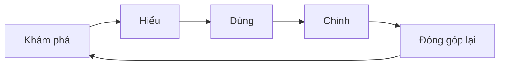

# Spec — Cá nhân hóa Planner và cộng đồng Planner

🇻🇳 English version: [specs-planner-personalization.md](specs-planner-personalization.md)

- **Trạng thái:** Đề xuất — một định hướng cần quyết định, chưa phải quyết định đã
  chấp nhận. Chưa có gì được xây. Mỗi lát trong [Các lát triển khai](#các-lát-triển-khai)
  cần ADR riêng trước khi viết code, theo
  [specs-roadmap.vi.md](specs-roadmap.vi.md#chưa-mở).
- **Bị thay thế một phần:** nửa Cộng đồng được mở rộng bởi
  [bộ spec Community Platform](specs-community-overview.vi.md); các lát P1–P3 và P6 là
  Phase 15 của [roadmap của nó](specs-community-roadmap.vi.md).
- **Ngày:** 2026-11-16
- **Chủ trì:** system-architect (thiết kế), chủ dự án (các quyết định trong
  [Câu hỏi còn mở](#câu-hỏi-còn-mở))

## Mục đích

Hai ý tưởng, một vòng lặp sản phẩm. **Cá nhân hóa** giúp Planner bắt đầu từ điều người
đi thích thay vì một biểu mẫu trống. **Cộng đồng** giúp người đi học từ chuyến đi thật
của nhau thay vì chỉ từ chuyến của Nhà Hưng. Vòng lặp: người đi nói mình đi theo kiểu
nào, thấy các chuyến và địa điểm hợp, sao chép một chuyến thành chuyến của mình, chỉnh
lại, và có thể chia sẻ lại kết quả.

Thương hiệu vẫn là trung tâm. Đây là một cặp đôi kể chuyện chuyến đi, không phải chợ:
không xếp hạng kiểu thi đua nổi tiếng, không có feed cố giữ người ta cuộn mãi.

## Hiện trạng

Các sự thật đọc từ repository ngày 2026-11-16, để thiết kế dựa trên chúng thay vì phát
minh lại.

| Khả năng | Trạng thái | Bằng chứng |
|---|---|---|
| Chuyến có `travelStyle`, `pace`, `partySize`, `budget` | Đã có, nhập theo từng chuyến, không được nhớ | `src/server/planner/schemas.ts` `tripCoreInputSchema` |
| Giá trị phong cách | `romantic`, `family`, `solo`, `friends`, `adventure`, `budget`, `foodie`, `relaxed` | `travelStyleSchema` trong `src/server/content/schemas.ts` |
| Giá trị nhịp độ | `relaxed`, `balanced`, `active` | `paceSchema`, cùng file |
| Hồ sơ người dùng | `displayName`, `handle`, thông tin đăng nhập, vai trò; **chưa có sở thích** | `plannerUserSchema` |
| Sao chép story hoặc template thành chuyến | Đã có | ADR [0005](adr/0005-trip-sharing-and-story-cloning.vi.md) |
| Nhân bản một chuyến | Đã có, chỉ cho chuyến **của chính chủ** | `PlannerRepository.duplicateTrip` gọi `requireOwnedTrip` |
| Link chia sẻ, màn xem chỉ đọc | Đã có | ADR 0005 |
| Thư viện chuyến cộng đồng | Đã có; nhân viên duyệt trước; mọi chỉnh sửa đều xếp hàng lại | ADR [0014](adr/0014-community-trips-and-reviews.vi.md) |
| Đánh giá địa điểm | Đã có; lên ngay; nhân viên có thể gỡ hoặc giữ lại | ADR 0014, [0015](adr/0015-community-review-author-controls.vi.md) |
| Cổng đóng góp | Mở: điều khoản và liên hệ gỡ bài đã được điền | `contributionOpen` trong `src/content/site.ts` |
| Bản đồ Planner, gợi ý AI | Chưa mở | [specs-roadmap.vi.md](specs-roadmap.vi.md#chưa-mở) |

Còn thiếu, mỗi thứ một dòng: Planner không nhớ người đi, thư viện không lọc được và
không khớp với ai, và chuyến cộng đồng đọc được nhưng không dùng được.

## Nguyên tắc

1. **Rõ ràng trước, suy đoán sau.** Sở thích người đi tự nhập thắng điều ta đoán. Chỗ
   nào suy đoán, ta nói lý do ("vì bạn chọn: foodie") và cho họ sửa.
2. **Luật, không phải mô hình.** Việc khớp là một hàm chấm điểm minh bạch trên vài
   trường. Gợi ý AI chưa mở; spec này không mở nó.
3. **Không theo dõi mới.** Không log click, không analytics bên thứ ba, không bảng hồ
   sơ hành vi. Tín hiệu ngầm được tính khi đọc, từ chính các chuyến của người đi.
4. **Mặc định riêng tư, công khai do chọn.** Sở thích không bao giờ nằm trong bất kỳ
   projection công khai nào. Đầu ra cộng đồng vẫn là danh sách cho phép, như ADR 0005
   và 0014.
5. **Cá nhân hóa không làm hỏng trang.** Không có hồ sơ thì Planner chạy y như hôm nay.
   Cá nhân hóa chỉ sắp xếp lại và điền sẵn, không bao giờ ẩn nội dung.
6. **Tin cậy trước khi mở rộng.** Mỗi tính năng cộng đồng có đường gỡ bài trước khi có
   đường tăng trưởng.

## Cá nhân hóa

### Sở thích người đi

Một đối tượng tùy chọn trên người dùng; vắng mặt nghĩa là "chưa có sở thích". Sửa ở
một trang tài khoản mới, chủ tài khoản đọc và xóa được bất kỳ lúc nào.

| Trường | Giá trị | Dùng cho |
|---|---|---|
| `styles` | tối đa 3 trong tám giá trị `travelStyle` | Xếp hạng, mặc định của chuyến |
| `pace` | ba giá trị `pace`, hoặc không | Mặc định của chuyến, xếp hạng |
| `typicalPartySize` | số nguyên 1–50, hoặc không | Mặc định của chuyến |
| `budgetBand` | `tight`, `comfortable`, `generous`, hoặc không | Xếp hạng, gợi ý ngân sách mặc định |
| `homeRegion` | một vùng của Việt Nam, hoặc không | Gợi ý di chuyển, "gần bạn" |
| `interests` | tối đa 5 thẻ từ danh sách cố định (ăn uống, biển, núi, văn hóa, đêm, chụp ảnh, …) | Xếp hạng |
| `interestInDestinations` | tối đa 10 giá trị `Destination.slug`, danh sách "muốn đi" | Xếp hạng, gợi ý ở trạng thái rỗng |

Danh sách thẻ sở thích là một enum cố định do chủ dự án và biên tập viên quản, không
phải văn bản tự do, để dịch và khớp được. `budgetBand` mang tính tương đối có chủ đích:
sản phẩm không giữ dữ liệu giá và không được bịa ra.

### Xuất hiện ở đâu

| Bề mặt | Thay đổi | Khi chưa có hồ sơ |
|---|---|---|
| Biểu mẫu tạo chuyến | Điền sẵn phong cách, nhịp độ, số người từ sở thích | Trống như hiện nay |
| `/trip-setup/[template]` | Cùng mặc định, thêm ghi chú khi phong cách của template khác người đi | Không đổi |
| Trạng thái rỗng của `/my-trips` | "Gợi ý cho bạn": tối đa 3 story hoặc template chấm theo sở thích | Story mới nhất |
| Thư viện cộng đồng | Tùy chọn sắp xếp "Hợp với bạn" và thẻ lý do hiện trên mỗi card | Mới nhất trước |
| Trang điểm đến và story | Một gợi ý nhỏ "hợp phong cách của bạn" khi đã đăng nhập và có styles | Không có gì |

Cá nhân hóa là **một cách sắp xếp và một gợi ý**, không bao giờ là bộ lọc mà người đi
không tắt được. Mọi danh sách cá nhân hóa đều có nút "Xem tất cả" hiển thị rõ.

### Khớp

Một hàm thuần, `scoreMatch(preferences, candidate) → { score, reasons[] }`, nằm trong
module server, có unit test như `budget.ts`. Đầu vào là các trường đã có trên story,
template và card chuyến cộng đồng (`travelStyle`, `pace`, `destinationSlug`,
`durationDays`, `partySize`). Trọng số nằm trong một bảng hằng duy nhất. `reasons` là
thứ UI hiển thị, nên lời giải thích chính là phép tính, không phải bản sao riêng có thể
lệch.

Tín hiệu ngầm (điểm đến của chính các chuyến người đi, các phong cách họ chọn nhiều
nhất) có thể cộng một khoản nhỏ. Chúng được suy ra lúc request từ các chuyến của chính
người đi và không bao giờ được lưu. Nếu quá yếu, việc lưu tín hiệu cần ADR riêng.

### Quyền riêng tư và kiểm soát

- Tự nguyện: biểu mẫu sở thích không bao giờ là cổng chặn và không bao giờ bắt buộc.
- Hiện ở một chỗ, xóa bằng một cú click; xóa đưa mọi bề mặt về hành vi khi chưa có hồ sơ.
- Không bao giờ được trả về bởi `GET /api/planner/session` (user tối thiểu, xem PR #105
  trên `main`), không nằm trong `SharedTripView`, không nằm trong `CommunityTripCard`.
- Xóa tài khoản hoặc xóa mềm (ADR [0017](adr/0017-super-admin-role.vi.md)) xóa nó cùng
  dòng user; không có bản sao thứ hai.
- Đây là dữ liệu cá nhân: tuyên bố riêng tư mà chủ dự án cung cấp cho người đóng góp
  cũng phải bao phủ nó.

## Cộng đồng

### Điểm muốn tới

| Bước | Hôm nay | Tiếp theo |
|---|---|---|
| Khám phá | Chuyến đã duyệt mới nhất, không bộ lọc | Lọc theo điểm đến, số ngày, phong cách, số người; tùy chọn sắp xếp "Hợp với bạn" |
| Hiểu | Màn chia sẻ với vượt ngân sách dự kiến | Dòng "dựa trên", số đánh giá của các địa điểm trong chuyến |
| Dùng | Không thể với chuyến của người khác | **Dùng chuyến này**: sao chép thành bản nháp riêng của người đi |
| Chỉnh | Trình soạn chuyến trên bản sao | Giống vậy; bản sao nhớ nó từ đâu tới |
| Đóng góp lại | Xin đăng, viết đánh giá địa điểm | Có thể đăng chuyến đã chỉnh; ghi công chuyến nguồn |

### Dùng chuyến này

Khả năng mới trung tâm. Người đi đã đăng nhập sao chép một chuyến **đã duyệt và đã đăng**
vào tài khoản của mình.

- Dùng lại logic nhân bản dòng của `duplicateTrip`, nhưng nguồn được đọc qua projection
  danh sách cho phép, không phải qua owner id. Bản sao mang **cấu trúc và tham chiếu địa
  điểm**, không mang ghi chú tự do của tác giả, số tiền chi riêng tư hay share token.
  Trường nào được đi theo là một danh sách cho phép có test, như ADR 0005.
- Bản sao là bản nháp riêng thuộc về người đi mới. Nó chỉ lưu
  `origin: { shareToken, authorDisplay }` khi tác giả nguồn chọn hiện tên; với tác giả
  ẩn danh thì không lưu tác giả nào.
- **Ghi công là quy tắc, không phải phép lịch sự.** Bản sao sau này được đăng vẫn giữ
  dòng "chỉnh từ" hiển thị, trừ khi nguồn đã bị rút. Rút nguồn không bao giờ xóa bản
  sao; nó chỉ gỡ liên kết của dòng đó.
- Việc sao chép bị giới hạn tốc độ theo người dùng và tác giả nguồn không được báo ai
  đã sao chép (chưa có thông báo ở lát này).

### Khám phá

Lọc phía server trên `GET /api/community/trips` có sẵn, với query theo danh sách cho
phép (`destination`, `durationMax`, `style`, `partySize`, `sort`). Không tìm kiếm văn
bản tự do ở lát này: văn bản tự do trên tiêu đề do người đi viết mời gọi lạm dụng và
cần cân nhắc kiểm duyệt riêng.

### Hồ sơ người đi (công khai, tự nguyện)

Một trang công khai nhỏ cho mỗi người đi chọn có nó, ở một URL theo handle. Nó hiện
tên hiển thị, các chuyến đã duyệt và đã đăng cùng các đánh giá đã duyệt, không gì khác.
Mặc định tắt. Chuyến và đánh giá ẩn danh không bao giờ hiện ở đó, và tắt hồ sơ không
đổi trạng thái đăng của các chuyến. Thêm nó làm lộ `handle` công khai, nên cần quyết
định xem handle đã được coi là công khai chưa (ADR 0018).

### Lưu và phản hồi nhẹ

- **Lưu** một chuyến cộng đồng hoặc một địa điểm vào danh sách riêng. Nuôi tín hiệu
  "muốn đi". Không ai khác thấy.
- **Hữu ích** trên một đánh giá: một con số, không có đánh giá xuống, không xếp hạng
  theo nó. Phản hồi là con số công khai mới duy nhất, nên hoãn tới lát cuối và cần chủ
  dự án đồng ý.
- Rõ ràng không dự kiến: bình luận, trả lời, theo dõi, tin nhắn riêng, tải ảnh, bảng
  xếp hạng. Mỗi thứ kéo theo chi phí kiểm duyệt và lạm dụng mà quy mô hiện tại chưa
  xứng (ADR 0014 đã liệt kê trả lời, thích và ảnh là các quyết định riêng).

### Tin cậy và an toàn

| Nhu cầu | Thiết kế |
|---|---|
| Người đọc báo vấn đề được | Một nút **Báo cáo** trên chuyến và đánh giá, giới hạn tốc độ, lý do chọn từ danh sách cố định, đổ vào hàng đợi kiểm duyệt có sẵn và `community:moderate`. Bắt buộc có trước khi "Dùng chuyến này" ra mắt. |
| Gỡ bài | Có sẵn: nhân viên duyệt, từ chối, giữ lại, gỡ. Bản sao không bao giờ tự bị gỡ. |
| Người dùng lạm dụng | `ReviewRestriction` có sẵn (ADR 0015) mở rộng sang đăng và sao chép. |
| Cày bản sao | Giới hạn bản sao mỗi ngày theo người dùng; không sao chép được từ chính các bản sao của tác giả. |
| Tải của nhân viên | Lượng báo cáo là tín hiệu để thêm vai trò `moderator` (ADR 0006); chưa xây ở đây. |

## Hai phần liên kết thế nào

| Sự thật cộng đồng | Dùng cho cá nhân hóa | Rào chắn |
|---|---|---|
| `travelStyle`, `pace`, `destinationSlug` của chuyến đã đăng | Chấm theo sở thích cho sắp xếp "Hợp với bạn" | Chỉ các trường đã có trong `CommunityTripCard` |
| Số đánh giá mỗi địa điểm | Gợi ý "được N người đi đánh giá" | Ẩn dưới 3, như ADR 0014 |
| Bản sao của một chuyến đã đăng | Tính như tín hiệu nhẹ về phong cách/điểm đến của người sao chép | Tính khi đọc từ các chuyến của chính họ |
| Chuyến đã đăng của chính người đi | Không bao giờ được đọc để cá nhân hóa góc nhìn của người khác | Không dựng hồ sơ chéo giữa người dùng |

**Không có lọc cộng tác** ("người giống bạn cũng…"). Nó cần dữ liệu hành vi của người
khác và là bước biến việc này thành theo dõi.

## Thay đổi dữ liệu và API

Mọi thứ đều cộng thêm và tùy chọn, nên kho ghi trước đó vẫn nạp không đổi (quy tắc của
ADR 0007).

| Thay đổi | Ở đâu | Ghi chú |
|---|---|---|
| `PlannerUser.preferences` | Kho Planner; cột JSONB nullable ở PostgreSQL | Vắng = không có. Bị loại khỏi mọi projection công khai. |
| `Trip.origin` | Kho Planner; JSONB nullable trên `trips` | `null` cho chuyến không sao chép từ cộng đồng. |
| `SavedItem` | Thực thể / bảng mới ở kho Planner, `userId`, `kind` (`trip`/`place`), `ref`, `createdAt` | Không khóa ngoại, ADR 0013. Riêng tư. |
| `ContentReport` | Thực thể / bảng mới: `targetKind`, `targetId`, `reason`, `reporterId` hoặc client key, `status` | Đổ vào hàng đợi kiểm duyệt. |
| `PATCH /api/planner/me/preferences`, `DELETE` cùng đường dẫn | API Planner | `If-Match` như các ghi khác. |
| `POST /api/community/trips/[token]/use` | API cộng đồng, cần đăng nhập | Trả về `TripView` mới. |
| `GET /api/community/trips?…` | Route có sẵn, query theo danh sách cho phép | Tương thích ngược. |
| `POST /api/community/reports` | API cộng đồng | Giới hạn tốc độ; cùng envelope lỗi. |
| `PUT/DELETE /api/planner/saved` | API Planner | Danh sách riêng. |
| Migration mới | `db/migrations/0010+` (`0009` đã dùng) | Kèm import/export và test cả hai kho, như ADR 0014 yêu cầu. |
| Trang mới | Sở thích tài khoản, hồ sơ người đi công khai, danh sách đã lưu | Route thêm vào `pathnames` ở cả hai locale. |

Mọi chuỗi mới tồn tại ở cả VI và EN; route mới chỉ vào sitemap khi công khai.

## Các lát triển khai

Mỗi lát là một branch, một ADR và một tài liệu tính năng riêng. Thứ tự theo giá trị và
rủi ro:

| Lát | Nội dung | Cần ADR | Phụ thuộc |
|---|---|---|---|
| P1 | Đối tượng sở thích, trang tài khoản, mặc định cho biểu mẫu chuyến | Có | Không |
| P2 | `scoreMatch`, "Gợi ý cho bạn", sắp xếp "Hợp với bạn" và thẻ lý do | Có (luật khớp) | P1 |
| P3 | Bộ lọc thư viện trên `GET /api/community/trips` | Nhỏ; đi kèm ADR của P2 được | Không |
| P4 | Nút báo cáo và mở rộng hàng đợi kiểm duyệt | Có (tin cậy và an toàn) | Cổng đóng góp mở |
| P5 | **Dùng chuyến này** kèm ghi công | Có (danh sách cho phép khi sao chép, quy tắc ghi công) | P4 |
| P6 | Mục đã lưu và tín hiệu "muốn đi" | Có | P1 |
| P7 | Hồ sơ người đi công khai, phản hồi hữu ích | Có, mỗi cái một ADR | P4, P5 |

P1–P3 chỉ chạm dữ liệu của chính người đi và các chuyến đã duyệt, nên xây độc lập được (Phase 15 trong roadmap). Từ P4 trở đi thêm đường ghi công khai và nên chờ Phase 10 (điều khiển Báo cáo, audit log) cùng công tắc sao chép theo từng chuyến khớp Điều 3 của Terms.

## Hướng nghiệm thu

Không phải kế hoạch test, mà là điều mỗi lát phải chứng minh được:

- Không có hồ sơ → mọi trang giống hệt hôm nay (snapshot đường không có sở thích).
- Sở thích không bao giờ xuất hiện trong phản hồi session, chia sẻ, thư viện hay hồ sơ
  (test liệt kê danh sách cho phép cho từng projection, như ADR 0005 và 0014).
- `scoreMatch` tất định và `reasons` đúng bằng các số hạng tạo ra điểm.
- Chuyến sao chép không chứa trường nào ngoài danh sách cho phép; nguồn ẩn danh không
  lộ tác giả.
- Rút hoặc từ chối nguồn không ảnh hưởng bản sao.
- Xóa tài khoản xóa sở thích, mục đã lưu và hồ sơ công khai.
- Khả năng truy cập: mọi điều khiển mới là button hoặc link thật, vùng chạm ≥44px, lối
  thoát "Xem tất cả" dùng được bằng bàn phím.

## Câu hỏi còn mở

Cần chủ dự án trả lời trước ADR đầu tiên. Đáp án khuyến nghị được ghi sẵn để có thể bắt
đầu theo đó nếu chủ dự án đồng ý.

| # | Câu hỏi | Khuyến nghị |
|---|---|---|
| 1 | Hỏi sở thích lúc đăng ký hay chỉ đề nghị về sau? | Đề nghị về sau, không bao giờ chặn |
| 2 | `handle` đã là định danh công khai chưa, hay hồ sơ công khai phải dùng slug riêng? | Xem ý định của ADR 0018; nếu không chắc, mặc định slug riêng tự nguyện |
| 3 | Có được sao chép chuyến của tác giả chọn ẩn danh không? | Có, không ghi công tác giả, vì ghi công sẽ lộ họ |
| 4 | "Dùng chuyến này" có được ra trước khi nhân viên có kênh báo cáo không? | Không; P4 trước P5 |
| 5 | Có cần số "hữu ích" trên đánh giá không? | Hoãn; quyết định sau khi P5 cho thấy lượng thật |
| 6 | Có báo tác giả rằng chuyến của họ được sao chép không? | Không ở lát này; xem lại cùng thông báo, vốn chưa có |
| 7 | Ai sở hữu danh sách thẻ sở thích cố định và bản dịch? | Chủ dự án và biên tập viên, sửa trong CMS ở lát sau |
| 8 | Gợi ý AI của Planner có thay cho việc khớp theo luật sau này không? | ADR riêng; giữ `scoreMatch` làm giao diện để mô hình có thể nằm sau nó |

## Ngoài phạm vi

- Gợi ý AI, lọc cộng tác, theo dõi hành vi hoặc analytics.
- Bình luận, trả lời, theo dõi, nhắn tin, tải ảnh, bảng xếp hạng.
- Vị trí trả phí hoặc quảng bá, chuyến tài trợ, link tiếp thị liên kết.
- Mọi dữ liệu giá hoặc đặt chỗ; `budgetBand` mang tính tương đối và sản phẩm không bịa giá.
- Bản đồ Planner, và nhà cung cấp danh tính bên ngoài.
- Vai trò `moderator` và nhật ký kiểm toán; cả hai vẫn nằm trong danh sách ở
  [specs-roadmap.vi.md](specs-roadmap.vi.md#chưa-mở).
