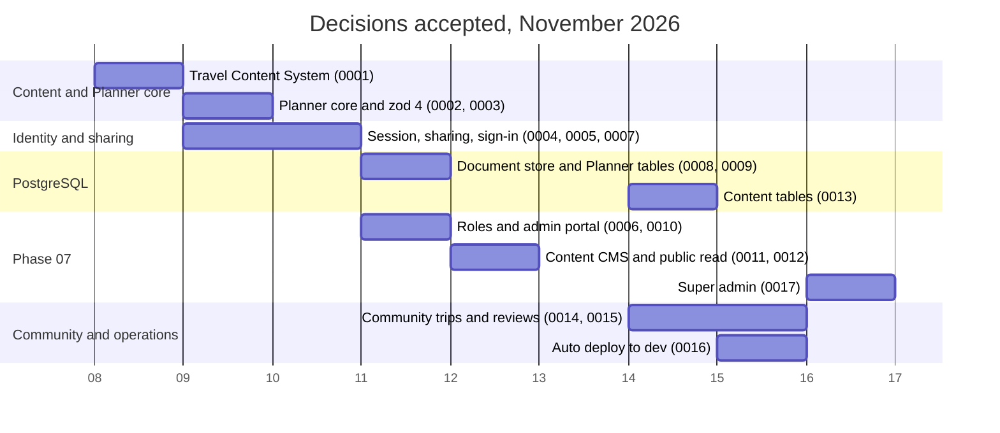

# Spec — project phases and roadmap

🇻🇳 Bản tiếng Việt: [specs-roadmap.vi.md](specs-roadmap.vi.md)

One page that answers "where is the project, what is done, what is next". It is a
reading guide built from the decisions already recorded in [adr/](adr/README.md) and
[architecture.md](architecture.md#phases); where the two disagree, those win. The
product side — who it serves and what it offers — is in
[specs-product.md](specs-product.md).

The themes below (T1–T9) are **themes in the order they landed**, grouped from the ADR dates.
Only "Phase 07" is a name the repository itself uses; the others are labels for
reading, not project-management gates. **A theme number is not a Phase ID:** T8 (community)
and T9 (deploy) are not Phase 08 (Media Library) or Phase 09 (Production Readiness) in
`.claude/roadmap/PHASES.md`. Community work continues as Phase 10 and later there.

## Status at a glance

| Theme | Subject | Status | Decided in | Detail |
|---|---|---|---|---|
| T1 | Public site: stories, destinations, map, itineraries, video reviews, design system, SEO, VI/EN routing | Shipped | none needed (see [architecture.md](architecture.md)) | [features/README.md](features/README.md) |
| T2 | Travel Content System API: typed entities behind a store interface | Shipped | [0001](adr/0001-travel-content-system.md) | [travel-content-api.md](travel-content-api.md) |
| T3 | Planner backend core: trips, days, activities, expenses, budget, template clone | Shipped | [0002](adr/0002-planner-core.md), [0003](adr/0003-zod-4.md) | [features/travel-planner-core.md](features/travel-planner-core.md) |
| T4 | Identity and sharing: session cookie, password and Google sign-in, share links, story cloning | Shipped | [0004](adr/0004-planner-identity.md), [0005](adr/0005-trip-sharing-and-story-cloning.md), [0007](adr/0007-password-and-google-sign-in.md) | [features/follow-hung-footsteps.md](features/follow-hung-footsteps.md) |
| T5 | Planner UI: My Trips, blank trip, trip editor, budget overrun on shared trips | Partly open | [0005](adr/0005-trip-sharing-and-story-cloning.md) | [features/trip-editor.md](features/trip-editor.md) |
| T6 | PostgreSQL persistence for both stores | Shipped | [0008](adr/0008-postgres-document-store.md), [0009](adr/0009-postgres-persistence.md), [0013](adr/0013-content-on-postgres-tables.md) | [features/planner-postgres-persistence.md](features/planner-postgres-persistence.md) |
| T7 | **Phase 07** — Admin portal, CMS and roles | In progress | [0006](adr/0006-unified-identity-and-roles.md), [0010](adr/0010-admin-portal-session-authorization.md), [0011](adr/0011-admin-content-cms.md), [0012](adr/0012-public-travel-from-content-repository.md), [0017](adr/0017-super-admin-role.md) | [features/admin-portal.md](features/admin-portal.md) |
| T8 | Community trips and reviews with moderation | Shipped (two ADR slices each) | [0014](adr/0014-community-trips-and-reviews.md), [0015](adr/0015-community-review-author-controls.md) | [features/community-trips.md](features/community-trips.md) |
| T9 | Deploy and operations: Docker on one VM, auto deploy, runbooks | Runs on the dev VM (5 green deploys, rollback exercised, 2026-11-15); production not started | [0016](adr/0016-auto-deploy-dev.md) | [deploy-runbook.md](deploy-runbook.md) |

"Shipped" means merged to `main` with its feature document. It does not mean the
owner's real data is in place — see the last section.

## Timeline

Dates are the ADR dates, which are the dates a decision was accepted, not release
dates.

## Stage notes

### Themes T1–T3: the base

The public site is server-rendered, bilingual and token-styled; Vietnamese is the
default, unprefixed locale. Travel Content and the Planner each have an API with their
own credentials and the same error envelope. Tour URLs are permanent redirects into
the itinerary routes.

### Themes T4–T5: from API to something a traveller uses

Sign-in is self-managed (operator token, email and password, or Google through
hand-written OIDC with PKCE) and always ends in the same `HttpOnly` session cookie.
A traveller can clone a story into a trip, edit it on `/my-trips/[id]`, and share it
through a read-only link. `/plan-your-trip` is **still the contact-only page**; wiring
it to the Planner API has not started.

### Theme T6: PostgreSQL

Both stores run on PostgreSQL when `PLANNER_DATABASE_URL` and `CONTENT_DATABASE_URL`
are set and fall back to a JSON file for local development when they are not. There
is deliberately no fallback from a configured database to JSON.

### Theme T7: Phase 07, in progress

Roles are `member`, `editor`, `admin` and `super_admin` on one user model, checked by
a pure `can()` function. The browser admin portal manages users, edits stories,
places and reviews, and moderates community content. Published CMS edits appear on
the public site on the next request.

### Themes T8–T9: community and operations

Community trips and reviews are opt-in and staff-moderated. The auto-deploy pipeline
(a green `main` builds an image, a self-hosted runner on the VM deploys it) is
has run end to end on the dev VM (deploy test report 2026-11-15: five green deploys, a rollback and a redeploy). Backups are still missing and there is no production environment.

## Not open yet

Each item needs its own ADR before any scaffolding. This list mirrors
[architecture.md](architecture.md#phases).

| Item | Why it waits |
|---|---|
| Planner map and AI suggestions | Deferred by the brief that opened the Planner phase |
| Hosted identity provider or Auth.js | Sign-in is self-managed by decision ([0004](adr/0004-planner-identity.md), [0007](adr/0007-password-and-google-sign-in.md)) |
| Self-service password reset, password sign-up, MFA | No email sender; MFA for `admin` is still open |
| Audit log | Who changed which template or role; not designed |
| Shared rate-limit store | The limiter is per process; it will not hold across several instances |
| Foreign keys between content entities | Needs a "still referenced" rule first |
| Create and delete in the CMS, template editing | Still token-only; versioning of templates undecided |
| Clickable video cards | No per-video URLs held |
| Real photography | Covers are generated SVG until the owner supplies photos |

## What still needs the owner

- Real handles, phone numbers and booking emails wherever seed content uses a
  stand-in; these are flagged in the feature documents, not hidden.
- Backups on the dev VM (none yet), per the deploy test report behind [ADR 0016](adr/0016-auto-deploy-dev.md).
- Nothing open from [ADR 0015](adr/0015-community-review-author-controls.md): the owner confirmed the recommended answers on 2026-11-16.
