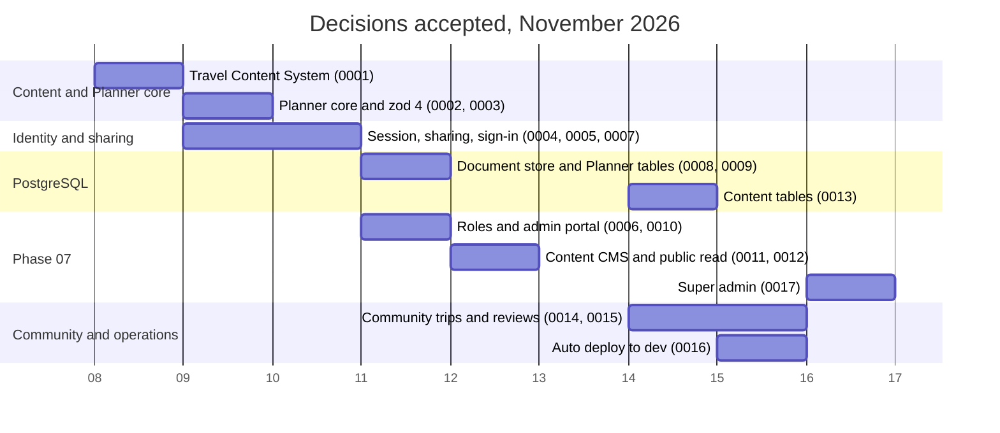

# Spec — các giai đoạn và lộ trình của dự án

🇻🇳 English version: [specs-roadmap.md](specs-roadmap.md)

Một trang trả lời "dự án đang ở đâu, đã xong gì, tiếp theo là gì". Trang này là bản đọc nhanh, dựng từ các quyết định đã ghi trong [adr/](adr/README.vi.md) và [architecture.vi.md](architecture.vi.md#các-phase); nếu có chỗ lệch thì các tài liệu đó là chuẩn. Phần sản phẩm — phục vụ ai, cung cấp gì — nằm ở [specs-product.vi.md](specs-product.vi.md).

Các chủ đề dưới đây (T1–T9) là **các chủ đề theo thứ tự chúng được hoàn thành**, gom theo ngày của ADR. Chỉ "Phase 07" là tên do chính repository dùng; các nhãn còn lại chỉ để đọc cho dễ, không phải cổng quản lý dự án. **Số chủ đề không phải Phase ID:** T8 (cộng đồng) và T9 (deploy) không phải Phase 08 (Media Library) hay Phase 09 (Production Readiness) trong `.claude/roadmap/PHASES.md`. Phần cộng đồng tiếp tục ở đó thành Phase 10 trở đi.

## Trạng thái nhanh

| Chủ đề | Nội dung | Trạng thái | Quyết định tại | Chi tiết |
|---|---|---|---|---|
| T1 | Site công khai: chuyện đi chơi, điểm đến, bản đồ, lịch trình, review video, design system, SEO, định tuyến VI/EN | Đã xong | không cần (xem [architecture.vi.md](architecture.vi.md)) | [features/README.vi.md](features/README.vi.md) |
| T2 | API Travel Content System: thực thể có kiểu sau một giao diện store | Đã xong | [0001](adr/0001-travel-content-system.vi.md) | [travel-content-api.vi.md](travel-content-api.vi.md) |
| T3 | Lõi backend của Planner: chuyến đi, ngày, hoạt động, chi phí, ngân sách, nhân bản template | Đã xong | [0002](adr/0002-planner-core.vi.md), [0003](adr/0003-zod-4.vi.md) | [features/travel-planner-core.vi.md](features/travel-planner-core.vi.md) |
| T4 | Danh tính và chia sẻ: cookie phiên, đăng nhập mật khẩu và Google, link chia sẻ, nhân bản chuyện đi | Đã xong | [0004](adr/0004-planner-identity.vi.md), [0005](adr/0005-trip-sharing-and-story-cloning.vi.md), [0007](adr/0007-password-and-google-sign-in.vi.md) | [features/follow-hung-footsteps.vi.md](features/follow-hung-footsteps.vi.md) |
| T5 | Giao diện Planner: Chuyến đi của tôi, chuyến đi trống, trình sửa chuyến đi, vượt ngân sách ở trang chia sẻ | Mở một phần | [0005](adr/0005-trip-sharing-and-story-cloning.vi.md) | [features/trip-editor.vi.md](features/trip-editor.vi.md) |
| T6 | Lưu trữ PostgreSQL cho cả hai store | Đã xong | [0008](adr/0008-postgres-document-store.vi.md), [0009](adr/0009-postgres-persistence.vi.md), [0013](adr/0013-content-on-postgres-tables.vi.md) | [features/planner-postgres-persistence.vi.md](features/planner-postgres-persistence.vi.md) |
| T7 | **Phase 07** — cổng quản trị, CMS và vai trò | Đang làm | [0006](adr/0006-unified-identity-and-roles.vi.md), [0010](adr/0010-admin-portal-session-authorization.vi.md), [0011](adr/0011-admin-content-cms.vi.md), [0012](adr/0012-public-travel-from-content-repository.vi.md), [0017](adr/0017-super-admin-role.vi.md) | [features/admin-portal.vi.md](features/admin-portal.vi.md) |
| T8 | Chuyến đi và đánh giá cộng đồng có kiểm duyệt | Đã xong (mỗi mảng hai lát ADR) | [0014](adr/0014-community-trips-and-reviews.vi.md), [0015](adr/0015-community-review-author-controls.vi.md) | [features/community-trips.vi.md](features/community-trips.vi.md) |
| T9 | Triển khai và vận hành: Docker trên một VM, tự động deploy, runbook | Chạy trên VM dev (5 lần deploy xanh, đã thử rollback, 2026-11-15); production chưa bắt đầu | [0016](adr/0016-auto-deploy-dev.vi.md) | [deploy-runbook.vi.md](deploy-runbook.vi.md) |

"Đã xong" nghĩa là đã merge vào `main` kèm tài liệu tính năng. Không có nghĩa là dữ liệu thật của chủ dự án đã được điền — xem phần cuối.

## Dòng thời gian

Ngày là ngày của ADR, tức ngày quyết định được chấp nhận, không phải ngày phát hành.

## Ghi chú từng giai đoạn

### Chủ đề T1–T3: nền tảng

Site công khai render phía server, song ngữ, dùng design token; tiếng Việt là locale mặc định, không có tiền tố. Travel Content và Planner mỗi bên có API với thông tin xác thực riêng và cùng một dạng phong bì lỗi. URL tour là redirect vĩnh viễn sang các route lịch trình.

### Chủ đề T4–T5: từ API đến thứ người dùng dùng được

Đăng nhập do app tự quản (token của vận hành viên, email và mật khẩu, hoặc Google qua OIDC + PKCE tự viết) và luôn kết thúc bằng cùng một cookie phiên `HttpOnly`. Người dùng có thể nhân bản một chuyện đi thành chuyến đi, sửa ở `/my-trips/[id]` và chia sẻ qua link chỉ đọc. `/plan-your-trip` **vẫn là trang chỉ có liên hệ**; chưa bắt đầu nối nó với API Planner.

### Chủ đề T6: PostgreSQL

Cả hai store chạy trên PostgreSQL khi đặt `PLANNER_DATABASE_URL` và `CONTENT_DATABASE_URL`, và quay về file JSON để phát triển cục bộ khi không đặt. Cố ý không có đường lùi từ database đã cấu hình về JSON.

### Chủ đề T7: Phase 07, đang làm

Vai trò là `member`, `editor`, `admin` và `super_admin` trên một mô hình người dùng, kiểm bằng hàm thuần `can()`. Cổng quản trị trong trình duyệt quản lý người dùng, sửa chuyện đi, địa điểm và đánh giá, và kiểm duyệt nội dung cộng đồng. Chỉnh sửa CMS đã xuất bản hiện lên site công khai ở request kế tiếp.

### Chủ đề T8–T9: cộng đồng và vận hành

Chuyến đi và đánh giá cộng đồng là tự nguyện tham gia và do nhân sự kiểm duyệt. Pipeline tự động deploy (`main` xanh build image, runner tự host trên VM triển khai nó) đã chạy trọn vẹn trên VM dev (báo cáo kiểm thử deploy 2026-11-15: năm lần deploy xanh, một lần rollback và một lần deploy lại). Vẫn chưa có sao lưu và chưa có môi trường production.

## Chưa mở

Mỗi mục cần ADR riêng trước khi dựng bất cứ thứ gì. Danh sách này phản chiếu [architecture.vi.md](architecture.vi.md#các-phase).

| Mục | Vì sao chờ |
|---|---|
| Bản đồ Planner và gợi ý AI | Brief mở giai đoạn Planner cố ý hoãn |
| Nhà cung cấp danh tính ngoài hoặc Auth.js | Đăng nhập do app tự quản theo quyết định ([0004](adr/0004-planner-identity.vi.md), [0007](adr/0007-password-and-google-sign-in.vi.md)) |
| Tự đặt lại mật khẩu, đăng ký bằng mật khẩu, MFA | Chưa có dịch vụ gửi email; MFA cho `admin` vẫn mở |
| Nhật ký kiểm toán | Ai đổi template hay vai trò nào; chưa thiết kế |
| Store giới hạn tốc độ dùng chung | Bộ giới hạn chạy theo từng tiến trình; không đứng vững khi có nhiều instance |
| Khóa ngoại giữa các thực thể nội dung | Cần quy tắc "còn được tham chiếu" trước |
| Tạo và xóa trong CMS, sửa template | Vẫn chỉ qua token; chưa quyết định việc lưu phiên bản template |
| Thẻ video bấm được | Chưa có URL cho từng video |
| Ảnh chụp thật | Ảnh bìa là SVG sinh ra cho đến khi chủ dự án cung cấp ảnh |

## Việc còn cần chủ dự án

- Handle, số điện thoại và email đặt chỗ thật ở mọi nơi seed đang dùng giá trị tạm; các chỗ này được đánh dấu trong tài liệu tính năng, không bị giấu đi.
- Sao lưu trên VM dev (hiện chưa có), theo báo cáo kiểm thử deploy làm cơ sở cho [ADR 0016](adr/0016-auto-deploy-dev.vi.md).
- [ADR 0015](adr/0015-community-review-author-controls.vi.md) không còn câu hỏi mở: chủ dự án đã xác nhận các đáp án khuyến nghị ngày 2026-11-16.
