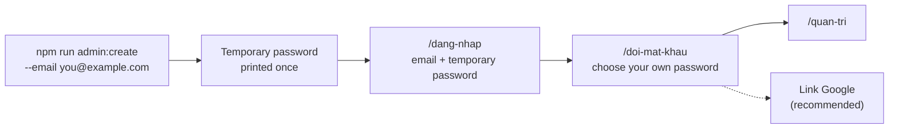

# Usage — Chuyện Nhà Hưng

🇻🇳 Bản tiếng Việt: [usage.vi.md](usage.vi.md)

How to run, verify and extend the app. For *what it is made of*, read
[architecture.md](architecture.md).

## Requirements

- **Node 24 LTS**, pinned in `.nvmrc` (`24.22.2`) — run `nvm use` in the repo. CI
  reads the same file, so local and CI cannot drift apart. `engines.node` is
  `>=24`, and npm warns on anything older.
  The `magic-string` override that Node 20.14 needed is gone. Vitest is still on
  3.x: Node 24 *allows* Vitest 4/5 now, but that upgrade has not been done.
- npm (the repo ships `package-lock.json`).
- Google Chrome at the default macOS path, only for `npm run verify:ui`.

## Install and run

```bash
npm install
npm run dev          # http://localhost:3000
```

Vietnamese is at `/`, English at `/en`. The site renders with no `.env` at all;
every variable below has a working default or disables a feature by failing
closed.

| Variable | Default | What it does |
|---|---|---|
| `NEXT_PUBLIC_SITE_URL` | `https://chuyennhahung.vn` | Canonicals, `hreflang`, sitemap. Must be set at **build** time |
| `ADMIN_API_TOKEN` | *unset* | Guards every admin route. Unset, or shorter than 32 chars, and they all answer `503` — never an open default |
| `TRAVEL_CONTENT_STORE` | `.data/travel-content.json` | Where the content store lives. Ignored when `CONTENT_DATABASE_URL` is set |
| `CONTENT_DATABASE_URL` | *unset* | PostgreSQL connection string for Travel Content. Set: the content store uses PostgreSQL and never falls back to the file ([ADR 0013](adr/0013-content-on-postgres-tables.md)). May be the Planner's database or its own. A secret — environment only. See *Run Travel Content on PostgreSQL* |
| `TRAVEL_CONTENT_AUTOSEED` | `true` | Set `false` to skip seeding demo content on first use. In production with PostgreSQL, import your real content and set `false` |
| `PUBLIC_CONTENT_SOURCE` | `repository` | Read on every call (a restart, not a rebuild). `repository`: public Travel content comes from the content store; `static`: from `src/content/stories.ts` (rollback). Any other value means `repository`. Applies to the home page, `/stories`, story pages, destination pages and the sitemap ([ADR 0012](adr/0012-public-travel-from-content-repository.md)) |
| `PLANNER_STORE` | `.data/planner.json` | Where Planner trips live. Separate file from the content store by design. Ignored when `PLANNER_DATABASE_URL` is set |
| `PLANNER_DATABASE_URL` | *unset* | PostgreSQL connection string. Set: the Planner uses PostgreSQL and never falls back to the file ([ADR 0009](adr/0009-postgres-persistence.md)). A secret — environment only. See *Run the Planner on PostgreSQL* |
| `DATABASE_POOL_MAX` | `5` | Size of the per-process connection pool |
| `TEST_DATABASE_URL` | *unset* | A scratch database for `tests/planner-postgres.integration.test.ts`. Unset: those tests are skipped |
| `GOOGLE_CLIENT_ID` / `GOOGLE_CLIENT_SECRET` | *unset* | Google sign-in ([ADR 0007](adr/0007-password-and-google-sign-in.md)). Both required; without them the Google routes answer 404 and the button is hidden. Server-only — never `NEXT_PUBLIC_*` |
| `GOOGLE_SIGNUP_ENABLED` | `true` | `false` stops a first Google sign-in from creating an account; existing accounts still sign in |
| `GOOGLE_REDIRECT_URI` | *derived* | Override for the callback URL; otherwise `NEXT_PUBLIC_SITE_URL` (or the request origin) + `/api/planner/oauth/google/callback`. Must match Google Cloud Console exactly |
| `TRUST_PROXY_HEADERS` | *unset* | `true` only behind a reverse proxy that **overwrites** `X-Forwarded-Proto` and `X-Forwarded-For` (see *Deploy*). Lets the session and OAuth cookies take `Secure` from `X-Forwarded-Proto`, and makes the same-origin check on sign-in accept the host in `X-Forwarded-Host` too, so a site reachable by an IP and a name signs in on both |

`.data/` is gitignored. Nothing in it is seeded for the Planner — see
*Provision a Planner traveller* below.

One more step per clone, which git cannot do for you — turn on the tracked git
hooks that keep commits off `main`:

```bash
git config core.hooksPath .githooks
```

`pre-commit` refuses a commit while you are on `main`, and `pre-push` refuses a
push that would move `main`; both point you at the branch-and-PR route instead.
Override deliberately with `--no-verify` if you ever really mean it.

## Commands

| Command | What it does |
|---|---|
| `npm run dev` | Dev server with Turbopack |
| `npm run build` | Production build — prerenders 42 pages; story, destination, home and sitemap routes render per request |
| `npm start` | Serves the production build |
| `npm run typecheck` | `tsc --noEmit` |
| `npm run lint` | ESLint, flat config |
| `npm run test` | Vitest, run-once |
| `npm run db:migrate` | Applies `db/migrations/*.sql` to `PLANNER_DATABASE_URL` and to `CONTENT_DATABASE_URL` (each one that is set); idempotent. Optional: the app runs the same code at startup |
| `npm run content:import -- <file>` | Loads a `travel-content.json` into empty PostgreSQL content tables, validated, in one transaction |
| `npm run content:export -- <file>` | Writes the PostgreSQL content out as a `travel-content.json` (backup and rollback) |
| `npm run planner:import -- <file>` | Loads a `planner.json` into an empty PostgreSQL Planner, validated, in one transaction |
| `npm run planner:export -- <file>` | Writes the PostgreSQL Planner out as a `planner.json` (backup and rollback) |
| `npm run verify:ui` | Screenshots 13 routes at 375/768/1440 into `screenshots/`, fails on horizontal overflow |
| `npm run covers` | Regenerates the SVG cover artwork into `public/images/covers/` |

`verify:ui` needs a dev or production server already running, and takes an
optional base URL and output directory:
`node scripts/screenshots.mjs http://localhost:3000 out/shots`.

## Definition of done

Every change ends with these three, and with their **real output stated**:

```bash
npm run typecheck && npm run lint && npm run test
```

A UI change adds a look at 375px, 768px and 1280px. If something failed or was
skipped, say so — a passing summary over a failing run is the one unrecoverable
mistake here.

`.github/workflows/ci.yml` runs the same three plus `npm run build` on every PR
into `main`. Treat it as a second opinion, not as a gate: these checks **cannot
be made required** while the repository is private on GitHub Free, because
branch protection and rulesets are unavailable there. A red run therefore does
not stop a merge — a human still has to look.

## Common tasks

### Add a content item

1. Append to the collection in `src/content/<collection>.ts`, filling `vi` **and**
   `en` on every `Localized<T>` field. `typecheck` catches a missing locale.
2. Keep the slug lowercase, hyphenated, unique — `tests/content.test.ts` enforces it.
3. Run `npm run covers` so the item gets cover art, or point `cover` at a real
   photograph in `public/images/`.
4. A destination also needs real WGS84 `coords`; the map projects them and a
   wrong value puts a truthful-looking pin in the wrong place.

### Accounts and passwords at a glance

Read this first if you are unsure how to sign in, or you lost access.

**Who signs in, and with what**

| Role | Can do | Signs in with |
|---|---|---|
| `member` | Their own Planner trips | Email + password, or Google |
| `editor` | Travel content and community moderation at `/quan-tri` | Email + password, or Google |
| `admin` | Content, community moderation (including restricting people) **and** users at `/quan-tri`; manages `member` and `editor` accounts only | Email + password, or Google |
| `super_admin` | Everything an `admin` does, plus the Runbook tab and management of `admin` accounts | Email + password, or Google |

An account is a `member` unless it was created with another role (`admin:create` makes an `admin` unless `--role` says otherwise). An admin (in `/quan-tri`) or the service token can make someone `member` or `editor`. Only a super admin (or the service token) can make an `admin` or `super_admin`, or reset an admin's password, and only a super admin opens the Runbook tab ([ADR 0017](adr/0017-super-admin-role.md)); promote the first one with `PATCH /api/admin/planner/users/<id>` and `{"role":"super_admin"}` using the admin token. In `/quan-tri` an account (member, editor, admin) can be banned (sessions end at once, sign-in refused, undone by *Unban*), soft-deleted (blocked and marked, undone by *Restore*) or deleted permanently, which only works on an already soft-deleted account (one that holds trips or reviews needs a super admin who types its handle; the *Deleted* tab lists them); you cannot do this to yourself, and an admin only reaches members and editors. Google never grants a role.

**The secrets, and what to do if one is lost**

| Secret | What it is | Where it lives | Lost it? |
|---|---|---|---|
| Your password | What you type at `/dang-nhap` | Only a hash in the store; nobody can read it back | Get a new temporary one — see the table below |
| Temporary password | Printed **once** by `admin:create`, by *Create user* or by *Reset password* | Only on your screen, until you change it | Ask for another reset |
| Google link | Signs you in with your Google account, no password | Set by you on `/doi-mat-khau` | Sign in with your password and link again |
| Service token `ADMIN_API_TOKEN` | An operator key for `curl`, **not** an account | `.env.local` (dev) or the server `.env` | Set a new value and restart the app — nothing else depends on it |
| Planner access token | A traveller's key for the API | Shown once on creation | `rotate-token` issues a new one |

**The first admin, from nothing to the portal**



Link Google as soon as you are in: it gives you a second way back if you forget the password.

**Lost access — what to do**

| Situation | Do this |
|---|---|
| Your Google account is linked | Sign in with Google; nothing else is needed |
| You forgot the password and **another admin** exists | They open `/quan-tri` → *Reset password* on your row and give you the new temporary password. An admin cannot reset their own |
| You forgot the password, you are the **only admin**, the app is running | Reset it with the service token (below) |
| No other admin, and the token is unknown or the app is down | Make a second admin with `npm run admin:create -- --email <another email>`, sign in with it, then reset the old account from `/quan-tri` |
| `admin:create` says *an account with that email or handle already exists* | That email already has an account: use one of the rows above, or `admin:create` with another email |
| You sign in but `/quan-tri` answers 404 | The account is not `admin` or `editor`; an admin changes its role |
| You sign in but the Runbook tab is missing or 404 | Only `super_admin` sees it ([ADR 0017](adr/0017-super-admin-role.md)); the service token promotes you: `PATCH /api/admin/planner/users/<id>` with `{"role":"super_admin"}` |
| The only **super admin** forgot the password | An admin cannot reset a super admin. Reset it with the service token (the same one-line command below) |
| Every super admin is locked out or gone | Use the service token to promote another account to `super_admin`; the last super admin itself can never be demoted or deleted, so this only happens if the rows were edited by hand |

Reset with the service token, in one line. It reads the token from `.env.local`, finds the account by email and prints a new temporary password. Change the email, run it **from the folder the app runs from**, while the app is running:

```bash
cd <the folder the app runs from> && export ADMIN_API_TOKEN="$(grep '^ADMIN_API_TOKEN=' .env.local | cut -d= -f2- | sed -e "s/^[\"']//" -e "s/[\"']$//")" && USER_ID="$(curl -s http://localhost:3000/api/admin/planner/users -H "authorization: Bearer $ADMIN_API_TOKEN" | jq -r '.. | objects | select(.email? == "you@example.com") | .id' | head -1)" && echo "userId: ${USER_ID:-NOT FOUND}" && [ -n "$USER_ID" ] && curl -s -X POST "http://localhost:3000/api/admin/planner/users/$USER_ID/reset-password" -H "authorization: Bearer $ADMIN_API_TOKEN"
```

**Run account commands from the folder the app runs from.** Without `PLANNER_DATABASE_URL`, accounts live in `.data/planner.json` *relative to the current folder*, so a command run from another checkout (a git worktree, say) reads and writes a different set of accounts. With `PLANNER_DATABASE_URL` every folder sees the same database.

### Provision a Planner traveller

Staff accounts are provisioned by an operator; the access token is shown
**once** — if it is lost, rotate it; it cannot be read back. Customers can also
create their own account by signing in with Google (see below). Add an `email`
and the response also carries a `temporaryPassword`, shown once; the person signs
in at `/dang-nhap` with it and is sent to `/doi-mat-khau` to choose their own.

```bash
# 1. A real secret, at least 32 characters, or every admin route answers 503.
export ADMIN_API_TOKEN="$(openssl rand -base64 36)"

# 2. Create the traveller. Keep `accessToken` from the response.
curl -s -X POST http://localhost:3000/api/admin/planner/users \
  -H "authorization: Bearer $ADMIN_API_TOKEN" \
  -H 'content-type: application/json' \
  -d '{"handle":"hung-tran","displayName":"Hưng Trần"}'

# 3. That token — not the admin one — is what reaches their trips.
curl -s http://localhost:3000/api/planner -H "authorization: Bearer <accessToken>"
```

A browser does not use that token directly — it signs in once and gets an
`HttpOnly` cookie ([ADR 0004](adr/0004-planner-identity.md)). With curl, use a
cookie jar:

```bash
# Sign in. The cookie lands in the jar; it is never readable by JavaScript.
curl -s -c jar.txt -X POST http://localhost:3000/api/planner/session \
  -H 'content-type: application/json' \
  -d '{"accessToken":"<accessToken>"}'

# Reads need nothing more.
curl -s -b jar.txt http://localhost:3000/api/planner

# Mutations must state a same-origin Origin — that is the CSRF rule cookies
# oblige, and a cookie request without it is refused with 403.
curl -s -b jar.txt -X POST http://localhost:3000/api/planner \
  -H 'origin: http://localhost:3000' -H 'content-type: application/json' \
  -d '{"source":"blank","title":"Đà Lạt 3 ngày","destinationSlug":"da-lat","durationDays":3,"partySize":2,"budget":{"targetTotalVnd":5000000}}'

# Sign out.
curl -s -b jar.txt -X DELETE http://localhost:3000/api/planner/session \
  -H 'origin: http://localhost:3000'
```

A session lasts 14 days, or 7 days without use. `rotate-token` signs the
traveller out everywhere.

Roles ([ADR 0006](adr/0006-unified-identity-and-roles.md)): `role` is `member`
(default), `editor`, `admin` or `super_admin` ([ADR 0017](adr/0017-super-admin-role.md)). Roles are
enforced by `can` on every admin route and page ([ADR 0010](adr/0010-admin-portal-session-authorization.md),
[ADR 0011](adr/0011-admin-content-cms.md)): `admin` and `super_admin` use the whole portal at `/quan-tri`; an `editor` sees the content and community pages only. Promote the first admin with the admin token; the body is strict, so any key
other than `role` is refused with 422.

```bash
# Create someone directly as admin (optional `role` on POST).
curl -s -X POST http://localhost:3000/api/admin/planner/users \
  -H "authorization: Bearer $ADMIN_API_TOKEN" -H 'content-type: application/json' \
  -d '{"handle":"admin-hung","displayName":"Hưng","role":"admin"}'

# Or promote an existing user. Repeating it is safe; demotion is the same call.
curl -s -X PATCH http://localhost:3000/api/admin/planner/users/<userId> \
  -H "authorization: Bearer $ADMIN_API_TOKEN" -H 'content-type: application/json' \
  -d '{"role":"admin"}'
```

Password and Google ([ADR 0007](adr/0007-password-and-google-sign-in.md)):

```bash
# Create a staff account with an email: keep `temporaryPassword` (shown once).
curl -s -X POST http://localhost:3000/api/admin/planner/users \
  -H "authorization: Bearer $ADMIN_API_TOKEN" -H 'content-type: application/json' \
  -d '{"handle":"lan-nguyen","displayName":"Lan Nguyễn","email":"lan@example.com"}'

# Forgotten password: a new temporary one, and every session ends.
curl -s -X POST http://localhost:3000/api/admin/planner/users/<userId>/reset-password \
  -H "authorization: Bearer $ADMIN_API_TOKEN"

# Remove a Google link.
curl -s -X DELETE http://localhost:3000/api/admin/planner/users/<userId>/google \
  -H "authorization: Bearer $ADMIN_API_TOKEN"
```

To turn Google sign-in on, follow *Set up Google sign-in* below.

Mutating an existing trip needs the version from its `ETag`:

```bash
curl -s -X PATCH http://localhost:3000/api/planner/<id> \
  -H "authorization: Bearer <accessToken>" \
  -H 'if-match: "3"' -H 'content-type: application/json' \
  -d '{"partySize":4}'
```

Without `If-Match` the answer is 428; with a stale version, 412. See
[features/travel-planner-core.md](features/travel-planner-core.md) for the full
endpoint list.

### Sign in as admin

The portal is at `/quan-tri` (`/en/admin`). The simplest way to create the first admin is `admin:create`. It writes straight to the store the app uses — PostgreSQL when `PLANNER_DATABASE_URL` is set, else the JSON file — needs no `ADMIN_API_TOKEN` and no running server, and prints a random temporary password once:

```bash
npm run admin:create -- --email you@example.com --name "Hưng"            # optional: --handle admin-hung, --role member|editor|admin|super_admin (default admin)
```

The first `super_admin` can be made the same way (it is the only role that opens the Runbook tab, [ADR 0017](adr/0017-super-admin-role.md)):

```bash
npm run admin:create -- --email you@example.com --name "Hưng" --role super_admin
```

On the deployed stack, run it in the `tools` container with the same `-f` files as your layout, so it reaches the same database:

```bash
docker compose -f compose.yml -f compose.app.yml -f compose.app.external-db.yml run --rm tools \
  npm run admin:create -- --email you@example.com --name "Hưng"
```

Or, with the service token against a running server, keep the `temporaryPassword` from the response (shown once):

```bash
curl -s -X POST http://localhost:3000/api/admin/planner/users \
  -H "authorization: Bearer $ADMIN_API_TOKEN" -H 'content-type: application/json' \
  -d '{"handle":"admin-hung","displayName":"Hưng","email":"you@example.com","role":"admin"}'
```

1. Sign in at `/dang-nhap?returnTo=/quan-tri` with that email and the temporary password.
2. You are sent to `/doi-mat-khau`: set a new password.
3. Open `/quan-tri`. Admin sessions end after 2 h idle or 12 h absolute.

On the dev VM over plain HTTP on its IP: `NEXT_PUBLIC_SITE_URL` must be the exact `http://<ip>` origin and is baked at build time, or admin mutations are refused. Cookies are not `Secure` over HTTP, so the admin password and cookie travel in clear text: LAN only, and switch to HTTPS before real users.

Recovery: if you lost access, see *Accounts and passwords at a glance* above — it covers a forgotten password, the only admin locked out, and `admin:create` refusing an existing email.

### Set up Google sign-in

Google sign-in ([ADR 0007](adr/0007-password-and-google-sign-in.md)) is off until the server has **both** `GOOGLE_CLIENT_ID` and `GOOGLE_CLIENT_SECRET`. Without them the "Sign in with Google" button is not rendered on `/dang-nhap` and the Google routes answer 404 — that is the expected state of a fresh checkout. The app asks Google for `openid email profile` only and accepts only a Google-verified email.

**1. Create the OAuth client in Google Cloud Console**

1. Pick or create a project at <https://console.cloud.google.com>.
2. *APIs & Services → OAuth consent screen*: user type **External**, app name, support email. Scopes: nothing beyond the defaults (`openid`, `email`, `profile`). While the app is in **Testing**, only the Google accounts listed under *Test users* can sign in — add yours.
3. *APIs & Services → Credentials → Create credentials → OAuth client ID*, type **Web application**.
4. *Authorized redirect URIs*: one entry per environment, byte-for-byte the callback the app sends:

   | Environment | Redirect URI |
   |---|---|
   | Local dev | `http://localhost:3000/api/planner/oauth/google/callback` |
   | Deployed | `https://<your-domain>/api/planner/oauth/google/callback` |

   *Authorized JavaScript origins* can stay empty: the flow is server-side.
5. Copy the **Client ID** and **Client secret**.

**2. Set the variables**

Locally, in `.env.local` at the repository root (gitignored — never commit it, never put the secret in a `NEXT_PUBLIC_*` variable):

```bash
GOOGLE_CLIENT_ID=<client-id>.apps.googleusercontent.com
GOOGLE_CLIENT_SECRET=<client-secret>
# Optional:
# GOOGLE_SIGNUP_ENABLED=false   # existing accounts only; no new account from Google
# GOOGLE_REDIRECT_URI=...       # only if the derived callback is wrong
```

On the Compose stack, put the same two lines in the `.env` beside the compose files; `compose.app.yml` passes them (and `GOOGLE_SIGNUP_ENABLED`) to the app container. `GOOGLE_REDIRECT_URI` is not passed there: the callback is derived from `NEXT_PUBLIC_SITE_URL`, so that origin must equal the one registered in step 1.4.

The variables are read at startup. **Restart** `npm run dev` (or recreate the container) after changing them.

**3. Check it**

1. Open `/dang-nhap`: the Google button is there.
2. Click it: Google's account chooser opens. If Google shows `redirect_uri_mismatch` instead, the URI registered in step 1.4 differs from the one the app sent — compare scheme, host, port and path.
3. Choose an account and you are back on the site, signed in.

**How accounts are matched**

- A Google email that **no** account has creates a new `member` account, unless `GOOGLE_SIGNUP_ENABLED=false` (then `account_not_found`). Staff roles are never granted by Google: promote with the service token or from `/quan-tri`.
- An email that **already** has an account (for example an admin made with `admin:create`) is refused with `link_required` — Google is never linked by email. Sign in with the password, then use "Link your Google account" on `/doi-mat-khau`. From then on either method signs that account in.
- Unlink with `DELETE /api/admin/planner/users/<userId>/google` (service token), or yourself with "Unlink Google" on `/doi-mat-khau` (needs a password on the account; your other devices are signed out).

**HTTP on an IP address does not work.** Google accepts a plain-HTTP redirect URI only for `localhost`. The dev VM served as `http://192.168.x.x` cannot use Google sign-in; it needs a domain with HTTPS first. Until then, use password sign-in there and leave the two variables unset so the button stays hidden.

### Moderate community trips (editor, admin or super admin)

Open `/quan-tri/cong-dong` (`/en/admin/community`). Pending requests come first: **Approve**, or **Reject** with a reason the owner will see; an approved trip can be **Removed** with a reason. The home page and `/chuyen-di-cong-dong` show only approved trips. The same page lists traveller place reviews: **Remove** any live review. Reviews, whether written in the Planner or by a visitor on the home page, are published without approval. Before travellers can submit anything, fill `contribution.terms` (VI and EN) and `contribution.takedownContact` in `src/content/site.ts`; until then the owner's control is closed.

Super admins also get a **Runbook** tab at `/quan-tri/runbook` (`/en/admin/runbook`): the API list and the operations guides, read from `docs/`. Editors and admins do not see it ([ADR 0017](adr/0017-super-admin-role.md)). In Docker the image carries a copy of `docs/`, so the tab matches the deployed version ([features/admin-runbook.md](features/admin-runbook.md)).

### Edit content in the browser (editor, admin or super admin)

Sign in as in the section above (an `editor` account has the role `editor`; an admin can set it from `/quan-tri`) and open `/quan-tri/noi-dung/chuyen-di` (`/en/admin/content/stories`). The five pages are stories, a story, places, a place and reviews (`/quan-tri/noi-dung/dia-diem`, `/quan-tri/noi-dung/danh-gia`). Edit a record and save; publishing or archiving a story or review is a separate action. Create, delete, templates and collections are not in the browser yet — use the token API ([travel-content-api.md](travel-content-api.md)).

A published edit shows on the public site on the next request: the story pages, home, destination pages and sitemap render per request from the content store ([ADR 0012](adr/0012-public-travel-from-content-repository.md)). Drafts and archived stories are not public (404). The browser sends `If-Match` with the record's `updatedAt`; if someone else saved first the save is refused with **412** `version_conflict` — reload and re-apply your change. Edits are not attributed in an audit log yet.

### Seed the static stories into the content store

A fresh content store already gets the typed-seed stories from `src/content/stories.ts` when it is first seeded. An **existing** store skips that step (it already has content), so add them by hand:

```bash
npm run content:seed-static -- --dry-run   # list what would be created, write nothing
npm run content:seed-static                # create them
```

It uses the same store as the app (`TRAVEL_CONTENT_STORE`, else `.data/travel-content.json`), creates only slugs that are not there yet and never updates one, so a CMS edit is never overwritten. It is not run on boot. If you deleted a seeded story and run it again, that story comes back. Owner action: the seeded `travelDates` are the publish date, not the real trip dates — correct them in the CMS. Until they are seeded, an existing store shows only its own stories on the public site ([ADR 0012](adr/0012-public-travel-from-content-repository.md)).

**Stop the app first.** The JSON content store is cached in the app process, which assumes it is the only writer. Seeding while the app runs leaves it serving the old copy, and its next CMS write would put that old copy back on disk, erasing the seeded stories. On the deployed stack, use the same `-f` files as your layout:

```bash
docker compose -f compose.yml -f compose.app.yml -f compose.app.external-db.yml stop app
docker compose -f compose.yml -f compose.app.yml -f compose.app.external-db.yml run --rm tools \
  npm run content:seed-static
docker compose -f compose.yml -f compose.app.yml -f compose.app.external-db.yml start app
```

Run it once when deploying the release that adds it: from that release the Planner already links a template to its story through the content store, so until the stories are seeded a template cloned from `da-lat-3-ngay-lang-man` carries no story attribution. Rebuild the `tools` image with this release first, so it contains the script.

### Run the Planner on PostgreSQL

With `PLANNER_DATABASE_URL` set the Planner keeps its data in PostgreSQL 16 or 17
([ADR 0009](adr/0009-postgres-persistence.md)); without it nothing changes — the
JSON file in development, the memory store in tests. When it is set the app
**never falls back** to the JSON file: if the database is down the Planner
routes answer `503 service_unavailable`.

The review write limits (5 an hour per signed-in traveller, 3 an hour per guest client) then count in the table `rate_limit_counters` (migration `0011`), so a restart keeps the count and several instances share it ([features/shared-write-limiter.md](features/shared-write-limiter.md)). While the database is down, posting a review answers `503 service_unavailable` and nothing is stored. Without `PLANNER_DATABASE_URL` the limits stay per process. They are keyed on the client address header, which a client can forge.

**One-time setup, by the owner, on the database host.** Create a dedicated role
and database; no superuser, no `CREATEDB`. Use a real password from a secret
store — `<password>` below is a placeholder:

```sql
CREATE ROLE planner LOGIN PASSWORD '<password>' NOSUPERUSER NOCREATEDB NOCREATEROLE;
CREATE DATABASE planner OWNER planner;
```

Keep port 5432 off every interface but the one the app reaches (see the TLS
paragraph below for the separate-VM layout). Because migrations run at startup, the app's role must be
able to create and alter tables: use one role that owns the database for both
migrating and running. **Accepted risk (ADR 0009):** a leaked app credential or
an injection bug in the app would also carry DDL rights. Splitting an owner role
for `npm run db:migrate` from a DML-only app role
(`GRANT SELECT, INSERT, UPDATE, DELETE` on the Planner tables, `USAGE` on the
schema) needs a switch to turn startup migrations off, which does not exist yet.

If another replica holds the migration lock, startup waits at most 30 seconds,
then answers `503`; requests during the next 5 seconds get the same `503`
without retrying, so a database that is down is not hammered. The old variable
`DATABASE_URL` is ignored — a warning is logged if it is set without
`PLANNER_DATABASE_URL`.

**On the same compose stack** the link stays on the private Docker network
(the `postgres` service, port not published) and needs no TLS. **When the
database is on another machine, the link uses TLS with full verification**:
the app reaches it across the LAN (ADR 0009 §5, amended 2026-11-11; both
layouts are in [Deploy](#deploy)). Add
`?sslmode=verify-full&sslrootcert=<path to the CA>` to `PLANNER_DATABASE_URL`.
The `pg` driver in use (8.23) treats `sslmode=require`, `prefer` and `verify-ca`
as aliases for `verify-full`, so there is no "encrypted but unverified" mode to
fall back on: the app must have the CA, and the server certificate must match
the host in the URL. On the database VM:

- a private CA, and a server certificate it signed whose **Subject Alternative
  Name contains the DB VM's IP** (`IP:<DB_IP>`) — the URL uses the IP, so a
  hostname-only certificate fails verification; `ssl = on` with
  `ssl_cert_file` / `ssl_key_file` pointing at them;
- in `pg_hba.conf`, one `hostssl cnh_planner cnh_app <APP_VM_IP>/32 scram-sha-256`
  line for the app VM only, and no `host` line that would accept the same role
  without TLS;
- a firewall that opens 5432 to the app VM's IP and nobody else.

Only the CA certificate (public) goes to the app VM; the server key never
leaves the database VM. `tests/postgres-tls-url.test.ts` pins how the driver
parses these parameters, without connecting.

```bash
# The connection string is a secret: environment only, never committed or logged.
export PLANNER_DATABASE_URL='postgres://planner:<password>@<db-host>:5432/planner?sslmode=verify-full&sslrootcert=/path/to/pg-ca.crt'

npm run db:migrate                       # optional: the app migrates itself at startup
npm run planner:import -- planner.json   # once, to move an existing JSON file in
npm run planner:export -- backup.json    # writes a planner.json the JSON store can open
```

The app applies pending migrations itself the first time it uses the database
(before it serves a request), under a PostgreSQL advisory lock, so replicas that
start together apply each file once. If that fails — the database is down, a
file is bad or was edited after it ran — Planner routes answer `503` and the next
request retries; the log line carries only an error code, so run
`npm run db:migrate` to see the real message. `db:migrate` runs the same code by
hand (CI, a first import) and applies the numbered files in `db/migrations/` in order, each in its
own transaction, and records them in `schema_migrations`; running it again does
nothing, and a file edited after it was applied is refused. The rollback for
each migration is in `db/rollback/` and is applied by hand — it **drops the
tables**, so export first.

`planner:import` validates every record, runs the Planner integrity check, and
inserts everything in one transaction. It refuses to run if any Planner table
already holds a row, and it leaves expired sessions behind. Do it with the app
stopped, then start it with `PLANNER_DATABASE_URL` set. These three commands run through
`vite-node` (a dependency of Vitest), so they need the dev dependencies installed
— run them from a checkout or the build stage, not a `--omit=dev` runtime image.
The import reads the content catalog to check places, so it needs the same
`TRAVEL_CONTENT_STORE` as the app.

**Backups.** Take both: `pg_dump --format=custom "$PLANNER_DATABASE_URL" > planner.dump`
(restore with `pg_restore`) and `npm run planner:export -- planner-$(date +%F).json`.
The export doubles as the rollback path: unset `PLANNER_DATABASE_URL`, point
`PLANNER_STORE` at the exported file, restart. Writes made after the last export
are lost, so export first. Both files hold password hashes and token digests —
keep them owner-readable only. The export script sets mode `0600` itself;
`pg_dump` does not, so run `chmod 600 planner.dump` after it (or `umask 077`
first).

**Tests against a real database.** Set `TEST_DATABASE_URL` to a *scratch*
database (never one with real data). `npm run test` then also runs
`tests/planner-postgres.integration.test.ts`, inside a throwaway schema it creates
and drops. Without the variable that file is skipped, and the run should be
reported as **not run**, not as passing.

### Run Travel Content on PostgreSQL

With `CONTENT_DATABASE_URL` set, the stories, places, collections, reviews and
templates live in PostgreSQL ([ADR 0013](adr/0013-content-on-postgres-tables.md));
without it nothing changes — the JSON file in development, the memory store in
tests. When it is set the app **never falls back** to the file: if the database is
down, the admin content API and every public page that reads content answer `503`.
This is what lets the app run as more than one instance (the rate limiter still
cannot, see the deploy section).

**Database and role.** Use the dedicated role and the connection rules of *Run the
Planner on PostgreSQL* (TLS `verify-full` across a network, percent-encoded password,
least privilege). `CONTENT_DATABASE_URL` may point at the Planner's database, or at a
database of its own (`cnh_content`) if you want a separate backup and blast radius.
Either way each store runs the whole `db/migrations` set on its database, so the
tables of the other store may exist there, empty.

**Moving existing content in.** Stop writes first, then:

```bash
CONTENT_DATABASE_URL='postgres://…' npm run db:migrate
CONTENT_DATABASE_URL='postgres://…' npm run content:import -- .data/travel-content.json
```

The import validates the file with the repository's own schemas, runs the integrity
check, refuses non-empty tables, and inserts in one transaction. Then start the app
with `CONTENT_DATABASE_URL` set, and `TRAVEL_CONTENT_AUTOSEED=false` so demo content
is never seeded next to the real content. On a *fresh* database the app seeds the
demo content once, under a lock. `npm run content:seed-static` tops up the seven
static stories in whichever store the environment selects.

**Backups and rollback.** `pg_dump --format=custom "$CONTENT_DATABASE_URL" > content.dump`
and `npm run content:export -- content-$(date +%F).json` (mode `0600`: it holds
unpublished drafts). To roll back, unset `CONTENT_DATABASE_URL`, point
`TRAVEL_CONTENT_STORE` at the exported file and restart; writes made after the last
export are lost, so export first. `db/rollback/0004_content.sql` drops the tables.

**Tests against a real database.** `TEST_DATABASE_URL` (a scratch database) also
enables `tests/content-postgres.integration.test.ts`, in a throwaway schema.

### Add a user-visible string

Add the key to **both** `messages/vi.json` and `messages/en.json`, then read it
with `useTranslations` / `getTranslations`. Never hard-code a string in a
component. `tests/i18n.test.ts` checks key parity, ICU placeholder parity, and
flags a Vietnamese value copied verbatim into English.

### Add a route

1. Add the internal pathname plus its VI and EN segments to `pathnames` in
   [`src/i18n/routing.ts`](../src/i18n/routing.ts).
2. Create the matching folder under `src/app/[locale]/`.
3. Export `generateMetadata` using `buildPageMetadata` from
   [`src/lib/metadata.ts`](../src/lib/metadata.ts).
4. Add it to `src/app/sitemap.ts`, and to `primaryNav` / `footerExtraNav` in
   [`nav-items.ts`](../src/components/layout/nav-items.ts) if it belongs in a menu.
5. Add a nav label to both message catalogues.
6. Add the route to `scripts/screenshots.mjs`.
7. Document it: a feature document in [`features/`](features/README.md) in both
   languages, and the route table in [architecture.md](architecture.md) and
   [architecture.vi.md](architecture.vi.md).

### Add a design token

Add it to `@theme` in [`globals.css`](../src/app/globals.css) — the only legal
place — then use the generated utility. If it is a text or control colour, extend
`tests/design-tokens.test.ts` so its contrast is asserted, not assumed.

### Add a locale

Three changes, together: `locales` + `pathnames` in `routing.ts`, a new
`messages/<locale>.json`, and the new key on every `Localized<T>` field in
`src/content/**`. `tests/i18n.test.ts` and `tests/content.test.ts` fail until all
three are done.

## Before going live — owner actions

These are plausible defaults, **not verified**. Confirm each with the owner:

1. **Facebook handle** — `src/content/site.ts` assumes `chuyennhahung`.
2. **Contact email** — `hello@chuyennhahung.vn` must exist; the planning page
   links a prefilled `mailto:` to it.
3. **Site URL** — set `NEXT_PUBLIC_SITE_URL`; it drives canonicals, `hreflang`
   and the sitemap.
4. **Photography** — swap the generated SVG covers for real photos.
5. **Google sign-in** — create the Google OAuth client, register the production
   redirect URI, and set `GOOGLE_CLIENT_ID` / `GOOGLE_CLIENT_SECRET` in the
   deployment environment.
6. **Planner database** — create the dedicated PostgreSQL role and database
   (see *Run the Planner on PostgreSQL*), keep the port private, store
   `PLANNER_DATABASE_URL` as a secret, optionally run `npm run db:migrate` (the app does it at startup), and import any existing
   `planner.json` once.
7. **Privacy notice** — customers who sign up with Google have their name and
   email stored; publish a privacy notice and a way to ask for deletion (Decree
   13/2023) before signup is on in production, or set
   `GOOGLE_SIGNUP_ENABLED=false` until then.

## Deploy

`npm run build` emits a mostly prerendered site with a standalone Node server
(`output: 'standalone'` in `next.config.ts`), so any Node-capable host works. The
Planner API is the exception to "no runtime data dependency": with
`PLANNER_DATABASE_URL` set it needs a reachable PostgreSQL at runtime, and a new
file in `db/migrations/` is applied by the first instance of the new version to
start, under an advisory lock (`npm run db:migrate` remains available to do it
ahead of the deploy). Without `PLANNER_DATABASE_URL` the Planner uses its JSON
file and the app is single-process only.
`NEXT_PUBLIC_SITE_URL` must be set at **build** time — it is baked into
canonicals, `hreflang` and the sitemap. Content changes require a rebuild;
there is no CMS and no revalidation path yet.

### Docker image

The `Dockerfile` (Node 24 Alpine, multi-stage) has two targets:

| Target | Contents | Use |
|---|---|---|
| `runner` (default) | The standalone server, `.next/static`, `public/`, `db/migrations/`; runs as `node`, port 3000, healthcheck on `GET /api/health` | The app |
| `tools` | The full build with dev dependencies | `npm run db:migrate`, `planner:import`, `planner:export` (they need `vite-node`) |

```bash
docker build --build-arg NEXT_PUBLIC_SITE_URL=https://chuyennhahung.vn -t chuyennhahung/app .
docker build --build-arg NEXT_PUBLIC_SITE_URL=https://chuyennhahung.vn --target tools -t chuyennhahung/app-tools .
```

The build fails without `NEXT_PUBLIC_SITE_URL`. The image contains no secret
and no data: `.data/` is emptied, so the content store lives on a mounted
volume at `/app/.data` and is seeded on first use. `GET /api/health` answers
`200 {"status":"ok"}` while the process serves requests; it touches no store,
so a database outage shows as Planner `503`s, not as a restart loop.

### Self-hosted stack (Docker Compose + nginx)

The `app` service ([`deploy/compose.app.yml`](../deploy/compose.app.yml)) joins a stack
that already runs `nginx`; no port is published and `.data/` lives on a volume. Pick
one database layout, each one overlay file: [`compose.app.local-db.yml`](../deploy/compose.app.local-db.yml)
(`postgres` in the same stack, private network, no TLS) or
[`compose.app.external-db.yml`](../deploy/compose.app.external-db.yml) (PostgreSQL on a
separate VM, TLS `verify-full`, CA mounted). If the VM has no stack yet,
[`deploy/compose.yml`](../deploy/compose.yml) is one, with bind mounts under `DEPLOY_ROOT`
(`/opt/chuyennhahung`) prepared by `sudo deploy/scripts/setup-host.sh <layout>`.

The step-by-step commands live in the runbooks, not here: from a blank VM to a running
app in [deploy-runbook.md](deploy-runbook.md); the database link, certificate and import
in [deploy-database.md](deploy-database.md); backup, rollback and limits in
[Docker deploy on one VM](features/docker-deploy.md) and
[deploy-operations.md](deploy-operations.md). What to remember:

- The stack's `.env` (mode 600, never committed) needs `NEXT_PUBLIC_SITE_URL`,
  `ADMIN_API_TOKEN`, `TRUST_PROXY_HEADERS=true` and the database URL of the layout. A
  password with `@ : / ? # &` must be percent-encoded in the URL.
- Use the same set of `-f` files for every command of a layout (`build`, `up`,
  `run --rm tools`); mixing them starts the app without its database wiring.
- For `external-db`, copy the public CA to `secrets/pg-ca.crt` (`chmod 644`) **before**
  `up`; a bind mount of a missing file makes Docker create a directory instead. If the
  Planner answers `503`, check that 5432 is reachable and the certificate SAN carries the
  IP used in the URL.
- Run **exactly one** `app` replica unless both `PLANNER_DATABASE_URL` and
  `CONTENT_DATABASE_URL` are set, and even then the rate limiters live in process memory,
  so a second replica multiplies the allowed rate. Without `CONTENT_DATABASE_URL` the
  content store is a JSON file on the volume ([ADR 0013](adr/0013-content-on-postgres-tables.md)).
- On a 2 GB host `next build` is the memory peak: keep swap on, or build elsewhere and
  move the image with `docker save | docker load`.

### Auto deploy to dev

Merging into `main` deploys to the dev VM once CI is green
([ADR 0016](adr/0016-auto-deploy-dev.md), [feature](features/auto-deploy-dev.md)); nothing
runs for a pull request. A hosted runner builds the image and pushes
`ghcr.io/<owner>/chuyennhahung-app:sha-<commit>`; the runner on the VM runs
[`deploy/deploy.sh`](../deploy/deploy.sh). The owner sets the runner up once by following
[deploy-runner.md](deploy-runner.md) (set `DEV_SITE_URL` when the dev origin is not
`http://192.168.100.140`; `DB_OVERLAY=local-db` for a local database).

A run succeeds only when the container is healthy within 180 s; otherwise the previous
tag is restored. To redeploy or roll back by hand, run **Deploy dev** from `main` with
`tag` = `sha-<commit>` (no build); the running tag is in `/opt/chuyennhahung/.deployed-tag`.
A rollback does not undo database migrations.

### Reverse proxy headers

Merge [`deploy/nginx-app.conf`](../deploy/nginx-app.conf) into the
`location /` that proxies to `app:3000`. Two headers matter:

- `X-Forwarded-For $remote_addr` — **overwrite**, never
  `$proxy_add_x_forwarded_for`. The rate limiter keys on the first hop, so an
  appended header would let a client pick its own bucket. If another proxy or
  CDN sits in front of nginx, restore the client address there with
  `real_ip_header` first.
- `X-Forwarded-Proto $scheme` — the browser's scheme. With
  `TRUST_PROXY_HEADERS=true` the session and OAuth state cookies take `Secure`
  from it (`src/server/request-scheme.ts`). Next's own server also builds
  `request.url` from this header, which is one more reason the proxy must set
  it rather than pass a client value through. Over plain `http://` the cookies
  are not `Secure` and the HSTS header is ignored by browsers; switch to HTTPS
  before real users sign in.

Behind a proxy, `request.url` carries the server's bind address
(`0.0.0.0:3000`), not the public host, so the Planner's same-origin check also
accepts the `NEXT_PUBLIC_SITE_URL` origin. Set it to the exact public origin.

## Troubleshooting

| Symptom | Cause |
|---|---|
| `require() of ES Module` from `@tailwindcss/node` | Running on a Node older than `.nvmrc` — run `nvm use` |
| `npm warn EBADENGINE` on install | Same cause: a Node older than `.nvmrc`. Run `nvm use`, then `npm ci` |
| `npm warn install-scripts … not yet covered by allowScripts` | A dependency with an install script is new, or an approved one changed version — approvals in `package.json` `allowScripts` are pinned to `pkg@version`. Check the package is the one you expect, then `npm install-scripts approve <pkg>` and commit the `package.json` change. Note that `--dry-run` writes anyway on npm 11.19 |
| Content API or public story pages answer `503 service_unavailable` | `CONTENT_DATABASE_URL` is set and the database is unreachable or refused the login — same checks as the Planner row below; the app does not fall back to the file |
| Planner routes answer `503 service_unavailable` | `PLANNER_DATABASE_URL` is set and the database is unreachable or refused the login — check the host, the role and run `npm run db:migrate` to see why the startup migration failed. The app deliberately does not fall back to the JSON file |
| `relation "trips" does not exist` | The startup migration did not complete for that database — run `npm run db:migrate` and read its message |
| `/quan-tri` answers 404 for a signed-in user | By design: the account is not `admin`. Promote it with the service token; the role is read on every request |
| An admin mutation answers `403 forbidden` | Origin mismatch: the page origin must equal `NEXT_PUBLIC_SITE_URL` exactly (scheme, host, port); it is baked at build time |
| An admin mutation answers `409 invalid_state` | A self role change or self password reset, or the change would remove the last admin |
| A Vietnamese URL 404s | Pathname missing from `pathnames` in `routing.ts`, or the folder name does not match the internal pathname |
| `MISSING_MESSAGE` at runtime | Key added to one catalogue only |
| `npm run verify:ui` cannot launch | Chrome is not at the hard-coded macOS path in `scripts/screenshots.mjs` |
| Diacritics render wrong | A font was added without the `vietnamese` subset |
| No "Sign in with Google" button | `GOOGLE_CLIENT_ID` or `GOOGLE_CLIENT_SECRET` is unset on the server, or the server was not restarted after setting them — see *Set up Google sign-in* |
| Google shows `Error 400: redirect_uri_mismatch` | The redirect URI in Google Cloud Console differs from the app's callback (scheme, host, port, path); on an `http://<ip>` host it cannot work at all |
| Google shows `Error 403: access_denied` | The consent screen is in *Testing* and that Google account is not a test user |
| Back on `/dang-nhap` with "this email already has an account" | `link_required`: sign in with the password and link Google on `/doi-mat-khau` |
