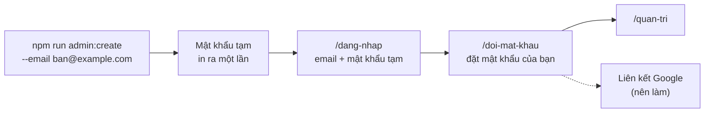

# Cách sử dụng — Chuyện Nhà Hưng

🇬🇧 English version: [usage.md](usage.md)

Cách chạy, kiểm chứng và mở rộng ứng dụng. Muốn biết *nó gồm những gì*, đọc
[architecture.vi.md](architecture.vi.md).

## Yêu cầu

- **Node 24 LTS**, ghim trong `.nvmrc` (`24.22.2`) — chạy `nvm use` trong repo. CI
  đọc cùng file đó, nên máy và CI không thể lệch nhau. `engines.node` là `>=24`, và
  npm cảnh báo nếu dùng bản cũ hơn.
  Override `magic-string` mà Node 20.14 cần đã được gỡ. Vitest vẫn ở 3.x: Node 24
  giờ *cho phép* Vitest 4/5, nhưng việc nâng đó chưa được làm.
- npm (repo có sẵn `package-lock.json`).
- Google Chrome ở đường dẫn mặc định của macOS, chỉ dùng cho `npm run verify:ui`.

## Cài và chạy

```bash
npm install
npm run dev          # http://localhost:3000
```

Tiếng Việt ở `/`, tiếng Anh ở `/en`. Site chạy được mà không cần `.env` nào cả;
mọi biến dưới đây đều có mặc định dùng được, hoặc tự tắt tính năng theo hướng
đóng an toàn.

| Biến | Mặc định | Làm gì |
|---|---|---|
| `NEXT_PUBLIC_SITE_URL` | `https://chuyennhahung.vn` | Canonical, `hreflang`, sitemap. Phải đặt lúc **build** |
| `ADMIN_API_TOKEN` | *chưa đặt* | Bảo vệ mọi route admin. Chưa đặt, hoặc ngắn hơn 32 ký tự, thì tất cả trả `503` — không bao giờ mở mặc định |
| `TRAVEL_CONTENT_STORE` | `.data/travel-content.json` | Nơi content store nằm. Bị bỏ qua khi đặt `CONTENT_DATABASE_URL` |
| `CONTENT_DATABASE_URL` | *chưa đặt* | Chuỗi kết nối PostgreSQL cho Travel Content. Đã đặt: content store dùng PostgreSQL và không bao giờ lùi về file ([ADR 0013](adr/0013-content-on-postgres-tables.vi.md)). Có thể là database của Planner hoặc database riêng. Là secret — chỉ qua biến môi trường. Xem *Chạy Travel Content trên PostgreSQL* |
| `TRAVEL_CONTENT_AUTOSEED` | `true` | Đặt `false` để bỏ qua seed nội dung demo ở lần dùng đầu. Ở production với PostgreSQL, hãy import nội dung thật rồi đặt `false` |
| `PUBLIC_CONTENT_SOURCE` | `repository` | Đọc ở mỗi lần gọi (khởi động lại, không cần build lại). `repository`: nội dung Travel công khai lấy từ content store; `static`: lấy từ `src/content/stories.ts` (đường lùi). Giá trị khác coi như `repository`. Áp dụng cho trang chủ, `/stories`, trang bài viết, trang điểm đến và sitemap ([ADR 0012](adr/0012-public-travel-from-content-repository.vi.md)) |
| `PLANNER_STORE` | `.data/planner.json` | Nơi trip của Planner nằm. Tách file khỏi content store một cách có chủ đích. Bị bỏ qua khi đã đặt `PLANNER_DATABASE_URL` |
| `PLANNER_DATABASE_URL` | *chưa đặt* | Chuỗi kết nối PostgreSQL. Đã đặt: Planner dùng PostgreSQL và không bao giờ quay về file ([ADR 0009](adr/0009-postgres-persistence.vi.md)). Là secret — chỉ qua biến môi trường. Xem *Chạy Planner trên PostgreSQL* |
| `DATABASE_POOL_MAX` | `5` | Kích thước connection pool của mỗi tiến trình |
| `TEST_DATABASE_URL` | *chưa đặt* | Database nháp cho `tests/planner-postgres.integration.test.ts`. Chưa đặt thì các test đó bị bỏ qua |
| `GOOGLE_CLIENT_ID` / `GOOGLE_CLIENT_SECRET` | *chưa đặt* | Đăng nhập Google ([ADR 0007](adr/0007-password-and-google-sign-in.vi.md)). Cần cả hai; thiếu thì các route Google trả 404 và nút bị ẩn. Chỉ phía server — không bao giờ là `NEXT_PUBLIC_*` |
| `GOOGLE_SIGNUP_ENABLED` | `true` | `false` thì lần đăng nhập Google đầu tiên không tạo tài khoản; tài khoản đã có vẫn đăng nhập được |
| `GOOGLE_REDIRECT_URI` | *suy ra* | Ghi đè URL callback; nếu không thì là `NEXT_PUBLIC_SITE_URL` (hoặc origin của request) + `/api/planner/oauth/google/callback`. Phải khớp đúng từng ký tự với Google Cloud Console |
| `TRUST_PROXY_HEADERS` | *chưa đặt* | Chỉ đặt `true` khi đứng sau reverse proxy **ghi đè** `X-Forwarded-Proto` và `X-Forwarded-For` (xem *Deploy*). Cho cookie phiên và cookie OAuth lấy cờ `Secure` từ `X-Forwarded-Proto` |

`.data/` đã được gitignore. Planner không seed gì trong đó — xem *Cấp tài khoản
cho một người đi chơi trong Planner* bên dưới.

Mỗi bản clone cần thêm một bước nữa mà git không tự làm được — bật các git hook
đã được theo dõi trong repo, để commit không lọt vào `main`:

```bash
git config core.hooksPath .githooks
```

`pre-commit` từ chối commit khi bạn đang ở `main`, còn `pre-push` từ chối cú push
làm `main` dịch chuyển; cả hai đều chỉ lại đường đi qua branch và PR. Nếu thật sự
cố ý thì ghi đè bằng `--no-verify`.

## Các lệnh

| Lệnh | Tác dụng |
|---|---|
| `npm run dev` | Dev server với Turbopack |
| `npm run build` | Build production — prerender 42 trang; route bài viết, điểm đến, trang chủ và sitemap render theo từng request |
| `npm start` | Chạy bản build production |
| `npm run typecheck` | `tsc --noEmit` |
| `npm run lint` | ESLint, flat config |
| `npm run test` | Vitest, chạy một lượt |
| `npm run db:migrate` | Áp dụng `db/migrations/*.sql` vào `PLANNER_DATABASE_URL` và `CONTENT_DATABASE_URL` (cái nào được đặt); idempotent. Tuỳ chọn: app chạy cùng đoạn code đó lúc khởi động |
| `npm run content:import -- <file>` | Nạp một `travel-content.json` vào các bảng content PostgreSQL đang trống, có kiểm tra, trong một transaction |
| `npm run content:export -- <file>` | Ghi content PostgreSQL ra `travel-content.json` (sao lưu và rollback) |
| `npm run planner:import -- <file>` | Nạp một `planner.json` vào Planner PostgreSQL đang trống, có kiểm tra, trong một transaction |
| `npm run planner:export -- <file>` | Ghi Planner PostgreSQL ra `planner.json` (sao lưu và rollback) |
| `npm run verify:ui` | Chụp 13 route ở 375/768/1440 vào `screenshots/`, fail nếu tràn ngang |
| `npm run covers` | Sinh lại tranh cover SVG vào `public/images/covers/` |

`verify:ui` cần một server dev hoặc production đang chạy, và nhận thêm base URL
cùng thư mục xuất tuỳ chọn:
`node scripts/screenshots.mjs http://localhost:3000 out/shots`.

## Định nghĩa "xong"

Mọi thay đổi đều kết thúc bằng ba lệnh này, và phải **nêu đúng kết quả thật**:

```bash
npm run typecheck && npm run lint && npm run test
```

Thay đổi UI thì phải xem lại ở 375px, 768px và 1280px. Nếu có gì fail hoặc bị bỏ
qua, nói ra — báo "xong" trên một lần chạy đang fail là lỗi duy nhất không sửa
lại được ở đây.

`.github/workflows/ci.yml` chạy đúng ba lệnh đó cộng thêm `npm run build` trên mọi
PR vào `main`. Hãy xem nó là ý kiến thứ hai, không phải cổng chặn: các check này
**không thể đặt thành bắt buộc** khi repo còn private trên GitHub Free, vì ở đó
không có branch protection lẫn ruleset. Vì vậy một lần chạy đỏ không ngăn được
merge — vẫn phải có người xem.

## Những việc thường làm

### Thêm một mục nội dung

1. Thêm vào bộ dữ liệu trong `src/content/<collection>.ts`, điền cả `vi` **và**
   `en` cho mọi field `Localized<T>`. `typecheck` sẽ bắt nếu thiếu locale.
2. Slug viết thường, nối bằng gạch ngang, không trùng — `tests/content.test.ts`
   kiểm tra điều này.
3. Chạy `npm run covers` để mục mới có tranh cover, hoặc trỏ `cover` tới một ảnh
   thật trong `public/images/`.
4. Điểm đến còn cần `coords` WGS84 thật; bản đồ chiếu theo toạ độ đó, sai một con
   số là có một cái ghim trông rất thật nằm sai chỗ.

### Tài khoản và mật khẩu — tóm tắt

Đọc mục này trước nếu bạn chưa rõ đăng nhập thế nào, hoặc bị mất quyền truy cập.

**Ai đăng nhập, bằng gì**

| Vai trò | Làm được gì | Đăng nhập bằng |
|---|---|---|
| `member` | Các trip Planner của chính mình | Email + mật khẩu, hoặc Google |
| `editor` | Nội dung du lịch ở `/quan-tri` | Email + mật khẩu, hoặc Google |
| `admin` | Nội dung **và** người dùng ở `/quan-tri` | Email + mật khẩu, hoặc Google |

Tài khoản là `member` trừ khi được tạo với vai trò khác (`admin:create` tạo ra `admin`). Chỉ admin (ở `/quan-tri`) hoặc service token mới nâng được ai đó lên `editor` hay `admin`; Google không bao giờ cấp vai trò.

**Các loại bí mật, và mất thì làm gì**

| Bí mật | Là gì | Nằm ở đâu | Bị mất? |
|---|---|---|---|
| Mật khẩu của bạn | Thứ bạn gõ ở `/dang-nhap` | Chỉ có bản băm trong store; không ai đọc lại được | Xin một mật khẩu tạm mới — xem bảng bên dưới |
| Mật khẩu tạm | In ra **một lần** bởi `admin:create`, *Tạo người dùng* hoặc *Đặt lại mật khẩu* | Chỉ trên màn hình của bạn, tới khi bạn đổi | Xin reset lần nữa |
| Liên kết Google | Đăng nhập bằng tài khoản Google, không cần mật khẩu | Do bạn bật ở `/doi-mat-khau` | Đăng nhập bằng mật khẩu rồi liên kết lại |
| Service token `ADMIN_API_TOKEN` | Khoá vận hành dùng với `curl`, **không** phải tài khoản | `.env.local` (dev) hoặc `.env` trên server | Đặt giá trị mới rồi khởi động lại app — không gì khác phụ thuộc vào nó |
| Access token Planner | Khoá API của một người đi chơi | Hiện một lần khi tạo | `rotate-token` cấp token mới |

**Admin đầu tiên, từ con số không tới trang quản trị**



Vào được rồi thì liên kết Google ngay: đó là đường thứ hai để vào lại nếu quên mật khẩu.

**Mất quyền truy cập — làm gì**

| Tình huống | Làm thế này |
|---|---|
| Tài khoản Google đã liên kết | Đăng nhập bằng Google; không cần gì thêm |
| Quên mật khẩu và **còn admin khác** | Người đó mở `/quan-tri` → *Đặt lại mật khẩu* ở dòng của bạn rồi đưa bạn mật khẩu tạm mới. Admin không tự reset cho mình được |
| Quên mật khẩu, bạn là **admin duy nhất**, app đang chạy | Reset bằng service token (bên dưới) |
| Không còn admin khác, và không biết token hoặc app không chạy | Tạo admin thứ hai bằng `npm run admin:create -- --email <email khác>`, đăng nhập bằng nó, rồi reset tài khoản cũ ở `/quan-tri` |
| `admin:create` báo *an account with that email or handle already exists* | Email đó đã có tài khoản: dùng một trong các dòng trên, hoặc `admin:create` với email khác |
| Đăng nhập được nhưng `/quan-tri` trả 404 | Tài khoản không phải `admin` hay `editor`; một admin đổi vai trò cho nó |

Reset bằng service token, một dòng. Lệnh đọc token từ `.env.local`, tìm tài khoản theo email và in ra mật khẩu tạm mới. Sửa email, chạy **từ thư mục app đang chạy**, trong lúc app đang chạy:

```bash
cd <thư mục app đang chạy> && export ADMIN_API_TOKEN="$(grep '^ADMIN_API_TOKEN=' .env.local | cut -d= -f2- | sed -e "s/^[\"']//" -e "s/[\"']$//")" && USER_ID="$(curl -s http://localhost:3000/api/admin/planner/users -H "authorization: Bearer $ADMIN_API_TOKEN" | jq -r '.. | objects | select(.email? == "ban@example.com") | .id' | head -1)" && echo "userId: ${USER_ID:-KHÔNG TÌM THẤY}" && [ -n "$USER_ID" ] && curl -s -X POST "http://localhost:3000/api/admin/planner/users/$USER_ID/reset-password" -H "authorization: Bearer $ADMIN_API_TOKEN"
```

**Chạy lệnh tài khoản từ thư mục app đang chạy.** Khi không có `PLANNER_DATABASE_URL`, tài khoản nằm ở `.data/planner.json` *tính từ thư mục hiện tại*, nên một lệnh chạy từ bản checkout khác (ví dụ một git worktree) sẽ đọc và ghi một bộ tài khoản khác. Có `PLANNER_DATABASE_URL` thì mọi thư mục đều thấy cùng một database.

### Cấp tài khoản cho một người đi chơi trong Planner

Tài khoản nhân viên do người vận hành cấp; access token chỉ hiện ra **một lần**
— nếu mất thì xoay vòng lại; không đọc lại được. Khách hàng cũng tự tạo được tài
khoản bằng cách đăng nhập Google (xem bên dưới). Thêm `email` thì response có kèm
`temporaryPassword`, chỉ hiện một lần; người đó đăng nhập ở `/dang-nhap` bằng mật
khẩu này và được đưa tới `/doi-mat-khau` để tự đặt mật khẩu riêng.

```bash
# 1. Một secret thật, tối thiểu 32 ký tự, nếu không mọi route admin trả 503.
export ADMIN_API_TOKEN="$(openssl rand -base64 36)"

# 2. Tạo người đi chơi. Giữ lại `accessToken` trong response.
curl -s -X POST http://localhost:3000/api/admin/planner/users \
  -H "authorization: Bearer $ADMIN_API_TOKEN" \
  -H 'content-type: application/json' \
  -d '{"handle":"hung-tran","displayName":"Hưng Trần"}'

# 3. Chính token đó — không phải token admin — mới chạm được tới trip của họ.
curl -s http://localhost:3000/api/planner -H "authorization: Bearer <accessToken>"
```

Trình duyệt không dùng trực tiếp token đó — nó đăng nhập một lần và nhận một
cookie `HttpOnly` ([ADR 0004](adr/0004-planner-identity.vi.md)). Với curl thì
dùng cookie jar:

```bash
# Đăng nhập. Cookie vào jar; JavaScript không bao giờ đọc được nó.
curl -s -c jar.txt -X POST http://localhost:3000/api/planner/session \
  -H 'content-type: application/json' \
  -d '{"accessToken":"<accessToken>"}'

# Đọc thì không cần gì thêm.
curl -s -b jar.txt http://localhost:3000/api/planner

# Request có thay đổi dữ liệu phải nêu Origin cùng origin — đó là luật CSRF mà
# cookie bắt buộc, và request cookie thiếu nó sẽ bị từ chối 403.
curl -s -b jar.txt -X POST http://localhost:3000/api/planner \
  -H 'origin: http://localhost:3000' -H 'content-type: application/json' \
  -d '{"source":"blank","title":"Đà Lạt 3 ngày","destinationSlug":"da-lat","durationDays":3,"partySize":2,"budget":{"targetTotalVnd":5000000}}'

# Đăng xuất.
curl -s -b jar.txt -X DELETE http://localhost:3000/api/planner/session \
  -H 'origin: http://localhost:3000'
```

Một session sống 14 ngày, hoặc 7 ngày nếu không dùng. `rotate-token` đăng xuất
người đi chơi khỏi mọi nơi.

Vai trò ([ADR 0006](adr/0006-unified-identity-and-roles.vi.md)): `role` là
`member` (mặc định), `editor` hoặc `admin`. Vai trò được thực thi cho việc quản lý user
([ADR 0010](adr/0010-admin-portal-session-authorization.vi.md)): session `admin` dùng được
cổng ở `/quan-tri`; `editor` chưa có màn hình. Nâng admin đầu tiên bằng admin token; body là strict, nên key nào khác
`role` đều bị từ chối với 422.

```bash
# Tạo thẳng một admin (`role` tùy chọn khi POST).
curl -s -X POST http://localhost:3000/api/admin/planner/users \
  -H "authorization: Bearer $ADMIN_API_TOKEN" -H 'content-type: application/json' \
  -d '{"handle":"admin-hung","displayName":"Hưng","role":"admin"}'

# Hoặc nâng một user có sẵn. Gọi lại an toàn; hạ vai trò cũng là lệnh này.
curl -s -X PATCH http://localhost:3000/api/admin/planner/users/<userId> \
  -H "authorization: Bearer $ADMIN_API_TOKEN" -H 'content-type: application/json' \
  -d '{"role":"admin"}'
```

Mật khẩu và Google ([ADR 0007](adr/0007-password-and-google-sign-in.vi.md)):

```bash
# Tạo tài khoản nhân viên kèm email: giữ lại `temporaryPassword` (chỉ hiện một lần).
curl -s -X POST http://localhost:3000/api/admin/planner/users \
  -H "authorization: Bearer $ADMIN_API_TOKEN" -H 'content-type: application/json' \
  -d '{"handle":"lan-nguyen","displayName":"Lan Nguyễn","email":"lan@example.com"}'

# Quên mật khẩu: cấp mật khẩu tạm mới, và mọi session kết thúc.
curl -s -X POST http://localhost:3000/api/admin/planner/users/<userId>/reset-password \
  -H "authorization: Bearer $ADMIN_API_TOKEN"

# Gỡ liên kết Google.
curl -s -X DELETE http://localhost:3000/api/admin/planner/users/<userId>/google \
  -H "authorization: Bearer $ADMIN_API_TOKEN"
```

Để bật đăng nhập Google, làm theo mục *Cấu hình đăng nhập Google* bên dưới.

Sửa một trip đang có thì cần version lấy từ `ETag` của nó:

```bash
curl -s -X PATCH http://localhost:3000/api/planner/<id> \
  -H "authorization: Bearer <accessToken>" \
  -H 'if-match: "3"' -H 'content-type: application/json' \
  -d '{"partySize":4}'
```

Thiếu `If-Match` thì nhận 428; version lạc hậu thì 412. Xem
[features/travel-planner-core.vi.md](features/travel-planner-core.vi.md) để có
danh sách endpoint đầy đủ.

### Đăng nhập với tư cách admin

Cổng quản trị ở `/quan-tri` (`/en/admin`). Cách đơn giản nhất để tạo admin đầu tiên là `admin:create`. Lệnh ghi thẳng vào kho mà app đang dùng — PostgreSQL khi đặt `PLANNER_DATABASE_URL`, nếu không thì tệp JSON — không cần `ADMIN_API_TOKEN`, không cần server đang chạy, và in ra một mật khẩu tạm ngẫu nhiên đúng một lần:

```bash
npm run admin:create -- --email you@example.com --name "Hưng"            # tuỳ chọn: --handle admin-hung
```

Trên stack đã deploy, chạy trong container `tools` với đúng các file `-f` của layout, để lệnh tới cùng database:

```bash
docker compose -f compose.yml -f compose.app.yml -f compose.app.external-db.yml run --rm tools \
  npm run admin:create -- --email you@example.com --name "Hưng"
```

Hoặc dùng service token với server đang chạy, giữ lại `temporaryPassword` trong response (chỉ hiện một lần):

```bash
curl -s -X POST http://localhost:3000/api/admin/planner/users \
  -H "authorization: Bearer $ADMIN_API_TOKEN" -H 'content-type: application/json' \
  -d '{"handle":"admin-hung","displayName":"Hưng","email":"you@example.com","role":"admin"}'
```

1. Đăng nhập ở `/dang-nhap?returnTo=/quan-tri` bằng email đó và mật khẩu tạm.
2. Bạn được chuyển sang `/doi-mat-khau`: đặt mật khẩu mới.
3. Mở `/quan-tri`. Session admin hết hạn sau 2 giờ không dùng hoặc 12 giờ tuyệt đối.

Trên VM dev chạy HTTP thuần qua IP: `NEXT_PUBLIC_SITE_URL` phải đúng origin `http://<ip>` và được nướng vào lúc build, nếu không mutation admin bị từ chối. Cookie không có `Secure` qua HTTP nên mật khẩu và cookie admin đi dạng rõ: chỉ dùng trong LAN, và chuyển sang HTTPS trước khi có người dùng thật.

Khôi phục: nếu mất quyền truy cập, xem mục *Tài khoản và mật khẩu — tóm tắt* ở trên — có đủ trường hợp quên mật khẩu, admin duy nhất bị khoá, và `admin:create` từ chối email đã có.

### Cấu hình đăng nhập Google

Đăng nhập Google ([ADR 0007](adr/0007-password-and-google-sign-in.vi.md)) tắt cho tới khi server có **cả hai** biến `GOOGLE_CLIENT_ID` và `GOOGLE_CLIENT_SECRET`. Thiếu chúng thì nút "Đăng nhập bằng Google" không hiện ở `/dang-nhap` và các route Google trả 404 — đó là trạng thái bình thường của một bản checkout mới. App chỉ xin Google `openid email profile` và chỉ chấp nhận email đã được Google xác minh.

**1. Tạo OAuth client trên Google Cloud Console**

1. Chọn hoặc tạo một project tại <https://console.cloud.google.com>.
2. *APIs & Services → OAuth consent screen*: user type **External**, tên app, email hỗ trợ. Scope: không thêm gì ngoài mặc định (`openid`, `email`, `profile`). Khi app còn ở chế độ **Testing**, chỉ các tài khoản Google có trong *Test users* mới đăng nhập được — thêm tài khoản của bạn vào.
3. *APIs & Services → Credentials → Create credentials → OAuth client ID*, loại **Web application**.
4. *Authorized redirect URIs*: mỗi môi trường một dòng, khớp từng ký tự với callback app gửi đi:

   | Môi trường | Redirect URI |
   |---|---|
   | Dev local | `http://localhost:3000/api/planner/oauth/google/callback` |
   | Đã deploy | `https://<tên-miền>/api/planner/oauth/google/callback` |

   *Authorized JavaScript origins* để trống được: luồng chạy phía server.
5. Chép **Client ID** và **Client secret**.

**2. Đặt biến môi trường**

Ở máy local, trong `.env.local` tại thư mục gốc repo (đã gitignore — không bao giờ commit, không bao giờ đặt secret vào biến `NEXT_PUBLIC_*`):

```bash
GOOGLE_CLIENT_ID=<client-id>.apps.googleusercontent.com
GOOGLE_CLIENT_SECRET=<client-secret>
# Tùy chọn:
# GOOGLE_SIGNUP_ENABLED=false   # chỉ tài khoản có sẵn; Google không tạo tài khoản mới
# GOOGLE_REDIRECT_URI=...       # chỉ khi callback tự suy ra bị sai
```

Trên stack Compose, đặt đúng hai dòng đó vào file `.env` cạnh các file compose; `compose.app.yml` truyền chúng (cùng `GOOGLE_SIGNUP_ENABLED`) vào container app. `GOOGLE_REDIRECT_URI` không được truyền ở đó: callback được suy ra từ `NEXT_PUBLIC_SITE_URL`, nên origin đó phải trùng với origin đã đăng ký ở bước 1.4.

Biến chỉ được đọc lúc khởi động. **Khởi động lại** `npm run dev` (hoặc tạo lại container) sau khi đổi.

**3. Kiểm tra**

1. Mở `/dang-nhap`: có nút Google.
2. Bấm vào: trang chọn tài khoản của Google hiện ra. Nếu Google báo `redirect_uri_mismatch`, URI đăng ký ở bước 1.4 khác với URI app gửi — so lại scheme, host, port và path.
3. Chọn tài khoản, bạn quay về site và đã đăng nhập.

**Cách khớp tài khoản**

- Email Google **chưa** có tài khoản sẽ tạo tài khoản `member` mới, trừ khi `GOOGLE_SIGNUP_ENABLED=false` (khi đó báo `account_not_found`). Google không bao giờ cấp quyền nhân viên: nâng quyền bằng service token hoặc ở `/quan-tri`.
- Email **đã** có tài khoản (ví dụ admin tạo bằng `admin:create`) bị từ chối với `link_required` — Google không bao giờ được liên kết theo email. Đăng nhập bằng mật khẩu, rồi bấm "Liên kết tài khoản Google" ở `/doi-mat-khau`. Từ đó cả hai cách đều vào được tài khoản đó.
- Gỡ liên kết bằng `DELETE /api/admin/planner/users/<userId>/google` (service token).

**HTTP trên địa chỉ IP không dùng được.** Google chỉ chấp nhận redirect URI HTTP thường cho `localhost`. VM dev chạy dạng `http://192.168.x.x` không dùng được đăng nhập Google; cần tên miền có HTTPS trước. Trong lúc chờ, dùng đăng nhập mật khẩu ở đó và để trống hai biến để nút không hiện.

### Duyệt chuyến đi cộng đồng (admin hoặc editor)

Mở `/quan-tri/cong-dong` (`/en/admin/community`). Yêu cầu chờ duyệt nằm trên: **Duyệt**, hoặc **Từ chối** kèm lý do để chủ chuyến thấy; chuyến đã duyệt có thể **Gỡ** kèm lý do. Trang chủ và `/chuyen-di-cong-dong` chỉ hiện chuyến đã duyệt. Cùng trang này liệt kê đánh giá địa điểm của người đi: **Gỡ** bất kỳ đánh giá đang hiện nào. Đánh giá, dù viết trong Planner hay do khách viết ở trang chủ, đều được đăng mà không cần duyệt. Trước khi người đi gửi được gì, hãy điền `contribution.terms` (VI và EN) và `contribution.takedownContact` trong `src/content/site.ts`; cho tới lúc đó nút của chủ chuyến vẫn đóng.

### Sửa nội dung trên trình duyệt (admin hoặc editor)

Đăng nhập như mục trên (tài khoản `editor` có vai trò `editor`; admin đặt vai trò này được từ `/quan-tri`) rồi mở `/quan-tri/noi-dung/chuyen-di` (`/en/admin/content/stories`). Năm trang gồm danh sách chuyến đi, một chuyến đi, địa điểm, một địa điểm và đánh giá (`/quan-tri/noi-dung/dia-diem`, `/quan-tri/noi-dung/danh-gia`). Sửa một bản ghi rồi lưu; xuất bản hoặc lưu trữ story hay review là một hành động riêng. Tạo mới, xoá, template và collection chưa có trên trình duyệt — dùng API token ([travel-content-api.vi.md](travel-content-api.vi.md)).

Bản sửa đã publish hiện trên site công khai ngay ở request kế tiếp: trang bài viết, trang chủ, trang điểm đến và sitemap được render theo từng request từ content store ([ADR 0012](adr/0012-public-travel-from-content-repository.vi.md)). Bản nháp và bài đã lưu trữ không công khai (404). Trình duyệt gửi `If-Match` kèm `updatedAt` của bản ghi; nếu người khác lưu trước, thao tác bị từ chối với **412** `version_conflict` — tải lại rồi áp dụng lại thay đổi. Việc sửa chưa được ghi vào audit log.

### Nạp các bài viết tĩnh vào content store

Content store mới tinh đã có sẵn các bài viết từ `src/content/stories.ts` ngay lần seed đầu tiên. Store **đã tồn tại** thì bỏ qua bước đó (vì đã có nội dung), nên hãy nạp thủ công:

```bash
npm run content:seed-static -- --dry-run   # liệt kê những gì sẽ tạo, không ghi gì
npm run content:seed-static                # tạo chúng
```

Lệnh dùng cùng store với app (`TRAVEL_CONTENT_STORE`, nếu không thì `.data/travel-content.json`), chỉ tạo các slug chưa có và không bao giờ cập nhật slug nào, nên bản sửa trong CMS không bị ghi đè. Lệnh không chạy khi khởi động. Nếu bạn đã xóa một bài đã seed rồi chạy lại, bài đó sẽ xuất hiện lại. Việc của chủ dự án: `travelDates` của bài seed là ngày đăng, không phải ngày đi thật — hãy sửa trong CMS. Cho tới khi seed, store đã có chỉ hiển thị các bài của chính nó trên site công khai ([ADR 0012](adr/0012-public-travel-from-content-repository.vi.md)).

**Dừng app trước.** Content store JSON được cache trong tiến trình app, vốn giả định mình là bên ghi duy nhất. Seed trong lúc app đang chạy thì app vẫn phục vụ bản cũ, và lần ghi CMS kế tiếp sẽ ghi bản cũ đó đè lên đĩa, xoá mất các bài vừa seed. Trên stack đã deploy, dùng đúng các file `-f` của bố cục bạn chọn:

```bash
docker compose -f compose.yml -f compose.app.yml -f compose.app.external-db.yml stop app
docker compose -f compose.yml -f compose.app.yml -f compose.app.external-db.yml run --rm tools \
  npm run content:seed-static
docker compose -f compose.yml -f compose.app.yml -f compose.app.external-db.yml start app
```

Chạy một lần khi deploy bản phát hành có lệnh này: từ bản đó Planner đã liên kết template với bài viết qua content store, nên cho tới khi seed xong, template clone từ `da-lat-3-ngay-lang-man` sẽ không mang ghi công bài viết. Trước đó hãy build lại image `tools` của bản phát hành này để nó có script.

### Chạy Planner trên PostgreSQL

Khi đặt `PLANNER_DATABASE_URL`, Planner lưu dữ liệu trong PostgreSQL 16 hoặc 17
([ADR 0009](adr/0009-postgres-persistence.vi.md)); không đặt thì không có gì đổi
— file JSON khi phát triển, memory store khi test. Khi đã đặt, app **không bao
giờ quay về** file JSON: database sập thì các route Planner trả
`503 service_unavailable`.

**Thiết lập một lần, do chủ nhà làm trên máy chạy database.** Tạo một role và
database riêng; không superuser, không `CREATEDB`. Dùng mật khẩu thật lấy từ nơi
lưu secret — `<password>` bên dưới chỉ là chỗ giữ chỗ:

```sql
CREATE ROLE planner LOGIN PASSWORD '<password>' NOSUPERUSER NOCREATEDB NOCREATEROLE;
CREATE DATABASE planner OWNER planner;
```

Chỉ mở cổng 5432 trên đúng giao diện mà app kết nối tới (xem đoạn về TLS bên dưới
cho bố cục database ở VM riêng). Vì migration chạy khi khởi động, role của app phải tạo và sửa được bảng:
dùng một role sở hữu database cho cả migrate lẫn chạy app. **Rủi ro đã chấp nhận
(ADR 0009):** nếu credential của app bị lộ hoặc app dính lỗi injection, kẻ tấn
công cũng có quyền DDL. Muốn tách một role chủ cho `npm run db:migrate` khỏi một
role app chỉ có quyền DML (`GRANT SELECT, INSERT, UPDATE, DELETE` trên các bảng
Planner, `USAGE` trên schema) thì cần một công tắc tắt migration khi khởi động, thứ
hiện chưa có.

Nếu một replica khác đang giữ lock migration, lúc khởi động app chờ tối đa 30 giây
rồi trả `503`; các request trong 5 giây sau nhận luôn `503` đó mà không thử lại,
để database đang chết không bị dội request. Biến cũ `DATABASE_URL` bị bỏ qua — app
ghi cảnh báo nếu nó được đặt mà không có `PLANNER_DATABASE_URL`.

**Trong cùng một compose**, kết nối nằm trong mạng Docker riêng (service
`postgres`, cổng không publish) và không cần TLS. **Khi database nằm ở máy khác,
kết nối dùng TLS có xác minh đầy đủ**: app kết nối qua mạng LAN (ADR 0009 §5, sửa
đổi 2026-11-11; cả hai bố cục ở [Deploy](#deploy)). Thêm `?sslmode=verify-full&sslrootcert=<đường dẫn tới CA>`
vào `PLANNER_DATABASE_URL`. Driver `pg` đang dùng (8.23) coi `sslmode=require`,
`prefer` và `verify-ca` là bí danh của `verify-full`, nên không có chế độ "mã hoá
nhưng không xác minh" để lùi về: app phải có CA, và certificate của server phải
khớp với host trong URL. Trên VM database:

- một CA riêng, và một server certificate do CA đó ký, có **Subject Alternative
  Name chứa IP của VM database** (`IP:<DB_IP>`) — URL dùng IP, nên certificate chỉ
  có hostname sẽ không qua xác minh; `ssl = on` với `ssl_cert_file` /
  `ssl_key_file` trỏ tới chúng;
- trong `pg_hba.conf`, đúng một dòng `hostssl cnh_planner cnh_app <APP_VM_IP>/32 scram-sha-256`
  cho VM app, và không có dòng `host` nào nhận cùng role mà không cần TLS;
- firewall chỉ mở 5432 cho IP của VM app, không cho ai khác.

Chỉ certificate của CA (công khai) được chép sang VM app; private key của server
không bao giờ rời VM database. `tests/postgres-tls-url.test.ts` khoá cách driver
đọc các tham số này, không cần kết nối.

```bash
# Chuỗi kết nối là secret: chỉ qua biến môi trường, không commit, không log.
export PLANNER_DATABASE_URL='postgres://planner:<password>@<db-host>:5432/planner?sslmode=verify-full&sslrootcert=/path/to/pg-ca.crt'

npm run db:migrate                       # tuỳ chọn: app tự migrate lúc khởi động
npm run planner:import -- planner.json   # một lần, để chuyển file JSON hiện có vào
npm run planner:export -- backup.json    # ghi ra planner.json mà JSON store mở được
```

App tự áp dụng các migration còn thiếu ở lần đầu dùng database (trước khi phục vụ
request nào), dưới một advisory lock của PostgreSQL, nên các replica khởi động
cùng lúc chỉ áp dụng mỗi file một lần. Nếu thất bại — database tắt, file hỏng hoặc
bị sửa sau khi đã chạy — route Planner trả `503` và request kế tiếp thử lại; dòng
log chỉ có mã lỗi, nên chạy `npm run db:migrate` để xem thông báo thật.
`db:migrate` chạy cùng đoạn code đó bằng tay (CI, lần import đầu) và áp dụng lần lượt các file đánh số trong `db/migrations/`, mỗi file
trong một transaction riêng, và ghi vào `schema_migrations`; chạy lại thì không
làm gì, và file bị sửa sau khi đã áp dụng sẽ bị từ chối. Rollback của từng
migration nằm trong `db/rollback/` và được chạy tay — nó **xoá bảng**, nên phải
export trước.

`planner:import` kiểm tra từng bản ghi, chạy kiểm tra toàn vẹn của Planner, rồi
chèn tất cả trong một transaction. Nó từ chối chạy nếu bảng Planner nào đã có
dòng, và bỏ lại các session đã hết hạn. Hãy làm khi app đang dừng, rồi khởi động
app với `PLANNER_DATABASE_URL`. Ba lệnh này chạy qua `vite-node` (phụ thuộc của Vitest)
nên cần cài dev dependencies — chạy từ bản checkout hoặc giai đoạn build, không
phải image runtime `--omit=dev`. Import đọc catalog nội dung để kiểm tra place
nên cần cùng `TRAVEL_CONTENT_STORE` với app.

**Sao lưu.** Làm cả hai: `pg_dump --format=custom "$PLANNER_DATABASE_URL" > planner.dump`
(khôi phục bằng `pg_restore`) và `npm run planner:export -- planner-$(date +%F).json`.
Bản export cũng là đường rollback: bỏ `PLANNER_DATABASE_URL`, trỏ `PLANNER_STORE` vào file
đã export, khởi động lại. Những gì ghi sau lần export cuối sẽ mất, nên export
trước. Cả hai file chứa hash mật khẩu và digest token — chỉ cho chủ sở hữu đọc.
Script export tự đặt quyền `0600`; `pg_dump` thì không, nên chạy
`chmod 600 planner.dump` sau đó (hoặc `umask 077` trước).

**Test với database thật.** Đặt `TEST_DATABASE_URL` trỏ tới một database *nháp*
(không bao giờ là database có dữ liệu thật). `npm run test` khi đó chạy thêm
`tests/planner-postgres.integration.test.ts` trong một schema tạm do chính nó tạo
và xoá. Không có biến này, file đó bị bỏ qua và lần chạy phải được báo là **chưa
chạy**, không phải là đã qua.

### Chạy Travel Content trên PostgreSQL

Khi đặt `CONTENT_DATABASE_URL`, story, place, collection, review và template nằm trong
PostgreSQL ([ADR 0013](adr/0013-content-on-postgres-tables.vi.md)); không đặt thì không có
gì đổi — file JSON ở development, memory store trong test. Khi đã đặt, app **không bao giờ
lùi về** file: nếu database sập, API nội dung admin và mọi trang public đọc content trả
`503`. Nhờ vậy app chạy được nhiều hơn một instance (rate limiter thì vẫn chưa, xem phần
deploy).

**Database và role.** Dùng role riêng và các quy tắc kết nối của *Chạy Planner trên
PostgreSQL* (TLS `verify-full` qua mạng, mật khẩu percent-encode, quyền tối thiểu).
`CONTENT_DATABASE_URL` có thể trỏ vào database của Planner, hoặc một database riêng
(`cnh_content`) nếu muốn sao lưu và phạm vi ảnh hưởng tách biệt. Dù thế nào, mỗi store chạy
toàn bộ bộ `db/migrations` trên database của nó, nên bảng của store kia có thể tồn tại ở
đó, rỗng.

**Chuyển nội dung hiện có vào.** Dừng việc ghi trước, rồi:

```bash
CONTENT_DATABASE_URL='postgres://…' npm run db:migrate
CONTENT_DATABASE_URL='postgres://…' npm run content:import -- .data/travel-content.json
```

Import kiểm tra file bằng chính schema của repository, chạy kiểm tra toàn vẹn, từ chối bảng
không rỗng, và chèn trong một transaction. Sau đó khởi động app với `CONTENT_DATABASE_URL`
và `TRAVEL_CONTENT_AUTOSEED=false` để nội dung demo không bao giờ được seed cạnh nội dung
thật. Trên database *mới*, app seed nội dung demo một lần, dưới một lock. `npm run
content:seed-static` bổ sung bảy story tĩnh vào store mà môi trường đang chọn.

**Sao lưu và rollback.** `pg_dump --format=custom "$CONTENT_DATABASE_URL" > content.dump`
và `npm run content:export -- content-$(date +%F).json` (mode `0600`: file chứa bản nháp
chưa xuất bản). Để rollback, bỏ `CONTENT_DATABASE_URL`, trỏ `TRAVEL_CONTENT_STORE` vào file
đã export rồi khởi động lại; những lần ghi sau lần export cuối sẽ mất, nên hãy export
trước. `db/rollback/0004_content.sql` xoá các bảng.

**Test với database thật.** `TEST_DATABASE_URL` (một database scratch) cũng bật
`tests/content-postgres.integration.test.ts`, trong một schema tạm.

### Thêm một chuỗi hiển thị cho người dùng

Thêm key vào **cả** `messages/vi.json` và `messages/en.json`, rồi đọc bằng
`useTranslations` / `getTranslations`. Không bao giờ hard-code chuỗi trong
component. `tests/i18n.test.ts` kiểm tra key khớp nhau, placeholder ICU khớp
nhau, và cảnh báo khi một giá trị tiếng Việt bị copy nguyên sang tiếng Anh.

### Thêm một route

1. Thêm pathname nội bộ cùng đoạn VI và EN vào `pathnames` trong
   [`src/i18n/routing.ts`](../src/i18n/routing.ts).
2. Tạo thư mục tương ứng dưới `src/app/[locale]/`.
3. Export `generateMetadata` dùng `buildPageMetadata` từ
   [`src/lib/metadata.ts`](../src/lib/metadata.ts).
4. Thêm vào `src/app/sitemap.ts`, và vào `primaryNav` / `footerExtraNav` trong
   [`nav-items.ts`](../src/components/layout/nav-items.ts) nếu nó thuộc một menu.
5. Thêm nhãn điều hướng vào cả hai file messages.
6. Thêm route vào `scripts/screenshots.mjs`.
7. Viết tài liệu: một tài liệu tính năng trong
   [`features/`](features/README.vi.md) bằng cả hai ngôn ngữ, và cập nhật bảng
   route trong [architecture.md](architecture.md) cùng
   [architecture.vi.md](architecture.vi.md).

### Thêm một design token

Thêm vào `@theme` trong [`globals.css`](../src/app/globals.css) — nơi duy nhất
được phép — rồi dùng utility sinh ra từ nó. Nếu đó là màu chữ hoặc màu của một
control, mở rộng `tests/design-tokens.test.ts` để tương phản được *kiểm tra*, chứ
không phải được *giả định*.

### Thêm một locale

Ba việc làm cùng lúc: `locales` + `pathnames` trong `routing.ts`, thêm
`messages/<locale>.json`, và thêm key mới vào mọi field `Localized<T>` trong
`src/content/**`. `tests/i18n.test.ts` và `tests/content.test.ts` sẽ fail đến khi
làm đủ cả ba.

## Trước khi lên sóng — việc của chủ nhà

Đây là các giá trị hợp lý nhưng **chưa được kiểm chứng**. Phải xác nhận từng mục:

1. **Handle Facebook** — `src/content/site.ts` đang giả định `chuyennhahung`.
2. **Email liên hệ** — `hello@chuyennhahung.vn` phải tồn tại thật; trang thiết kế
   chuyến đi có link `mailto:` điền sẵn tới địa chỉ này.
3. **URL site** — đặt `NEXT_PUBLIC_SITE_URL`; nó quyết định canonical, `hreflang`
   và sitemap.
4. **Ảnh** — thay tranh SVG sinh tự động bằng ảnh thật.
5. **Đăng nhập Google** — tạo OAuth client của Google, đăng ký redirect URI của
   production, và đặt `GOOGLE_CLIENT_ID` / `GOOGLE_CLIENT_SECRET` trong môi trường
   triển khai.
6. **Database của Planner** — tạo role và database PostgreSQL riêng (xem *Chạy
   Planner trên PostgreSQL*), giữ cổng ở mạng riêng, lưu `PLANNER_DATABASE_URL` như một
   secret, có thể chạy `npm run db:migrate` (app tự làm lúc khởi động), và import `planner.json` hiện có một lần.
7. **Thông báo quyền riêng tư** — khách đăng ký bằng Google được lưu tên và email;
   hãy đăng thông báo quyền riêng tư và cách yêu cầu xoá dữ liệu (Nghị định
   13/2023) trước khi bật đăng ký trên production, hoặc đặt
   `GOOGLE_SIGNUP_ENABLED=false` cho tới lúc đó.

## Deploy

`npm run build` tạo ra một site phần lớn được prerender kèm một Node server độc lập
(`output: 'standalone'` trong `next.config.ts`), nên host nào chạy được Node cũng
dùng được. API Planner là ngoại lệ của "không phụ thuộc dữ liệu lúc chạy": khi đặt
`PLANNER_DATABASE_URL` nó cần một PostgreSQL truy cập được lúc chạy, và file mới
trong `db/migrations/` được instance đầu tiên của phiên bản mới áp dụng dưới một
advisory lock (vẫn có thể chạy `npm run db:migrate` trước khi deploy). Không đặt
`PLANNER_DATABASE_URL` thì Planner dùng file JSON và app chỉ chạy được một tiến trình.
`NEXT_PUBLIC_SITE_URL` phải được đặt lúc **build** — nó được nướng vào canonical,
`hreflang` và sitemap. Đổi nội dung thì phải build lại; hiện chưa có CMS và chưa
có đường revalidate.

### Docker image

`Dockerfile` (Node 24 Alpine, nhiều stage) có hai target:

| Target | Nội dung | Dùng cho |
|---|---|---|
| `runner` (mặc định) | Server standalone, `.next/static`, `public/`, `db/migrations/`; chạy bằng user `node`, cổng 3000, healthcheck qua `GET /api/health` | App |
| `tools` | Bản build đầy đủ kèm dev dependency | `npm run db:migrate`, `planner:import`, `planner:export` (cần `vite-node`) |

```bash
docker build --build-arg NEXT_PUBLIC_SITE_URL=https://chuyennhahung.vn -t chuyennhahung/app .
docker build --build-arg NEXT_PUBLIC_SITE_URL=https://chuyennhahung.vn --target tools -t chuyennhahung/app-tools .
```

Thiếu `NEXT_PUBLIC_SITE_URL` thì build thất bại. Image không chứa secret và không
chứa dữ liệu: `.data/` bị làm rỗng, nên content store nằm trên volume gắn vào
`/app/.data` và được seed ở lần dùng đầu. `GET /api/health` trả
`200 {"status":"ok"}` khi tiến trình còn phục vụ request; nó không chạm store nào,
nên database sập sẽ hiện thành `503` của Planner chứ không thành vòng restart.

### Stack tự host (Docker Compose + nginx)

[`deploy/compose.app.yml`](../deploy/compose.app.yml) thêm service `app` vào một
stack đã chạy `nginx`: mạng `edge`, không publish cổng, volume tên `app-data` cho
`.data/`, và service `tools` thuộc profile `tools`. **Tự nó không nối database
nào.** Có hai bố cục được hỗ trợ, mỗi bố cục thêm đúng một file overlay lên trên —
không bố cục nào phải sửa file của bố cục kia:

| Bố cục | Overlay | Kết nối database |
|---|---|---|
| Cùng một compose | [`compose.app.local-db.yml`](../deploy/compose.app.local-db.yml) | service `postgres`, mạng riêng `backend`, không TLS |
| Postgres trên VM riêng | [`compose.app.external-db.yml`](../deploy/compose.app.external-db.yml) | qua mạng LAN, TLS `verify-full`, mount CA |

Đặt bản checkout cạnh file compose của stack (hoặc đặt `APP_SRC`) rồi thêm vào
`.env` của stack (mode 600, không bao giờ commit) các giá trị chung dưới đây cùng
`PLANNER_DATABASE_URL` của bố cục bạn chọn. `compose.yml` là file compose của chính
stack:

```bash
NEXT_PUBLIC_SITE_URL=https://chuyennhahung.vn        # hoặc http://<host> trước khi có TLS
ADMIN_API_TOKEN=<openssl rand -base64 36>
TRUST_PROXY_HEADERS=true
```

Mật khẩu có ký tự dành riêng của URL (`@`, `:`, `/`, `?`, `#`, `&`) phải được
percent-encode trong `PLANNER_DATABASE_URL`. Dùng cùng ba file `-f` cho mọi lệnh
của một bố cục (`build`, `up`, `run --rm tools`); trộn lẫn sẽ khởi động app mà
không có phần nối database.

#### Cùng một compose

`compose.yml` của stack định nghĩa service `postgres` và mạng `backend`. Overlay
thêm `depends_on: postgres` và mạng `backend` cho `app` và `tools`. Kết nối nằm
trong mạng Docker riêng và cổng 5432 không publish, nên không TLS, không CA:

```bash
PLANNER_DATABASE_URL=postgres://cnh_app:<password>@postgres:5432/cnh_planner
```

```bash
docker compose -f compose.yml -f compose.app.yml -f compose.app.local-db.yml build app
docker compose -f compose.yml -f compose.app.yml -f compose.app.local-db.yml up -d app
docker compose -f compose.yml -f compose.app.yml -f compose.app.local-db.yml run --rm tools   # db:migrate, không bắt buộc
docker compose -f compose.yml -f compose.app.yml -f compose.app.local-db.yml run --rm tools \
  npm run planner:import -- /import/planner.json                                              # ./import được mount chỉ đọc
```

#### Postgres trên VM riêng

PostgreSQL chạy trên VM riêng và app kết nối qua mạng LAN bằng TLS `verify-full`
— thiết lập certificate, `pg_hba.conf` và firewall như trong
[Chạy Planner trên PostgreSQL](#chạy-planner-trên-postgresql). Overlay mount CA
của database chỉ đọc từ `/opt/chuyennhahung/secrets/pg-ca.crt` vào
`/run/secrets/pg-ca.crt` trong `app` và `tools`; không service nào vào mạng
`backend`. Chép CA vào đó **trước** khi `up` (`chmod 644`; đây là certificate
công khai, không phải secret) — bind mount một file chưa có sẽ khiến Docker tạo
một thư mục ở chỗ đó:

```bash
PLANNER_DATABASE_URL=postgres://cnh_app:<password>@<DB_IP>:5432/cnh_planner?sslmode=verify-full&sslrootcert=/run/secrets/pg-ca.crt
```

```bash
docker compose -f compose.yml -f compose.app.yml -f compose.app.external-db.yml build app
docker compose -f compose.yml -f compose.app.yml -f compose.app.external-db.yml up -d app
docker compose -f compose.yml -f compose.app.yml -f compose.app.external-db.yml run --rm tools   # db:migrate, không bắt buộc
docker compose -f compose.yml -f compose.app.yml -f compose.app.external-db.yml run --rm tools \
  npm run planner:import -- /import/planner.json                                                 # ./import được mount chỉ đọc
```

Nếu Planner trả `503` sau khi khởi động, hãy kiểm tra từ VM app rằng cổng 5432 của
VM database truy cập được và SAN của certificate có đúng IP dùng trong URL.

#### Một replica, host nhỏ

Chạy **đúng một** replica `app` trừ khi cả `PLANNER_DATABASE_URL` và `CONTENT_DATABASE_URL`
đều được đặt, và kể cả khi đó rate limiter vẫn nằm trong bộ nhớ tiến trình nên replica thứ
hai nhân đôi mức cho phép. Không có `CONTENT_DATABASE_URL`, content store của Travel là file
JSON trên volume ([ADR 0013](adr/0013-content-on-postgres-tables.vi.md)) và replica thứ hai
sẽ chia đôi nó. Trên host nhỏ
(2 GB RAM) `next build` là lúc tốn bộ nhớ nhất — giữ swap, hoặc build ở máy khác
rồi chuyển image bằng `docker save | docker load`.

### Header của reverse proxy

Gộp [`deploy/nginx-app.conf`](../deploy/nginx-app.conf) vào `location /` đang
proxy tới `app:3000`. Hai header quan trọng:

- `X-Forwarded-For $remote_addr` — **ghi đè**, không bao giờ dùng
  `$proxy_add_x_forwarded_for`. Rate limiter lấy hop đầu tiên làm khóa, nên header
  bị nối thêm sẽ cho client tự chọn bucket của mình. Nếu có proxy hay CDN khác đứng
  trước nginx, khôi phục địa chỉ client ở đó bằng `real_ip_header` trước.
- `X-Forwarded-Proto $scheme` — scheme của trình duyệt. Với
  `TRUST_PROXY_HEADERS=true`, cookie phiên và cookie state của OAuth lấy cờ `Secure`
  từ header này (`src/server/request-scheme.ts`). Server của chính Next cũng dựng
  `request.url` từ header này, thêm một lý do để proxy tự đặt nó thay vì chuyển tiếp
  giá trị của client. Qua `http://` thường, cookie không có `Secure` và trình duyệt
  bỏ qua header HSTS; chuyển sang HTTPS trước khi người dùng thật đăng nhập.

Sau proxy, `request.url` mang địa chỉ bind của server (`0.0.0.0:3000`) chứ không
phải host công khai, nên kiểm tra same-origin của Planner chấp nhận thêm origin của
`NEXT_PUBLIC_SITE_URL`. Hãy đặt đúng origin công khai.

## Khắc phục sự cố

| Hiện tượng | Nguyên nhân |
|---|---|
| `require() of ES Module` từ `@tailwindcss/node` | Đang chạy Node cũ hơn `.nvmrc` — chạy `nvm use` |
| `npm warn EBADENGINE` khi cài | Cùng nguyên nhân: Node cũ hơn `.nvmrc`. Chạy `nvm use`, rồi `npm ci` |
| `npm warn install-scripts … not yet covered by allowScripts` | Có dependency mới mang install script, hoặc một package đã duyệt vừa đổi phiên bản — các phê duyệt trong `allowScripts` của `package.json` được ghim theo `pkg@version`. Kiểm tra đúng là package bạn mong đợi, rồi `npm install-scripts approve <pkg>` và commit thay đổi trong `package.json`. Lưu ý `--dry-run` vẫn ghi file ở npm 11.19 |
| API nội dung hoặc trang story public trả `503 service_unavailable` | Đã đặt `CONTENT_DATABASE_URL` mà database không truy cập được hoặc từ chối đăng nhập — kiểm tra như dòng của Planner bên dưới; app không lùi về file |
| Route Planner trả `503 service_unavailable` | Đã đặt `PLANNER_DATABASE_URL` mà database không truy cập được hoặc từ chối đăng nhập — kiểm tra host, role và chạy `npm run db:migrate` để xem vì sao migration lúc khởi động thất bại. App cố ý không quay về file JSON |
| `relation "trips" does not exist` | Migration lúc khởi động chưa hoàn tất trên database đó — chạy `npm run db:migrate` và đọc thông báo của nó |
| `/quan-tri` trả 404 cho người đã đăng nhập | Cố ý: tài khoản không phải `admin`. Nâng quyền bằng service token; role được đọc ở mỗi request |
| Mutation admin trả `403 forbidden` | Lệch origin: origin của trang phải khớp chính xác `NEXT_PUBLIC_SITE_URL` (scheme, host, port); giá trị này được nướng lúc build |
| Mutation admin trả `409 invalid_state` | Tự đổi role hoặc tự reset mật khẩu, hoặc thay đổi sẽ xoá admin cuối cùng |
| Một URL tiếng Việt trả 404 | Pathname chưa có trong `pathnames` ở `routing.ts`, hoặc tên thư mục không khớp pathname nội bộ |
| `MISSING_MESSAGE` lúc chạy | Key chỉ được thêm vào một file messages |
| `npm run verify:ui` không mở được browser | Chrome không nằm ở đường dẫn macOS hard-code trong `scripts/screenshots.mjs` |
| Dấu tiếng Việt hiển thị sai | Thêm font mà thiếu subset `vietnamese` |
| Không có nút "Đăng nhập bằng Google" | Server thiếu `GOOGLE_CLIENT_ID` hoặc `GOOGLE_CLIENT_SECRET`, hoặc chưa khởi động lại sau khi đặt — xem *Cấu hình đăng nhập Google* |
| Google báo `Error 400: redirect_uri_mismatch` | Redirect URI trên Google Cloud Console khác callback của app (scheme, host, port, path); trên host `http://<ip>` thì không thể chạy |
| Google báo `Error 403: access_denied` | Consent screen đang ở *Testing* và tài khoản Google đó không có trong test users |
| Quay về `/dang-nhap` với thông báo "email này đã có tài khoản" | `link_required`: đăng nhập bằng mật khẩu rồi liên kết Google ở `/doi-mat-khau` |
